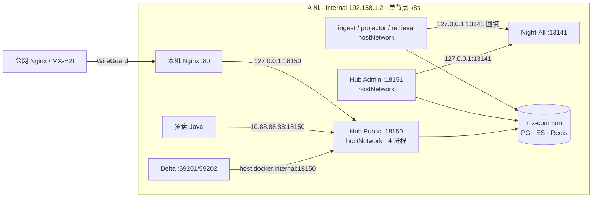
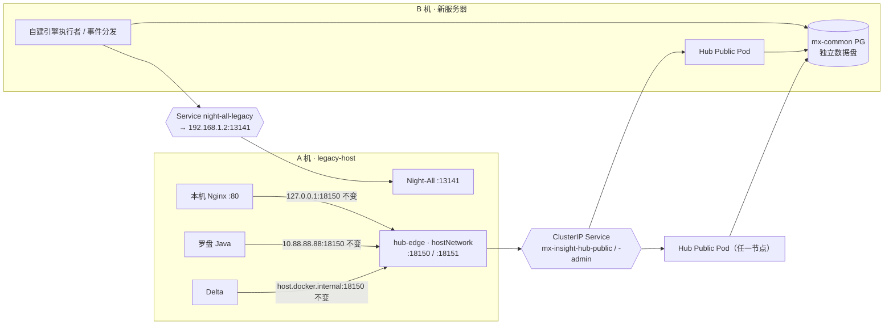

# 01 部署拓扑与多节点演进

状态：规划中。新服务器尚未采购；本文的 S0 约定现在就执行，S1 起等新机器到位。

## 1. 问题

后续会购买新服务器，Hub 所在的 k8s 会变成多节点，事件中心需要跨机器可用。而 Delta、罗盘 Java、Night-All 暂时还留在现在这台机器上（下文称 **A 机**，即 Internal `192.168.1.2`；新服务器称 **B 机**）。

目标：**现有业务零改动，以后能横向扩展。**

## 2. 现在的事实（单节点）

| 项目 | 现状 | 来源 |
|---|---|---|
| Hub 工作负载 | Public `:18150`、Admin `:18151`、ingest、projector、classifier、retrieval **全部 hostNetwork**；除 retrieval（2 副本）外都是 1 副本 + Recreate | `deploy/k8s/internal/30–35-*.yaml` |
| 监听地址 | Public、Admin 监听 `0.0.0.0`（`MX_INSIGHT_HOST` 未设置时的默认值），所以 `127.0.0.1`、`10.88.88.88`、`192.168.1.2` 都能访问 | `server/config.mjs` |
| Public 并发 | 因为 hostNetwork 绑固定端口不能加副本，改成一个 Pod 里跑 4 个进程 | `server/index.mjs` 中的 `PUBLIC_API_PROCESSES` |
| k8s Service | 已有 `mx-insight-hub-public:18150`、`mx-insight-hub-admin:18151`（命名空间 `mx-insight-hub`），但外部调用方没用它 | 同上 30/31 清单 |
| Delta → Hub | `http://host.docker.internal:18150` | 性能汇总第 5 节 |
| Java → Hub | `http://10.88.88.88:18150`。`10.88.88.88` 是 A 机的 WireGuard 地址 | 同上 |
| 内网 Nginx → Hub | `127.0.0.1:18150` | 同上 |
| Hub → Night-All | `NIGHT_ALL_BASE_URL` 默认 `http://127.0.0.1:13141`。Admin 和 ingest 都依赖「回环地址就是宿主机」 | `server/config.mjs`；`33-ingest.yaml` 注释 |
| MX-H2I → Night-All | `night-all.mxinfo-inc.cn` → split DNS → 宿主机 Nginx → `:13141` | Night-All `specs/NIGHT_ALL_RUNTIME_AND_BOUNDARIES.md` |
| mx-common 数据面 | PG / ES / Redis 用 hostPath PV，落在 A 机根盘（2026-08 时已用 93%）；PG 与 etcd 共用一块盘 | mx-common README；性能汇总第 4 节 |
| Night-All 监听 | 源码 `app.listen(PORT)` 未指定地址，即监听所有网卡；`/search/raw`、`/library/run`、`/tasks` 没有 Bearer 校验。线上实际监听地址和防火墙**未核实** | Night-All `server.js:84`；审计详稿 2.2 节 |

## 3. 多节点后会失效的假设

| 现在的假设 | 多节点后会怎样 | 处理 | 阶段 |
|---|---|---|---|
| A 机的 `:18150` 就是 Hub 入口 | Public Pod 被调度到 B 机后，A 机 `:18150` 没人监听，Delta、Java、内网 Nginx 全部断开 | 过渡期把 Hub 钉在 A 机；之后在 A 机放 hub-edge 入口代理 | S1 → S2 |
| `127.0.0.1:13141` 就是 Night-All | B 机上 Pod 的回环地址不是 A 机 | 过渡期把 Admin、ingest 钉在 A 机；之后改用 `night-all-legacy` Service | S1 → S2 |
| 1 副本就等于单例（Admin 的通知、余额监控、支付报表等定时任务） | 多副本或重新调度期间可能同时跑两份 | Admin 保持 1 副本 + Recreate；新执行者靠 PG 仲裁，不依赖副本数 | 不变 |
| 并发上限按进程平分 | 实际总量 = 配置值 × 副本数 | 改成全局信号量（见 [04](04-admission-and-concurrency.md)），完成之前 Public 不加副本 | S2 前置 |
| 事件唤醒在进程内 | 跨 Pod 收不到 | 使用 PG `LISTEN/NOTIFY`：所有 Pod 连同一个主库，跨节点也能用 | 设计即支持 |
| hostPath PV 在 A 机 | 有状态 Pod 必须固定在数据所在的节点 | 用 nodeAffinity 固定；B 机用独立数据盘承接 PG，WAL 单独放 | S1 → S3 |

## 4. 兼容策略：三个稳定面

核心原则：**机器外只认稳定地址和 HTTP 合同，机器内的拓扑可以随便变。** 守住下面三个面，调用方就不需要改。

### 4.1 Hub 入口：A 机 hub-edge（推荐）

| 方案 | 做法 | 优点 | 缺点 |
|---|---|---|---|
| A. 继续钉在 A 机 | Public、Admin 保持 hostNetwork，加 nodeSelector 固定到 A 机 | 零改动 | 不能横向扩展；A 机故障时 Hub 全停（和现在一样） |
| **B. A 机入口代理** | A 机上跑 hub-edge（nginx / haproxy / envoy 任选），hostNetwork 监听 **原端口 18150 / 18151**，转发到已有的 ClusterIP Service；Public、Admin 改为普通 Pod，可以跨节点、可以多副本 | **所有现有地址继续可用**：`127.0.0.1`、`10.88.88.88`、`192.168.1.2`、`host.docker.internal`；Pod 可以放在任意节点 | 入口仍在 A 机，是单点（和现在相同，没有变差）；多一跳，小于 1 ms（估算） |
| C. 浮动 VIP | keepalived 或 MetalLB L2 提供一个新 VIP，例如 `192.168.1.20:18150` | 入口高可用 | 调用方要改地址（或改成用 DNS 名）；需要二层网络支持；WireGuard 的 `10.88.88.88` 仍然在 A 机 |

**结论：** S2 采用方案 B；以后确实需要入口高可用时，再叠加方案 C。到那时调用方统一改成一个内部 DNS 名。不在 `mxinfo-inc.cn` 私有区里随意加记录，避免影响 MX-H2I 的 split DNS。

hub-edge 要注意这几点：

- **监听地址：** 和现在的 Public、Admin 一样监听 `0.0.0.0:18150` 和 `0.0.0.0:18151`，这样上面列出的所有现有地址都继续可用。
- **长连接：** `text/event-stream` 关闭缓冲；读超时不小于 75 秒，覆盖 25 秒长轮询和 10 秒 SSE 心跳；上游使用 keepalive。
- **客户端 IP：** Hub 的登录限流等逻辑按客户端 IP 判断。经过代理后来源 IP 都是 hub-edge，所以必须配置「只信任来自 hub-edge 的 `X-Forwarded-For`」，不能信任任意来源带来的这个头。
- **切换顺序：** hostNetwork 端口不能被两个进程同时占用，所以需要一个短维护窗口：
  1. 停掉 hostNetwork 版的 Public；
  2. 启动 hub-edge，占住 18150；
  3. 启动普通网络版的 Public。
  
  回滚就倒过来执行。Delta 和 Java 的请求应该有重试，提交类请求依赖幂等键。

### 4.2 上游自建服务地址：`night-all-legacy` Service

- 在 `mx-insight-hub` 命名空间建一个**不带 selector 的 Service** `night-all-legacy:13141`，再配一个 EndpointSlice 指向 `192.168.1.2:13141`。
- Hub 里所有访问 Night-All 的地方，包括 `NIGHT_ALL_BASE_URL`、自建引擎的地址配置、ingest 回填，都改用 `http://night-all-legacy.mx-insight-hub.svc.cluster.local:13141`。这样 Pod 放在哪个节点都能访问。
- **防火墙：** A 机的 13141 只接受来自本机回环、Docker 网桥和集群节点 IP 的连接（Pod 出站经 SNAT 后源地址是节点 IP）。Night-All 这几个接口本身没有鉴权，这一步必须做。
- **以后 Night-All 迁走**（迁到 B 机，或者进集群）：只改 EndpointSlice 或 Service，Hub 不用重新部署。
- 自建引擎的地址校验要允许 `*.svc` / `*.svc.cluster.local` 形式的集群内名字（见 [03](03-self-hosted-engines.md) 6.2 节）。
- 如果以后 Night-All 需要回调 Hub，在 A 机上调 `127.0.0.1:18151`；hub-edge 上线后这个地址仍然有效。

### 4.3 下游合同

- 对外地址不变。
- 事件游标是**不透明字符串**，事件 ID 用 UUID，任务 ID 用 UUID。这样换存储后端时调用方不受影响。
- 幂等键语义不变。
- 下游永远不直连 PG、Redis、ES、BullMQ。

## 5. 节点角色

| 标签 | 机器 | 放什么 |
|---|---|---|
| `mx.role/legacy-host=true` | A | hub-edge；过渡期依赖宿主机回环地址的 Pod（Admin、ingest） |
| `mx.role/data=true` | 起初是 A，迁移后是 B | mx-common 的 PG / ES / Redis（hostPath 或 local PV） |
| 不打标签 | A、B 都可以 | Public、projector、retrieval、classifier、事件分发、自建引擎执行者（S2 之后） |

控制面和 etcd 起初留在 A 机。如果 B 机磁盘更好，优先把 PG 放到 B 机，顺带解决「PG 与 etcd 共盘」的风险。

## 6. 演进阶段

| 阶段 | 内容 | 退出条件 | 回滚 |
|---|---|---|---|
| **S0（现在，单机）** | 只做「不绑死单机」的约定，**不改变任何行为**：新代码不写死 `127.0.0.1`，只能作为可配置的默认值；事件游标不透明；资源互斥放 PG；准入全局化按 [04](04-admission-and-concurrency.md) 设计 | 新代码评审通过 | 不需要 |
| **S1（B 机加入为 worker 节点）** | 给节点打标签；所有现有 Hub 工作负载和 mx-common 有状态组件加 nodeSelector 钉回 A 机，**行为和今天完全一样**；B 机先只跑无状态、不依赖宿主机的 Pod | B 节点 Ready；跨节点 Pod 网络和 DNS 正常；实测跨节点 Pod 到 PG 的延迟 | 去掉 B 节点 |
| **S2（入口与上游地址解耦）** | 上线 `night-all-legacy` 和防火墙；Hub 配置改用服务名；hub-edge 上线（维护窗口）；Public、Admin 去掉 hostNetwork；**全局准入信号量上线之后**，Public 才允许多副本 | Delta、Java、内网 Nginx、MX-H2I 回归全部通过；准入总量不随副本数增加；事件长轮询和 SSE 经 hub-edge 正常 | 停 hub-edge，恢复 hostNetwork 清单 |
| **S3（数据面迁移 / 高可用）** | PG 迁到 B 机独立盘（WAL 单独放），或做 PG 主从（CloudNativePG / Patroni）；ES 扩成多节点；事件日志随 PG 一起获得高可用 | 计划内切换演练通过；备份恢复演练通过 | 按迁移文档 |
| **S4（按需）** | 节点数 ≥ 3 且事件总线需要独立高可用时，评估 NATS JetStream（3 副本）承接事件日志，对外接口不变；Delta、Java、Night-All 迁到 B 机或进集群，只改 DNS 或 EndpointSlice | 见 [02](02-event-delivery.md) 第 11 节 | 回到 PG 事件日志 |

**注意：** 只有 2 个节点时，JetStream、etcd 这类需要多数派投票的系统**无法容忍任何一个节点故障**，至少要 3 个节点才有意义。

## 7. 不变的边界

- MX-H2I 的 `night-all.mxinfo-inc.cn` → split DNS → 宿主机 Nginx → `:13141` 链路不变。
- WireGuard 和 `10.88.88.88` 留在 A 机。
- Launcher 的身份服务和网络组件不改。
- 公网 Nginx → WireGuard → A 机本机 Nginx → `127.0.0.1:18150` 的路径不变，S2 之后由 hub-edge 接住。

## 8. 验证清单（每个阶段都要跑）

1. Delta 用原地址调 `/api/v1`、`/api/v2`，不带 Key，应返回 `401 api_key_required`；带 Key 的业务请求正常。
2. Java 用 `10.88.88.88:18150` 做同样的检查。
3. 公网 `hub.minsight-ai.com` 的管理台登录、SSO 正常；MX-H2I 用户登录和联网不受影响。
4. 从 Hub Pod（任意节点）访问 Night-All `GET /api/v1/health` 正常；从非集群主机访问 13141 被拒绝（S2 之后）。
5. 事件长轮询能挂满 25 秒不被代理切断；SSE 心跳能穿过 hub-edge。
6. 准入并发总量在多副本下不超过配置值（S2 之后）。
