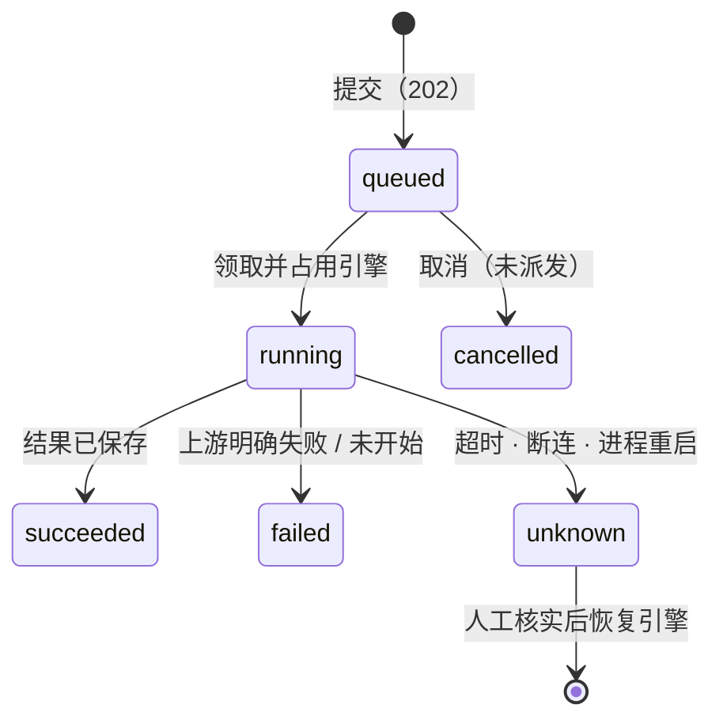

# 03 自建引擎

状态：第一阶段已实现，未部署（实现见第 10 节）。第一个引擎是「微信 → 自建引擎」，背后是 Night-All 的搜狗微信 `wechat_mp`。源码逐行审计见[审计详稿（2026-10-22）](../wechat-self-hosted-engine-2026-10-22.md)；本文汇总结论，并补充多节点和通用模型。

## 1. 定位

- **引擎 = 一个真实的执行资源**，容量通常是 1，例如一个只能串行跑的爬虫。
- **Hub 负责：** 排队、互斥、授权、计量、结果、通知、可查询。
- **上游负责：** 真正的采集。
- **下游只和 Hub 打交道：** 提交拿到 jobId，再按状态取结果。下游不知道、也不传上游地址。

## 2. 通用模型

三类持久记录：

| 记录 | 内容 |
|---|---|
| 引擎（engine） | 稳定的 resourceId、地址、启停、修订号、当前占用的 jobId、隔离原因、下次允许派发的时间 |
| 任务（job / batch） | 调用者身份、幂等键、规范化输入的指纹、状态、派发时使用的配置快照、结果、错误 |
| 派发记录（dispatch attempt） | 派发前写下的意图、上游关联 ID、开始和结束时间、响应或停止证据、未知原因、晚到的证据 |

状态机：



**单执行槽放在 PG：**
- 引擎行上记录 `active_job_id`；
- 再加部分唯一索引 `WHERE status='running'`。

两者都由数据库约束，所以不管有几个 Public 进程、几个副本、几个节点，同一时间最多只有一项在执行。**不能用进程内的信号量**，它是按进程计数的，和图 4 限速是同一个缺陷（见 [04](04-admission-and-concurrency.md)）。

**一次执行分三步：**
1. 短事务：领取任务，**先把「准备派发」的意图落盘**；
2. 在事务外调用上游，有超时上限；
3. 短事务：记录终态，释放或隔离引擎。

网络调用期间不持有数据库事务。

**为什么要隔离：**
- HTTP 超时不代表爬虫已经停止；
- Night-All 超时只发 SIGTERM，不确认子进程退出。

这时如果直接派下一条，可能有两个爬虫同时在跑，更容易触发上游反爬。

## 3. 第一个引擎：微信 `wechat_mp`

### 3.1 调查结论（2026-10-23 对照源码核实）

| 项目 | 事实 |
|---|---|
| 实现方式 | **不是浏览器爬虫**。调用链：Node → Python `requests`（BeautifulSoup 可选）→ 搜狗微信 HTML → 逐条解析文章跳转 |
| 不需要的东西 | Chromium、Playwright、微信登录 Cookie、付费 Key、OCR、向量化 |
| 依赖 | Python 和 requests；宿主机能直连搜狗（`trust_env=False`，不走代理）；可写的 `data/crawler-runs` 和缓存目录；可选用 Night-All 自己的 PG 入库 |
| 串行方式 | 每个 Node 进程一个 Promise 队列（`wechat-miku-stability.js`）。**API 进程和异步 worker 各有一个队列，互相不排斥** |
| 节奏 | 每次执行完再间隔 10 秒；反爬触发后冷却 30 分钟；新鲜缓存 24 小时；失败时会回退到 7 天内的旧结果 |
| 超时 | 子进程默认 120 秒，可以设到 180 秒；超时只发 SIGTERM，不确认退出 |
| 调用入口 | 同步 `POST /api/v1/search/raw`（`platform=wechat_mp`、`params.provider=sogou`，不经过 BullMQ）；异步 `/crawlers/library/script%3Awechat-mp-miku/run` → 202 和 taskId（经过 BullMQ，但幂等和重试有缺陷，暂不能信任） |
| Hub 现状 | 微信旧接口别名已转到 TikHub，`/api/v1/night-all/search/raw` 对微信返回 410。**自建引擎必须是独立接口** |
| 「3 分钟」是什么 | 出队之后单条的执行预算，**不是包含排队时间的响应承诺** |

按每条正好 180 秒、每次间隔 10 秒、开始时没有排队估算：

| 第几条 | 理论完成时间（不含入库和网络） |
|---|---|
| 1 | 3 分 00 秒 |
| 5 | 15 分 40 秒 |
| 10 | 31 分 30 秒 |

### 3.2 结果判定

| Night-All 返回 | 任务状态 | 结果来源 | 引擎 |
|---|---|---|---|
| 200，`cache.status=miss` | succeeded | 实时采集 | 释放 |
| 200，`fresh` | succeeded | 新鲜缓存 | 释放 |
| 200，`stale`，原因是反爬 | succeeded，**界面明确标注「旧结果」** | 旧结果 | 冷却到 `retryAfterMs` |
| 200，`stale`，原因是临时失败 | **unknown**，旧结果仍可读 | 旧结果 | **隔离** |
| 429 `SOGOU_RATE_LIMITED` | failed | — | 冷却到 `retryAfterMs` |
| 503 `SOGOU_TEMPORARILY_UNAVAILABLE`，且明确原因不是超时 | failed | — | 释放 |
| 其他 4xx、3xx（不跟随重定向）、连接被拒、DNS 失败 | failed（请求没有真正开始） | — | 释放 |
| 超时、连接中断、504、其他 5xx | **unknown** | — | **隔离** |
| 执行进程重启时任务仍在运行 | **unknown** | — | **隔离** |

**说明：**
- `cacheMaxAgeHours=0` 只是不命中新鲜缓存，**并没有关掉旧结果回退**。所以上游没法保证「只要实时结果」。
- 「采集成功」和「交付成功」要分开记。

### 3.3 绕过 Hub 的入口

- **Hub 的串行只管经过 Hub 的流量。** Night-All 控制台、异步 worker、Delta 旧路径等直接调用方仍然可能和 Hub 同时调用搜狗。
- **要做到真正的全局串行，需要第二阶段（第 7 节）。** 在那之前要盘点并收口这些入口（[05](05-roadmap-and-decisions.md) Q2）。

## 4. 执行者放在哪

| 阶段 | 位置 | 访问 Night-All 的方式 |
|---|---|---|
| 单机（现在） | Hub Admin 进程（1 副本、Recreate、hostNetwork） | 默认 `http://127.0.0.1:13141`，回环地址就是宿主机 |
| 多节点 S1 | 和 Admin 一起钉在 A 机 | 不变 |
| 多节点 S2 起 | 任意节点，可以独立成一个 Deployment | `http://night-all-legacy.mx-insight-hub.svc.cluster.local:13141`，改一下页面上的地址配置即可，不需要重新部署 |

- **重启处理：** 执行者启动时，把「状态为 running、但 owner 不是自己」的任务标记为 unknown，并隔离引擎。
- **晚到的结果：** 旧执行者回来提交时，要校验 owner 和 attempt，不能覆盖已有的终态，只追加为晚到证据。
- **多副本：** 领取由 PG 条件更新仲裁，执行者多副本也安全。

## 5. 下游合同（拟定，当前不可调用）

### 5.1 接口

| 接口 | 含义 |
|---|---|
| `POST /api/v1/data/wechat/self-hosted/jobs` | 提交一条，持久保存后返回 `202`、`Location`、`Retry-After: 5` |
| `POST /api/v1/data/wechat/self-hosted/batches` | 一次 1–5 条，父批次和子任务原子保存 |
| `GET /api/v1/data/wechat/self-hosted/jobs/{jobId}` | 状态、排队位置估计、时间、结构化错误 |
| `GET /api/v1/data/wechat/self-hosted/jobs/{jobId}/result` | 读取已保存的结果；不会发起采集，也不会重复计费 |
| `GET /api/v1/data/wechat/self-hosted/batches/{batchId}`、`/result` | 各状态计数；按输入顺序返回结果和逐项错误 |
| `GET /api/v1/data/wechat/self-hosted/jobs` | 当前调用方最近的任务（最多 50 条） |
| `POST /api/v1/data/wechat/self-hosted/jobs/{jobId}/cancel` | 取消还在排队的任务；已派发的任务不能取消 |
| 事件 | 通过 [02](02-event-delivery.md) 的事件流收到 `job.*` 和 `batch.completed`（事件中心上线后） |

**第一版只提供 202 + 轮询：** `wait` 参数（同步等待最多 25 秒）暂不提供，避免长时间占用 Public 的读取名额。以后事件中心有了独立的长连接通道再加。下游现在只需要轮询 GET，不需要改用别的协议。

### 5.2 下游怎么知道结束、要不要等

- **不需要等上一条完成再发下一条。** 一次提交 N 条或一个批次，各拿到 jobId，由 Hub 排队串行执行。
  - 让下游自己串行有两个问题：多个下游各自串行，到上游仍然会撞车；下游一重启，进度就丢了。
- **知道结束的三种方式：**
  1. 轮询 GET，服务端给 `Retry-After: 5`；
  2. 订阅事件流；
  3. 可选的 webhook。
  
  通知漏了不要紧，以 GET 查到的状态为准。
- **同一参数再请求一次：**
  - 幂等键相同，返回原来的任务，不会重复采集或计费；同一个幂等键配不同的请求内容，返回 409。
  - 想要新数据，换一个新键并设 `cacheMaxAgeHours=0`（旧结果回退仍可能发生）。
  - 24 小时内同一个关键词会直接命中缓存。
- **定期监控同一个关键词：** 下游收到终态事件之后再排下一次，**不要在执行期间轮询上游**。
- **队列上限：** 见 5.4 节。超出时返回 429，附上 `Retry-After`。**不会悄悄丢弃。**

### 5.3 能力项、计量与价格（2026-10-23 与用户确认）

| 项目 | 决定 |
|---|---|
| 开放范围 | **直接对 Delta 等下游开放**，不只是管理员可用 |
| 能力项 / 计量键 | `wechat.selfhosted.search`，二者同名；授权平台沿用微信产品的 `social`。不会把现有 TikHub 微信权限自动扩展到这里 |
| 计费开关 | **默认关闭，只转发**（2026-10-23 用户要求「以性能为主」）。关闭时：不写使用账本、不扣费、不进入 Hub 使用记录，也不会和调用方其他付费请求争用同一把按调用方加的预留锁；派发前仍会复核 Key 和能力项。在管理页勾选「计费」后，才按下面几行的规则计费 |
| 计费单位 | **按任务计费**：一个关键词的一页算一次，与返回几篇文章无关；批量提交 N 条就是 N 次。查询状态、读取结果、事件推送都不计费 |
| 收费范围 | 实时采集、24 小时内新鲜缓存：**收费**。旧结果回退（可读，界面标注）：**不收费**。失败、取消、排队超时：**不收费**。结果未知：**待核实**，不自动扣费 |
| 价格 | Hub 官方价格表 **¥0.10 / 次**（`unitPriceMinor=10`，单位为分）。各调用方的实际执行价按其套餐条目和倍率计算；套餐没有该条目时按账户默认价；计费未启用时为 0 |
| 价格生效方式 | 在套餐管理里给对应套餐发布 `wechat.selfhosted.search` 条目。**代码不自动改动任何线上套餐** |

**账本时序（仅在开启计费时）：在派发时预留，不在提交时预留。**

1. **提交：** 校验 Key 和能力项，写入任务，返回 202。此时不冻结额度。
2. **派发前：** 执行者用任务记录的 Key ID 重新取得身份（Key 撤销、过期或租户停用都会被拦下），复核能力项，再用 `wsh-<jobId>` 作为幂等键在账本上预留一次。平台 `social` 的授权和额度窗口由预留统一校验。
3. **预留被拒**（余额不足、授权撤销、额度用尽）：任务记为 failed，并带上对应错误码；**不派发、不扣费**，引擎立即释放。
4. **结算：** 先保存结果，再处理账本：
   - 实时结果、新鲜缓存：`commit`；
   - 旧结果、失败：`release`；
   - 未知：`markUnknown`。
   
   结算本身出错时，账本记为 unknown，任务的计费状态显示「待核实」。
5. **价格以派发时为准。** 排队期间改价，按派发时的有效价格结算。

### 5.4 排队保护（适中档）

| 项目 | 内置值 |
|---|---|
| 每批条数 | 最多 10 条 |
| 每个调用方未完成的任务（排队 + 执行中） | 最多 10 条 |
| 全局排队 | 最多 30 条 |
| 最长排队 | 2 小时。超时记为 expired，不派发、不收费 |
| 单条输入 | `query` 1–100 字；`limit` 1–20，默认 5；`page` 1–10，默认 1；`cacheMaxAgeHours` 0–24，默认 24 |

**预计开始时间：** 单条实际耗时可能是几十秒，也可能 3 分钟，所以用最近 20 条已完成任务的耗时中位数加 10 秒间隔来估算；没有历史数据时按 180 秒估。如果引擎处在冷却中，从冷却结束时间开始算。

**不接收新任务的情况：** 引擎被停用或被隔离时，提交返回 `503` 加 `Retry-After`，不进入排队。冷却期间照常接收，预计时间会顺延。

## 6. 页面与配置

### 6.1 页面

- **位置：** 左侧「微信」组最下方加 `#/data-products/wechat-self-hosted`，导航名称「自建引擎」。
- **复用现有产品工作台：** 「接口调试」从 OpenAPI 自动列出新接口，并用所选调用身份发送；「管理」复用套餐价格展示，再追加引擎配置区块。
- **四个标签，和「微信搜一搜」一样：**

| 标签 | 内容 |
|---|---|
| 接口调试 | 单条或批量输入，手动提交；显示 jobId、排队位置、状态、结果 JSON。切换选项不会触发调用 |
| 产品展示 | 搜索表单、批次完成数、逐条文章卡片；标注采集时间、新鲜缓存或旧结果、部分结果、失败原因 |
| 接入指南 | 202 与轮询、批次、幂等、unknown 的含义、取消边界、cURL 示例（示例里只出现 Hub 地址） |
| 管理 | Night-All 地址、启停、引擎状态（空闲 / 执行中 / 冷却到 / 已隔离 + 恢复按钮）、排队数和预计开始时间、连通性探测（只读 `GET /api/v1/health`）、审计记录 |

- **不能直接加进 `shared/wechat.mjs` 的 `WECHAT_PRODUCTS`。** 现有代码里路径只要带 `wechat`，管理入口、价格和供应商就会落到 TikHub 上（例如 `shared/product-management.mjs` 的 `productManagementLinks`）。要单独分支处理。
- **可能涉及的文件：**
  - `shared/product-navigation.mjs`、`src/App.jsx`：菜单和路由；
  - 新增页面组件和样式；
  - `server/app.mjs`：Admin 路由；
  - `server/index.mjs`：执行者的启动和停止；
  - 新增迁移、存储和执行者模块，以及测试；
  - 对外开放时还要改 `shared/product-access.mjs`、`shared/product-catalog.mjs`、`server/public-docs.mjs` 和 OpenAPI。

### 6.2 地址配置

- **存放位置：** 引擎专用的数据库配置表，带修订号（乐观锁）、修改原因和审计。**不覆盖**旧适配器用的 `NIGHT_ALL_BASE_URL`，也不新增环境变量。
- **默认值：** `http://127.0.0.1:13141`（宿主机端口，因为 Admin 是 hostNetwork）。
- **校验规则：**
  - 只接受 http / https，必须显式写端口；
  - 不能带账号密码、路径或查询参数；
  - 主机只能是以下之一：本机回环；内网段 `10/8`、`172.16/12`、`192.168/16`、`100.64/10`；集群内名字 `*.svc` / `*.svc.cluster.local`；
  - 禁止跟随重定向。
- **服务 token：** 只有在地址与现有 Night-All 配置同源时才携带，避免把旧 token 发给新服务器。
- **切换时机：** 有任务正在执行时不允许改地址，返回 409；已派发的任务冻结派发时的配置；还在排队的任务按派发时的新配置执行，并记录所用的修订号。

## 7. 第二阶段：由 Night-All 自己排队

先修好 Night-All 异步接口的这些问题（审计详稿 2.4 节）：

1. 幂等键要包含请求内容；
2. 失败状态和重试之间的冲突；
3. 建任务和入队之间不一致的窗口；
4. API 进程和 worker 不共享执行槽；
5. 子进程停止没有确认。

修好之后：

- 给 wechat_mp 建一个专用队列，配 `setGlobalConcurrency(1)`；同步接口也走这个队列，做到**真正的全局串行**。
- Hub 改成保存「Hub jobId ↔ Night-All taskId」的映射，然后查询终态。**对外接口不变。**
- **职责划分：** Night-All 唯一负责采集排队、并发和重试；Hub 只保留身份、授权、计量、结果和通知。

## 8. 以后接入新的自建引擎

1. 写清上游合同：同步还是异步、哪些状态才算终态、超时后是否还在跑、是否会自动重试、缓存和旧结果的语义、真实容量。
2. 在引擎表里登记一个 resourceId 和容量；一个真实资源的所有地址别名共用同一个 resourceId。
3. 按第 3.2 节的格式写出这个引擎自己的结果判定表；不能证明已停止的情况一律记为 unknown。
4. 新建独立的能力项和价格；页面复用四个标签的结构。
5. 在本目录的 README 看板和变更记录里登记。

## 9. 验收标准（实现时）

1. 4 个 Public 进程（多节点时是多个副本）同时提交 5 条，全部保存，同一时间最多一条在派发。
2. 用同一个幂等键重新提交、提交的响应丢失、API 重启，都能回到原来的任务；同一个键配不同内容返回 409。
3. 超时、SIGTERM 后进程没退出、执行者崩溃、数据库断开、旧执行者晚回包，都**不会**自动派下一条或重复采集。
4. 新鲜缓存、旧结果、部分结果、空结果互相不混淆。
5. 授权撤销、跨租户读取、配置修订冲突、地址更换都按合同处理；GET、事件、SSE 不会派发，也不会重复计费。
6. 原有三个微信产品、别名、价格、授权不变；MX-H2I 的登录和联网不受影响。

## 10. 实现现状（2026-10-23）

状态：**第一阶段已实现，未部署，未提交。** 交付范围只在 Hub 侧，没有修改 Delta 和罗盘 Java。

### 10.1 代码位置

| 位置 | 内容 |
|---|---|
| `migrations/165_self_hosted_engines.sql` | 新 schema `self_hosted`：`engines`、`batches`、`jobs`、`engine_events`；部分唯一索引保证同一引擎只有一项 running。只新建，不改动已有表 |
| `shared/wechat-self-hosted.mjs` | 产品定义（能力项、计量键、路径、官方价 10 分）和内置上限 |
| `server/self-hosted/wechat-contract.mjs` | 输入校验、地址校验、Night-All 请求体、结果判定、预计开始时间、公开视图 |
| `server/self-hosted/store.mjs` | PG 版和内存版存储：提交（advisory lock 串行化计数）、领取、结算、隔离、恢复、清理 |
| `server/self-hosted/executor.mjs` | 执行者：派发前复核 Key 和能力项并预留账本 → 调 Night-All → 先存结果再结算 |
| `server/self-hosted/service.mjs`、`runtime.mjs` | 公开接口和 Admin 操作；只有 Admin（或 combined）进程运行执行者 |
| `server/self-hosted/docs.mjs` | OpenAPI 7 个路径和 `/docs/wechat-self-hosted` 接入指南 |
| `server/app.mjs` | 公开路由 `/api/v1/data/wechat/self-hosted/*`；Admin 路由 `/internal/v1/admin/wechat-self-hosted`（GET 状态、PUT engine、POST engine/recover、POST engine/probe、GET jobs/:id） |
| `server/hub-service.mjs` | 新能力项加入 `PUBLIC_CAPABILITIES`；新增 `usagePolicy()`，供排队任务派发时取平台额度策略 |
| 产品登记 | 导航、工作台、产品授权可见性、产品套餐、能力目录路由、价格查询、管理页计价项、数据准入（新路径走 read 通道） |
| `src/wechat-self-hosted.jsx/.css` | 「产品展示」页和「管理」里的引擎区块；四个标签复用现有产品工作台 |

### 10.2 验证结果

- **单元和 HTTP 测试：** `tests/server/wechat-self-hosted.test.mjs` 共 16 项通过。覆盖校验、判定、幂等、上限、4 路并发领取只派发 1 条、计费关闭时完全不碰账本、开启计费时的三种结算、空闲时不取锁、`Retry-After` 计算、派发前撤权、重启隔离、Admin 配置、HTTP 合同和产品登记。
- **原生 PG 测试：** `tests/server/wechat-self-hosted-postgres.test.mjs` 共 5 项（新增「计费关闭时不产生任何 usage_requests、空闲检查无锁」）。在本机 PG 17（迁移到 165 的完整库）上通过：
  - 4 个连接池并发领取只派发 1 条，running 唯一索引生效；
  - 并行提交不超过单调用方上限；
  - 真实账本：实时结果 committed、旧结果 released、超时 unknown 并隔离；
  - 重启后的晚到结果只记证据；
  - 排队超时、取消和清理。
- **全量服务端测试：** 唯一由本次改动引起的失败是 `public-docs.test.mjs` 的路径清单，已补上新路径。其余 42 项失败在不含本次改动的 HEAD 上同样失败，与本次无关。
- **浏览器验证**（本地内存模式 + 返回合成文章的 mock Night-All）：
  - 「微信」组最下方出现「自建引擎」；
  - 连续提交两条，状态依次为执行中、排队第 1 位，之后都完成并计费，mock 端没有出现并行派发；
  - 非公网地址校验、改地址后修订号 +1 并写审计；
  - 500 → 结果未知 → 引擎隔离、拒收新任务 → 人工恢复。

### 10.3 与设计的差异和注意事项

- **计费默认关闭。** 引擎表的 `billing_enabled` 列默认 false，第一版就是纯转发；需要收费时在管理页开启即可，不用重新部署。
- **Delta 的 Key 会自动拿到权限。** 能力项进了 `PUBLIC_CAPABILITIES`。LCY-delta 的托管 Key（`access_profile='managed_full'`，迁移 141）会在每次部署执行迁移时自动同步全部能力，所以**上线后 Delta 现有 Key 自动拥有 `wechat.selfhosted.search`**，不需要另外授权。其他调用方仍需显式授权。
- **价格不在部署时自动写入。** 理由见 10.6 节。只有开启计费后价格才有意义：套餐里有 `wechat.selfhosted.search` 条目就按条目价格算，没有就按租户默认价（迁移 142 之后默认 1 分）；租户计费模式不是 enforced 的账户不会实际扣款。
- **第一版没有的功能：** `wait` 参数和事件流（见 5.1 节）。
- **执行者的位置：** 执行者跑在 Admin 进程里，访问 Night-All 的默认地址是 `127.0.0.1:13141`；多节点后改为 `night-all-legacy` Service 名即可（见 [01](01-topology-and-multinode.md)）。

### 10.4 上线步骤（需要操作员执行）

1. 正常部署 Hub，迁移 165 会随部署执行。
2. 在 Hub「微信 → 自建引擎 → 管理」点「连通性探测」，确认 Admin 能访问宿主机 13141。
3. 用 `scripts/verify-wechat-self-hosted.sh` 做一次真实采集验收（见 10.7 节）：确认状态、结果、幂等重放、引擎释放。真实耗时会进入中位数估算。
4. 只有决定收费时，才需要两步：先在管理页开启「计费」，再在相关套餐中发布 `wechat.selfhosted.search` 条目（建议 ¥0.10，即 `unitPriceMinor=10`）。
5. 盘点并收口直接调用 13141 wechat_mp 的旁路入口（[05](05-roadmap-and-decisions.md) Q2）。

### 10.5 性能措施（2026-10-23）

| 位置 | 做法 | 效果 |
|---|---|---|
| 账本 | 计费关闭时完全不调用预留、结算接口 | 不写 `usage_requests`；不与调用方其他付费请求争用同一把按调用方加的预留锁 |
| 执行者空闲轮询 | 每 2 秒只做一次无锁读（`readiness`），有排队任务时才开领取事务 | 引擎空闲时不加行锁、不产生 WAL |
| 状态查询 | 排队快照（排队位置、运行中任务、耗时中位数）在每个 Public 进程内缓存 2 秒；本进程提交、取消或改配置时立即失效 | 轮询时不必每次都跑 3 条统计查询 |
| 轮询间隔 | `Retry-After` 按预计开始时间给出 5–60 秒，执行中为 5 秒 | 排队较长时下游自动降低轮询频率 |
| 准入通道 | 新路径走 Public 的 read 通道 | 提交和查询都是短数据库操作，不占采集通道 |
| 数据写入 | 不入库规范化数据、不建 ES 索引；每条任务只写一行（结果 JSON，最多 100 条文章） | 按每小时约 19 条估算，写入量可以忽略 |

### 10.6 价格为什么不在部署时自动迁移

1. **扣费的计算方式：** 由数据库触发器按「租户计费模式（disabled / shadow / enforced）+ 套餐价格表条目」计算。没有条目时用租户默认单价（迁移 142 设为 1 分）。
2. **仓库惯例：** 已发布的价格表不可修改，迁移从不改价格（迁移 080、106 的注释都明确写了）。自动写价格只有两种做法：改已发布的价格表，或者给所有租户新建套餐版本再重新分配。两种都会影响所有租户，而且绕过套餐的审核流程。
3. **LCY-delta 的情况：** 它的 Key 是 `managed_full`，会被识别为内部流量，豁免 Hub 的额度和限速（`server/core/internal-traffic-policy.mjs`）。是否实际扣费取决于该租户的计费模式；按用户观察「不受价格影响」，大概率不是 enforced，但线上配置未核实。
4. **结论：** 现在计费开关默认关闭，不需要价格。以后要收费，在管理页开启计费，再通过套餐管理发布条目（有审计）。

### 10.7 API 验证

**改动范围：**
- 只改了 `electron-dock/mx-insight-hub`；
- 另外在仓库根目录的 `.claude/launch.json` 加了一个本地开发启动项 `mx-insight-hub-api`；
- Delta、罗盘 Java、Night-All、Launcher、mx-common 都没有改动。

**一键验证（在 Internal 宿主机上执行）：**

```bash
HUB_URL=http://10.88.88.88:18150 ADMIN_URL=http://10.88.88.88:18151 \
ADMIN_TOKEN=<Hub admin token> HUB_API_KEY=<LCY-delta Key> \
bash scripts/verify-wechat-self-hosted.sh
```

- **默认只提交 1 条真实任务**，会触发一次真实的搜狗采集。加 `VERIFY_BATCH=1` 会再提交 2 条批量任务。
- **管理检查只读：** 引擎状态、对 Night-All 的 `/api/v1/health` 探测。
- **提交后的检查：** 按 `Retry-After` 轮询、读取结果、同一幂等键重放应返回原任务。

**手工 curl：** 见 `/docs/wechat-self-hosted` 接入指南里的示例。

**本地验证结果（2026-10-23，内存模式加合成 mock）：**
- 返回 202，带 Location 和 `Retry-After`；
- 轮询过程 running → succeeded；
- 读到 3 篇文章；
- 幂等重放返回原任务；
- 批量两条都完成；
- 计费关闭时，该 Key 的使用记录为 0。
