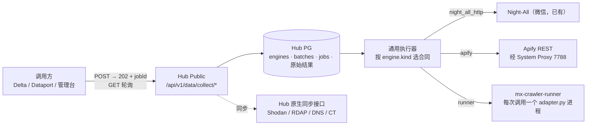

# 06 外部交付采集包接入计划（/tmp/platforms）

**活文档，持续调整。** 每完成一个阶段或一个平台，都要更新本章对应小节、第 13 节平台总表、[README](README.md) 的看板和变更记录。

最后更新：2026-11-09。状态：阶段 1–6 已实现未部署（见 [07](07-collect-engines.md)）；音频下载和 Podcast Index 仍在等待。

## 1. 材料与现状

`/tmp/platforms` 是外包按「数据源表」交付的独立采集包：

- 共 49 个目录。交付方 README 写的是「50 个独立项目」；其中 181 含 dnsx 和 dnspython、182 含 certspotter 和 subfinder，各是两个工具。第 13 节按目录列出。

- 包号就是 Hub `source_catalog` 的 `legacySequence`（216–222 不在 catalog 里）。
- 每个包的入口都是 `adapter.py`：stdin 读一个 JSON，stdout 写一个 JSON，日志写到 stderr；另附 `manifest.yaml`。
- 状态值有 `success / no_data / partial / unknown / error / stopped`。
- `invoke` 是同步的，同一个解释器里不能并发，所以每次调用都要单独起一个进程。
- 交付方只在 **Windows + Python 3.13** 上验证过。181 和 182 里的 Go 工具是 Windows `.exe`。

2026-11-09 核对的接入情况：

| 情况 | 包 |
|---|---|
| Hub 已有同等能力 | 4 小红书热点（`server/contracts/xiaohongshu-discovery.mjs` 调同样两个接口）、ipsearch（`server/adapters/ipsearch.mjs`）、额度监控（已被 Hub 余额监控取代） |
| Hub 已有该平台，只是供应商不同 | 85 TikTok、91 LinkedIn、92 Threads 已走 TikHub；108 Amazon、110 AliExpress、114 Shopee 只走 JustOne |
| 只登记了候选插槽 | 195 小米（`integrations/market-195/manifest.json`，`candidate`） |
| 未接入 | 其余全部。20 个 Apify 包的 `live_status` 都是 `not_run_credentials_not_configured`，从未真实取过数 |

**结论：** 在 Hub 里做采集平台，可以直接复用两样现成的东西：

- [数据插槽](../integration-slots.md)：登记格式和六阶段验收；
- [自建引擎](03-self-hosted-engines.md)：PG 单执行槽、202 + 轮询、`unknown` 隔离。

缺的是两块：

- 一个**通用执行器**：现在的执行器写死了微信的合同；
- 一个**独立进程 runner**：Hub 镜像是 `node:22-bookworm-slim`，没有 Python；设计上也不允许在 Web 进程里执行上传的代码。

## 2. 已定决策

编号接续 [05](05-roadmap-and-decisions.md) 的 D16。

| 编号 | 日期 | 决策 | 状态 |
|---|---|---|---|
| D17 | 2026-11-09 | **Apify 凭据来源。** · `/tmp/platforms` 里没有凭据：各包只读 `APIFY_TOKEN` / `APIFY_TOKEN_FILE` 环境变量。 · Night-All 的 `config.json` 里也没有 Apify：`crawlerProviders` 只有 tikhub、rapidapi、justOne、scrapeCreators、tgstat。 · 目前唯一找到的是 po-infra 旧爬虫里写死的同一个 token（`media/spiders_src/` 下的 `*apify*.py`、`reddit-*.py`、`youtube-*.py` 等）。 · 接入时由操作员在 Admin 录入 Hub 凭据库（migration 052，`provider_key = 'apify'`）。token 不写进代码、文档、manifest 或 `MX_*` 环境变量。 | 已定（用户确认）。token 是否有效、什么套餐、余额多少**未核实** |
| D18 | 2026-11-09 | **先不做花费限制。** · Hub 不传 `maxTotalChargeUsd`，不设单次、每日或每月预算。 · 每次运行仍记录 Apify 回报的 `usageTotalUsd`，作为采购成本。 · 输入白名单里的条数上限、Actor 超时、单个结果的大小上限仍然保留。它们是接口合同的一部分，不是花费控制。 | 已定（用户确认）。看到实际花费后再评估 |
| D19 | 2026-11-09 | **海外出口走 System Proxy 的 7788。** · Hub Agent 中心的 System Proxy 里已有 Internal 7788 出口：migration 076 写入了 `tikhub-internal-7788` → `http://127.0.0.1:7788`。 · Apify 和其他海外目标都绑定这条序列：新 migration 照 117 / 119 / 135 的写法，把新供应商加进 `external_platform_proxy_bindings` 的 provider 列表。 · 不改 TikHub、LLM 和全局路由。 · 只有未鉴权的连通性探测可以切换代理；结果不确定的付费调用一律不重试。 | 已定（用户确认）。实现前先在线上读一次 System Proxy 列表，确认 7788 序列的实际 key |

## 3. 总体结构

一共三种执行方式：

| 执行方式 | 适用 | Python |
|---|---|---|
| Hub 原生同步适配器（Node） | 秒级返回的 REST 查询 | 不需要 |
| Apify 异步合同（Node） | 20 个 Apify 平台 | 不需要 |
| 独立 runner | 应用商店、单 URL 内容补全、子域名、音频 | 需要，单独部署 |

## 4. 阶段 0：边界（不开发）

| 平台 | 方向 | 原因 / 处理 |
|---|---|---|
| 4 小红书热点 | 不接 | Hub 已有，接口相同 |
| ipsearch | 不接 | Hub 已有 |
| 额度监控 | 不接，已废弃 | Hub 余额监控已接管告警，两者不能同时运行。`/tmp` 副本的 `config.toml` 填有真实 token 和 webhook，建议删除 |
| 95 Quora | 暂不接 | 包内用的 Selenium 接口在 4.x 已移除，原样不能运行 |
| 103 Rumble | 暂不接 | 一直返回 403 |
| 221 Podcast Index | 等凭据 | 缺 `PODCAST_INDEX_KEY` |
| 85 / 91 / 92 | 暂不接 | TikHub 已覆盖（105 / 10 / 12 个接口），以后需要时再拿 Apify 当备用 |

## 5. 阶段 1：通用采集任务骨架

> **2026-11-09 已实现未部署，实际设计见 [07 通用采集引擎](07-collect-engines.md)。** 和下面的原计划相比有三处调整：
> - 改为新建 schema `collect`（migration 183），不扩展 `self_hosted.engines`，微信引擎的表和代码保持不动，迁入以后再做；
> - 引擎可以有多个执行槽（`engine_slots` 加 SKIP LOCKED），不再只能串行；
> - 异步任务进入 `waiting` 后不再占用执行器进程，派发途中进程失联靠租约发现并向上游核对。
>
> 管理台新增「数据接入与治理 → 自建引擎」，原微信引擎也列在其中。

所有后续阶段都依赖这一步。改动只做加法，现有的微信自建引擎行为不变。

1. **新 migration**：
   - 在 `self_hosted.engines` 上加 `kind` 列（`night_all_http` / `apify` / `runner`，默认 `night_all_http`）和 `slot_id` 列，对应 `integrations/<slotId>`；
   - 现有的微信那一行取默认值，不用改数据；
   - 以后需要并发时再加 `capacity`，[03](03-self-hosted-engines.md) 第 8 节已经预留了这个概念。
2. **执行器通用化**：
   - `server/self-hosted/executor.mjs` 现在直接依赖 `wechat-contract.mjs`，改成按 `engine.kind` 选合同模块；
   - 每个合同模块只提供三个函数：`buildRequest`、`classify`（判定终态）、`classifyTransportError`；
   - `service.mjs` 和 `store.mjs` 已经按 `engineId` 传参，基本不用动；
   - 现有微信测试必须原样通过。
3. **对外接口**（名称拟定）：
   - `POST /api/v1/data/collect/jobs`：请求体是 `{ capability, input, idempotencyKey }`，返回 202 + `jobId`；
   - `POST /api/v1/data/collect/batches`：批量提交，1–100 条；
   - `GET /api/v1/data/collect/jobs/{id}`：查询任务；
   - 轮询、`Retry-After` 和排队保护照搬微信的做法（D12、D13、D16）。
4. **能力项**：每个平台的每种操作单独一个能力项，例如 `ecommerce.temu.search`、`ads.meta.library`（拟定）。
   - 能力项加进 `PUBLIC_CAPABILITIES` 后，每次部署 migrate 都会自动授给 `managed_full` 的 Key（LCY-delta）。每上线一个能力项都要在变更记录里写明这一点。
5. **计费**：沿用 D14 / D15。引擎上的计费开关默认关闭，关闭时不写使用账本；需要收费时通过套餐管理发布价格。
6. **结果交付**：
   - 第一期先原样保存结果外壳，加上哈希，满足 [数据插槽](../integration-slots.md)「数据交付契约」的原始证据要求；
   - 标准化映射按领域分批做：电商、应用、广告、主体等。
7. **启用流程**：插槽 manifest 走完六阶段验收后，才把它绑定到某个引擎行。凭据走凭据库，不新增环境变量。

## 6. 阶段 2：Apify（Hub 原生 Node，不需要 Python）

> **2026-11-09：执行方式和 2a 试点（Temu、Meta 广告库、Similarweb）已实现未部署，见 [07](07-collect-engines.md) 第 10 节。** 和下面的原计划相比有两处调整：
> - 启动路径用官方的 `/v2/acts/{id}/runs`；
> - 执行器失联时不重提，直接记为 unknown 并隔离执行槽，因为 Apify 不能按 Hub 的任务 ID 查运行。
>
> 联网验收需要先在引擎页录入 token 并探测。
>
> **2b 电商（Amazon、eBay、AliExpress、Etsy、Shopee）同日已实现未部署**，输入白名单见 [07](07-collect-engines.md) 第 10.2b 节；付费附加项一律关闭。
>
> **2c 同日已实现未部署**（Shein、Flipkart、Mercado Libre、FB Marketplace、Craigslist、Shopify、BuiltWith、UK Companies House、Trip.com），见 07 第 10.2c 节。另外，每次运行都传 `maxItems`（D27）。至此 20 个 Apify 交付包里，除了暂缓的 85、91、92，都已接入（都是候选）。

### 6.1 技术实现

新增 Apify 合同模块和一个客户端（拟定 `server/adapters/apify.mjs`），调用流程照 `/tmp/platforms/108/src/platform_108_apify/client.py`：

| 步骤 | 请求 | 说明 |
|---|---|---|
| 启动 | `POST /v2/acts/{actorId}/runs?build=<固定版本>&timeout=<秒>` | 先把派发意图写入 PG，再发请求；`restartOnError=false`；按 D18 不传 `maxTotalChargeUsd`。`actorId` 用交付包里的不透明 ID（例如 108 是 `BG3WDrGdteHgZgbPK`）。交付包写的路径是 `actors/{actor_id}/runs`，Apify 官方文档写的是 `acts/{actorId}/runs`；交付包从没跑过联网，所以以官方文档为准，在 2a 联网验收时确认 |
| 关联 | 响应里的 `data.id` 和 `defaultDatasetId` | 写进任务行，作为上游关联 ID |
| 轮询 | `GET /v2/actor-runs/{runId}` | `SUCCEEDED` 进入读取；`FAILED`、`TIMED-OUT`、`ABORTED` 记为明确失败 |
| 读结果 | `GET /v2/datasets/{datasetId}/items?format=json&clean=false&offset=&limit=` | 必须有 `x-apify-pagination-total` 响应头，用它判断是完整结果还是部分结果 |
| 取消 | `POST /v2/actor-runs/{runId}/abort` | 只对已拿到 runId 的任务开放 |
| 成本 | run 对象里的 `usageTotalUsd` | 记成采购成本，不影响结果判定 |

结果判定：

| 情况 | 记为 | 处理 |
|---|---|---|
| 启动请求超时或断连，没拿到 runId（交付包里叫 `START_UNCERTAIN`） | `unknown` | 隔离引擎、人工核实。Apify 那边可能已经生成了一个付费运行，**不自动重提** |
| 拿到 runId 后轮询失败 | 继续轮询，直到超过 deadline | 过了 deadline 记 `unknown`，保留 runId 供人工核实 |
| `SUCCEEDED`，0 条结果 | `succeeded` + `no_data` | |
| `SUCCEEDED`，读到的条数少于 total | `succeeded` + `partial` | |

其他实现要点：

- **输入白名单**：每个 Actor 只开放审核过的字段，条数上限写死在 manifest 里，写法参照 195 的候选 manifest。不允许直接透传 Actor 的原始输入。
- **出口**：Apify API 按 D19 走 7788 序列。Actor 本身在 Apify 云上运行，它访问目标网站用的是 Apify 的代理，不经过我们的出口。
- **执行槽**：首期每个平台一个引擎行、一个执行槽，天然串行。要提高吞吐时再加 `capacity`。注意 Apify 账号本身也有并发运行数上限。
- **版本**：Actor 的 build 固定写在 manifest 里，升级时重新走联网验收。

### 6.2 接入顺序

| 批次 | 平台 | 方向 | Actor@build | 白名单字段（初定） |
|---|---|---|---|---|
| **2a 试点** | 111 Temu 美国站 | 新平台，Hub 没有 | `crw/temu-products-scraper@0.0.452` | `keyword`、`region`、`sort`、`max_items` |
| | 202 Meta 广告库 | 新能力：广告投放监测 | `apify/facebook-ads-scraper@0.0.375` | `startUrls`、`resultsLimit`、`activeStatus` |
| | 185 Similarweb | 新能力：网站流量概览 | `tri_angle/similarweb-scraper@0.0.82` | `websites` |
| **2b 电商** | 108 Amazon | 补 JustOne 的备用 | `junglee/Amazon-crawler@0.0.433` | `categoryOrProductUrls`、`maxItemsPerStartUrl`、`countryCode` |
| | 110 AliExpress | 补 JustOne 的备用 | `khadinakbar/aliexpress-all-in-one-scraper@1.1.4` | `searchQuery`、`maxResults`、`includeReviews` |
| | 114 Shopee | 补 JustOne 的备用 | `gio21/shopee-scraper@0.4.66` | `keywords`、`shopUrls`、`country`、`maxItems` |
| | 109 eBay | 新平台 | `automation-lab/ebay-scraper@0.1.36` | `searchQueries`、`marketplace`、`maxProductsPerSearch` |
| | 113 Etsy | 新平台 | `yumitori/etsy-listings-scraper@0.1.104` | `queries`、`maxPages`、`maxResults` |
| **2c 长尾** | 112 Shein | 新平台 | `shahidirfan/shein-product-scraper@1.0.12` | `startUrl`、`results_wanted` |
| | 123 Flipkart | 新平台 | `shahidirfan/Flipkart-Product-Scraper@0.0.8` | `keyword`、`startUrl`、`results_wanted` |
| | 118 Mercado Libre | 新平台 | `sourabhbgp/mercadolibre-scraper@0.0.74` | `mode`、`country`、`searchQuery`、`productUrls` |
| | 124 FB Marketplace | 新平台 | `apify/facebook-marketplace-scraper@0.0.326` | `startUrls`、`resultsLimit` |
| | 127 Craigslist | 新平台 | `ivanvs/craigslist-scraper-pay-per-result@0.0.38` | `urls`、`maxAge` |
| | 129 Shopify 独立站 | 新平台 | `trovevault/shopify-products-scraper@0.1.75` | `domains`、`maxProducts` |
| | 184 BuiltWith | 新能力：主体追踪 | `builtwith/builtwith-official-technology-scraper@0.0.35` | `startDomains` |
| | 191 UK Companies House | 新能力：主体追踪 | `scrapesage/companies-house-scraper@1.1.18` | `searchQueries`、`companyNumbers`、`includeOfficers` |
| | 80 Trip.com | 只做酒店评论 | `knagymate/trip-com-reviews-scraper@0.0.23` | `hotelUrl`、`maxReviews`、`cutoffDate` |
| **2d 按需** | 85 TikTok、91 LinkedIn、92 Threads | TikHub 不可用时的备用 | 见交付包 | — |

需要注意的几点：

- **Apify 不能直接做同步电商搜索的备用。** `ecommerce-routing.mjs` 的 `priority` 模式要求主备供应商实现同一份同步合同，而 Apify 一次运行要几十秒到几分钟。所以首期只作为异步采集产品。如果以后要并入统一商品结构，在标准化映射那一层做。
- **JustOne 欠费**（11-04 记录）。如果还没续费，2b 批就是 Amazon / AliExpress / Shopee 在 Hub 里唯一可用的来源，优先级可以提到 2a 之前。
- **价格模型没有记录。** 交付包里没有任何 Actor 的计费方式（按结果计费、按事件计费，还是按月租用）。每个平台做联网验收前，都要先在 Apify 页面查清楚，写进该插槽的 manifest 证据里。

## 7. 阶段 3：主体追踪类，改成 Hub 原生同步接口

> **2026-11-09 已实现未部署，见 [07](07-collect-engines.md) 第 11 节。** 和下表原计划的区别：Shodan 没有做成 native forwarding 的新前缀，而是在通用采集引擎上加了同步执行方式（`native`、`shodan` 两种 kind），新增同步接口 `POST /api/v1/data/collect/query`，有空槽时直接返回 200（D28）。证书透明日志用 SSLMate Cert Spotter。

这几个包都只是对公开协议或 REST 的薄封装。在 Hub 里用 Node 直接实现，比放进 runner 更稳，也不用开异步任务。

| 平台 | 方向 | 技术实现 |
|---|---|---|
| 188 Shodan | 资产查询，交付包已在 dev 套餐上验证了 16 个单接口 | 在 `server/contracts/native-forwarding.mjs` 新增一个供应商前缀（例如 `s`），每个接口登记成固定合同，接入现有的价格、准入和计费。Key 放凭据库；出口按 D19 走 7788 |
| 180 WHOIS | 域名注册信息 | 改用 **RDAP**（HTTP JSON，用 IANA bootstrap 表找注册局）。原包走 43 端口 WHOIS，交付方记录过超时和连接重置。少数没有 RDAP 的后缀，以后再交给 runner 跑原包 |
| 181 DNS | DNS 记录 | 用 `node:dns` 的 `Resolver`，可以指定解析服务器。dnsx 和 dnspython 都不需要 |
| 182 证书透明日志 | 证书查询 | 先做按需查询的 HTTP 接口（crt.sh 或 SSLMate）。certspotter 的持续监控需要持久状态，放到以后再做 |

这一阶段和阶段 2 互不依赖，可以并行。

## 8. 阶段 4：独立 runner + 应用商店

> **2026-11-09：已实现，未部署。** 详见 [07](07-collect-engines.md) 第 12 节。和下面原计划相比有以下调整：
> - **runner 的实现**：用 Node 22 写成，不依赖任何第三方包。7 个交付包原样放进仓库，每个包登记 sha256；lock 相同的包共用一个 Python 环境。
> - **部署**：单独一个 Deployment，不进 Hub 的 kustomization；只监听 `127.0.0.1:18190`，用 podAffinity 和 Hub Admin 放在同一节点（回答 Q13 的首期部分）。
> - **出口**：Google Play 经新增的 `googleplay` 绑定（migration 186）由 Hub 选好代理，每次调用时传给 runner。
> - **能力项**：Google Play 的另外 8 个操作是独立能力项 `collect.app.googleplay.*`。
> - **runner 引擎的凭据改为必填。**
> - **历史版本**：上限为 10 个应用 × 5 个版本。
>
> 本地实测：小米、vivo、应用宝、百度、联想都取到了真实详情。豌豆荚因为本机 DNS 没有测成；Google Play 因为本机没有海外代理没有测。

### 8.1 runner（项目名拟定 `electron-dock/mx-base/mx-crawler-runner`）

- **部署**：放在 Hub 所在的 k8s 命名空间。首期在 A 机上用 `hostNetwork`（和 `33-ingest`、`36-dictionary` 一样），这样能连到 `127.0.0.1:7788`。监听地址只开在内网，只认 Hub 的服务 token。
- **镜像**：Python 3.11 + Node 22，可选 FFmpeg。只装审核过的包，每个包锁定版本和 sha256。**请求里不能带代码，也不接受任意命令。**
- **接口**：

  | 接口 | 作用 |
  |---|---|
  | `POST /v1/invocations` | 请求体 `{ dispatchId, slotId, operation, params, deadlineMs, proxyUrl? }`。每次起一个 `python adapter.py` 进程，在 `/work/<slotId>/<dispatchId>` 里运行，限制 CPU、内存和时间，返回结果外壳 |
  | `GET /v1/invocations/{dispatchId}` | 结果保留 24 小时，用来核实 `unknown` 的任务（晚到证据） |

- **Hub 侧**：runner 就是 `kind = runner` 的引擎，每个平台一行，所以同一个平台天然串行。代理地址由 Hub 根据 System Proxy 解析出来，每次调用传给 runner，runner 再以 `HTTPS_PROXY` 传给子进程；国内目标直连。
- **多节点之后**：`127.0.0.1:7788` 只在 A 机上有效。到时候要么把 runner 固定在 A 机，要么把代理改成集群内可寻址的地址（见 [01](01-topology-and-multinode.md) S0 约定）。
- **重新验证**：所有包都要在 Linux 上重新离线验证一遍，并做一次有界联网验收，不沿用 Windows 上的结论。

### 8.2 应用商店

| 顺序 | 平台 | 方向 | 说明 |
|---|---|---|---|
| 4a | 195 小米 | runner 试点 | 已有候选 manifest，直接走六阶段 |
| 4b | 197 vivo、198 应用宝、217 联想 | 应用详情 | 和 195 是同一套 Scrapy 模板 |
| 4c | 216 百度手机助手、219 豌豆荚 | 应用详情 + 历史版本 | 历史版本数要设上限 |
| 4d | 193 Google Play | 详情、搜索、评论、榜单、开发者、联想词、相似应用、权限、数据安全，共 9 类 | Node 包，需要 Node 22 和海外代理；`categories` 未验证，不开放 |

这 7 个对外合并成一个「应用商店」产品，用 `market` 参数区分。

- 统一字段：`package`、`app_id`、`name`、`version`、`version_code`、`developer`、`rating`、`privacy_policy_url`、`updated_at`、`icon_url`、`download_url`。
- 标准化身份用 `market + app_id`，`app_id` 一律按字符串处理。每次快照用 `version_code + observed_at` 区分。
- `updated_at` 是来源给的日期，不能当增量水位。
- 国内这 6 家只有详情，没有评论正文。

## 9. 阶段 5：runner 上的单 URL 内容补全和子域名

> **2026-11-09：已实现，未部署。** 详见 [07](07-collect-engines.md) 第 13 节。和下面原计划相比有以下调整：
> - **subfinder 改由 Hub 原生实现**：`collect.intel.subdomains` 查 Cert Spotter 和 crt.sh（D38）。交付配置本来就只开了 crt.sh。
> - **Mastodon 暂不接**：适配器把账号写死了（D39）。
> - **上游库**：只收审核 commit 的导入包，用 `PYTHONPATH` 加载，不构建、不安装；yt-dlp 一份三家共用（D36）。
> - **runner 镜像改用 Python 3.13**：这是交付方的验收版本，Substack 也要求 ≥ 3.12。
> - **链接限制**：只接受各站点自己的主机名，不接受自定义域名（D37）。
> - **出口**：海外站点共用新增的 `overseas` 绑定（migration 187）。
>
> **本地实测**：子域名、Pinterest、Dailymotion、Kick、WordPress 成功；另外 3 家失败，原因都不在我们这边：
> - Medium：交付包自身的缺陷；
> - Snapchat：页面改版，上游 yt-dlp 已失效；
> - Substack：接口改版，上游库已失效。

| 平台 | 方向 | 底层 |
|---|---|---|
| 94 Pinterest | 给一个 Pin URL，取元数据和媒体链接 | gallery-dl |
| 98 Snapchat、101 Dailymotion、104 Kick | 视频元数据（不下载） | yt-dlp（`skip_download`）；Dailymotion 需要 curl_cffi |
| 96 Medium、105 Substack、107 WordPress.com | 文章正文 | 各自的开源库；WordPress 的 HTML 要清洗 |
| 100 Mastodon | 实例、账号、帖子 | Mastodon.py |
| 182 subfinder | 子域名发现 | 换成 Go 的 **Linux** 二进制 |

- 对外合并成一个「URL 详情补全」能力，按域名分到对应的包。
- 定位是给已有的搜索结果补详情，不是发现内容。
- yt-dlp 和 gallery-dl 更新很频繁，要定期更新固定的版本。

## 10. 阶段 6：音频（最后做）

> **2026-11-09：已实现，未部署。** 详见 [07](07-collect-engines.md) 第 14 节。
> - **不挂持久卷**：每次调用用一个新的 `run_dir`；runner 新增「一次调用多个步骤」，`discover` 和 `collect` 在同一次调用里先后执行（D41、D42）。
> - **新增两个能力项**：`collect.audio.shows`、`collect.audio.episodes`。
> - **ID 必须填写**（D43）。
> - **Podcast Index 等凭据**（D44）。
> - **下载、列表、统计不开放**。
>
> 本地实测：小宇宙、Apple Podcasts、LibriVox 成功；喜马拉雅接口对本机返回「操作过于频繁」，需要在 Internal 上复测。

| 平台 | 方向 | 说明 |
|---|---|---|
| 45 小宇宙、46 喜马拉雅、220 Apple Podcasts、222 LibriVox | 先只做 `discover` 和 `collect`（元数据和音频 URL） | 交付包有状态（SQLite、锁文件、`.part` 文件），runner 要给它挂持久卷 |
| 221 Podcast Index | 同上 | 拿到凭据后再接 |
| 音频下载（`download`） | 暂缓 | 要等 mx-static 上线。Internal 的 PV 都在根盘上，大量下载会挤占根盘空间 |

## 11. 每个平台的上线验收

每个平台都走 [数据插槽](../integration-slots.md) 的六阶段：

1. **登记**：写 `integrations/<slotId>/manifest.json`，`node scripts/check-integration-slots.mjs` 通过。
2. **离线契约**：成功、空结果、部分结果、错误、超时的样例都要有，返回大小有上限。
3. **部署验证**：Linux 环境、锁定依赖、网络和出口、隔离目录、执行槽。
4. **一次有界联网验收**：事先定好目标和条数，保留真实结果、状态和 Apify 成本。
5. **映射验收**：身份、时区、空值、重复、分页、完整性。
6. **受控启用**：绑定引擎、发布能力项。价格只有在开启计费时才通过套餐管理发布。

另外，每个阶段上线前都要确认：

- MX-H2I 的登录和联网不受影响：不改 Launcher、WireGuard、split DNS；
- 现有微信自建引擎、TikHub 和 JustOne 的路由、价格、授权不变；
- System Proxy 里 TikHub 原有的绑定不变。

## 12. 待决问题

| 编号 | 问题 | 影响 |
|---|---|---|
| Q9 | po-infra 旧爬虫里的 Apify token 是否还有效？是什么套餐、余额多少、并发运行数上限是多少？ | 决定阶段 2 能否开工，以及执行槽开多少 |
| Q10 | 各 Actor 的计费方式和单价 | 是否对外收费、怎么定价 |
| Q11 | JustOne 是否已经续费 | 决定 2b 电商批的优先级 |
| Q12 | 能力项和对外产品怎么命名、怎么分组（按平台还是按领域） | 阶段 1 接口和权限的设计 |
| Q13 | runner 首期部署在 A 机，多节点后跟着代理走还是改用集群内代理 | 阶段 4 的部署方式。首期已定：hostNetwork + 与 Hub Admin 同节点（07 第 12.2 节）；多节点方案仍待定 |
| Q14 | po-infra 源码里写死的 token 要不要清掉，迁到 Hub 凭据库后要不要轮换 | 安全 |

## 13. 平台总表

| 包 | 平台 | 阶段 | 执行方式 | 状态 |
|---|---|---|---|---|
| 4 | 小红书热点 | 0 不接 | Hub 已有 | — |
| ipsearch | IP 查询 | 0 不接 | Hub 已有 | — |
| 额度监控 | TikHub / JustOne 余额告警 | 0 不接 | 已被 Hub 余额监控取代 | 已废弃 |
| 45 | 小宇宙 | 6 | runner | 已实现未部署（候选，本地联网成功；不下载） |
| 46 | 喜马拉雅 | 6 | runner | 已实现未部署（候选）；本机被接口限流（ret 999），待在 Internal 复测 |
| 80 | Trip.com 酒店评论 | 2c | Apify | 已实现未部署（候选） |
| 85 | TikTok | 2d 按需 | Apify | 暂不接 |
| 91 | LinkedIn | 2d 按需 | Apify | 暂不接 |
| 92 | Threads | 2d 按需 | Apify | 暂不接 |
| 94 | Pinterest | 5 | runner（gallery-dl） | 已实现未部署（候选，本地联网成功） |
| 95 | Quora | 0 暂不接 | — | 包不可运行 |
| 96 | Medium | 5 | runner（medium-scraper） | 已实现未部署（候选）；交付包缺陷：调用了锁定的 curl_cffi 没有的 `aclose()`，待交付方修复 |
| 98 | Snapchat Spotlight | 5 | runner（yt-dlp） | 已实现未部署（候选）；页面改版，yt-dlp（含最新 nightly）失效 |
| 100 | Mastodon | 5 | — | 暂不接：适配器把账号写死成 `Mastodon`；以后考虑 Hub 原生公开 API（D39） |
| 101 | Dailymotion | 5 | runner（yt-dlp + curl_cffi） | 已实现未部署（候选）；Mac 上联网成功，Linux 容器取 m3u8 时 CDN 返回 403，待在 Internal 经 7788 确认 |
| 103 | Rumble | 0 暂不接 | — | 上游 403 |
| 104 | Kick | 5 | runner（yt-dlp） | 已实现未部署（候选，本地联网成功；只接受剪辑和回放） |
| 105 | Substack | 5 | runner（substack_api） | 已实现未部署（候选）；接口拒绝 `offset=0`，上游（含 1.3.2）失效 |
| 107 | WordPress.com | 5 | runner（blog2epub，Linux 依赖清单） | 已实现未部署（候选，本地联网成功） |
| 108 | Amazon | 2b | Apify | 已实现未部署（候选） |
| 109 | eBay | 2b | Apify | 已实现未部署（候选） |
| 110 | AliExpress | 2b | Apify | 已实现未部署（候选） |
| 111 | Temu 美国站 | 2a 试点 | Apify | 已实现未部署（候选） |
| 112 | Shein | 2c | Apify | 已实现未部署（候选） |
| 113 | Etsy | 2b | Apify | 已实现未部署（候选） |
| 114 | Shopee | 2b | Apify | 已实现未部署（候选） |
| 118 | Mercado Libre | 2c | Apify | 已实现未部署（候选） |
| 123 | Flipkart | 2c | Apify | 已实现未部署（候选） |
| 124 | Facebook Marketplace | 2c | Apify | 已实现未部署（候选） |
| 127 | Craigslist | 2c | Apify | 已实现未部署（候选） |
| 129 | Shopify 独立站 | 2c | Apify | 已实现未部署（候选） |
| 180 | WHOIS | 3 | Hub 原生（RDAP） | 已实现未部署（候选） |
| 181 | DNS（dnsx / dnspython） | 3 | Hub 原生（`node:dns`） | 已实现未部署（候选） |
| 182 | certspotter / subfinder | 3（证书查询）、5（子域名） | Hub 原生 | 证书查询和子域名（Cert Spotter + crt.sh，代替 subfinder）都已实现未部署（候选，子域名本地联网成功） |
| 184 | BuiltWith | 2c | Apify | 已实现未部署（候选） |
| 185 | Similarweb | 2a 试点 | Apify | 已实现未部署（候选） |
| 188 | Shodan | 3 | 同步引擎 `shodan`（不是 native forwarding） | 已实现未部署（候选，4 个接口） |
| 191 | UK Companies House | 2c | Apify | 已实现未部署（候选） |
| 193 | Google Play | 4d | runner（Node 后端，经 `googleplay` 出口） | 已实现未部署（候选；9 个操作在本机预演中联网成功） |
| 195 | 小米应用商店 | 4a 试点 | runner | 已实现未部署（候选，本地已联网实测） |
| 197 | vivo 应用商店 | 4b | runner | 已实现未部署（候选，本地已联网实测） |
| 198 | 应用宝 | 4b | runner | 已实现未部署（候选，本地已联网实测） |
| 202 | Meta 广告库 | 2a 试点 | Apify | 已实现未部署（候选） |
| 216 | 百度手机助手 | 4c | runner | 已实现未部署（候选，本地已联网实测；历史版本未测） |
| 217 | 联想应用商店 | 4b | runner | 已实现未部署（候选，本地已联网实测） |
| 219 | 豌豆荚 | 4c | runner | 已实现未部署（候选；本机 DNS 原因未联网验收） |
| 220 | Apple Podcasts | 6 | runner（经 `overseas`） | 已实现未部署（候选，本地联网成功：搜索、榜单、RSS 单集） |
| 221 | Podcast Index | 6 | runner | 等凭据（D44），未接入 |
| 222 | LibriVox | 6 | runner（经 `overseas`） | 已实现未部署（候选，本地联网成功：书目和章节） |

## 14. 调整记录

| 日期 | 变更 |
|---|---|
| 2026-11-09 | 阶段 6 已实现未部署： · runner 新增「一次调用多个步骤」和 4 个音频包（45、46、220、222）； · `collect.audio.shows` / `collect.audio.episodes` 按平台路由； · 不挂持久卷，下载等 mx-static；Podcast Index 等凭据； · 4 个插槽 manifest。 详见 [07](07-collect-engines.md) 第 14 节。 |
| 2026-11-09 | 阶段 5 已实现未部署： · runner 新增 7 个交付包和 5 个上游库（固定 commit 和 sha256），镜像改用 Python 3.13； · 新增 `collect.web.url.details`（按链接路由）和原生 `collect.intel.subdomains`； · migration 187 新增 `overseas` 出口绑定； · 7 个插槽 manifest； · Mastodon 暂不接。 详见 [07](07-collect-engines.md) 第 13 节。 |
| 2026-11-09 | 阶段 4 已实现未部署： · 新项目 `mx-crawler-runner`，含 7 个审核过的交付包、镜像和部署清单； · `collect.app.details` 扩展到 7 个市场，新增 8 个 `collect.app.googleplay.*` 能力项； · migration 186，新增 `googleplay` 出口绑定； · runner 引擎只能承接本插槽的能力； · 7 个插槽 manifest。 详见 [07](07-collect-engines.md) 第 12 节。 |
| 2026-11-09 | 阶段 3 已实现未部署：同步执行方式 native 和 shodan，同步查询接口 `/query`，7 个能力项（DNS、RDAP、证书透明日志、Shodan host / search / count / domain），migration 185。详见 [07](07-collect-engines.md) 第 11 节。 |
| 2026-11-09 | 2c 9 个能力项已实现未部署；新增运行选项 `maxItems`（D27）；平台总表状态已更新。详见 [07](07-collect-engines.md) 第 10.2c 节。 |
| 2026-11-09 | 2b 电商 5 个能力项已实现未部署：Amazon、eBay、AliExpress、Etsy、Shopee，输入白名单，付费附加项全部关闭，都是 candidate；平台总表状态已更新。详见 [07](07-collect-engines.md) 第 10.2b 节。 |
| 2026-11-09 | 阶段 2 执行方式和 2a 试点已实现未部署：`apify` 合同、migration 184（apify 出口绑定 7788）、只写凭据、成本记录、截止时间中止；三个能力项都是 candidate。详见 [07](07-collect-engines.md) 第 10 节。 |
| 2026-11-09 | 阶段 1 已实现未部署：schema `collect`（migration 183）、多执行槽、runner 合同、`/api/v1/data/collect/*`、管理台「自建引擎」页；第一个能力项是 `collect.app.details`（不自动授权）。详见 [07](07-collect-engines.md)。 |
| 2026-11-09 | 建立本章：分阶段接入顺序和每个平台的技术方向。用户确认 D17（Apify 凭据录入 Hub 凭据库，来源是 po-infra 旧爬虫的 token，有效性未核实）、D18（先不做花费限制）、D19（海外出口走 System Proxy 7788）。 |
