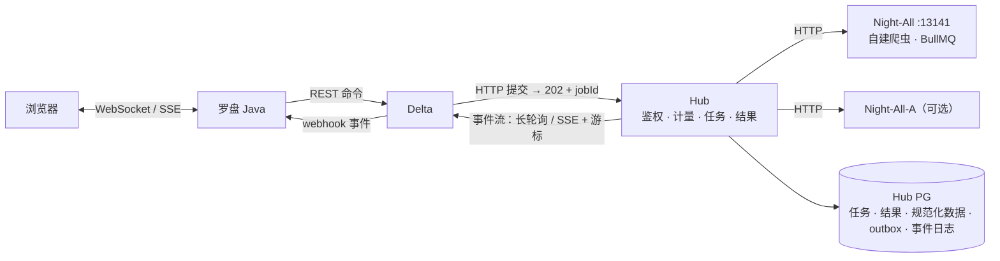

# Spider-Man：自建采集服务架构

**这是活文档。** 凡是新增或改动自建采集服务（Night-All、Night-All-A、Hub 自建引擎、事件交付），或改动它们的部署拓扑，都要同步更新本目录，并在文末「变更记录」追加一行。只看本目录，就应该能知道当前状态和目标形态。

最后更新：2026-11-09。本目录记录的是设计与现状核对；标注「设计中」的部分**尚未实现、未部署**。

## 1. 范围

「自建服务」指不依赖第三方付费数据 API、由我们自己运行的采集能力，以及把它们接入 Hub、交付给下游业务的整条链路。

| 组件 | 位置 | 角色 | 状态 |
|---|---|---|---|
| Night-All | Internal 宿主机 `:13141`，不在 k8s 内 | 历史自建平台：本地爬虫（如搜狗微信 `wechat_mp`）、旧供应商编排、BullMQ 异步任务 | 运行中。供应商类接口按 operation 逐个迁到 Hub；自建爬虫能力保留 |
| Night-All-A | VPN 固定地址 `100.127.0.1:8100`（Internal 侧为 `100.127.0.6`） | HTTP 异步采集 + 独立清洗库；含 Facebook 协议爬虫 `facebook-protocol` | Facebook 内容搜索的「自建」模式已实现未部署（[03](03-self-hosted-engines.md) 第 11 节）；旧 Admin 控制台转发仍由环境开关控制（默认关闭），线上是否启用未核实 |
| Hub 自建引擎 | Hub（k8s）内的引擎配置、任务表、执行者 | 把一个自建爬虫包装成可排队、可计量、可查询的数据产品。第一个是「微信 → 自建引擎」 | 已实现未部署 |
| Hub 单帖评论 | Hub Public 原生接口与旧兼容别名 | 13 平台固定供应商评论，现有 PG 归档/计费/分页/入库；不转 Night-All | Twitter、Reddit、快手统一入口首屏均验收通过；快手分页 unknown/不可继续。其余七个 JustOne 平台受余额阻塞；微博新搜索已核验 8 条有效 ID/零计数，准备复用首条执行剩余一次评论采样；见 [迁移合同](../../integrations/post-comments-migration.md) |
| Hub 事件中心 | Hub Public 的事件接口 + PG 事件日志 | 把任务终态和数据变化可靠地交付给 Delta、Java | 设计中 |
| 下游 | Delta（po-infra）、罗盘 Java，都是 Internal 宿主机上的 Docker | 提交任务、消费事件 | 目前同步调 Hub；直连改造见[性能汇总第 5 节](../../operations/platform-performance-review-2026-10-22.md) |
| 旁路采集 | Delta 自带的 spiders、直接调 Night-All 的控制台等 | 不经过 Hub 的采集入口 | 待盘点 |
| 外部交付采集包 | `/tmp/platforms`，49 个目录的 `adapter.py` 包 | 按 Apify / Hub 原生 / 独立 runner 三种方式分阶段接入 Hub。Apify 是第三方付费服务，因为复用自建引擎的异步任务骨架，所以也放在本目录 | 设计中，见 [06](06-platforms-integration-plan.md) |

## 2. 总体结构

分四层，每层只做一件事：

| 层 | 负责 | 由谁承担 |
|---|---|---|
| 执行层 | 真正的采集、上游并发、重试 | Night-All / Night-All-A / Hub 原生连接器 |
| 记录层 | 任务、结果、原始证据、规范化数据、outbox，在同一事务提交 | Hub PG |
| 交付层 | 每个消费方一条有序事件日志、游标、保留期 | Hub 事件接口 |
| 传输层 | 长轮询、SSE、webhook，**只负责送达和唤醒** | Hub Public / 下游 |

## 3. 不变量

以下规则不随阶段变化。改设计前先看是否违反其中一条。

1. **机器外只认「稳定地址 + HTTP 合同」。** Delta、Java、Night-All 从不直连 PG、Redis、ES 或 BullMQ。集群内部拓扑可以随意变，对外地址和接口不变。详见 [01](01-topology-and-multinode.md)。
2. **正确性只来自持久记录。** 任务、结果、事件、游标都在数据库里。长连接和通知断了也不丢数据，只是晚一点被发现。
3. **业务语义归 Hub。** 租户、授权、计量、证据都在 Hub；mx-common 只提供不含业务语义的原语；不新建对外开放的消息中间件。
4. **资源互斥和准入限流分开处理。** 「同一时间只能跑一个爬虫」不可超发，由 PG 行约束仲裁（同步提交）；「保护上游的并发上限」允许短暂超发，用 PG 租约（异步提交，和现有每分钟请求数桶同一做法）。详见 [04](04-admission-and-concurrency.md)。
5. **未知就是未知。** 超时、断连、执行进程重启都记为 `unknown` 并隔离资源，不自动放行下一条，也不自动按成功结算。
6. **不影响 MX-H2I 的登录和联网。** 不改 Launcher、WireGuard、split DNS，也不改 `night-all.mxinfo-inc.cn` 的现有链路。
7. **少配置。** 新增的保护参数用内置值；地址类配置存进 Hub 数据库（带修订号和审计），不新增 `MX_*` 环境变量。

## 4. 文档目录

| 文档 | 内容 |
|---|---|
| [01 部署拓扑与多节点演进](01-topology-and-multinode.md) | 当前单机事实；新服务器加入后哪些假设会失效；怎样做到调用方零改动；S0–S4 迁移阶段 |
| [02 事件中心](02-event-delivery.md) | 为什么不直连中间件；事件日志、游标、长轮询/SSE；Delta 如何消费；Delta 与 Java 之间怎么通信 |
| [03 自建引擎](03-self-hosted-engines.md) | 通用引擎模型、单执行槽、结果判定；微信 `wechat_mp` 调查结论；下游合同；页面与地址配置 |
| [04 准入、并发与全局资源](04-admission-and-concurrency.md) | 图 4 限速在多进程下的实际效果；多副本后的问题；全局信号量设计 |
| [05 路线图、决策与待决事项](05-roadmap-and-decisions.md) | 决策记录、分阶段计划、待决问题、验收清单 |
| [06 外部交付采集包接入计划](06-platforms-integration-plan.md) | `/tmp/platforms` 各包的分阶段接入顺序、每个平台的方向和技术实现、平台总表 |
| [07 通用采集引擎](07-collect-engines.md) | 阶段 1 的骨架：schema `collect`、多执行槽并发、异步核对与租约、runner 合同、`/api/v1/data/collect/*`、管理台「自建引擎」页 |

相关文档：

- [微信自建引擎上游审计详稿（2026-10-22）](../wechat-self-hosted-engine-2026-10-22.md)：Night-All 源码逐行审计、异步接口缺陷、业界模式对比。
- [Night-All 过渡集成](../night-all-integration.md)、[数据插槽](../integration-slots.md)、[系统上下文](../system-context.md)。
- [平台性能排查与 100 QPS 建议](../../operations/platform-performance-review-2026-10-22.md)：Delta、Java 直连 Hub 的改法。

## 5. 当前状态看板

| 能力 | 状态 | 下一步 |
|---|---|---|
| Night-All 同步接口经 Hub 兼容转发 | 运行中（微信已转 TikHub，旧路径对微信返回 410） | 按 operation 继续退役 |
| Internal Hub 断电恢复启动门禁 | 已实现未部署：六个生产工作负载等宿主 PG `:5432` 与 HanLP 就绪，见 [01](01-topology-and-multinode.md) | 重建 Hub 镜像、更新 Hub 清单并验收；多节点前重审回环地址约定 |
| 微信自建引擎 | 已实现未部署（第一阶段：Hub 侧对外接口 + 计费 + 引擎配置 + 页面，见 [03](03-self-hosted-engines.md) 第 10 节） | 部署、连通性探测、用验证脚本做真实采集验收（[05](05-roadmap-and-decisions.md) P1b）。计费默认关闭（只转发）；Delta 托管 Key 部署后自动获得权限 |
| Hub 事件中心 | 设计中 | 先做异步任务的生命周期事件 |
| Delta 事件消费进程 | 设计中 | 等 Hub 事件接口上线 |
| Delta → Java webhook | 设计中 | 确认 Java 能否开内网入口（Q5） |
| 多节点 | 规划中，新服务器尚未采购 | S0 约定现在就执行，S1 等新机器到位 |
| 全局准入信号量 | 设计中 | Public 多副本之前必须完成 |
| LCY 供应商优先排队 | 已实现未部署：每进程优先队列 + 80% 预留 + PG 令牌桶等待，见 [04](04-admission-and-concurrency.md) | 发布 migration 172，先调好“管理”页供应商限额，再在开关里选“优先排队” |
| 外部交付采集包接入（[06](06-platforms-integration-plan.md)） | 阶段 0–6 都已实现未部署：通用骨架；17 个 Apify 能力项；同步查询；runner + 7 个应用市场；单链接补全 + 原生子域名；音频节目与单集（4 个平台）。D17–D44 | 部署 migration 183–187、Hub 和 runner 镜像；录入 Apify token、Shodan key、runner token 并探测；逐个能力做小量联网验收。外部待办：Medium 交付包修复、Snapchat 和 Substack 上游修复、Podcast Index 凭据；音频下载等 mx-static |
| 通用采集引擎（[07](07-collect-engines.md)） | 已实现未部署：migration 183、184，多执行槽，runner 和 apify 两种执行方式，collect 对外接口，管理台「自建引擎」页（原微信引擎也列在其中） | 发布 migration 183、184 和 Hub 镜像；部署后没有任何引擎，对现有接口无影响 |
| Facebook 自建搜索（Night-All-A） | 已实现未部署：策略模式 `selfhosted`，全集群 PG 名额（默认同时 2 个、每分钟 12 次启动），见 [03](03-self-hosted-engines.md) 第 11 节 | 发布 migration 173 → Internal 上确认 Night-All-A 可达且 facebook-protocol 有有效登录会话 → 策略搜索管理里选「自建」 |

## 6. 维护约定

- **状态词只用这几个：** 运行中 / 已实现未部署 / 设计中 / 规划中 / 待决 / 已废弃。
- **写清事实来源：** 事实写源码路径或文档链接；没有实测的数字标「估算」；线上状态没核实就写「未核实」。
- **改动时同步更新三处：** 相关章节、上面的看板、下面的变更记录。
- **单次专题另起文档：** 事故复盘、审计详稿放在 `docs/operations` 或 `docs/architecture` 下单独成文，这里只链接并摘要结论。

## 7. 变更记录

- 2026-11-09 上线准备：新增 [采集引擎上线手册](../../operations/collect-engines-rollout.md) 和 `scripts/collect-acceptance.mjs`（plan / apply / runner-token / probe / enable / smoke）。
  - 标准引擎集合从能力目录推导，覆盖每条路由且只覆盖一次。
  - 本机预演发现 runner 并发上限（8）低于标准配置的 18 个 runner 执行槽，已改为 24，`probe` 会核对这条规则。
  - runner 部署脚本复用 Hub 的 `MX_INSIGHT_BUILD_PROXY` builder。
  - 预演中 Google Play 9 个操作全部联网成功。
- 2026-11-09 阶段 6：音频已实现未部署（[07](07-collect-engines.md) 第 14 节）。
  - **runner**：协议新增 `steps`，一次调用按顺序执行多个白名单内的操作，共用一个工作目录（D41）。
  - **能力**：`collect.audio.shows` / `collect.audio.episodes`，覆盖小宇宙、喜马拉雅、Apple Podcasts、LibriVox，只取元数据和音频地址。
  - **不挂持久卷**，下载等 mx-static（D42）；ID 必须填写（D43）；Podcast Index 等凭据（D44）。
  - **本地实测**：小宇宙、Apple、LibriVox 成功；喜马拉雅被接口限流，待在 Internal 复测。
- 2026-11-09 阶段 5：单链接补全与子域名已实现未部署（[07](07-collect-engines.md) 第 13 节）。
  - **单链接补全**：`collect.web.url.details` 按链接主机名路由到 Pinterest、Medium、Snapchat、Dailymotion、Kick、Substack、WordPress.com 的 runner 包，不接受自定义域名（D37）。上游库只收审核 commit 的导入包，经 `PYTHONPATH` 加载，yt-dlp 三家共用（D36）。runner 镜像改用 Python 3.13，适配器输出也做代理脱敏（D40）。migration 187 新增 `overseas` 出口。
  - **子域名**：subfinder 改为 Hub 原生的 `collect.intel.subdomains`，查 Cert Spotter 和 crt.sh（D38）。
  - **Mastodon**：暂不接（D39）。
  - **本地实测**：子域名、Pinterest、Dailymotion、Kick、WordPress 成功；Medium 是交付包缺陷，Snapchat 和 Substack 是上游失效。
- 2026-11-09 阶段 4：runner 与应用商店已实现未部署（[07](07-collect-engines.md) 第 12 节）。
  - **runner**：新项目 `electron-dock/mx-base/mx-crawler-runner`，Node 22，不依赖第三方包。7 个交付包原样放进仓库，按 sha256 校验；每次调用一个进程组，先持久登记再启动；只监听 127.0.0.1:18190，单独部署，不进 Hub 的 kustomization（D31、D32）。
  - **Hub 能力**：`collect.app.details` 扩展到小米、vivo、应用宝、百度、联想、豌豆荚、Google Play；另有 8 个 `collect.app.googleplay.*` 能力项（D33）。
  - **出口**：Google Play 经 migration 186 的 `googleplay` 绑定选代理，再传给 runner（D34）。
  - **约束**：runner 引擎必须带 token，只能承接本插槽的能力（D35）。
  - **验证**：本地经 Hub → runner 从 5 个国内市场取到了真实详情；豌豆荚因本机 DNS 没有测成；Google Play 没有联网测试。
- 2026-11-09 阶段 3：同步查询已实现未部署（[07](07-collect-engines.md) 第 11 节）。新增 `POST /api/v1/data/collect/query`：有空槽时在请求内执行并返回 200 和结果，否则退回 202。新增 `native` 执行方式（DNS 只走公共解析器、RDAP 走 IANA 引导表、证书透明日志走 Cert Spotter）和 `shodan` 执行方式（host / search 首页 / count / domain；每秒 1 次的节流记在 PG 冷却里，跨进程共享；migration 185 把出口绑到 7788）。只读任务失联记为失败，并释放执行槽（D28–D30）。本地已对 DNS、RDAP、证书透明日志做了真实只读查询；Shodan 没有用真实 key 调用。
- 2026-11-09 2c：新增 9 个 Apify 候选能力项，已实现未部署（[07](07-collect-engines.md) 第 10.2c 节）：Shein、Flipkart、Mercado Libre、FB Marketplace、Craigslist、Shopify、BuiltWith、UK Companies House（只取企业基础信息，高管和实际控制人等个人数据关闭）、Trip.com 酒店评论。每次运行都传 `maxItems`，值等于 Hub 会读回的条数（D27）。管理台引擎列表能折叠显示较多的能力项。没有调用真实 Apify。
- 2026-11-09 2b 电商：新增 Amazon（关键词加站点，或站内链接）、eBay、AliExpress、Etsy、Shopee（国家必填，关键词或本国站点店铺链接）5 个 Apify 能力项，已实现未部署（[07](07-collect-engines.md) 第 10.2b 节）。只开放搜索；卖家、报价、验证码破解、详情、评论一律关闭。都是 candidate，不自动授权。它们是异步产品，不作为同步商品搜索的备用。没有调用真实 Apify。
- 2026-11-09 阶段 2：Apify 执行方式已实现未部署（[07](07-collect-engines.md) 第 10 节）。启动用 `/v2/acts/{id}/runs`，固定版本，不传花费上限；运行 ID 落库后异步核对；数据集分页读取，完整性按总数判断；启动应答丢失或执行器失联都记为 unknown 并隔离执行槽，从不重提；截止时间请求中止，确认后才释放执行槽；成本记入任务，只在管理台显示。migration 184 把 apify 出口绑定到 7788 序列（探测缓存 5 分钟），其他绑定不动。凭据写入共享凭据库，只写不读。新增 Temu、Meta 广告库、Similarweb 三个候选能力项，不自动授权。没有用真实 token 调用 Apify。不涉及 MX-H2I、Launcher。
- 2026-11-09 阶段 1：通用采集引擎已实现未部署（[07](07-collect-engines.md)）。新建 schema `collect`（migration 183），微信表不动；执行槽为行，派发用 SKIP LOCKED，加锁顺序统一为引擎 → 执行槽 → 任务；同一调用方的提交加锁，因此每个调用方的上限精确；异步任务进入 waiting 后由任一执行器核对，派发途中进程失联靠租约发现；结果单独存表。新增 `/api/v1/data/collect/*` 和管理台「数据接入与治理 → 自建引擎」页，原微信引擎嵌入其原有面板。能力项 `collect.app.details` 加入 PUBLIC_CAPABILITIES，但不自动授予 managed_full Key。另外把微信内存存储的提交时间改为严格递增，修复同一毫秒提交时顺序随机的问题。不涉及 MX-H2I、Launcher。
- 2026-11-09：新增 [06 外部交付采集包接入计划](06-platforms-integration-plan.md)（设计中）。用户确认 D17–D19：Apify token 录入 Hub 凭据库（来源是 po-infra 旧爬虫里写死的 token，有效性未核实），先不做花费限制，海外出口走 System Proxy 的 7788 序列。只改了文档，没有代码、存储或 MX-H2I 变化。

- 2026-11-02 后续：Twitter 的样本校准、完整 36 条归档解析、发布后路由检查和旧 URL 首屏验收均通过。usage d167ad9e-48b4-4668-bcd3-8b1d6ef2aeb0 返回 20 条，committed、一次成功计费 TikHub 调用、归档完整；hasMore=true 表示已购余量，不推定新归档也是 36 条。不重复探测、不自动续页。capabilities 的评论 ready 当前基于小红书，不能据此判断 Twitter；本次使用已有原生授权 Key 做 TikHub 预检。其余九个 JustOne 平台仍受余额阻塞；Reddit/快手待真实目标样本，Facebook 替代尚未登记。
- 2026-11-02 目标查找：用户授权 Reddit/快手优先复用服务器记录、缺少时新采集。新增 Admin stdin 只读有界查找脚本，区分历史评论请求与原帖规范记录，正确区分快手 cid/photoId；服务器已找到 Reddit 历史请求与快手原帖，改用精确源 UUID 查询；20 项测试通过，待各一页评论采样，未新增供应商调用。
- 2026-11-02 评论校准：Reddit 原生 usage 7eb265f4-5c2c-4d15-91d5-7dc7fed83b61 成功计费，9844 字节归档含 3 条树；快手 usage ce942beb-a379-4e18-b62f-ee69cc24b3d3 返回 Hub 502，未追加采样。准备 Reddit 保存请求绑定的完整纯解析验证与快手只读错误/计费检查；52 项测试通过，暂无运行路由变更。

- 2026-11-02：单帖评论 13 平台迁移到 Hub 原生执行；沿用既有 PG 和准入，不改自建引擎拓扑或 MX-H2I。官方例子离线验证，生产部署与限定次数验收待执行。

| 日期 | 变更 |
|---|---|
| 2026-10-31 | Facebook 内容搜索新增「自建：仅 Night-All-A」模式（已实现未部署，migration 173）：沿用现有搜索接口，Hub 提交 Night-All-A `search.posts` 任务并轮询；全集群 PG 先进先出名额，默认同时 2 个在途、每分钟 12 次均匀启动，管理页可调，不豁免任何 Key；结果未知时名额保留到过期。见 [03](03-self-hosted-engines.md) 第 11 节、[04](04-admission-and-concurrency.md)。 |
| 2026-10-31 | LCY-delta 开关新增供应商“优先排队”模式（已实现未部署，migration 172）：排队代替绕过、80% 并发预留、上游限流后放慢、明确未计费的限流拒绝重试一次；默认仍为原来的绕过。见 [04](04-admission-and-concurrency.md)。 |
| 2026-10-27 | 新增 Internal Hub PG/HanLP initContainer 启动门禁（已实现未部署），有界等待并由 k8s 重试；不修改 Launcher/MX-H2I/kubelet，新增多节点回环地址限制。见 [操作说明](../../operations/internal-startup-dependencies-2026-10-27.md)。 |
| 2026-10-23 | 以性能为主改为只转发：引擎计费开关默认关闭（不写使用账本、不与调用方其他付费请求争用预留锁）；执行者空闲时无锁；状态快照缓存；`Retry-After` 5–60 秒自适应；新增 `scripts/verify-wechat-self-hosted.sh`。价格不随部署自动迁移的原因见 [03](03-self-hosted-engines.md) 10.6 节（D14–D16）。 |
| 2026-10-23 | 微信自建引擎第一阶段实现完成（未部署、未提交）：迁移 165、`server/self-hosted/*`、对外 202 + 轮询接口、派发时计费、Admin 引擎配置/探测/恢复、产品页。单元、原生 PG、浏览器验证见 [03](03-self-hosted-engines.md) 第 10 节。 |
| 2026-10-23 | 自建引擎直接对 Delta 开放：能力项 `wechat.selfhosted.search`、按任务计费、¥0.10 / 次、实时和缓存收费、旧结果不收费、派发时预留账本、适中档排队上限（[03](03-self-hosted-engines.md) 5.3–5.4 节，[05](05-roadmap-and-decisions.md) D9–D13）。开始实现第一阶段。 |
| 2026-10-23 | 建立本目录。整合事件中心、微信自建引擎、限速分析三部分设计；新增多节点演进方案（A 机 hub-edge 入口、`night-all-legacy` Service、全局准入信号量）。均为设计，未实现。 |

- 2026-11-02 Reddit 运行接入：保存请求绑定的完整 3 条解析验证通过，本地固定 TikHub 配方、手动单页采购、signed score 规范化保留已接入；旧签名/原生游标仅精确历史重放，旧排队 JustOne 入库归属不变。待 Hub-only 部署与统一入口验收。快手 Web 拒绝为上游 400，billed=null 不按未收费处理；保留原 marker，准备一次独立 App 端点样本。无 DDL、Launcher/SSO/VPN 变动。

- 2026-11-02 评论验收进展：Reddit 运行容器路由已确认 TikHub/manualProviderPagination；准备旧 URL 至多一次业务验收，保留原生样本。快手独立 App 样本 16eb4f8e-7d1d-40e2-8593-02570ee3fd37 成功且计费，13227 字节归档/rootComments11；候选纯解析器与只读全量校验已准备，特别检查数值 ID 精度与回复预览隔离，尚未切换统一快手路由，无新供应商调用。

- 2026-11-02 评论运行接入：Reddit 统一旧 URL 验收 usage 6fbf167b-9d1c-44f6-8ac0-5cd90fd3100b 返回 3 条并 exhausted，同 usage 唯一成功计费 TikHub 调用；闭环保留回执。快手 App 全 11 条保存归档验证通过，评论/作者数值 ID 安全，内部 photo_id 不作身份，2 条回复预览隔离；本地统一配方/投影/manual pagination/旧 JustOne 入库兼容已接入。快手旧非空原生 pcursor 仅历史重放，避免跨供应商复用同名 token；no_more 保守 unknown。待 Hub-only 发布和一次统一验收，无新增存储或 H2I 变化。

- 2026-11-02 快手发布检查：操作者 Public 静态断言实际为 JustOne；只证明该容器仍是旧配方，原因尚未确定。完整 set-e 命令在付费验收前退出。新增可直接粘贴的源码/逐 Pod hash 与节点镜像只读核对，区分未同步源码和运行版本不一致；保留全部 marker，无重采、服务变更或 H2I 影响。见评论校准操作文档末节。

- 2026-11-02 快手版本对齐：第一次回传证明宿主机 af1f0701 源码仍旧且两个容器与其一致；第二次 1089e532 的宿主机/Public/Admin 六文件 SHA 全部对齐本地 TikHub App，两个新 Pod Ready、同镜像 c001eb6c。部署差异已解决，直接继续保留防重标记的单次统一验收，不重部署或重购原生样本。实际业务交付/计费证据仍待回传，无 H2I 变动。

- 2026-11-02 快手统一验收完成：usage2274fe73-43e4-4914-9f21-a3629b188d09 HTTP200/11条/六项检查全通过，同 usage committed、唯一 TikHub bc64 succeeded+billed、归档 verified。分页 null/不可继续/unknown，不推定全帖已穷尽。Twitter/Reddit/快手本轮首屏均闭环，保留所有 marker、不再采购；剩余七个 JustOne 路由继续受余额阻塞。仅更新证据文档，无运行、存储或 H2I 变化。

- 2026-11-02 微博迁移发现：最近 5000 次 TikHub 调用未命中两个主评论端点，仅证明该切片无记录。准备按准确端点索引查成功历史、无归档时按每数据集最新 50 条找已存原帖候选；候选 UUID 后续需核验原始 ID 精度。只读、零供应商请求，微博仍为 JustOne，未改权限/存储/H2I。

- 2026-11-02 微博候选定位：两条精确 native 评论端点成功历史均未命中；search 数据集最新切片中找到 canonical ffe325bc-1e9a-4cab-8693-4d866252c88a，正评论量证据未确认。下一步按固定 UUID 分别核验 canonical revision 与当前 source 输入的 ID/计数类型和 run 归属，避免旧计数字符串遗漏或 ID 转换误判。无重扫、付费采购、微博路由或 H2I 改动。

- 2026-11-02 微博重新采样准备：固定候选版本及当前来源 ID 一致、同 run，comment_count 是安全整数 0；不再追查历史。用户再次授权少量付费请求，准备最多一次 Web 热门搜索和一次主评论请求的独立批次，先免费预检，再核对唯一成功计费调用、完整归档 SHA 与正评论量目标；任一步失败停止。57 项模拟 HTTP/数据库及归档检查通过，服务器命令语法通过；尚未生产执行，微博统一路由仍为 JustOne，无存储、权限或 MX-H2I 变更。

- 2026-11-02 微博采样进展：高级搜索 usage15fc7955-8bcb-4b01-9618-d23c56ff64b6 HTTP200，准备流程通过计费与完整归档门禁后返回 no_positive_comment_target；主评论未请求。新增同次归档只读字段/选择状态检查，26 项测试通过。不能把该错误解释成所有微博无评论；已有 realtime 搜索计数全零的历史证据，只作排查参考。保留 marker，不重复采购搜索；微博路由、存储和 MX-H2I 无变化。

- 2026-11-02 微博零计数选样：操作者回传同次 8130B 完整归档验证，8 条有效字符串 ID、评论计数均为数值 0。准备显式零计数模式从同次保存结果固定取首条，最多执行剩余一次主评论采样，沿用原 marker；不重搜、换目标、重试或续页。33 项测试与封装审查通过，尚未执行生产评论请求；微博统一路由、存储和 MX-H2I 不变。

- 2026-11-02 微博评论归档：usage fedbc7e0-e9fa-4fe3-a3e3-5107fcb13849 唯一 TikHub 调用成功且计费，137665B，响应根评论 22 条；新增无依赖纯解析器和 Admin 只读全量投影验证，检查字符串身份、字段覆盖、回复预览隔离与 max_id 保守分页。11 项微博校验及既有相关测试通过，待生产只读命令回传；不重复采购、不切路由、不改 H2I。
