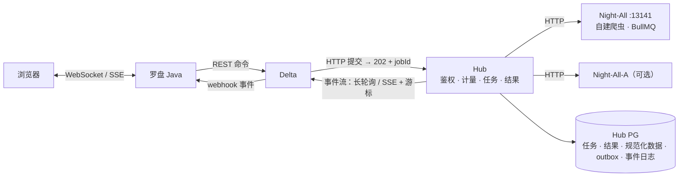

# Spider-Man：自建采集服务架构

**这是活文档。** 凡是新增或改动自建采集服务（Night-All、Night-All-A、Hub 自建引擎、事件交付），或改动它们的部署拓扑，都要同步更新本目录，并在文末「变更记录」追加一行。只看本目录，就应该能知道当前状态和目标形态。

最后更新：2026-10-27。本目录记录的是设计与现状核对；标注「设计中」的部分**尚未实现、未部署**。

## 1. 范围

「自建服务」指不依赖第三方付费数据 API、由我们自己运行的采集能力，以及把它们接入 Hub、交付给下游业务的整条链路。

| 组件 | 位置 | 角色 | 状态 |
|---|---|---|---|
| Night-All | Internal 宿主机 `:13141`，不在 k8s 内 | 历史自建平台：本地爬虫（如搜狗微信 `wechat_mp`）、旧供应商编排、BullMQ 异步任务 | 运行中。供应商类接口按 operation 逐个迁到 Hub；自建爬虫能力保留 |
| Night-All-A | VPN 固定地址 `100.127.0.1:8100` | HTTP 异步采集 + 独立清洗库 | Hub 已有可选适配器（环境开关默认关闭）；线上是否启用未核实 |
| Hub 自建引擎 | Hub（k8s）内的引擎配置、任务表、执行者 | 把一个自建爬虫包装成可排队、可计量、可查询的数据产品。第一个是「微信 → 自建引擎」 | 已实现未部署 |
| Hub 事件中心 | Hub Public 的事件接口 + PG 事件日志 | 把任务终态和数据变化可靠地交付给 Delta、Java | 设计中 |
| 下游 | Delta（po-infra）、罗盘 Java，都是 Internal 宿主机上的 Docker | 提交任务、消费事件 | 目前同步调 Hub；直连改造见[性能汇总第 5 节](../../operations/platform-performance-review-2026-10-22.md) |
| 旁路采集 | Delta 自带的 spiders、直接调 Night-All 的控制台等 | 不经过 Hub 的采集入口 | 待盘点 |

## 2. 总体结构

分四层，每层只做一件事：

| 层 | 负责 | 由谁承担 |
|---|---|---|
| 执行层 | 真正的采集、上游并发、重试 | Night-All / Night-All-A / Hub 原生连接器 |
| 记录层 | 任务、结果、原始证据、规范化数据、outbox，在同一事务提交 | Hub PG |
| 交付层 | 每个消费方一条有序事件日志、游标、保留期 | Hub 事件接口 |
| 传输层 | 长轮询、SSE、webhook，**只负责送达和唤醒** | Hub Public / 下游 |

## 3. 不变量

以下规则不随阶段变化。改设计前先看是否违反其中一条。

1. **机器外只认「稳定地址 + HTTP 合同」。** Delta、Java、Night-All 从不直连 PG、Redis、ES 或 BullMQ。集群内部拓扑可以随意变，对外地址和接口不变。详见 [01](01-topology-and-multinode.md)。
2. **正确性只来自持久记录。** 任务、结果、事件、游标都在数据库里。长连接和通知断了也不丢数据，只是晚一点被发现。
3. **业务语义归 Hub。** 租户、授权、计量、证据都在 Hub；mx-common 只提供不含业务语义的原语；不新建对外开放的消息中间件。
4. **资源互斥和准入限流分开处理。** 「同一时间只能跑一个爬虫」不可超发，由 PG 行约束仲裁（同步提交）；「保护上游的并发上限」允许短暂超发，用 PG 租约（异步提交，和现有每分钟请求数桶同一做法）。详见 [04](04-admission-and-concurrency.md)。
5. **未知就是未知。** 超时、断连、执行进程重启都记为 `unknown` 并隔离资源，不自动放行下一条，也不自动按成功结算。
6. **不影响 MX-H2I 的登录和联网。** 不改 Launcher、WireGuard、split DNS，也不改 `night-all.mxinfo-inc.cn` 的现有链路。
7. **少配置。** 新增的保护参数用内置值；地址类配置存进 Hub 数据库（带修订号和审计），不新增 `MX_*` 环境变量。

## 4. 文档目录

| 文档 | 内容 |
|---|---|
| [01 部署拓扑与多节点演进](01-topology-and-multinode.md) | 当前单机事实；新服务器加入后哪些假设会失效；怎样做到调用方零改动；S0–S4 迁移阶段 |
| [02 事件中心](02-event-delivery.md) | 为什么不直连中间件；事件日志、游标、长轮询/SSE；Delta 如何消费；Delta 与 Java 之间怎么通信 |
| [03 自建引擎](03-self-hosted-engines.md) | 通用引擎模型、单执行槽、结果判定；微信 `wechat_mp` 调查结论；下游合同；页面与地址配置 |
| [04 准入、并发与全局资源](04-admission-and-concurrency.md) | 图 4 限速在多进程下的实际效果；多副本后的问题；全局信号量设计 |
| [05 路线图、决策与待决事项](05-roadmap-and-decisions.md) | 决策记录、分阶段计划、待决问题、验收清单 |

相关文档：

- [微信自建引擎上游审计详稿（2026-10-22）](../wechat-self-hosted-engine-2026-10-22.md)：Night-All 源码逐行审计、异步接口缺陷、业界模式对比。
- [Night-All 过渡集成](../night-all-integration.md)、[数据插槽](../integration-slots.md)、[系统上下文](../system-context.md)。
- [平台性能排查与 100 QPS 建议](../../operations/platform-performance-review-2026-10-22.md)：Delta、Java 直连 Hub 的改法。

## 5. 当前状态看板

| 能力 | 状态 | 下一步 |
|---|---|---|
| Night-All 同步接口经 Hub 兼容转发 | 运行中（微信已转 TikHub，旧路径对微信返回 410） | 按 operation 继续退役 |
| Internal Hub 断电恢复启动门禁 | 已实现未部署：六个生产工作负载等宿主 PG `:5432` 与 HanLP 就绪，见 [01](01-topology-and-multinode.md) | 重建 Hub 镜像、更新 Hub 清单并验收；多节点前重审回环地址约定 |
| 微信自建引擎 | 已实现未部署（第一阶段：Hub 侧对外接口 + 计费 + 引擎配置 + 页面，见 [03](03-self-hosted-engines.md) 第 10 节） | 部署、连通性探测、用验证脚本做真实采集验收（[05](05-roadmap-and-decisions.md) P1b）。计费默认关闭（只转发）；Delta 托管 Key 部署后自动获得权限 |
| Hub 事件中心 | 设计中 | 先做异步任务的生命周期事件 |
| Delta 事件消费进程 | 设计中 | 等 Hub 事件接口上线 |
| Delta → Java webhook | 设计中 | 确认 Java 能否开内网入口（Q5） |
| 多节点 | 规划中，新服务器尚未采购 | S0 约定现在就执行，S1 等新机器到位 |
| 全局准入信号量 | 设计中 | Public 多副本之前必须完成 |
| LCY 供应商优先排队 | 已实现未部署：每进程优先队列 + 80% 预留 + PG 令牌桶等待，见 [04](04-admission-and-concurrency.md) | 发布 migration 172，先调好“管理”页供应商限额，再在开关里选“优先排队” |

## 6. 维护约定

- **状态词只用这几个：** 运行中 / 已实现未部署 / 设计中 / 规划中 / 待决 / 已废弃。
- **写清事实来源：** 事实写源码路径或文档链接；没有实测的数字标「估算」；线上状态没核实就写「未核实」。
- **改动时同步更新三处：** 相关章节、上面的看板、下面的变更记录。
- **单次专题另起文档：** 事故复盘、审计详稿放在 `docs/operations` 或 `docs/architecture` 下单独成文，这里只链接并摘要结论。

## 7. 变更记录

| 日期 | 变更 |
|---|---|
| 2026-10-31 | LCY-delta 开关新增供应商“优先排队”模式（已实现未部署，migration 172）：排队代替绕过、80% 并发预留、上游限流后放慢、明确未计费的限流拒绝重试一次；默认仍为原来的绕过。见 [04](04-admission-and-concurrency.md)。 |
| 2026-10-27 | 新增 Internal Hub PG/HanLP initContainer 启动门禁（已实现未部署），有界等待并由 k8s 重试；不修改 Launcher/MX-H2I/kubelet，新增多节点回环地址限制。见 [操作说明](../../operations/internal-startup-dependencies-2026-10-27.md)。 |
| 2026-10-23 | 以性能为主改为只转发：引擎计费开关默认关闭（不写使用账本、不与调用方其他付费请求争用预留锁）；执行者空闲时无锁；状态快照缓存；`Retry-After` 5–60 秒自适应；新增 `scripts/verify-wechat-self-hosted.sh`。价格不随部署自动迁移的原因见 [03](03-self-hosted-engines.md) 10.6 节（D14–D16）。 |
| 2026-10-23 | 微信自建引擎第一阶段实现完成（未部署、未提交）：迁移 165、`server/self-hosted/*`、对外 202 + 轮询接口、派发时计费、Admin 引擎配置/探测/恢复、产品页。单元、原生 PG、浏览器验证见 [03](03-self-hosted-engines.md) 第 10 节。 |
| 2026-10-23 | 自建引擎直接对 Delta 开放：能力项 `wechat.selfhosted.search`、按任务计费、¥0.10 / 次、实时和缓存收费、旧结果不收费、派发时预留账本、适中档排队上限（[03](03-self-hosted-engines.md) 5.3–5.4 节，[05](05-roadmap-and-decisions.md) D9–D13）。开始实现第一阶段。 |
| 2026-10-23 | 建立本目录。整合事件中心、微信自建引擎、限速分析三部分设计；新增多节点演进方案（A 机 hub-edge 入口、`night-all-legacy` Service、全局准入信号量）。均为设计，未实现。 |
