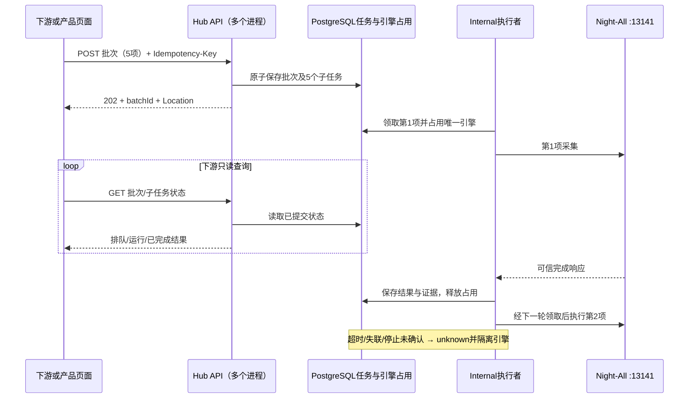
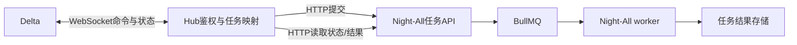
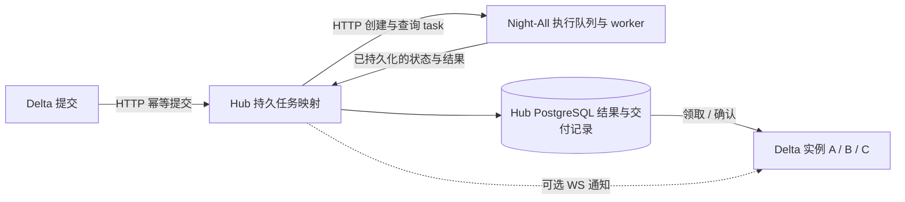

# 微信「自建引擎」：上游审计与接入设计

日期：2026-10-22（Asia/Shanghai）。状态：评审稿，未实现、未部署。

本轮按用户确认仅做分析与设计。依据本地 Night-All 与 Hub 源码、用户提供的四张截图及官方队列/API 文档。未读取生产配置、未调用搜狗/TikHub/JustOne、未修改业务代码、数据库、MX-H2I 登录或联网配置。本文的建议值不是现有部署值或性能承诺。

## 1. 结论与接入方向

新增「微信 → 自建引擎」独立产品，位于微信公众号、微信视频号、微信搜一搜之后。保持现有 TikHub 微信产品及旧接口语义。推荐采用 **Hub 持久任务 + 引擎全局并发 1 + HTTP 202 / 状态查询**；SSE 可以补充通知，不承担排队、幂等或互斥。

`wechat_mp` 的实际实现是 Node 调用 Python `requests` 搜狗微信爬虫，并不启动 Chromium/Playwright。单进程内有串行队列，但 API 进程、异步 worker、其他实例之间没有共同的执行锁。「预计三分钟」只能作为一次出队后的执行预算，不能作为包含排队的响应 SLA。

建议分两阶段：

1. Hub 先保存任务，由 Internal 的专用执行者调用现有 Night-All 同步接口；下游立即拿到任务 ID。只有本引擎使用独立的长等待预算。未知结果暂停引擎，不能自动释放并继续派发。此阶段要求核清绕过 Hub 的其他采集入口，否则只能保证 Hub 自身串行。
2. 修复 Night-All 已有异步任务入口的重试、幂等、终态和进程清理问题后，Hub 改为保存上游 taskId 并查询终态。对外 Hub 合同无需变化。长期推荐这一形态。

## 2. Night-All 的实际调用链

### 2.1 同步入口

```text
POST 宿主机:13141/api/v1/search/raw
  platform=wechat_mp, params.provider=sogou
  → searchSogou
  → runWechatMikuSearch
  → 单 Node 进程 Promise 队列 / 磁盘缓存
  → Python miku_spider.py
  → requests.Session → 搜狗搜索 HTML → 逐条解析文章跳转
  → 结果持久化 / raw envelope → 一次性 JSON 响应
```

以下是 **Hub 服务端到 Night-All** 的内部请求示例，不是下游公开合同：

```json
{
  "businessId": "hub-wechat-self-hosted",
  "platform": "wechat_mp",
  "query": "人工智能",
  "limit": 5,
  "page": 1,
  "cacheMaxAgeHours": 24,
  "params": {
    "provider": "sogou",
    "timeoutMs": 180000,
    "timeoutSeconds": 10,
    "noResolve": false
  }
}
```

`businessId` 必填，由 Hub 生成。显式固定 `wechat_mp` 和 `sogou`；`wechat/weixin` 会归一为 `wechat_search`。Night-All 文档平台表与实际 manifest 已是 Sogou 默认，文档末尾仍有 JustOne 默认的旧描述，应在实现时修正文档冲突。

源码依据：Night-All `lib/domains/search/search-service-assembly.js:255`、`lib/domains/crawlers/crawler-library-executor.js:170`、`crawlers/wechat/miku_spider.py:113`。

### 2.2 依赖与能力边界

| 层 | 实际依赖 / 行为 |
|---|---|
| 爬虫 | Python、`requests`；BeautifulSoup 可选，有标准库解析后备 |
| 网络 | 宿主机可直连搜狗及文章跳转目标；该 Session 设置 `trust_env=False`，不继承共享代理 |
| 文件 | 可写 `data/crawler-runs/output` 与微信缓存目录；共享磁盘文件不是跨进程互斥 |
| 持久化 | 配置数据库时尝试同步写入新结果；未配置可能 skipped，请求审计失败通常 fail-soft。存储耗时可增加同步接口总耗时；Python 爬虫自身不依赖 PG |
| 服务初始化 | 使用数据库凭据中心时，`/api/v1` 前置初始化也是可用性依赖；不等于搜狗需要 TikHub/JustOne key |
| 服务鉴权 | 本地 raw、library run、tasks 查询路由未实现 Bearer/API Key 校验；`businessId` 只是归属/审计字段。线上是否有额外代理鉴权需核实，不能套用只保护 `/data/export` 的 `NIGHTALL_EXPORT_TOKEN` |
| 无需的组件 | 此搜索执行链不依赖浏览器运行时、微信登录 Cookie、OCR、向量化或付费供应商凭据 |
| 搜索内容 | 公众号文章搜索；不是公众号账号全量抓取或用户资料合同；文章全文与互动指标覆盖不能从名称推断 |
| 异步入口额外依赖 | 任务库、实际选用的队列后端、运行中的 worker；BullMQ 模式需要 Redis |

Python 每个 HTTP 操作默认 10 秒、最多 3 次尝试，文章链接逐条处理。应用的 `limit` 是上限，不承诺填满；禁止为了凑满结果自动跨页采集。

### 2.3 超时、缓存与串行边界

| 项目 | 当前源码行为 | 对 Hub 的影响 |
|---|---|---|
| 子进程超时 | 默认 120000 ms，可通过参数改为 180000 ms | 不包含排队、间隔等待、入库与回包 |
| 并发 | 模块内 Promise 队列；每个 Node 进程各有一份 | 不能保证 API 与 worker 全局串行 |
| 请求间隔 | 一次执行完成后默认再间隔 10 秒 | 批次 ETA 必须计入间隔 |
| 排队 | 原同步队列无持久化、无明确数量/等待上限 | 不能直接把下游洪峰推给 Night-All |
| fresh 缓存 | 默认 24 小时 | 页面展示采集时间和缓存来源 |
| stale 回退 | 暂时失败可返回 7 天内旧结果 | 必须区分旧结果交付与本次采集成功 |
| 反爬冷却 | 默认 30 分钟 | 显示暂停/冷却，不循环重新采集 |
| 同参数合并 | 同进程按 query/page/includeRaw/noResolve 合并 | key 不含 limit/timeout/cacheMaxAgeHours，不能当 Hub 的精确幂等 |
| HTTP 断连 | 没有取消传播至排队项或子进程 | Hub 停止等待不等于采集停止 |
| 子进程超时 | 发 SIGTERM 后立即 reject，未等 close 确认、无后续强制终止确认 | 超时不是可靠的释放资源证据 |

`cacheMaxAgeHours=0` 只关闭 fresh 命中，**没有禁用 stale 回退**，因此当前上游不能被包装成有保证的 `live_only`。

raw 输出保留 `meta.cache`，但没有完整拷贝 provider warnings；不能只依赖 warnings 识别 stale。stale 路径的 `upstreamCallCount=0` 也不能证明本次没有尝试采集：它可能是在一次失败之后回退缓存。若 `cache.reason=temporary_failure` 隐藏了超时原因，第一阶段应将结果交付标记为 `stored_fallback`，同时把引擎执行安全状态设为待核实，不能以 HTTP 200 自动放行下一次。

源码依据：Night-All `lib/domains/crawlers/wechat-miku-stability.js:21,77,125,161,182,230`、`lib/domains/crawlers/process-runner.js:58`、`lib/domains/search/raw-search-service.js:137`。结果入库函数 `crawler-result-persistence.js:522` 中 `try { return asyncFn() }` 未 await，部分异步写入失败可能直接传播；成功采集和成功交付也须区分。

### 2.4 已有异步接口与修复门槛

原 Night-All（不是 Night-All-A）已经存在：

```text
POST /api/v1/crawlers/library/script%3Awechat-mp-miku/run
  Idempotency-Key: hub:<child-job-id>
  body: { query, limit, page, timeoutMs: 180000,
          cacheMaxAgeHours: 24, params: { timeoutSeconds: 10, noResolve: false } }
→ 202，data.taskId

GET /api/v1/tasks/:id
→ data.status / data.result
```

异步入口的 `timeoutMs` 在顶层；同步 raw 示例中位于 `params`。异步结果为 `items/itemCount/cache/upstreamCallCount/storage/outputFile`，不是 raw 的 `raw_data` 字符串。Hub 适配时隐藏宿主机路径，保留受限原始证据。

不能直接把现有 task status 作为可信完成信号，原因如下：

1. 默认幂等键由类型、目标、调用者和分钟生成，没有 payload；同一分钟的五个不同关键词可能误合并。必须使用 Hub 生成的稳定子任务键，终态后也保留映射。
2. BullMQ 默认三次尝试、5 秒指数退避。lifecycle 每次失败先写 `failed` 再抛错触发重试；repository 禁止 `failed → running/success`，但 handler 未确认状态更新成功就继续执行。**查询为 failed 时仍可能有后台采集，后续成功结果也可能无法入库。**
3. 任务 DB 建行和队列 enqueue 分离；任务幂等只查活跃状态，而旧 BullMQ job 可能仍存在，存在新 taskId 与旧 job 不一致的窗口。需要持久幂等映射及 outbox/对账。
4. 同步 API 与异步 worker 调同一个执行函数，但分别运行在不同进程，其 Promise 队列不共享。应统一到同一真实资源的执行槽。
5. 缺少逐条采集进度、可靠的取消/停止确认。先完成 SIGTERM→close 确认→必要时 SIGKILL→记录终态，再允许下一次运行；不能因 heartbeat/lease 到期自动重派。

源码依据：Night-All `routes/v1/crawlers.js:52`、`routes/v1/tasks.js:45`、`lib/runtime/tasks/task-service.js:13`、`lib/infra/queue/bullmq-adapter.js:53`、`workers/runners/task-lifecycle-runner.js:153`、`lib/infra/storage/repositories/task-postgres-repository.js:185`、`workers/job-handlers.js:44`。

## 3. 图 4 的限速在新架构下是否有效

**有效，但它是业务准入，不能提供本需求的全局资源互斥。**

当前源码中 Public + PostgreSQL 模式是 4 个 Node 进程。并发和等待队列属于各个 gateway 对象，再按 `max(1, ceil(配置值 / 进程数))` 分摊；RPM 在 PostgreSQL 中按供应商共享。当前 split Admin 不接 Public 数据路由，不能额外加一份 Admin 并发来计算线上微信调用。

| 图 4 配置 | 按当前 4 进程源码解释 |
|---|---|
| 总并发 16 | 同类 gateway 每进程 4，四进程理论合计 16 |
| 单调用者并发 8 | 每进程 2，四进程理论合计 8 |
| 等待请求 32 | 每进程 8；队列不跨进程均衡 |
| 每分钟 50 | PostgreSQL 供应商共享令牌桶，未简单乘 4 |
| 等待 10000 ms | 仍是短 HTTP 等待；不是持久任务期限 |
| 总并发改为 1 | 每进程至少 1，四进程仍可能并行 4 个 |

还有四个限制：

- 不同 TikHub gateway 对象各自计数，虽然读取同一个供应商配置、共享 RPM，但没有一个覆盖所有 TikHub 操作的共享总并发计数器。图中文字不宜被理解为供应商全局硬上限。
- 部分明确授权的内部身份可豁免业务准入；资源并发 1 必须与这类豁免独立。
- 当前设置 UI/后端写入上限为 60 秒，实际等待还受 reservation 到期时间减去上游 timeout 及安全余量限制。
- 截图是修订 0 的部署继承值 10 秒/32；本地当前默认已为 30 秒/256。未读取线上环境和数据库，不能声称截图配置已自动变更或线上新代码已生效。

图 4 管 TikHub，**不管另行直连 Night-All 的 Sogou 请求**。当前 Hub 又已把微信旧搜索别名转到 TikHub：`/api/v1/search/raw`、`/api/v1/data/search` 中的微信走新合同；`/api/v1/night-all/search/raw` 对微信明确 410。新增自建能力必须走独立接口。

源码依据：Hub `server/core/process-share.mjs:24`、`server/external-platforms/admission-runtime.mjs:20`、`server/external-platforms/store.mjs:2979`、`server/index.mjs:413,473,804`、`server/contracts/wechat-search-alias.mjs:7`、`server/core/internal-traffic-policy.mjs:29`。

## 4. 推荐的下游调用合同（拟新增，当前不可调用）



### 4.1 API 形态

| 拟新增 API | 语义 |
|---|---|
| `POST /api/v1/data/wechat/self-hosted/jobs` | 提交一条；持久保存后 202 |
| `POST /api/v1/data/wechat/self-hosted/batches` | 一次 1–5 条；父批次与子任务原子保存后 202 |
| `GET /api/v1/data/wechat/self-hosted/jobs/{jobId}` | 只读状态、时间、结果是否可取、结构化错误 |
| `GET /api/v1/data/wechat/self-hosted/jobs/{jobId}/result` | 获取已保存交付；不发起采集、不重复扣费 |
| `GET /api/v1/data/wechat/self-hosted/batches/{batchId}` | 总数、各状态计数、原顺序子任务引用 |
| `GET /api/v1/data/wechat/self-hosted/batches/{batchId}/result` | 按输入顺序读取全部结果/逐项错误；未完成时返回明确 pending 状态 |
| 可选 `GET .../batches/{batchId}/events` | SSE 通知；断线后仍用 GET 恢复 |

批次请求只包含业务参数，例如：

```json
{
  "items": [
    {"clientRef":"q1","query":"人工智能","limit":5,"page":1},
    {"clientRef":"q2","query":"新能源","limit":5,"page":1},
    {"clientRef":"q3","query":"机器人","limit":5,"page":1},
    {"clientRef":"q4","query":"低空经济","limit":5,"page":1},
    {"clientRef":"q5","query":"医药","limit":5,"page":1}
  ]
}
```

```http
HTTP/1.1 202 Accepted
Location: /api/v1/data/wechat/self-hosted/batches/<batch-id>
Retry-After: 5
```

```json
{
  "batchId":"<batch-id>",
  "status":"queued",
  "total":5,
  "completed":0,
  "statusUrl":"/api/v1/data/wechat/self-hosted/batches/<batch-id>"
}
```

状态建议：`queued → running → succeeded | failed`；未派发可 `cancelled/expired`；已派发但结果/停止不明为 `unknown`。结果的数据完整性另用 `complete/partial/unknown`，来源另用 `live/fresh_cache/stored_fallback`。批次分别显示成功、失败、排队、运行、未知数量，不把「五条都已结束」显示成「五条成功」。

`succeeded` 必须意味着结果及证据已持久保存且可读取。后台 Canonical 清洗、ES、向量化完成度另行报告，不能让用户把采集完成误解为索引已完成。`unknown` 可以暂停批次，但不得把另外四项标成上游失败。

特殊情况：已保存旧结果，但本次爬虫停止未确认时，保留 `job.status=unknown`、`engine.status=quarantined`，另记 `delivery.status=available`、`delivery.sourceMode=stored_fallback`。此时 `/result` 可读取带上述明确标记的旧结果；批次计入 unknown，不计入成功。结果可读绝不意味着资源已经释放。

### 4.2 下游如何知道完成

下游每 5 秒左右查询同一个 jobId/batchId，依据明确状态读取结果。可选 SSE 推送 `queued/running/item.completed/batch.completed/attention_required`；这些事件来自已提交状态。通知漏收、断连、网页刷新都不能新建采集任务。上游没有逐条进度时，只展示阶段和批次完成数，不虚构百分比。

**下游可以一次提交 5 个请求，不需要先等第一条返回再提交第二条。** Hub 负责顺序执行。下游可以逐条获取，也可以在全部终结后一次读取聚合 JSON。

若每条恰好执行 180 秒、每次完成后间隔 10 秒、最初无排队，完成时间约为：

| 第几条 | 理论完成时间（不含入库/网络） |
|---|---|
| 1 | 3分00秒 |
| 2 | 6分10秒 |
| 3 | 9分20秒 |
| 4 | 12分30秒 |
| 5 | 15分40秒 |

因此不能用一个普通 HTTP 请求等五条全部结束。SSE 可能缓解部分代理空闲超时，但不能避免绝对连接时限、断网或进程重启。保留 `202 + GET` 作为基础合同；如未来提供短暂同步等待，也只能等待已有持久任务，到期返回同一任务的查询地址。

## 5. 执行、幂等与故障恢复

### 5.1 专用持久状态

建议三类记录：

- `engine_config`：稳定 resourceId、地址引用、配置修订、启停、当前占用 jobId、隔离原因、下次允许时间。
- `jobs/batches`：租户/consumer/原 Key、幂等键、规范化输入指纹、接收顺序、配置快照、状态、排队期限、执行尝试、结果引用。
- `dispatch_attempts`：派发前意图、上游关联 ID、开始时间、可证明的响应/停止信息、原始证据哈希、未知原因及晚到证据。

同一真实资源的所有 URL 别名、配置修订共用 resourceId。短事务锁定资源行并领取下一项，将 dispatch intent 持久化后才外发；网络调用不持有三分钟数据库事务。数据库唯一约束及条件更新共同阻止两个活动派发，不能只依赖 worker `concurrency=1` 或进程数。

worker 心跳用于发现失联；失联后保留持久资源占用/隔离，不能由 TTL 自动变回 idle。旧 worker 的完成提交须校验 attempt/owner；晚到结果保留证据，再由受控对账处理，不覆盖历史响应。上游不验证 fencing token 时，token 不能阻止旧爬虫继续运行。

第一阶段仅当真实运行成功/已确认退出，或有明确的未启动证据，才能安全派下一条。HTTP 超时、连接中断、模糊 5xx、stale 暂时失败、worker 崩溃都不能直接解锁。需要上游可验证的终态/停止，或操作员确认旧执行已结束后恢复。

### 5.2 不直接复用默认 mxq 重试器

现有 `mx-common PostgresQueue` 默认 visibility 120 秒、maxAttempts 5；`SKIP LOCKED` 只防同一行被同时领取，不限制不同任务共享一个资源。`reclaimExpired()` 把过期 running 重新排队且无 queue 过滤，`runWorker` 没有自动心跳。三分钟采集可能被重领；仅设 maxAttempts=1 仍不等于没有过期回收。

专用任务表不进入此通用回收路径。可借鉴 Hub `server/peripherals/service.mjs:151` 的短事务领取、先记派发、unknown 隔离、显式恢复模式；不要将本采集挂到设备功能本身。队列工具若只负责唤醒，重投唤醒必须重新读取任务证据，绝不能直接再次采集。

### 5.3 幂等、授权和计量

- 幂等唯一性为 `tenantId + consumerId + 原apiKeyId + operation + idempotencyKey`；jobs 与 batches 是不同 operation，各自独立。同作用域、同键、同规范化请求返回原 job/batch；同键不同请求 409。父键确定性派生子键，API 响应丢失后重交仍返回原映射。
- 任务接受与队列容量检查必须原子进行，不能承诺 202 后才发现没有保存。建议首期每批最多 5 项、全局最多 5 项等待、每调用者最多 5 项未结束；超限返回带原因/Retry-After 的拒绝，不暗中丢弃。
- 示例建议排队期限 20 分钟、执行预算 180 秒、专用内部 HTTP 观察上限 210 秒；后者覆盖间隔及少量清理/存储余量，不是完成保证。仅在上游无其他不可见队列时成立；超时仍进入 unknown。结果保留期建议 7 天，幂等映射保留至少覆盖结果/账务重放期；过期返回明确 410，不自动创建新任务。
- 接收时授权，真正派发前重查当前 Key、租户、权限、启停及余额；状态/结果读取也校验归属。页面、SSO 或 Admin 登录不依赖此引擎健康。
- 创建独立业务 capability，复用既有微信业务域，不自动把现有 TikHub 权限扩展为自建执行权限。下游不传 baseUrl/provider/businessId/任意 header。
- 每个子任务是独立业务交付与计量单位；batch/status/result/SSE 不重复计费。提交时冻结报价证据，执行前校验当前有效报价并预留：首期若排队期间价格变化，明确以 `quote_changed` 未派发失败，要求用户按新报价重新提交，不静默按新价收费。未派发取消不产生采集费用。未知沿用待核实语义，不能自动按成功结算。
- 搜狗不需要第三方付费 API key，不代表服务器成本为零或对客免费；新业务价格需单独制定，不能从 TikHub 价格或 `upstreamCallCount=0` 推导。

## 6. 页面、地址配置与接入范围

左侧新增 `#/data-products/wechat-self-hosted`，置于微信组最下方；文档增加对应 `#/docs?path=/docs/wechat-self-hosted`。沿用 Neon Void 和「接口调试 / 产品展示 / 接入指南 / 管理」四标签。

| 标签 | 页面行为 |
|---|---|
| 接口调试 | 单条/批量输入，明确提交按钮，显示 jobId、队列位置估计、状态、结果 JSON；选项变化不发送 |
| 产品展示 | 搜索表单、批次完成数、逐项文章结果；展示采集时间、缓存/旧结果、部分结果、失败原因 |
| 接入指南 | 202、轮询、批次、幂等、超时未知、取消边界及 cURL；公开示例仅出现 Hub 地址 |
| 管理 | Admin Token 权限下配置 Night-All 地址、启停、排队政策、引擎状态和恢复证据；编辑/保存不采集 |

默认基址 `http://127.0.0.1:13141`。当前 Public/Admin manifest 使用 hostNetwork，loopback 指宿主机；专用执行 worker 必须具备相同宿主机可达性，不能让普通 bridge 容器误连自己的 127.0.0.1。未来迁移到 bridge/其他节点时，显式配置经过审核的宿主机地址；不更改 H2I 的 VPN、DNS、登录或路由。

地址配置必须是 **此自建引擎专用的数据库配置**，不可直接覆盖现有全局 Night-All 环境配置。现有 `NightAllPlatformAdminService` 仅提供只读分析，凭据更新明确拒绝，所以不能只添加一个没有后端语义的输入框。

Admin 保存带 `expectedRevision` 与原因并写审计；仅接受部署许可 origin，固定接口路径，禁用跨 origin 重定向，拒绝 URL 内嵌凭据。支持宿主机 loopback 属于明确的部署许可，不向普通租户开放任意内网 URL。地址变化要重新确认或清除对应服务凭据，避免向新服务器发送旧 token。已派发任务冻结配置；地址切换须先停止新派发并排空/核实旧运行，不能换个 URL 绕过旧占用。未派发旧修订任务显式取消或经审核重绑。

当前目录中微信产品管理常通过 `wechat` 前缀默认定位 TikHub；新增产品须专门分支，避免管理页保存到 TikHub 或展示错误价格。拟涉及：

- `shared/wechat.mjs`、`shared/product-navigation.mjs`、`src/App.jsx`：菜单与路由。
- `shared/product-workbenches.mjs`、`src/product-workbench.jsx`：保留四标签，新增任务式执行区。
- `shared/product-access.mjs`、`shared/product-catalog.mjs`：独立能力与展示授权。
- `shared/product-management.mjs`、`server/operations/product-management.mjs`：自建引擎配置及范围。
- 新增 Hub 专用任务存储、迁移、执行者、API 和测试；`server/public-docs.mjs`、OpenAPI 同步更新。
- Night-All 修复上述进程停止、全局执行槽、异步状态/去重后，才进入第二阶段；不影响其其他采集队列。

## 7. 业界调用模式与可选实现

以下是调用方式与基础设施选择，不是替代搜狗的微信数据供应商。资料于本次审计查阅官方文档。

| 方式/实现 | 能解决什么 | 本项目判断 |
|---|---|---|
| HTTP 202 + Location + 轮询 | 将提交与长时间执行分开，客户端不维持长连接 | 首选对外合同；参考 [Microsoft 异步请求响应模式](https://learn.microsoft.com/en-us/azure/architecture/patterns/asynchronous-request-reply) |
| SSE / WebSocket | 服务器通知状态；SSE 是单向事件流 | SSE 可选，GET 是恢复依据；参考 [MDN SSE](https://developer.mozilla.org/en-US/docs/Web/API/Server-sent_events/Using_server-sent_events) |
| Webhook 回调 | 下游有接收服务时主动通知完成 | 后续选项；事件签名、eventId 去重、回调重试与采集重试分开 |
| PostgreSQL 专用任务 + 资源状态 | 持久排队、短事务仲裁、和 Hub 结果/计量同库提交 | 首期推荐；复用已有 mx-common PG。`SKIP LOCKED` 是领取工具，需另加资源互斥；参考 [PostgreSQL SELECT](https://www.postgresql.org/docs/current/sql-select.html) |
| BullMQ | 提供跨 worker 的 global concurrency，可设 `setGlobalConcurrency(1)` | Night-All 已使用，可修复后继续用；重投和远端未停止仍需应用状态机处理。参考 [BullMQ Global Concurrency](https://docs.bullmq.io/guide/queues/global-concurrency) |
| RabbitMQ | Single Active Consumer，配合 prefetch=1、完成后 ack | 成熟选择，但新增维护成本；断连重投仍不代表远端停止。参考 [RabbitMQ Consumers](https://www.rabbitmq.com/docs/consumers#single-active-consumer) |
| Amazon SQS FIFO | 相同 MessageGroupId 按序领取；可见性期间阻止该组后续领取 | 云托管选择；同一批取多条时应用仍须顺序执行，可见性过期可能重投。参考 [SQS FIFO 处理规则](https://docs.aws.amazon.com/AWSSimpleQueueService/latest/SQSDeveloperGuide/FIFO-queues-understanding-logic.html) |
| Apify Actor Run | 爬虫服务用 runId 表示长任务，再查询运行状态和结果 | 很接近本需求的产品/API 形态，非建议迁移服务。参考 [Run Actor](https://docs.apify.com/api/v2/actors-runs-post)、[Get Actor run](https://docs.apify.com/api/v2/actor-run-get) |

任何队列的「单消费者」「全局并发 1」「去重」都不能独自保证远端副作用恰好一次。进程失联后是否重试、是否可放行下一条，最终依赖上游任务身份及停止证据。

## 8. 实施前后验证标准

本次已进行静态调用链审计，Hub 定向离线测试 19 项通过，1 项需要独立 PostgreSQL 而跳过；Night-All 缓存/串行稳定层离线测试 5 项通过。它们证明对应本地行为，不证明线上部署、搜狗可用性、三分钟时延或全局串行已满足。

落地时至少验证：

1. 四个 Public 进程同时提交 5 项，数据库保留五项且同一真实引擎最多一项派发。
2. 相同键重交、提交回包丢失、API 重启均回到原任务；不同 payload 冲突；不同关键词不会被分钟幂等误合并。
3. HTTP 超时、SIGTERM 未退出、worker 崩溃、数据库失联、旧 worker 晚回包均不会自动开启下一次或重复采集。
4. 上游 API 与 worker 同时访问时仍受同一个资源槽限制；无法统一前明确限制可用范围。
5. fresh/stale/partial/空结果不混淆；stale-after-timeout 不被视为停止证明；成功响应只有在证据/结果提交后返回。
6. 授权撤销、跨租户读取、配置修订冲突、地址更换、结果过期均按合同处理；GET/SSE 不派发、不重复扣费。
7. 原微信三个产品、别名、价格、授权与 MX-H2I 登录/联网行为不变。用本地 mock 做并发/故障验证；部署与真实采集验收分开安排。

上线前还需只读确认：Night-All 实际 API/worker 数量、是否有其他 Sogou 入口、Python/requests 与目录权限、服务鉴权、队列模式、实际超时/限速配置。这里只列确认项，没有执行线上探测。

## 9. 后续问答：十个请求、长等待、WebSocket 与 BullMQ

### 9.1 Node 并发与十个同步请求的回包

本地 `start-node.sh:313` 启动一个 `node server.js` 和一个独立 `node workers/node-worker.js`；未发现该 API 启动链使用 cluster/worker_threads。线上是否另有副本未检查。单个 Node 进程仍能同时接受多个 HTTP 请求，等待 I/O 不会为每条请求独占一个 JavaScript 线程。微信串行来自专门的 Promise 队列，而不是 Node 只能处理一个连接。

`NIGHTALL_WORKER_CONCURRENCY` 默认 4（范围 1–16），是异步 worker 并发任务数，不是四个 JavaScript 线程，也不意味着微信能并行四次采集。同一个 worker 内的微信任务仍经过它自己的串行器。

假定十个不同查询都通过准入、没有缓存、进入同一个 API 进程：

```text
HTTP 请求 R1..R10 同时进入
  → 各自保持 HTTP 请求待返回
  → 微信内存队列依次执行 C1..C10
  → C1完成 → R1自己的持久化/格式化 → R1回包
  → C2完成 → R2自己的持久化/格式化 → R2回包
  ...
  → C10完成 → R10自己的持久化/格式化 → R10回包
```

不会等十项全部完成后再统一回包，也没有一次请求自动变成十项批次。爬虫执行按入队顺序；结果持久化在串行器返回后进行，因此 HTTP 完成顺序还受各自入库与网络影响，不能把采集 FIFO 等同于严格回包 FIFO。

若每项恰好 180 秒、九次间隔各 10 秒，第十项完成约 `10×180+9×10=1890 秒`，即 31 分 30 秒，不含额外等待与写入。默认子进程预算其实为 120 秒；这里是用户三分钟假设下的容量示例。

例外：fresh 缓存可立即返回；相同缓存键可合并到同一个在途结果；反爬冷却可直接回旧结果或错误；多个 API/worker 进程各有自己的串行器；HTTP 已经超时的调用方通常收不到后续结果，但采集可能继续。

离线验证：用实际 `createWechatMikuStability` 配十个不同关键词和 mock fetcher，并发提交十项，得到 `maxConcurrentFetchers=1`、启动顺序 1..10，虚拟耗时 1890000 ms。未请求搜狗；这验证的是进程内排队行为，不是线上时延。

### 9.2 长时间等待开关与引擎并发分开配置

可以支持单条长时间转发，但开关应称为「返回方式/等待结果」，不称为「单线程模式」。建议分离以下设置：

| 设置 | 含义 |
|---|---|
| 上游调用模式 | 同步 raw 或异步 task API；由平台管理员配置 |
| 返回方式 `wait/job` | 等待已有任务的结果，或立即返回同一任务号 |
| 状态订阅 `SSE/WS` | 观察同一个任务；订阅不会再次提交 |
| 本次等待预算 | 客户端这次等多久；到期返回任务查询位置，不取消工作 |
| 上游 HTTP deadline | Hub→Night-All 每次网络调用的期限；和 WebSocket 心跳无关 |
| 引擎执行并发 | 资源可以执行几项；当前微信按 1，不能由普通调用者扩大 |

最简单的纯同步代理也可实现，但需要端到端协调 Delta、Hub、反向代理和 Night-All 超时；断连后没有持久查询能力时，会丢失调用方对结果的掌握。正式产品建议 `wait` 等待持久任务，等待到期返回同一 jobId，切换模式不新建工作。批量提交仍优先立即返回任务号。

当前 Hub Night-All adapter 默认 60 秒，覆盖响应头和完整 JSON body；增加页面等待时间或下游 WS 心跳不会修改此 deadline。只对自建引擎配置专用预算，不扩大其他接口的全局超时。

若未来真改用浏览器：单个共享 Page 通常需独占；同一浏览器可创建多个 Page/独立 BrowserContext，技术上可并发，但上游必须实现池容量、会话隔离、导航归属和故障清理。Hub 只能遵守上游声明并实测过的容量，无法通过多发 HTTP 创造该能力。当前微信实现没有浏览器池；通用 raw schema 中的 `concurrency` 也没有进入 `searchSogou` 的执行参数，不能把它设成 10 就得到十路微信并发。参考 [Playwright Pages](https://playwright.dev/docs/pages)、[BrowserContext 隔离](https://playwright.dev/docs/browser-contexts)。

### 9.3 Delta↔Hub 使用 WebSocket，Hub↔Night-All 使用 HTTP

这一组合可行，收益是复用一条双向连接提交/订阅多个任务并及时推送变化，而不是提升爬虫速度或取消上游超时。建议保持同一个任务后端：



示例事件名（拟新增）：客户端 `job.submit/job.subscribe/job.unsubscribe`；服务端 `job.accepted/job.state/job.completed/job.failed/job.unknown`。命令带稳定 requestId/幂等键，响应带 Hub jobId；通知带 eventId/revision。断线后用相同 jobId 重新订阅并取得快照；已持久化的任务继续执行，不能因 socket 重连自动重新采集。

Hub 四个 Public 进程不能仅靠进程内 EventEmitter 通知完成：任务映射/结果须共享，连接所在进程从共享状态或消息通知读取变化。每次提交/订阅都检查当前身份、租户和任务归属；慢连接有界缓冲，完整结果可走 GET。若只需要单向状态通知，HTTP POST + SSE/GET 更简单。

Night-All 目前不提供该微信任务的逐条爬取事件，Hub 只能展示排队、执行中、已用时间、收到结果及批次完成数，不能凭 WebSocket 虚构爬取百分比。参考 [WebSocket API](https://developer.mozilla.org/en-US/docs/Web/API/WebSockets_API)。

### 9.4 现有 BullMQ 调用资料与示例

现有项目资料描述了架构与运行方式，但未找到完整的「微信 BullMQ 对外调用/订阅指南」：

- Night-All `specs/NIGHT_ALL_RUNTIME_AND_BOUNDARIES.md:41`：API、队列与 worker 分工。
- `docs/ARCHITECTURE.md:80`：队列后端选择。
- `docs/LOCAL_DEPLOYMENT_AND_MX_INSIGHT_HUB_2026_08.md:52,107`：历史验证链路和 BullMQ 配置。
- `lib/shared/schemas/api-contracts.js:163,236`：实际采集与任务 HTTP 合同。

内部调用示例如下，仅展示已有接口，未执行：

```bash
curl --noproxy '*' -X POST \
  'http://127.0.0.1:13141/api/v1/crawlers/library/script%3Awechat-mp-miku/run' \
  -H 'Content-Type: application/json' \
  -H 'Idempotency-Key: hub-wechat-example-001' \
  --data '{"query":"人工智能","limit":5,"page":1,"timeoutMs":180000}'
```

成功接受返回 `202`，核心字段为 `data.taskId`、`data.status="accepted"`、`data.deduplicated`。后续以该 ID 查询：

```text
GET http://127.0.0.1:13141/api/v1/tasks/<taskId>
```

业务结果从 `data.result` 获取。提交十个不同查询应携带十个不同且可重放的幂等键，否则当前默认分钟去重可能合并请求。不要对提交超时盲目新建键重发；当前上游完整可靠性限制见 2.4。

`/library/run` 才进入所配置的任务队列（BullMQ 模式下为 `nightall.task`）；`/search/raw` 不经过 BullMQ。普通 task 当前无公开 WebSocket、`QueueEvents` 或 `/tasks/:id/events` 订阅入口。项目已有 `/api/v1/agent-runs/:id/events` SSE，但只适用于 Agent run，不能用于此处的普通 taskId。

### 9.5 consume、subscribe、长连接不是同一层

| 行为 | 谁负责 | 含义 |
|---|---|---|
| produce/提交 | Hub 调 Night-All REST | 创建采集任务 |
| consume/执行 | Night-All worker | 从执行队列取得工作并真正运行爬虫 |
| subscribe/观察 | Hub 任务桥接层 | 观察运行状态并通知 Delta |
| WS/SSE 连接 | Delta↔Hub | 传输命令/通知，不拥有任务本身 |

Hub 若直接向 Night-All 的执行队列注册 BullMQ Worker，会竞争取得本应由 Night-All 执行的任务；它不是「只收结果」。通常不应这么做。可以订阅 `QueueEvents` 来观察跨 worker 事件，但它依赖 Redis 访问和队列内部命名，且事件会裁剪；最终仍须从任务存储取得结果。当前 Night-All lifecycle runner 返回的是处理标志 `true`，不能假设 BullMQ completed 的 returnvalue 就是完整微信文章结果。

若需要可靠消息投递结果，可由上游新增专用 results queue/outbox，Hub 消费的是「结果交付消息」，而不是「采集执行任务」。这需要新的消息合同，并非现有接口已经具备。参考 [BullMQ Events](https://docs.bullmq.io/guide/events/)、[Returning job data / results queue](https://docs.bullmq.io/guide/returning-job-data)。

**长期责任划分进一步明确**：上游异步合同可靠后，由 Night-All/BullMQ 唯一负责采集排队、并发及尝试；Hub 只保留请求身份、授权/计量、`Hub jobId↔Night-All taskId` 持久映射、结果和通知恢复。Hub 不必再建立第二套完整采集队列，也不需要理解 requests/浏览器内部实现。当前同步兼容阶段的 Hub 调度是过渡方案。

Hub 仍需理解外部合同：幂等提交是否可安全重放、哪个状态真正终结、失败后是否还重试、超时是否取消、结果何时可读/保留多久、返回是否缓存。已发现的终态冲突不能靠长连接或订阅事件消除。可以忽略爬虫算法，不能忽略任务合同。

## 10. Delta 多实例：持久结果交付与可选长连接

本节为新增设计建议，尚未实现，也不表示已经选定新的消息中间件。

### 10.1 连接数量、执行容量、交付可靠性分别处理

一个 Delta 实例可以只用一个 WebSocket，按 jobId/requestId 复用多个任务；不需要每个任务一条连接。多个独立 Delta 实例通常各建一条连接。若要求所有实例共用一条物理连接，就需要额外连接代理与内部路由，增加故障点，此处没有必要。

内网不消除进程重启、发布、连接中断和 ACK 丢失。自动重连仅恢复传输；任务恢复依赖持久 jobId、结果、交付状态和补查。WebSocket 也不提高 Night-All 的执行容量；大量并发提交可以被受理，但后台仍按引擎容量排队。

| 层 | 推荐职责 |
|---|---|
| Night-All 执行队列 | 接受任务、爬虫并发、执行尝试、保存上游结果；以修复异步合同为前提 |
| Hub 任务与结果记录 | 授权、幂等、Hub jobId 与上游 taskId 映射、读取上游结果、统一计量与可查询结果 |
| Hub 结果交付记录 | 哪个 Delta 实例领取、领取租约、确认、失败后接管 |
| 可选 WebSocket/SSE | 告知在线客户端状态变化或有待领取结果 |

结果交付队列不等于再排一次采集任务。前者重投已经生成的结果，不能触发再次采集。

### 10.2 推荐链路与首版最小实现



利用 Hub 现有 PostgreSQL，首版可以不新增 Redis/RabbitMQ：

1. Delta 提交后拿到 `202 + jobId`；Hub 持久保存请求与上游 taskId，断线后可恢复查询。
2. Hub 按上游任务接口查询状态；有可靠终态后，在同一数据库事务保存统一结果与待交付记录，避免「结果已存但通知任务漏建」。结果和事件带稳定版本与唯一键，重复查询不重复建交付。
3. Delta 通过 Hub 的领取接口取得一批待交付结果。领取使用短事务、租约和唯一 deliveryToken；事务不覆盖 Delta 的业务处理时间。
4. Delta 先把结果和后续工作可靠写入自身业务存储，再 ACK。长业务流程可在本地事务写入 inbox/后续任务后 ACK，无需让 Hub 等完整后续流程。
5. ACK 必须匹配当前领取 token；过期或旧实例 ACK 不覆盖新归属。未确认记录可重新领取，超过交付尝试上限进入可检查的失败区，不能静默丢弃。结果保留期与 Delta 可离线时间共同约定。

拟新增接口能力为 `submitJob / getJob / claimDeliveries / ackDelivery`；可用 HTTP（领取支持有限长轮询），也可以把领取与 ACK 封装成 WS 命令。两种传输复用同一持久交付协议，不能各维护一套内存队列。单纯主动推送 `job.completed` 然后删除消息不满足可靠交付。

通知可以携带 `eventId, schemaVersion, jobId, runId, type, revision, resultRef`，完整结果通过授权 GET 获取。若 WS 只负责唤醒，它允许偶发丢失，由周期领取兜底；若要求事件逐条重放，必须另有持久游标/事件记录。心跳、退避重连、重订阅和有界发送缓冲是连接管理，不能替代业务 ACK。

未来若选择消息中间件，PG 先同事务保存结果与 outbox，再可靠发布到独立 results 队列。不能直接双写「数据库 + 消息代理」而没有补偿/重放。BullMQ 官方也介绍了专用 results queue 用于接收服务离线后恢复处理的模式：[Returning job data](https://docs.bullmq.io/guide/returning-job-data)。

### 10.3 多个 Delta 实例的归属与幂等

同一 Delta 应用下可互相接管的实例共用一个逻辑消费组，每个实例有独立 consumerId；正常情况下同一交付由一个实例处理。故障接管可能造成重复或旧实例尚未停止，因此保证目标是「至少一次投递 + 幂等业务处理」，不能承诺天然恰好一次。

Delta 应在自己的数据库中用 eventId 或 `(jobId, resultVersion)` 建唯一处理记录，并与业务更新/本地下游任务入队在同一事务提交。外部副作用另外使用幂等键或 outbox。实例必须共享可恢复的 runId/流程状态，否则另一实例拿到结果也无法接续原来的内存流程。

不同应用都需要结果时，每个应用有自己的订阅/交付记录；租户及消费组由 Hub 授权绑定，不能由客户端随意指定别人的组。状态展示可广播，业务接续使用竞争领取。Redis Streams 对应 consumer group + 独立 consumer；BullMQ 对应独立结果队列的多个 Worker，不能把二者 API 混称。参考 [Redis XREADGROUP](https://redis.io/docs/latest/commands/xreadgroup/)、[RabbitMQ ACK 与断线重投](https://www.rabbitmq.com/docs/confirms)。

如果 Delta 已经有持久工作流调度、任务归属与恢复补查，首版仅 `202 + GET` 即可，由其现有机制处理归属；无需为了长耗时再造结果队列。只有需要 Hub 统一承担「分给哪个实例、未处理如何接管」时，才增加 claim/ACK 能力。

### 10.4 耗时选择没有统一秒数标准

HTTP 与消息不是同步/异步的对应关系：`HTTP 202 + 查询` 本身就是异步接口。RFC 9110 定义 202 为已接受但未完成，并未规定「超过多少秒必须改用消息」。微软异步请求响应模式给出了 202、状态位置和后续查询的通用实现。[RFC 9110 §15.3.3](https://www.rfc-editor.org/rfc/rfc9110.html#name-202-accepted)、[Asynchronous Request-Reply](https://learn.microsoft.com/en-us/azure/architecture/patterns/asynchronous-request-reply)。

以下仅为本项目可评审的初始策略，不是业界强制标准；耗时包含排队、执行及结果传输，应用实测 P95/P99 调整：

| 情况 | 建议 |
|---|---|
| 通常 5 秒内且尾延迟稳定 | 同步返回方便；仍需符合整条链路的超时预算 |
| 5–30 秒、尾延迟可控 | 可短等 5–10 秒，完成则返回，否则 202 返回同一 jobId |
| 超过 30 秒、分钟级、排队时间不确定 | 默认持久任务 + 202；状态查询与通知分离 |
| 任意耗时，但必须离线恢复或多实例接管 | 必须有持久归属、结果与幂等；由已有工作流或结果交付队列承担 |

同步能否接受要比较 `P99(排队 + 执行 + 传输) + 安全余量 < 调用链最短超时`。长轮询的单次等待上限、WS 心跳、任务最长执行时间是不同参数。微信单项可能三分钟、十项可能排到约半小时，已经适合任务式异步；换成 WS 并不会缩短这段时间。

当前推荐目标为：修复 Night-All 异步合同后保留其唯一采集队列，Hub 通过 HTTP 桥接并保存结果，Delta 按自身恢复能力选 GET 或领取/ACK，WS 作为可选通知。当前上游终态与重试冲突等问题见 2.4；不能因采用这一结构而把已有异步接口直接视为可靠。
