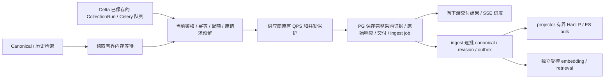

# Hub 数据 API 与后台处理削峰

同一块设备承载 PG、ES、容器和 etcd 时，提高连接数或并行写入会继续争用设备。此次优化尽快交付上游结果，把派生处理留在现有持久队列，并控制重查询和后台执行量。历史 NVMe 超时与 etcd fsync 长尾见 [控制面调查](admin-freeze-controller-2026-10-19.md)；软件回归不能证明磁盘故障已经修复。

## 数据路径

读取入口等待期间不读取或解析正文，不持有 PG 连接、客户资金预留或供应商名额。实时转发默认直接进入已有鉴权/幂等/缓存流程，只有需要新增采购时才进入原供应商调度，不为等待上游 I/O 再占用一个 Hub 总闸门。执行开始后仍完整检查当前身份和授权；等待不能延长原业务预留期限、放宽采购预算或跳过 unknown 保护。已采购的数据继续使用原事务和持久队列保存，不把原始响应替换成仅内存保存。

## 默认预算

| 层 | 默认行为 |
| --- | --- |
| 数据读取 | 每进程最多 8 个执行（2026-10-22 起；Public 为 4 个进程，合计 32，见 [Public 多进程](public-api-processes-2026-10-22.md)），覆盖 canonical、stored、相关列表/时间线、Admin 数据浏览/导出/高级搜索 |
| 实时采集与聚合 | 默认 `acquisitionConcurrency=0`，关闭额外的整请求采集并发闸门；供应商内部调度、PG pool 与业务保护继续生效 |
| 读取入口等待 | 最多 512 个等待、最多 30 秒；满队/超时返回 `503 hub_data_busy` 和 `Retry-After: 1` |
| 供应商内部并发等待 | 未显式配置时由 32 个/10 秒放宽为 256 个/30 秒；实际仍受原预留期限减去完整上游超时和 5 秒保存余量限制 |
| 请求体 | 入场后的 JSON 读取最多 10 秒，原有字节上限保留；未完成的慢请求体关闭连接并释放执行槽 |
| Hub 自有 PG pool | 保留原最大连接数，默认等待上限 512、checkout 5 秒；PG 服务端每语句 30 秒、锁等待 5 秒，显式选项与事务局部设置优先 |
| 实时 ingest | 2026-10-21 起默认 2 个任务并行，每批后至少停本批耗时（上限 60 秒）；未处理任务留在原 PG 队列，见 [下游链路与后台跟进](delivery-path-throughput-2026-10-21.md) |
| 全文 projector | 有积压时每批完成后间隔 250 毫秒；2026-10-21 起整批预分词、积压时批量最多升到 400 |
| 查询分词 | 搜索、tokenize、高级搜索的 HanLP 查询合并成批并缓存验证结果；可降级查询最多等 2 秒后退 jieba，见 [HanLP 查询分词并发](hanlp-query-concurrency-2026-10-20.md) |
| 外部持续同步 | 继续现有单 worker 与每源续页间隔；TG、Night-All-A、省份舆情不会因此永久暂停；积压时页间隔随上一页耗时自动拉长，见 [外部库拉取入库压力](external-pull-ingest-pressure-2026-10-20.md) |

配置由 `.env.example` 中 `MX_INSIGHT_DATA_API_*`、`MX_INSIGHT_INGEST_WORKER_*`、`MX_INSIGHT_PROJECTOR_WORKER_DELAY_MS` 控制，标准 K8s 发布和 Compose 均已接线。读取并发允许 1–32；采集并发允许 0–32，0 表示无额外整请求上限，正数为操作者显式选择的上限。入口等待数 1–4096、等待时间 1–30000 毫秒；ingest 并发 1–4（默认 2），批间隔 0–60000 毫秒（默认 0，另按批耗时自适应）。多 Pod 会累加进程预算；不要把单进程数值当作数据库或供应商的集群总限额。

若部署文件已经显式设置 `MX_INSIGHT_DATA_API_ACQUISITION_CONCURRENCY=8`，需要将其改为 `0` 才关闭该显式上限。既有环境中的 TikHub 等待参数、数据库已保存的供应商策略继续优先，不被代码默认值或迁移静默覆盖；要同步扩大它们，应通过原 Admin 审计设置或显式部署配置。此次不提高采购并发/RPM 数值，不把 Hub 原先的观察性节流宣称为上游真实额度，也不修改上游 429、客户授权/余额或 unknown 保护。

登录、SSO、支付、health 和原请求/交付回执查询不进入数据执行通道。现有数据库连接仍共享，故数据通道隔离不构成磁盘完全不可用时的登录 SLA。MX-H2I、Launcher、网络、DNS、WireGuard 和 mx-common/Pay 服务配置均无变更。

## 依赖拒绝与事务清理

ES bulk 单项 429 代表容量拒绝：成功项先正常确认，429 对应 outbox 项释放回 pending、回退本次领取次数，并使用循环退避；合并的同记录事件和删除也保留。HTTP 429 整批释放后退避。非法 mapping/正文等永久错误继续使用既有失败预算，避免坏数据永久堵住队列。[Elastic 官方建议](https://www.elastic.co/docs/deploy-manage/production-guidance/optimize-performance/indexing-speed)

向量 bulk 保留明确 429 的原因状态，使已有 retrieval resource guard 进入依赖退避；429 与 500/503 混合时保留非 429 的错误语义。没有新增模型/供应商自动重购或改写已派发任务。

在入库、原子入队和搜索交付热链路，ROLLBACK 自身失败会丢弃连接，不能将失败事务放回池中。原业务异常保留；COMMIT 回执不确定仍保持原 unknown 与原 key 核查规则。SQL/锁超时由服务器执行，未使用可能留下后台写入的客户端 Promise.race。[PG 超时说明](https://www.postgresql.org/docs/16/runtime-config-client.html)、[node-postgres pool](https://node-postgres.com/features/pooling)

## 接收和重试边界

512 是读取入口的内存等待容量，不是已经持久接收 512 个业务任务的承诺，也不是每秒吞吐量。长检索或持续超额会收到明确繁忙响应；客户端不得据此为原来的 unknown 请求更换 key 或盲目重购。`currentAttemptStarted=false` 仅说明本次 HTTP 尝试没进入业务处理，不能推断相同 key 的旧请求状态。

需要跨重启等待数分钟的工作由 Delta 已保存的 Run/Celery 任务及 Hub 已提交的 ingest/outbox 任务承载。此次保留原同步 API 契约，没有把旧 POST 静默改为 202 或给出虚假的成功接收回执。每条已取得数据的采购证据和正文仍需成功持久化；在 PG/磁盘不可写时无法同时保证立即确认和数据不丢。

## 观测与发布

`GET /internal/v1/admin/data-pressure` 使用既有 source-admin 授权，只返回本进程读取/采集 active、pending、最老等待、高水位、准入/完成/拒绝/超时/取消计数，以及两个 Hub 自有 pool 的连接压力。没有搜索词、原始正文、凭据、SQL或调用者标识；读取快照不新增数据库查询。多实例应逐 Pod 采样，并同窗核对队列年龄、每源进度、PG WAL/慢阶段、设备等待和 etcd fsync/Lease 进度。

不创建 DDL、不扩大 PG max_connections、不关闭 fsync/synchronous_commit、不迁移或重启共享存储。仍按操作者的 Hub 标准流程发布，保留 `MX_INSIGHT_SYNC_LAUNCHER=0 MX_SMOKE_DATA=0`；磁盘和控制面异常时不绕过既有发布冻结/恢复检查。此次工作没有执行生产发布、付费探测、历史恢复或授权调整。

本地完成两组定向回归：243 项中 239 通过/4 跳过；202 项中 200 通过/2 跳过。随后在独立 Unix socket 的临时原生 PostgreSQL 18.4 上运行 11 项，全部通过，补齐前两组的 5 个原生 PG 条件项：300 条实际写入完整、连接数保持 2、服务器端取消不留迟到写入、锁等待及 reaper/结算多会话竞争。其余仍跳过的一项为需要专用配置的真实 HTTPS OIDC/SSO 集成；普通 SSO 路由、身份和隔离测试通过。原生测试实例已经停止。

去掉重复运行项后，共 445 项覆盖，444 通过、1 跳过、0 失败。另有 manage shell 171 项、类型检查、shell 语法及差异格式检查通过。测试使用合成业务数据、离线供应商 fixture 与隔离数据库；未调用生产供应商。模拟 300 个重叠 HTTP 请求只能证明有界执行/出入队和取消行为，不能据此承诺生产 100 QPS 持续吞吐或 NVMe 故障下的可用性。

## Delta 策略扇出结论与本轮范围

已只读检查 `/Users/qpjoy/workspace/mingxi/po-infra`：`data_hub/api.py` 的 `_enqueue_internal_cold_start_runs` 会按平台和关键词集中创建 `CollectionRun` 并立即入 Celery；`scripts/run_worker.sh` 的 data 角色默认并发 8、prefetch 1。冷启动调用使用 `single_page=True`，当前页完成后重新入队下一页。因此创建 300 个 Run 不等于同时发出 300 个 HTTP。多 worker/其他调用方的合计负载仍由 Hub 入口及既有供应商门禁控制。

用户后续明确允许在影响不大时不改 Delta。本轮保留其现有队列/调度/重试；临时研究的 Redis 派发限速方案未应用。贴吧截图的 `403 platform_not_granted` 是当前 Key 缺平台授权，不能当作数据库过载或通过重试修复；本轮没有扩大授权、重购或修改失败历史。

## 可用性优先的后续调整

用户进一步要求尽量减少 Hub 自有转发限制，并保障已有数据仍可取得。因此取消上一版默认 8 个采集整请求槽，避免慢上游占满后连回放/缓存也先被入口拒绝。既有网关在供应商并发、RPM 和熔断之前处理精确幂等回放及合法缓存；本次保留这条顺序，没有在 HTTP 入口猜测请求语义、预读账本或重复结算。

新的请求使用缓存仍遵守原客户计费合同；同 key 的精确回放不新增采购或客户结算。`live_only` 继续只交付实时结果，不将旧数据伪装成实时。历史交付读取保持原所有权和授权检查，后台入库/ES 故障不应成为查询旧回执的新依赖。

后续定向回归 347 项，346 通过、1 项因未提供原生 PG 专用配置跳过，0 失败；类型检查、manage shell 171 项、shell 语法及差异格式检查通过。覆盖 40 个慢转发期间入口回放/缓存/历史查询不被额外总闸门挡住，以及真实网关 40 个排队请求等待 11 秒后各派发一次、原 lease 不延长、并发及等待队列满时 fresh/stale cache 与精确回放可用。真实上游 429、管理员已保存策略和付费幂等保护继续保留。尚未部署。

## 转发与长连接的交付延迟复核

继续按“转发尽快交付，取得数据后排队处理”的要求复核。采集整请求并发默认仍为 0，没有增加转发 QPS 总闸门。canonical、HanLP、ES 和向量派生继续走已提交的 ingest/outbox 链路；返回成功前仍需保存完整原始证据、采购和客户结算、交付及 ingest job。现有队列包含 parser/lineage 等信息，不能删成只有 call ID 的内存任务，也没有把旧同步接口改成 202。

此次减少了交付热路径中的数据库往返与竞争：

- 原始归档由逐条 INSERT 改为同事务参数化批量 INSERT，普通 50 条结果从 50 次变成 1 次。每批最多 1000 条或约 1 MiB UTF-8 参数估算；单个大对象仍整条保存，正文、顺序、JSON null、哈希、去重和事务回滚语义保留。
- 请求触发的过期维护按 pool 和方法共享同一次执行，成功后 1 秒内复用“已经维护”的事实，不缓存授权、配额或请求状态；失败不缓存，显式管理维护仍直接执行。供应商补偿维护每次最多 100 条，使用 `SKIP LOCKED`，不等结算正在持有的 call 行，不覆盖成功结果。
- 通用网关在派发工作结束后先释放本地供应商执行槽，再做可选清理。清理只使用已有空闲 PG 连接、不加入忙池队列；成本锁使用 advisory try-lock，租约行使用 `SKIP LOCKED`，事务内设置 100 毫秒锁超时和每条 SQL 500 毫秒超时。它们不是 HTTP 总耗时的硬上限，COMMIT/fsync 和故障设备仍可能等待。
- 忙时跳过清理不会重新采购或释放未知账目。成本 reservation 的物理状态可能暂时保留，但现有预算查询只计入当前仍 reserved 且 lease 有效的 usage。已明确 committed/released 的旧租约允许同租户、调用者、平台和指纹的新 reserved 请求原子接管；旧 owner 有 pending/unknown、证据缺失或范围不符时仍阻止。竞争者只能有一个成功，旧 owner 的迟到清理不能删除新 owner。
- Facebook 已完成的配额观察不在 finally 再写一次；观察失败仍保持原保守状态。Night-All 非 JSON 错误响应取消未消费的 body，避免占住 HTTP 连接池；取消故障不改原始结果、不触发付费重试。

聚合 SSE 保留原鉴权与持久预留后的开流顺序、及时 flush 和 10 秒心跳，不等待后续 canonical/ES 处理才开流。心跳也检查已有慢读缓冲上限，防止断开或极慢下游无限积压内存；正常的大结果不新增单事件字节限制。下游断开后仍按原规则完成已经派发的付费调用结算。普通 JSON 接口继续交付完整 JSON。

本轮 27 文件定向回归 457 项，446 通过、11 项因可选配置跳过；随后在隔离原生 PostgreSQL 上运行维护/清理/多会话组合 27 项全部通过，补齐其中 10 项，并单独开启 PGlite 完整采购→归档→worker/outbox 用例补齐剩余 1 项。另有 Facebook 观察定向 2 项通过。去重后本轮 459 项均已通过，类型检查及差异格式检查通过。原生临时实例在验证后停止，未接触生产或付费上游。

扩展检查发现的旧 fixture 失败已用原代码复现：Night-All 限流文件中 5 项仍把已切换的 TikTok 搜索送往 Night-All；Telegram capability 的一项断言未包含现有 semanticSearch；Facebook 两项旧 unknown 断言对现有 v2 admission 的错误码预期不同。未把这些旧失败计入上述定向通过数，也未借此次优化改动其产品语义。此次仍未部署，Delta、MX-H2I 登录/联网及共享服务配置保持原状。

## 后续：供应商热点行与数据库分道

复核突发场景后发现主要瓶颈是每供应商热点行（`provider_state`、令牌桶）持锁到落盘，以及连接池 FIFO 让新请求挤占已派发请求的结算。处理见 [突发写入：供应商热点行与数据库分道](burst-hot-rows-db-lanes-2026-10-19.md)。
