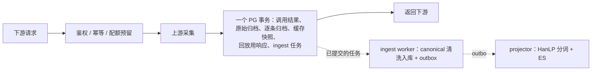

# 下游调用链路与后台跟进能力（100 QPS 复核）

2026-10-21。起因：并发量上来后网页打开仍然卡；需要确认下游调用 Hub 时，是否要等原始数据、清洗后数据和 ES 都写完才返回，以及后台处理能否跟上 100 QPS。

## 结论

- **现在的链路不是「存原始 PG → 存清洗 PG → 存 ES → 返回」。** 实际是：鉴权、幂等、配额预留 → 上游采集 → 一个 PG 事务保存原始证据、交付记录和一条 ingest 任务 → 返回下游。清洗（canonical）和 ES 都在返回之后，由 ingest worker 和 projector 处理。如果改成「存完清洗数据再返回」，请求路径反而多一步。
- **网页卡顿的一个主要来源在结算事务里，本轮已修。** 付费结算（`finishProviderStep`）写入前、写入后各读一次自己的 ingest 任务。这条查询用的是 `IS NOT DISTINCT FROM`，走不了索引；唯一的去重索引又只覆盖 pending/running，于是每次结算都要对 `mxq.jobs` 做两次全表扫描。done 行从不清理（服务器上约 174 万行），而且一直在增长。扫描发生在结算事务内、持有调用行锁期间，并发越高越慢，同库的其他页面也一起被拖慢。
- **后台原来跟不上。** ingest 每次只处理 1 个任务，处理完固定停 100 ms，本机实测约 7 个任务/秒，其中 88% 的时间在等待。projector 对每条记录的 5 个字段依次单独调用 HanLP，每条记录 5 次往返，估计每秒只能处理 5–10 条。
- **本轮不新增环境变量、不加部署步骤、不做数据库迁移，**随 Hub 正常 `deploy` 生效。索引由 deploy 已有的在线索引步骤创建。改了两个默认值：ingest 并发 1 → 2，固定停顿 100 ms → 0（改为按耗时自适应停顿）。

## 请求路径



返回前必须落盘的只有采购证据、原始响应、交付记录和 ingest 任务：已经付费拿到的数据不能只放在内存里。canonical、HanLP、ES 和向量化都不在返回路径上。

## 改动

| 位置 | 改前 | 改后 |
| --- | --- | --- |
| 结算读 ingest 任务（`external-platforms/store.mjs`） | `dedupe_key IS NOT DISTINCT FROM $2`，每次全表扫描 | 键非空时用 `dedupe_key = $2`，结果完全相同，可以走索引 |
| 索引 `mxq.jobs_dedupe_lookup_idx (queue, dedupe_key, created_at) WHERE dedupe_key IS NOT NULL` | 无 | deploy 的 `acquisition-history-indexes.sql` 用 `CONCURRENTLY` 在线创建，不阻塞写入。建不成（锁等待超时、表属主不符）只告警，deploy 继续，查询退回原计划，下次 deploy 再建 |
| ingest 并发 | 1 | 2（`MX_INSIGHT_INGEST_WORKER_CONCURRENCY`，范围不变 1–4） |
| ingest 停顿 | 每批后固定 100 ms | 每批后至少停「本批耗时」那么久（上限 60 秒，内置）。库快就快排空，库慢就自动放慢。`MX_INSIGHT_INGEST_WORKER_DELAY_MS` 仍可设，作为最小停顿，默认 0 |
| 并发 ingest 的锁顺序 | 只有小红书、微博按排序加身份锁 | 所有排队的 API 结果在第一次行锁前，按排序一次性加身份 advisory 锁。重叠的搜索结果（同一批帖子不同顺序）会串行执行，不会死锁 |
| projector 分词 | 每条记录 5 个字段依次单独请求 HanLP | 先把整批的文本去重，按 16 条一批、2 个请求并行发给 HanLP；名字类短文本跨批缓存 30 分钟。建文档时仍走严格 HanLP 校验，预取没拿到的字段照旧重试 |
| projector 批大小 | 固定 50 | 每批都满时翻倍，最多 400；不满立即回到 50。claim、读记录、清理旧副本、bulk、确认、批间停顿这些固定开销，按几百条摊一次 |

不变的部分：HanLP 严格校验、退避与隔离规则；ES 按版本写入的幂等性；结算的证据核对逻辑（读出的行与原来完全相同）；同步 API 契约；MX-H2I 登录、联网，以及 Launcher、Pay 配置。

## 本机实测（PG 17、笔记本 SSD，不代表服务器）

ingest，端到端：真实队列、worker 循环和 `ingestExternalRecords`；每个任务 20 条，结果互相重叠且顺序相反：

| 配置 | 吞吐 | 死锁 |
| --- | --- | --- |
| 改前：1 个任务一次，固定 100 ms | 7 个任务/秒 | 0 |
| 1 个一次，按耗时停顿 | 22 个任务/秒 | 0 |
| **2 个一次，按耗时停顿（新默认）** | **44 个任务/秒** | 0 |
| 4 个一次，按耗时停顿 | 53 个任务/秒 | 0 |
| 对照：4 个一次，不加排序锁 | 1 个任务/秒 | 120 个中 30 个 |

不加排序锁时，并发 ingest 会在重叠结果上大量死锁，这说明原来把并发调高本身就有风险。选 2 作为默认值：多数收益都拿到了，而在磁盘故障、单任务变慢到秒级时，平均同时只有约 1 个写入事务，和改前一样。

结算查询：`mxq.jobs` 30 万行时，全表扫描约 22 ms/次；建索引后为 0.17 ms/次（Index Scan Backward）。在线建索引耗时 1.2 秒。服务器约 174 万行，盘也更慢，改前每次结算的扫描成本按比例更高。

projector：单元测试中 6 条记录一批，原来要 30 次分词往返，现在只需 1 次批量请求；下一批同样的作者名、标题不再请求 HanLP。按每次请求 25 ms 固定开销 + 每条 2 ms 估算，400 条一批约从 54 秒降到 1.5 秒。这只是估计，实际取决于 HanLP 推理池；HanLP 推理池为 5 个 worker，其中 1 个留给查询。

## 能否跟上 100 QPS

- **返回路径：** 不等清洗和 ES。结算不再全表扫描，并发高时不会再越跑越慢。
- **清洗（canonical）：** 本机约 44 个任务/秒（每个任务约 20 条）。服务器的盘更慢，应以实测为准。100 个新采集请求/秒持续不停时，仍会积压在持久队列里，不会丢，峰值过后自动追上。
- **ES：** 瓶颈从「每字段一次往返」变成 HanLP 的批量吞吐。

部署后在服务器上只读观察积压（都走部分索引，不扫全表）：

```bash
kubectl -n mx-common exec -i statefulset/mx-common-postgres -- psql -X -U mx_common -d mx_insight_hub -c "SELECT queue, status, count(*), min(created_at) AS oldest FROM mxq.jobs WHERE status IN ('pending','running') GROUP BY 1, 2"
```

```bash
kubectl -n mx-common exec -i statefulset/mx-common-postgres -- psql -X -U mx_common -d mx_insight_hub -c "SELECT status, count(*), min(created_at) AS oldest FROM outbox.projection_events WHERE status IN ('pending','claimed') GROUP BY 1"
```

`oldest` 在高峰后持续回落，说明后台追得上；只增不减，说明这一层仍是瓶颈。projector 日志里每行 `claimed=` 的数字，在积压时会逐步升到 400。

## 仍然存在的上限（本轮没改）

1. **同步事务里原始数据存了多份**：`response_archives`、`archive_objects`、缓存快照、回放用的 `usage_requests.response_body`，ingest 任务里还有一份 records。ingest 入库时又写了 `source_objects` 和 revisions。这是请求路径上最大的写放大，但涉及计费、回放和证据契约，需要逐个 provider 核对后再改。
2. **`mxq.jobs` 的 done 行从不清理**：有了索引，查询不再变慢，但表和 TOAST 还在增长、占盘。清理需要先定保留期，并确认没有依赖旧任务的核对流程。
3. **读取执行槽每进程 4 个**：canonical/stored 搜索、tokenize 都走这条通道。
4. **ES `refresh_interval` 仍是 1 秒**：写入量大时可以在可见性允许的范围内调到 5–10 秒，需要先看 ES 的 merge/refresh 是否真的占满磁盘。

## 回退

- 要恢复原来的 ingest 节奏，部署时设 `MX_INSIGHT_INGEST_WORKER_CONCURRENCY=1 MX_INSIGHT_INGEST_WORKER_DELAY_MS=100`；按耗时停顿仍会叠加，只会更慢，不会更快。
- 索引可以保留；要删除时执行 `DROP INDEX CONCURRENTLY mxq.jobs_dedupe_lookup_idx`，查询会退回全表扫描。
- 回退代码即可恢复其余行为，没有数据需要清理。
