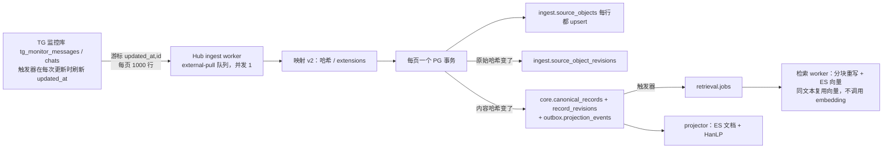

# 外部库拉取（TG 监控）入库压力与节流

2026-10-20。起因：TG 监控面板上「变更」几乎等于「读取」，需要确认 Hub 清洗是否会造成磁盘拥堵。

## 结论

- **平时流量很小。** 面板上 TG 大约每 6 分钟一轮：消息读取 128–185 条，其中 58–94 条是删除；会话 9–14 个。折合约 0.4 行/秒，对磁盘的压力可以忽略。
- **真正的问题是写放大。** 被重新读到的每一行都被当成一次「变更」，于是走完整条写链：PG 多张表、ES 重建索引、HanLP、检索分块。
- **风险集中在补数。** 典型情况是监控停了又恢复、映射版本变化，或水位被重置。以前遇到这种情况，会按 1000 行一页、页间只停 1 秒连续读，和 API 抢同一块盘。
- **这轮改了两处，都不需要新增 `.env` 配置，也没有数据库迁移：**
  1. 同步水位 `updated_at` 不再算作内容变化，只有「碰了一下」的行不再生成新版本。
  2. 积压时页间隔自动按上一页的耗时拉长：盘慢，Hub 就自动慢。

## 数据流



## 每行的写入量

| 条件 | 写入 |
| --- | --- |
| 每读到一行 | `source_objects` 一次 UPDATE（`raw_payload`、`last_seen_at`） |
| 原始哈希变化 | `source_object_revisions` 一行（保留原始内容，供 Agent 追溯） |
| 内容哈希变化 | `canonical_records` 整行更新、`record_revisions` 一行、`projection_events` 一行、`retrieval.jobs` 一行；随后 ES 文档重建、HanLP 分词、检索分块重写和 ES 向量文档更新 |

## 为什么「变更」≈「读取」

- **水位字段进了哈希。** TG 消息映射 v2 没有消费游标列 `updated_at`，它落进 `extensions`，`extensions` 参与内容哈希；原始哈希也包含它。而监控库的触发器 `telegram_monitor_touch_updated_at` 会在每次更新时刷新 `updated_at`，所以每重读一次都算变化。
- **浏览数、转发数仍参与哈希。** `metrics`（`view_count`、`forward_count`）通过 `stableFields` 计入内容哈希。这是有意的：ES 里的热度需要保持新鲜。这类变化是真实的。
- **「删除」是真实变化。** 来源行的 `deleted_at` 被置上（消息被删、退群等），映射为 `deletedAt`，ES 文档随之移除。

## 改动

### 1. 同步水位不算内容

`DatabaseSourcePuller` 把游标列作为 `bookkeepingColumns` 传给 `applyMapping`（见 `server/ingest/external/mapping.mjs`）：

- 游标列一律不参与原始哈希，不论映射是否用到它。会话映射把它当 `collectedAt`，而 `collectedAt` 本来就不计入内容哈希。
- 映射没用到游标列时，它不再进入 `extensions`。
- `rawItem` 和原始库表仍保留它，追溯不受影响。
- 如果某个映射把游标列当成真正的内容字段，内容哈希仍会照常变化。
- 正文、删除、浏览数、转发数的变化照常生成新版本。

已有记录不会被批量重写。上线后，每条 TG 记录下次被触碰时最多再生成一次版本（`extensions` 去掉了 `updated_at`），这部分工作量摊在平时流入里。现存 `extensions.updated_at` 没有任何读取方。

### 2. 积压时按页耗时自适应退让

`runExternalPullJob` 决定下一页的间隔：

```
下一页间隔 = max(固定页间隔, min(60 秒, 上一页耗时 × 1))
```

- 固定页间隔沿用原来的值：TG 1 秒，Night-All-A 1 秒，省份 2 秒。
- 倍数 1 和上限 60 秒是内置值，不是部署配置。
- 例：盘忙时一页用了 8 秒，下一页就等 8 秒，worker 在磁盘上的占空比不超过约 50%。盘恢复后自动回到固定间隔。
- 间隔被拉长时会打日志：`[external] <source> page took Nms; next page in Nms`。
- 原有限流全部保留：
  - external-pull 单并发，每批之后等 `MX_INSIGHT_EXTERNAL_PULL_WORKER_DELAY_MS`（默认 1 秒）；
  - 每页 1000 行、一页一个事务；
  - 每 60 秒轮询来源；
  - projector 批间 250 ms，派生写入 `synchronous_commit=off`；
  - API 请求在连接池里优先（见 [数据库分道](burst-hot-rows-db-lanes-2026-10-19.md)）。

## 测量

只读脚本，可在上线前后各跑一次对比：

```bash
psql -X "$DATABASE_URL" -v ON_ERROR_STOP=1 < scripts/external-pull-churn-measure.sql
```

| 段 | 看什么 |
| --- | --- |
| 2 | 每个来源每小时的读取行数与入库行数、单轮耗时 |
| 3 | 24 小时内生成的内容版本数、`revisions_per_record` |
| 4 | 相邻两个版本之间哪些原始列变了：只有 `updated_at` 的就是这轮消除的空转；`view_count`、`forward_count` 是热度变化；`deleted_at` 是删除 |
| 5 | `projection_events`、`retrieval.jobs` 待处理积压 |

## 未做（需要产品决定）

- **热度变化走轻量路径。** 浏览数、转发数变化时只更新 canonical 列和 ES 的部分字段，不写 `record_revisions`，也不重建检索分块。如果第 4 段显示上线后的变更主要是 `view_count`，这一步收益最大，但会改变「每个版本都可追溯」的语义。
- **未变化的行跳过 `source_objects` 更新。** 现在每读一行都 UPDATE 一次，用来记录 `last_seen_at` 和最近一次运行。按目前的流量成本很低，暂不动。

## 回滚

只改了代码：不新增 `.env`，不做迁移，也不改数据库配置。回退代码即可恢复原行为；回退后，每条被触碰的记录会再多生成一次版本。

## 验证

- `tests/server/source-watermark-hash.test.mjs` 4 项通过：只碰水位不生成版本；正文、删除、热度变化照常生成；未开启时行为不变；被消费、被 `_drop` 的水位不进原始哈希；用作内容的水位仍会生成版本。
- `tests/server/external-pull-pacing.test.mjs` 10 项通过。
- 外部入库相关 22 个测试文件中，新增失败只有 `raw-search-routing` 的 4 项 Twitter `Top`/`Latest` 断言，来自另一处进行中的 Twitter 默认分类改动，与本次无关。
- `scripts/external-pull-churn-measure.sql` 已在一次性 PG 18.4（迁移到 164）上用 TG 样例数据核对各段输出。
