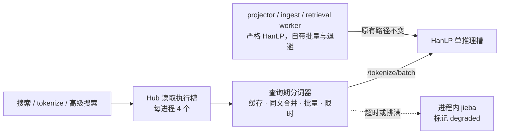

# HanLP 查询分词并发（100 QPS 复核）

2026-10-20。起因：需要确认 Hub 在 100 QPS 下 HanLP 分词是否成为卡点，以及数据清洗/存储是否会卡住用户请求。

## 结论

- **会成为瓶颈，卡在请求路径上的查询分词，不在入库。** 原来每个搜索/分词请求单独向 HanLP 发一次 `/tokenize`。HanLP 服务只有 1 个推理槽（`MAX_CONCURRENT_INFERENCES=1`，模型对象未验证线程安全），每次推理都要付 HTTP、Python 调度和模型交接的固定开销。100 QPS 时这个固定开销本身就超过 1 秒/秒，队列只增不减。
- **排队会连锁放大。** 查询在等 HanLP 时仍占着 Hub 的「读取」执行槽（每进程 4 个）。默认超时 5 秒后才退 jieba，所以 HanLP 一慢，4 个槽很快被占满，后续 canonical/stored 搜索和 tokenize 收到 `503 hub_data_busy`。客户端超时后，HanLP 服务端仍会处理那条已被放弃的请求，进一步挤占推理槽。
- **数据清洗和存储不会卡住用户。** 同步路径只做必须落盘的事：采购证据、原始响应、交付和 ingest job 在同一个 PG 事务里保存。canonical 清洗、HanLP、ES 投影和向量化都由已提交的 ingest/outbox 队列交给独立 worker（projector、ingest、retrieval）异步完成，失败只会退避重试，不回到 API。见[数据 API 削峰](data-pressure-reservoir-2026-10-19.md)。
- **这轮只改了查询期分词，不新增 `.env`、不改部署步骤、不迁移数据库。** 随 Hub 正常 `deploy` 生效。HanLP 服务本身、projector 等写入端、MX-H2I 登录与联网都没有改动。

## 调用链

## 改动

新增 `interactiveSegmenter`（`mx-common/src/segmenter/index.mjs`），只用于有人在等结果的查询路径：

| 机制 | 行为 |
| --- | --- |
| 连续批量 | 空闲时立即单条发送，不加延迟；已有请求在途时，新到的查询并入下一批。负载越高，一次推理处理的查询越多 |
| 在途上限 | 每进程最多 2 批在途：一批在推理，一批在服务端排队，推理槽不空转 |
| 批量上限 | 每批最多 32 条或约 16k 字符，保证单次推理短，排在后面的请求等待也短 |
| 同文合并 | 同一时刻相同的文本共享一个名额 |
| 结果缓存 | 只缓存 HanLP 验证过的结果；每进程 5000 条、单条 ≤256 字符、10 分钟过期。降级结果不缓存 |
| 等待上限 | 可降级的调用（普通搜索、tokenize）最多等 2 秒，然后按原有语义退 jieba，`degraded=true`、`errorCode=hanlp_busy` |
| 严格调用 | 高级搜索不接受替代分词，最多等 `MX_COMMON_HANLP_TIMEOUT_MS`（默认 5 秒），然后按原逻辑报错，不返回 jieba 词项 |
| 丢弃过期工作 | 所有等待者都已放弃、且尚未发出的文本直接丢弃，不再送进 HanLP；已经发出的批次继续完成并写入缓存 |
| 排队上限 | 未发出的文本最多 1024 条；超出后立即降级，不再占着读取槽空等 |

接入范围：

- `SearchQueries`：canonical/stored/Telegram 内容搜索、作者与会话查找、语义检索的查询分词
- `POST /api/v1/tools/tokenize`
- 高级搜索的 HanLP 词项（仍经 `requireSegmenterBackend` 严格校验）
- 不接入：projector、ingest、retrieval、embedding、全量重建、启动校验。它们继续使用原分词器，保留严格 HanLP、批量、重试和隔离规则；写入端不能因为慢而被丢弃。

行为变化：可降级查询在 HanLP 持续繁忙时，从「最多等 5 秒再降级」变为「最多等 2 秒再降级」。降级后的搜索语义不变：仍报告 `backendUsed`/`degraded`/`errorCode`，balanced 策略照旧切到 phrase，降级词项不会查询 HanLP 字段。

## 观测

`GET /internal/v1/admin/data-pressure` 新增 `tokenizer` 字段，只包含本进程计数，不含查询文本：`pending`、`inFlight`、`cacheSize`、`requests`、`cacheHits`、`joined`、`batches`、`batchedTexts`、`verified`、`failed`、`shed`、`waitExpired`、`dropped`。

- `batchedTexts / batches` 是平均批量。数值高说明合并在起作用。
- `waitExpired`、`shed` 持续增长，说明 HanLP 推理能力不足，或被写入端长时间占用。
- 该接口在 Admin 进程上，只反映 Admin 的查询；Public 进程的计数需要在 Public Pod 内取。

## 验证

- mx-common 全部测试 136 项通过，1 项跳过；新增 11 项覆盖合并、缓存过期、等待上限、丢弃、排满、错误码透传、批量字符上限和严格调用。
- Hub 新增 3 项：只有查询路径使用新分词器；单推理槽模拟下 200 条突发查询全部得到 HanLP 结果；高级搜索仍严格要求 HanLP。
- Hub 类型检查、`tests/manage-script.test.sh` 通过。Hub 全量服务端测试中的失败项，在未修改的 HEAD 上同样失败，与本次改动无关（Twitter、小红书、计费、目录等既有 fixture）。
- 模拟：单推理槽、每次推理 25 ms 固定开销 + 每条 1 ms，100 QPS 持续 5 秒（500 条）：

| 场景 | 降级 | p50 | p99 | 推理次数 |
| --- | --- | --- | --- | --- |
| 原：每条查询一次请求 | 188/500 | 4004 ms | 5003 ms | 393 |
| 新：查询期分词器 | 0/500 | 74 ms | 89 ms | 200 |
| 原 + projector 持续占用 | 197/500 | 4131 ms | 5004 ms | 418 |
| 新 + projector 持续占用 | 0/500 | 111 ms | 147 ms | 201 |

25 ms 是估计值，生产 HanLP 的真实单次开销尚未测量；可在服务器上运行只读巡检 `bash scripts/inspect-retrieval-capacity.sh --probe-hanlp`，它在 Admin Pod 内发 3 个合成批量（1/8/16 条），报告实际延迟。模拟能证明排队行为，不能替代生产压测。

## 仍然存在的上限

1. **HanLP 单推理槽。** 查询已合并成批，100 QPS 不再是问题；但全量重建这类长批次运行时，查询仍要排在它后面，可能等满 2 秒后降级。代码已在[第二轮](#第二轮hanlp-推理池与查询优先通道)解决（多进程推理池 + 查询优先通道），但 HanLP 镜像不随 Hub `deploy` 重建，**执行 `deploy hanlp` 之前线上仍是单槽**。
2. **读取执行槽每进程 4 个。** canonical/stored 搜索和 tokenize 都在这条通道里，100 QPS 要求单次请求平均占槽不超过 40 ms（PG 鉴权/用量 + ES + 分词）。分词已不再是主要占用；若实测仍出现 `hub_data_busy`，可调现有的 `MX_INSIGHT_DATA_API_READ_CONCURRENCY`（1–32），但会增加 PG/ES 并发，应结合磁盘压力一起看。

## 回退

回退本次代码即可恢复原行为，无数据或配置需要清理。

## 第二轮：HanLP 推理池与查询优先通道

上面第 1 条上限的根本修复。代码已完成，**尚未部署**。只改 HanLP 服务（`mx-common/deploy/hanlp/server.py`、`mx-common/deploy/k8s/optional/50-hanlp.yaml`），以及查询期分词器多发的一个请求头。不新增 env，不改 Hub `deploy`。Dockerfile 不用改：`server.py` 在模型层之后复制，重建只需几秒。

| 机制 | 行为 |
| --- | --- |
| 多进程推理池 | 同一个 Pod 内 N 个 worker 进程，各自加载一份模型，模型对象从不跨线程共享。HTTP 前端进程不加载 PyTorch |
| 自动定池 | 读容器 cgroup 的 CPU 配额和内存上限：每个 worker 按 1.5 GiB 预算，前端预留 512 MiB，worker 数不超过 CPU 数。OMP/MKL/Torch 线程按 CPU 均分，在 worker 加载 PyTorch 之前设定。读不到限额时退回原来的单槽 |
| 当前规格 | 16 CPU / 8Gi → **5 个 worker × 3 线程**，其中 1 个留给查询。要加 worker，就调高内存上限 |
| 查询优先 | 带 `x-mx-segment-priority: interactive` 的请求先于排队中的写入请求放行，可以用任意空闲 worker。写入请求最多同时占 N−1 个 worker，长批次再多也占不到留给查询的那 1 个。没有这个头的请求一律按写入处理：旧客户端、projector、ingest、retrieval、全量重建 |
| 断开即跳过 | 请求排队期间客户端已断开（Hub 超时放弃）的，轮到它时直接丢弃，不做推理 |
| 故障隔离 | 单个 worker 崩溃时，只有当次请求得到 500，后台会补起一个新 worker，其余照常服务。补起失败时 `/health` 转 503，由 liveness 重启 Pod |
| 接口不变 | `/tokenize`、`/tokenize/batch`、`MAX_BATCH_TEXTS`、`MAX_BODY_BYTES`、排队超时返回 429，均不变。`/health` 仍然要等全部 worker 预热完成才返回 200，返回体多了 `pool` 字段：worker 数、线程数、排队数、断开跳过数、补起次数 |

客户端：`HanlpSegmenter.segmentBatchWithMeta` 新增 `priority` 选项，只有 `interactiveSegmenter` 传 `'interactive'`。写入端调用和严格 HanLP 语义都不变。旧 HanLP 镜像会忽略这个头，所以 Hub 和 HanLP 哪个先部署都可以。

代价：纯写入负载时（例如没有查询的夜间重建）始终有 1 个 worker 空着，写入并行上限是 N−1（现为 4，原来是 1）。查询持续排队时写入要让路；不过查询端每进程最多 2 批在途，不会长期饿死写入。

### 部署与验证（需用户批准后执行）

1. `PROXY=127.0.0.1:7788 bash electron-dock/mx-common/scripts/manage.sh deploy hanlp`。`PROXY` 只作用于镜像构建；节点直连 Docker Hub 不通时，没有它会卡在解析 `docker/dockerfile:1.7`（2026-10-21 实际遇到）。脚本自带 `/health` 和 `/tokenize` 冒烟检查。Recreate 策略下，5 个 worker 加载完成前 Hub 会退回 jieba，和以往每次部署 HanLP 一样。
2. `kubectl -n mx-common logs deploy/mx-common-hanlp | head -1` 应显示 `5 worker(s) x 3 thread(s), 1 reserved for interactive requests`。如果显示 1 个 worker，检查 Deployment 是否还残留 `MAX_CONCURRENT_INFERENCES`。
3. `bash scripts/inspect-retrieval-capacity.sh --probe-hanlp`，看 1/8/16 条批量的实际延迟。注意这个探针不带优先头，测的是写入通道。巡检报告的 safeEnv 里不再出现线程变量，池信息请看 `/health` 的 `pool` 字段或启动日志。
4. **内存要在真实写入负载下看。** 探针只发很小的批次。等 projector 或重建跑起来后，用 `kubectl -n mx-common top pod` 确认容器内存稳定低于 8Gi。每个 worker 1.5 GiB 是估计值，还没有在生产上测过。

### 回退

- 不重建镜像：`kubectl -n mx-common set env deployment/mx-common-hanlp MAX_CONCURRENT_INFERENCES=1` 恢复单槽。这是原有变量，现在只作 worker 数上限；设为 1 时线程数等于全部 CPU，和原来一致。这个值不在清单里，之后的 `deploy hanlp` 不会清掉它；要恢复池子，执行 `kubectl -n mx-common set env deployment/mx-common-hanlp MAX_CONCURRENT_INFERENCES-`。
- 代码回退：还原 `server.py` 和 `50-hanlp.yaml`，再执行一次 `deploy hanlp`。客户端的优先头可以保留，旧服务会忽略它。

### 验证（本地）

- `mx-common/tests/hanlp_server_test.py`（55 项，用桩 tokenizer）覆盖：定池（cgroup v1/v2、无限额、cpuset、上限变量）、查询先于写入放行、写入占不到预留 worker、断开跳过、worker 崩溃补起与失败、日志不含请求文本、`/health` 就绪时机，以及原有 HTTP 状态码和返回体。其中 6 项是端到端用例：启动真实 `server.py` 和 3 个 worker 进程，走真实 socket。由 `tests/hanlp-server.test.mjs` 接入 `npm test`。
- mx-common `node --test tests/*.test.mjs`：138 项，137 项通过，1 项跳过（原有）。
- 未在生产 HanLP 镜像上运行过：真实模型的内存、延迟和吞吐要等部署后按上面的步骤确认。

### 待定

- 内存 request 仍是 1Gi，常驻内存却会变成约 N 份模型。节点内存紧张时，这个 Pod 会被优先驱逐，Hub 随之退回 jieba。要更稳可以调高 request，但要先确认节点可分配内存，否则 Pod 可能调度不上。
