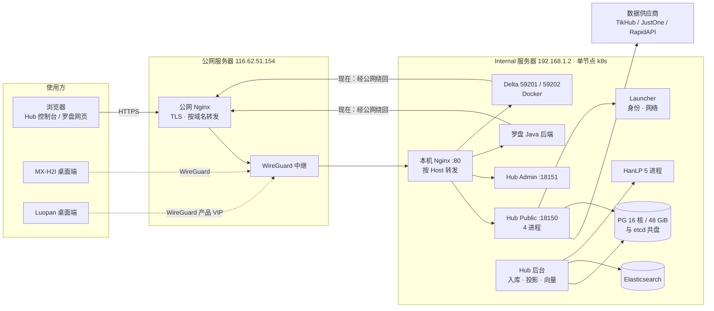

# MX 平台性能排查与 100 QPS 建议（汇总）

2026-10-22。汇总 2026-10-20 至 10-22 关于 Hub 高并发、HanLP 分词、数据入库、连接池、多进程，以及 Delta、罗盘（Luopan）Java 调用 Hub 路径的排查结论和建议，重点给出 **Delta 与 Java 改为内网直连 Hub 的修改步骤**。

可视化版本：[MX 平台架构与容量](https://claude.ai/artifact/DgXpFWaohVYzcD2Hi4ZDWK)（私有页面，需先在页面右上角 Share 中共享给同事）。

数字来源标注：**本机实测**（开发机上的真实代码与 PG 17）、**配置值**（仓库或部署清单）、**事故记录**（既有事故文档）、**估算**、**未测**。估算与未测的数字要等服务器压测和链路探针拿到实测值再定。

---

## 1. 结论速览

1. **下游调用 Hub 的返回路径已经是「先落盘后返回」。** 鉴权、配额预留 → 上游采集 → 一个 PG 事务保存原始证据、交付记录和入库任务 → 返回。清洗入库、HanLP 分词、ES 索引、向量化都在返回之后由后台完成，不会卡住用户。
2. **一次采集请求的时间九成以上在等上游**（通常 1–5 秒，最长 30 秒）。Hub 自身正常约 0.1 秒。
3. **本轮已修复并合入 `pro` 的 9 项**见第 3 节：查询分词、HanLP 推理池、结算全表扫描、入库节奏、投影分词、写放大两项、读取并发、Public 多进程。
4. **最大的结构性风险是磁盘**：PG 与 etcd 共用一块消费级 NVMe，事故中单次落盘 1.5 秒。加连接、加进程都绕不过它。
5. **Delta 和罗盘 Java 后端都跑在 Internal 这台机器上，却经公网绕一圈再回来调 Hub。** 改成本机直连，可以省掉每次 4–5 个公网往返和两次办公网出口，第 5 节给出逐步改法。
6. **Delta 网页只有 2 个同步 gunicorn 进程**，网页里还有接口同步调 Hub（超时 90 秒）。这很可能是「并发一高网页就卡」的直接原因，第 6 节给出改法。

---

## 2. 架构与一次请求的路径



一次采集请求的阶段：

| 阶段 | 正常 / 出问题时 | 来源 | 卡点 |
| --- | --- | --- | --- |
| 1 公网入口（TLS + Nginx） | 20 ms / 300 ms | 估算 | 新建连接要做 TLS 握手 |
| 2 WireGuard 跨机房 | 15 ms / 200 ms | 未测 | 往返时间和带宽都没测过 |
| 3 Internal 网关 | 1 ms / 5 ms | 估算 | 80 端口曾被 Caddy 抢占（10-14 事故） |
| 4 Hub 入口排队 | ≈0 / 30 s | 配置值 | 读取类请求每进程同时 8 个，最多排 512 个、30 秒 |
| 5 鉴权 + 配额预留（约 5 次写库） | 25 ms / 7.5 s | 估算、事故记录 | 每次写库都要等落盘；磁盘卡时被放大 |
| 6 上游采集 | 3 s / 30 s | 估算、事故记录 | 上游慢或超时，以及上游额度 |
| 7 落盘结算（1 个事务） | 20 ms / 1.5 s | 估算 | 原始数据存了约 5 份 |
| 8 返回下游 | 20 ms / 300 ms | 估算 | — |

搜索请求不访问上游，正常约 0.2 秒：HanLP 查询分词在 100 QPS 本机模拟下中位数 74 ms，ES 查询约 50 ms（估算）。

---

## 3. 已发现的问题与处理

| # | 问题 | 原因 | 处理 | 效果 | 状态 | 文档 |
| --- | --- | --- | --- | --- | --- | --- |
| 1 | 搜索、tokenize 在高并发时卡在分词 | 每个请求单独调一次 HanLP，单推理槽 | 查询期分词合并成批、缓存验证结果、最多等 2 秒后降级 | 100 QPS 模拟：中位数 4 s → 74 ms，降级 188/500 → 0 | 已合入 | [查询分词](hanlp-query-concurrency-2026-10-20.md) |
| 2 | HanLP 只有一个推理槽，写入端长批次挡住查询 | 单进程单槽 | 多进程推理池，按 cgroup 定为 5 进程 × 3 线程，留 1 个专给查询 | 空闲内存 2.59 GiB，上限 8 GiB | 已部署（10-21） | 同上 |
| 3 | 并发一高 PG 被拖慢 | 结算前后读入库任务的 SQL 走不了索引，每次付费结算两次全表扫描 `mxq.jobs`（服务器约 174 万行） | 改为等值查询，并在 deploy 时在线建 `mxq.jobs_dedupe_lookup_idx`（建不成只告警，不影响部署） | 本机 30 万行：22 ms → 0.17 ms | 已合入 | [下游链路与后台跟进](delivery-path-throughput-2026-10-21.md) |
| 4 | 清洗入库跟不上 | 每次 1 个任务，固定停 100 ms | 默认 2 个并行；停顿 = 上一批耗时（上限 60 秒）；并行任务按排序加身份锁，防止重叠结果死锁 | 本机 7 → 44 个任务/秒；不加锁的对照组 120 个任务中 30 个死锁 | 已合入 | 同上 |
| 5 | 搜索索引跟不上 | 投影时每条记录的 5 个字段逐个调 HanLP | 整批预分词、短文本跨批缓存、积压时批量 50 → 400 | 测试中 6 条记录从 30 次请求降到 1 次 | 已合入 | 同上 |
| 6 | 入库重复写原始数据 | 值没变也整列重写 TOAST | 值不变时保留原 TOAST | 每次未变化的 upsert，WAL 从 18 KB 降到 370 B（本机） | 已合入 | [写放大](delivery-write-amplification-2026-10-21.md) |
| 7 | 任务表无限增长 | done 行从不清理 | done 行保留 14 天，按字节预算分批清理，dead 行永远保留 | 表不再增长 | 已合入 | 同上 |
| 8 | 读取并发偏低 | 每进程只允许 4 个读取请求同时执行，PG 大部分时间闲着 | 默认改为 8（每进程） | Public 合计 32 | 已合入 | [Public 多进程](public-api-processes-2026-10-22.md) |
| 9 | Public API 只能用 1 个核 | Node 单线程；主机网络固定端口，不能加副本 | 一个 Pod 里跑 4 个进程，共用 18150 端口；连接池和上游并发限额按进程分份，整体总量不变 | 本机：4 进程启动、处理请求、正常退出 | 已合入 | 同上 |

「已合入」指已进入 `pro` 分支。是否已部署以服务器为准，Public 多进程可以用第 9 节的日志命令确认。

**连接池**：每个进程都已经在用 `pg.Pool`，Hub 连接合计约 110 个（估算），PG 上限 200。单纯调大连接池不能提高 QPS：请求大部分时间在等上游，写库慢在落盘，盘慢时多开连接只会让更多事务一起等。只有当 data-pressure 里连接等待在涨、而 PG 本身不忙时，调大才有用。

---

## 4. 尚未处理的风险

| 风险 | 影响 | 建议 | 负责 | 估时 |
| --- | --- | --- | --- | --- |
| Delta、罗盘 Java 调 Hub 绕公网 | 每次多 4–5 个往返；响应要上传、下载各一次，占用办公网出口；依赖公网 DNS、公网 Nginx、隧道和代理 | 第 5 节 | Delta、Java、运维 | 1–2 天 |
| Delta 网页只有 2 个同步进程 | 两个慢请求就能挡住所有页面 | 第 6 节 | Delta | 0.5–2 天 |
| PG 与 etcd 共用一块盘 | 磁盘卡顿时每次写库都被拖到秒级 | 把 etcd 迁出 PG 所在盘，或给 PG 的 WAL 单独一块盘 | 运维 | 0.5–1 天 + 维护窗口 |
| Launcher 身份服务单副本 | 曾出现单次令牌校验 2.2–6.2 秒 | 压测；必要时加副本（Hub 和罗盘都已缓存 30 秒，故障时可沿用 120 秒） | Launcher | 1 天 |
| 同步事务里原始数据存约 5 份 | 写入量大 | 先在服务器跑 `scripts/delivery-write-amplification.sql`，看各份副本占多少，再决定 C/D 两项改动 | Hub | 2–4 天 |
| 公网到 Internal 的链路没测过 | 不知道每段到底花多少时间 | 按 Launcher 文档 52 在公网、Domestic、Internal 三处上线探针 | 运维 | 1 天 |
| ES 每秒刷新一次索引 | 写入量大时段合并占盘 | 确认有压力后，在可见性允许范围内调到 5 秒 | Hub | 0.5 天 |
| 办公室内的 Luopan 桌面端经公网中继 | WireGuard 数据包先到公网服务器再回来 | 单独评估 Launcher 的「Internal 直连 peer」。和 MX-H2I 共用网络组件，本轮不改 | Launcher | 另行评估 |

---

## 5. Delta 与 Java 改为内网直连 Hub

### 5.0 实施状态（2026-10-22）

三个仓库都已从当前分支切出 `fix/100qps`。po-infra（`8909715`）和 po-backend-java（`96563e9c`）的改动已经提交，都还没部署：

| 仓库 | 改动 | 地址 | 交接文档 |
| --- | --- | --- | --- |
| po-infra（Delta） | 内部目标（私有 IP、`host.docker.internal`、`*.mxinfo-inc.cn`）只走直连，加测试；Web 改为 gthread 多线程（每进程 8 个线程），默认 4 个进程 | `DATA_QUERY_HUB_API_BASE_URL=http://host.docker.internal:18150`（同机部署时）；不同机时用 `http://192.168.1.2:18150` | `docs/hub-internal-direct-and-web-threads-20261022.md` |
| po-backend-java（罗盘后端） | pro、pub 两个配置的 Hub 地址默认改为 `http://10.88.88.88:18150`（`HUB_URL` 仍可覆盖）；Hub 调用加连接 5 秒、读取 45 秒超时 | `10.88.88.88:18150`，与它访问 PG、Delta 的方式一致 | `docs/hub-internal-address-20261022.md` |
| luopan（前端单仓） | 只建了分支，没有改动：仓库内不直接调 Hub；网页端经罗盘后端，桌面端走产品 VIP | — | — |

实施时选用 5.3 的方案 B（直连 Hub 端口）：两边都不再依赖本机 Nginx 别名、hosts 条目和 80 端口归属，**下面的步骤 1、2、4 都变成可选**。Delta 的直连规则同样覆盖 `*.mxinfo-inc.cn`，以后想改用方案 A 时不用再改代码。

**不需要修改任何 Nginx 配置**（2026-10-22 核对）：

- **公网 Nginx（de-mingxi `compass/deploy/nginx`）**：继续服务外网用户和浏览器；Delta、Java 不再经过它。它到 Internal 已经保持 32 个长连接，Hub API 没有限流，不用改。
- **Internal 本机 Nginx（`internal-nginx`）**：Delta 只调 `/api/v1`、`/api/v2`，Java 只调 `/api/v1`。这两类路径 Nginx 本来就原样转给 18150，直连不会少掉任何路由。
- **Hub 返回的链接**：Hub 不根据请求的 Host 生成链接，公开地址来自 `MX_INSIGHT_PUBLIC_URL`，所以直连后返回的媒体和翻页链接不变。
- **Delta 自带的 gateway Nginx**：读超时 600 秒，与 Web 的超时一致，也没有连接数或限流设置，不影响新增的线程。

### 5.1 现状

依据：

- Internal 的 `/etc/hosts` 有 `127.0.0.1 delta.mxinfo-inc.cn`、`dev.delta…`，还有 `192.168.1.2 mx-internal-server`。
- Delta 文档写明「本机 59201 是正式环境、59202 是测试环境」。
- Internal Nginx 的 `delta.minsight-ai.com.conf` 回源 `127.0.0.1:59201/59202`，`compass.minsight-ai.com.conf` 回源本机 55955 等端口。

所以 Delta、罗盘 Java 和 Hub 都在同一台机器上，但两者调 Hub 用的都是公网域名。

Delta 调一次 Hub 的实际路径：

```text
Delta 容器
 → host.docker.internal:7788（mihomo 代理，每次新建 CONNECT 隧道）
 → 办公网出口 → 116.62.51.154:443（TLS 握手 + 公网 Nginx）
 → WireGuard → 10.88.88.88:80（Internal 本机 Nginx）
 → 127.0.0.1:18150（Hub Public，同一台机器）
响应原路返回，上传、下载各经过一次办公网出口
```

关键代码事实（po-infra）：

- `llm/data_query.py` 的 `_hub_http_post` / `_hub_http_get` 每次调用都新建 `requests.Session()`，用完就关，并设置 `trust_env = False`，所以 `NO_PROXY` 不生效，每次都重新建连接。
- 线路由 `llm/network_routes.py` 的 `model_network_routes()` 决定，默认 `MX_MODEL_PROXY_FALLBACK_CHAIN=http://host.docker.internal:7788,http://host.docker.internal:7890,direct`：先走 7788，失败走 7890（他人部署的 clash），最后才直连，对所有目标地址一视同仁。

罗盘 Java（`po-backend-java`）调 Launcher（`http://10.88.88.88:18090`）、PG、ES 都是本机地址；调 Delta 用 `http://delta.mxinfo-inc.cn`，经 hosts 指到 127.0.0.1，也在本机。只有 Hub 用的是 `hub.public-opinion.base-url: ${HUB_URL:https://hub.minsight-ai.com}`，同样绕公网。

### 5.2 改了能快多少

- **每次调用：** 省掉约 4–5 个「办公网 ↔ 公网服务器」往返（代理握手、TCP、TLS、请求经隧道往返）。往返 20 ms 时约 80–100 ms，40 ms 时约 160–200 ms（估算）。改完后本机往返不到 1 ms。
- **对不同请求的意义：** 采集请求通常 3 秒，省下的只占几个百分点；搜索和存量查询正常约 0.2 秒，能快 30–50%。
- **带宽：** 响应不再上传、下载两次。按 100 QPS、每个响应 200 KB 粗算，原路径需要约 160 Mbps 的持续上行，一般办公宽带扛不住；而且 MX-H2I 用户的 WireGuard 流量走的是同一个出口和中继，会被一起拖慢。
- **可靠性：** 不再依赖公网 DNS、公网 Nginx 的路由配置、WireGuard 隧道和 mihomo。10-17 的 `/api/v2` 404 就出在公网 Nginx 这一层。

### 5.3 方案选择

| 方案 | 做法 | 结论 |
| --- | --- | --- |
| A 走本机 Nginx（最初推荐） | 本机 Nginx 的 Hub 配置加域名别名 `hub.mxinfo-inc.cn`；Delta、Java 改用 `http://hub.mxinfo-inc.cn` | 和现有 `delta.mxinfo-inc.cn` 的做法一致；保留 Nginx 的路径分流（`/api/v1`、`/api/v2`、管理面）、超时和包大小限制；公网域名不受影响 |
| **B 直连 Hub 端口（已实施，见 5.0）** | Delta 用 `http://host.docker.internal:18150`，Java 用 `http://10.88.88.88:18150` | 最快，不依赖 80 端口归属；Delta 只调 `/api/v1`、`/api/v2`，Java 只调 `/api/v1`，绕过 Nginx 不会少掉路由（见 5.0） |
| C 只改 hosts 指向本机 | 把 `hub.minsight-ai.com` 指到 127.0.0.1 | 不可行：本机 Nginx 只开了 80，HTTPS 会失败；容器也读不到宿主机的 hosts |

### 5.4 前置确认（只读，在 Internal 服务器执行）

确认 Delta 和 Java 都在这台机器上（看监听端口属于哪个进程）：

```bash
sudo ss -ltnp | grep -E ':(59201|59202|55955|55866|52548|51558)\b'
```

确认 80 端口归本机 Nginx（10-14 出现过 Caddy 抢占）：

```bash
sudo ss -ltnp 'sport = :80'
```

确认 Hub 的 server 块：

```bash
sudo nginx -T 2>/dev/null | grep -n "server_name hub"
```

记录改前的耗时基线，每条连跑 20 次取中位数。公网路径：

```bash
curl -sS -o /dev/null -w 'connect=%{time_connect} tls=%{time_appconnect} ttfb=%{time_starttransfer} total=%{time_total}\n' https://hub.minsight-ai.com/health/live
```

Delta 当前实际用的线路（经 7788）：

```bash
curl -sS -o /dev/null -x http://127.0.0.1:7788 -w 'connect=%{time_connect} tls=%{time_appconnect} total=%{time_total}\n' https://hub.minsight-ai.com/health/live
```

本机 Nginx 路径：

```bash
curl -sS -o /dev/null -w 'connect=%{time_connect} ttfb=%{time_starttransfer} total=%{time_total}\n' -H 'Host: hub.minsight-ai.com' http://127.0.0.1/health/live
```

### 5.5 步骤 1：本机 Nginx 加域名别名

仓库文件：`de-mingxi/compass/deploy/internal-nginx/hub.minsight-ai.com.conf`；服务器上的文件：`/etc/nginx/conf.d/hub.minsight-ai.com.conf`。

只改 `server_name` 一行，其余 location 不动：

```nginx
server {
    listen 80;
    listen [::]:80;
    server_name hub.minsight-ai.com hub.mxinfo-inc.cn;
    ...
}
```

检查配置并平滑重载：

```bash
sudo nginx -t && sudo systemctl reload nginx
```

验证新域名走到了 Hub（不带 Key，预期 401 JSON，`error.code=api_key_required`）：

```bash
curl -sS -i -X POST http://127.0.0.1/api/v2/data/search -H 'Host: hub.mxinfo-inc.cn' -H 'Content-Type: application/json' --data '{}'
```

这一步不影响公网访问：公网 Nginx 回源时用的仍是 `hub.minsight-ai.com`。

### 5.6 步骤 2：本机 hosts 加一行

在 Internal 的 `/etc/hosts` 加：

```text
127.0.0.1 hub.mxinfo-inc.cn
```

验证宿主机进程能解析：

```bash
curl -sS -o /dev/null -w '%{http_code} %{time_total}\n' http://hub.mxinfo-inc.cn/health/live
```

容器读不到宿主机的 hosts，Delta 另需步骤 4。

### 5.7 步骤 3：Delta 代码改动（po-infra）

目的：调本机服务时不走 7788、7890 代理，只直连。照搬现有 `_is_qianfan_deepseek` 的写法：只有在没有显式代理配置时才生效，其它公网目标的线路不变。

`llm/network_routes.py`，在常量区加：

```python
# Hosts served by this machine. Worker-wide proxies are for public upstreams:
# an internal call sent through them leaves the office and comes back, or waits
# for a proxy that cannot resolve the name to fail before going direct.
INTERNAL_DIRECT_HOSTS = {"localhost", "127.0.0.1", "::1", "host.docker.internal"}
INTERNAL_DIRECT_HOST_SUFFIXES = (".mxinfo-inc.cn",)


def _is_internal_direct_target(endpoint: str) -> bool:
    try:
        host = (urlsplit(endpoint).hostname or "").lower()
    except ValueError:
        return False
    return host in INTERNAL_DIRECT_HOSTS or host.endswith(INTERNAL_DIRECT_HOST_SUFFIXES)
```

在 `model_network_routes()` 里，紧跟千帆那条判断之后加：

```python
    if not explicit_chain and not has_explicit_proxy and _is_internal_direct_target(endpoint):
        return [ModelNetworkRoute(label="direct", proxy_url=None)]
```

新增测试 `llm/tests_network_routes.py`：

```python
import os
import unittest
from unittest.mock import patch

from llm.network_routes import model_network_routes

CHAIN = "http://host.docker.internal:7788,http://host.docker.internal:7890,direct"


class InternalDirectRouteTests(unittest.TestCase):
    @patch.dict(os.environ, {"MX_MODEL_PROXY_FALLBACK_CHAIN": CHAIN})
    def test_internal_hub_goes_direct(self):
        routes = model_network_routes(target_url="http://hub.mxinfo-inc.cn/api/v2/data/search")
        self.assertEqual([(r.label, r.proxy_url) for r in routes], [("direct", None)])

    @patch.dict(os.environ, {"MX_MODEL_PROXY_FALLBACK_CHAIN": CHAIN})
    def test_public_targets_keep_the_proxy_chain(self):
        routes = model_network_routes(target_url="https://hub.minsight-ai.com/api/v2/data/search")
        self.assertEqual([r.proxy_url for r in routes][:2],
                         ["http://host.docker.internal:7788", "http://host.docker.internal:7890"])

    @patch.dict(os.environ, {"MX_MODEL_PROXY_FALLBACK_CHAIN": CHAIN})
    def test_an_explicit_chain_still_wins(self):
        routes = model_network_routes({"extra": {"model_proxy_fallback_chain": "http://proxy.local:1,direct"}},
                                      target_url="http://hub.mxinfo-inc.cn/")
        self.assertEqual([r.proxy_url for r in routes], ["http://proxy.local:1", None])


if __name__ == "__main__":
    unittest.main()
```

运行新测试，以及会走到这些线路的既有测试：

```bash
python -m unittest llm.tests_network_routes llm.tests_news_discovery llm.tests_enterprise_query
```

影响范围：`*.mxinfo-inc.cn` 目前只出现在运维脚本的默认地址里，它们不经过 `model_network_routes`，不受影响。所有公网目标（Hub 公网域名、各模型接口）的线路和原来一样。

已验证（2026-10-22，在 po-infra 当前 `llm/network_routes.py` 的副本上，未改动 po-infra 仓库）：打补丁后 3 项测试全部通过；不打补丁时第 1 项失败，Hub 内部地址仍会先走 7788。

### 5.8 步骤 4：Delta 容器能解析内部域名

`docker-compose.ghcr.yml` 里，凡是已有 `host.docker.internal:host-gateway` 的服务（web、各 worker、beat 等），都在同一个 `extra_hosts` 下加一行：

```yaml
    extra_hosts:
      - "host.docker.internal:host-gateway"
      - "hub.mxinfo-inc.cn:host-gateway"
```

`host-gateway` 是宿主机在 Docker 网桥上的地址。本机 Nginx 监听所有地址的 80 端口，容器访问这个地址的 80 端口就会到 Hub 的 server 块。Delta 已经在用 `host.docker.internal:7788`，说明容器到宿主机是通的；但 80 端口要在步骤 6 实测确认。

### 5.9 步骤 5：先改测试实例（59202）

1. 用包含步骤 3、4 的代码构建或拉取新镜像。
2. 编辑测试实例的 env 文件 `deploy/.env.<实例名>.ghcr`（正式实例是 `deploy/.env.ghcr`）：

   ```text
   DATA_QUERY_HUB_API_BASE_URL=http://hub.mxinfo-inc.cn
   ```

   部署脚本不会改写这一项，`MX_MODEL_PROXY_FALLBACK_CHAIN` 也保持原值，模型调用照旧走代理。
3. 用原有方式重新部署测试实例：`./scripts/deploy_public_ghcr.sh --instance <实例名> --port 59202 …`，参数与上次部署一致。

### 5.10 步骤 6：验证测试实例

先看容器里能否访问新地址（容器名以 `docker ps` 为准）：

```bash
docker exec <测试实例的 worker 容器> python -c "import requests,time; t=time.time(); r=requests.get('http://hub.mxinfo-inc.cn/health/live', timeout=5); print(r.status_code, round((time.time()-t)*1000), 'ms')"
```

再看 Hub v2 入口（不带 Key，预期 401 JSON `api_key_required`，不会产生采购）：

```bash
docker exec <测试实例的 worker 容器> python -c "import requests; r=requests.post('http://hub.mxinfo-inc.cn/api/v2/data/search', json={}, timeout=5); print(r.status_code, r.text[:120])"
```

然后：

- 在测试实例跑一次真实的存量搜索或回放（用测试 Key），确认结果与改前一致。
- 看 worker 日志：不应再出现 `Model network route failed route=proxy-7788` 一类的 Hub 线路失败告警。
- 按 5.4 的方法，对比改前和改后的耗时。

### 5.11 步骤 7：正式实例（59201）

测试实例稳定运行至少一天后，正式实例重复步骤 5、6：改 `deploy/.env.ghcr`，按原方式重新部署。

### 5.12 罗盘 Java 后端

按方案 B 实施，后端以容器运行（`compass-backend-pub` 等）。pro、pub 配置文件里的默认地址已改为 `http://10.88.88.88:18150`，**不用加环境变量，不用改 Dockerfile 或 Compose**。

1. 确认后端容器的环境里没有显式设置 `HUB_URL`（有的话，它的优先级高于配置文件）。
2. 发布前在后端容器里确认 Hub 可达（不带 Key，预期 `401` 和 JSON `api_key_required`）：

   ```bash
   docker exec <后端容器> curl -sS -i --noproxy '*' -X POST http://10.88.88.88:18150/api/v2/data/search -H 'Content-Type: application/json' --data '{}'
   ```

   必须带 `--noproxy '*'`。容器里的 `http_proxy` 指向 `127.0.0.1`，那是容器自己，没有代理。不带这个参数时，curl 会报 `Failed to connect to … via 127.0.0.1`，请求根本没有发出去（2026-10-22 实测）。Java 的 HTTP 客户端不读 `http_proxy`，所以这个变量不影响后端本身。`10.88.88.88` 是宿主机自己的 WireGuard 地址，容器经 Docker 网桥就能访问，不需要在容器里接 VPN。后端访问 PG、ES、Launcher、Delta 用的也是这个地址。
3. 先发 pub（52548），打开一个需要 Hub 数据的罗盘页面，确认数据正常、日志里没有 `Public opinion Hub` 报错；再发 pro（7000）。
4. 只有带 `--noproxy` 仍然连不上时才需要换地址：设 `HUB_URL=http://192.168.1.2:18150`；或者在 Compose 里给后端加 `extra_hosts: ["host.docker.internal:host-gateway"]`，再设 `HUB_URL=http://host.docker.internal:18150`。主机映射只能在 Compose 或 `docker run --add-host` 里配，Dockerfile 配不了。

细节见 `po-backend-java/docs/hub-internal-address-20261022.md`。

### 5.13 回退与注意事项

- **回退**：把 `DATA_QUERY_HUB_API_BASE_URL` 和 `HUB_URL` 改回 `https://hub.minsight-ai.com`，重新部署或重启即可。Nginx 别名、hosts 条目和 Delta 代码保留也不影响任何东西。
- **公网访问不受影响**：外网用户、浏览器和公网 Nginx 继续使用 `hub.minsight-ai.com`；不要在 hosts 里改这个公网域名。
- **明文 HTTP**：API Key 以明文 HTTP 发送，但流量只在本机回环和 Docker 网桥上，不出这台机器。
- **客户端 IP**：Hub 看到的来源变成本机或容器地址。Hub 只在 Admin 登录限流时用这个 IP，数据接口不受影响。
- **日志**：公网 Nginx 的访问日志里不会再有 Delta、Java 的流量，Hub 自己的请求记录照常。
- **80 端口**：如果本机 Nginx 没拿到 80 端口（被 Caddy 占用），步骤 1 会失败。先按 Launcher 文档 50 修好端口归属，或者临时改用方案 B。
- **范围**：MX-H2I 登录和联网、Launcher 网络、SSO 和证书都不涉及。

### 5.14 Luopan 网页端与桌面端

| 客户端 | 现状 | 建议 |
| --- | --- | --- |
| 罗盘网页（`compass.minsight-ai.com`） | 外网用户必须经公网 Nginx → 隧道 → 本机 Nginx → Java。页面需要 Hub 数据时，Java 又经公网绕一圈调 Hub | 改 Java（5.12）后，每个用到 Hub 的页面少一次「出办公网再回来」。办公室内用户如果想让访问本身也走内网，需要另配内网域名、SSO 回调和 Cookie 设置，优先级低 |
| Luopan 桌面端 | 业务接口用 Launcher 下发的产品 VIP，经 WireGuard 访问 Internal，不经过公网 Nginx；但 WireGuard 默认经过公网中继 | 办公室内的客户端可评估 Launcher 的「Internal 直连 peer」，改走局域网。和 MX-H2I 共用网络组件，需单独评估，本轮不改 |
| MX-H2I | 不变 | 不在本轮范围 |

---

## 6. Delta 网页改多线程

现状：`scripts/run_web.sh` 用 `gunicorn --workers ${MX_WEB_WORKERS:-2} --timeout ${MX_WEB_TIMEOUT:-600}`，默认是同步 worker，一个容器同时只能处理 2 个请求。`data_hub/api.py` 里至少有一处（Telegram timeline，`fetch_telegram_timeline`）在网页请求中同步调 Hub，超时取 `DATA_QUERY_API_TIMEOUT`，默认 90 秒。两个这样的慢请求就能挡住所有页面。

建议：

1. `run_web.sh` 改用线程 worker，例如：

   ```bash
   exec gunicorn mx_data.wsgi:application \
     --bind "${MX_HOST:-0.0.0.0}:${MX_PORT:-8000}" \
     --workers "${MX_WEB_WORKERS:-4}" \
     --worker-class gthread \
     --threads 8 \
     --timeout "${MX_WEB_TIMEOUT:-600}"
   ```

2. 线程数写成内置值，和「少加环境变量」的约定一致。Django 每个线程可能持有一个数据库连接（受 `CONN_MAX_AGE` 影响），4 × 8 = 32，先确认 Delta 自己的 PG 连接上限够用。
3. 网页请求里直接调 Hub 的接口，改为后台任务加轮询，或把超时缩短到 10 秒以内，失败时提示稍后重试。
4. 验证：一个慢请求进行中，同时打开其他页面，应能正常返回。

负责：Delta 程序。估时：配置 0.5 天，改接口 1–2 天。

---

## 7. 100 QPS 逐层判断

| 层级 | 当前上限 | 卡在哪里 | 100 QPS | 依据 |
| --- | --- | --- | --- | --- |
| Delta 网页 | 每容器 2 个同步进程 | 网页里同步调 Hub | 风险 | 仓库默认值；线上 env 未核对 |
| Delta 后台 | Celery：data 8，agent 每队列 32 | Hub 调用超时 90 秒 | 可以 | 配置值 |
| 公网入口与隧道 | 32 个长连接回源 | 往返时间、带宽未测 | 待测 | 未测 |
| Launcher 身份 | 1 副本，各端缓存 30 秒 | 曾出现单次 2–6 秒 | 关注 | 事故记录 |
| Hub Public | 4 进程，读取 32，连接 40 | 发布时短暂中断 | 可以（部署后） | 本机测试 |
| Hub Admin | 1 进程，读取 8 | 重导出和统计查询 | 可以 | 配置值 |
| 数据供应商 | 每家每分钟请求数全局共享 | 上游额度、费用、30 秒超时 | 看上游 | 配置值 |
| PostgreSQL | 16 核 / 48 GiB / 200 连接 | 与 etcd 共盘，事故中落盘 1.5 秒 | 最大风险 | 事故记录 |
| HanLP | 5 进程 × 3 线程 | 全量重建长批次 | 可以 | 已部署 |
| 入库进程 | 2 并行，按耗时停顿 | 本机 44 任务/秒，服务器更慢 | 高峰会积压，不丢 | 本机实测 |
| 投影进程 | 整批预分词，最多 400 条/批 | HanLP 批量吞吐 | 高峰会积压，不丢 | 估算 |
| Elasticsearch | 每秒刷新 | 写入量大时段合并 | 待测 | 配置值 |

---

## 8. 后续建议与顺序

| 优先级 | 事项 | 负责 | 估时 |
| --- | --- | --- | --- |
| P1 | Delta、Java 改为内网直连 Hub（第 5 节） | Delta、Java、运维 | 1–2 天 |
| P1 | Delta 网页改多线程，网页里不再同步等 Hub（第 6 节） | Delta | 0.5–2 天 |
| P1 | 部署后做阶梯压测（第 9 节） | 测试 + Hub | 1–2 天 |
| P1 | 上线链路探针（Launcher 文档 52） | 运维 | 1 天 |
| P2 | PG 与 etcd 分盘 | 运维 | 0.5–1 天 + 维护窗口 |
| P2 | 同步事务原始数据减少副本（先测量） | Hub | 2–4 天 |
| P2 | Launcher 身份服务压测，必要时加副本 | Launcher | 1 天 |
| P3 | 定目标、配告警 | 产品 + 测试 + 运维 | 1–2 天 |

建议目标（P3 用）：搜索类 P95 ≤ 1 秒；Hub 自身附加耗时 P95 ≤ 200 ms；503 比例 < 1%；高峰后 10 分钟内积压回落。

---

## 9. 测量与压测方法

- **压测范围**：只打存量数据、缓存和回放接口，用测试 Key，不触发付费上游。
- **分档**：25、50、100 QPS，每档 10 分钟。
- **记录**：P50/P95 耗时、503 比例、`GET /internal/v1/admin/data-pressure` 里的排队与超时、PG 落盘耗时、队列中最老任务的等待时间。
- **回归**：每次发布后，确认 MX-H2I 原账号登录、联网和 Pay 访问正常。

确认 Public 多进程已生效：

```bash
kubectl -n mx-insight-hub logs deploy/mx-insight-hub-public | grep -E "started 4 API processes|listening on"
```

查看入库任务积压（走部分索引，不扫全表）：

```bash
kubectl -n mx-common exec -i statefulset/mx-common-postgres -- psql -X -U mx_common -d mx_insight_hub -c "SELECT queue, status, count(*), min(created_at) AS oldest FROM mxq.jobs WHERE status IN ('pending','running') GROUP BY 1, 2"
```

查看搜索投影积压：

```bash
kubectl -n mx-common exec -i statefulset/mx-common-postgres -- psql -X -U mx_common -d mx_insight_hub -c "SELECT status, count(*), min(created_at) AS oldest FROM outbox.projection_events WHERE status IN ('pending','claimed') GROUP BY 1"
```

查看 PG 连接分布：

```bash
kubectl -n mx-common exec -i statefulset/mx-common-postgres -- psql -X -U mx_common -d mx_common -c "SELECT datname, application_name, count(*) FROM pg_stat_activity GROUP BY 1, 2 ORDER BY 3 DESC"
```

---

## 10. 相关文档

- [HanLP 查询分词并发](hanlp-query-concurrency-2026-10-20.md)
- [下游调用链路与后台跟进能力](delivery-path-throughput-2026-10-21.md)
- [交付链路写放大与 mxq.jobs 保留期](delivery-write-amplification-2026-10-21.md)
- [Public API 单 Pod 多进程与读取并发](public-api-processes-2026-10-22.md)
- [数据 API 与后台处理削峰](data-pressure-reservoir-2026-10-19.md)
- [突发写入：供应商热点行与数据库分道](burst-hot-rows-db-lanes-2026-10-19.md)
- Launcher：[链路耗时量化方案（52）](../../../mx-launcher/docs/52-path-latency-observability-plan.md)、[Internal 80 端口归属（50）](../../../mx-launcher/docs/50-internal-gateway-port80-ownership.md)
- de-mingxi：`compass/deploy/internal-nginx/`（本机 Nginx 配置）、`compass/deploy/HUB-SEARCH-V2.md`
- po-infra：`llm/network_routes.py`、`llm/data_query.py`、`scripts/run_web.sh`、`scripts/deploy_public_ghcr.sh`、`docs/OnBoard.md`
- po-backend-java：`src/main/resources/application.yml`（`hub.public-opinion.base-url`）
