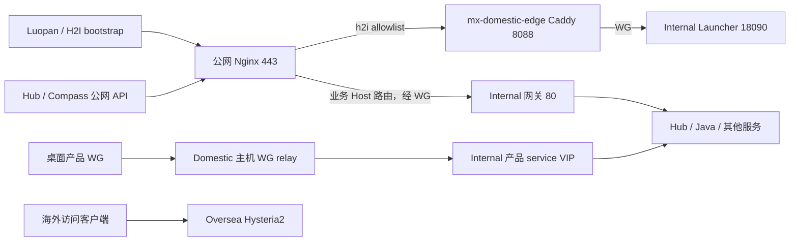

# 正式 Luopan 登录与 Domestic 容量分析（2026-10-22）

状态：源码分析、现有测试和低频只读公网探测；没有修改或部署客户端、认证、网络、生产配置。本次新增分析文档。MX-H2I 现有登录与联网是修复的硬约束。

## 1. 结论及证据边界

1. 正式 Luopan 的前置链路确实可以超过 5 秒：启动先建网再加载主界面，登录后又执行用户认证、租约交接、peer 同步、本机 WG/路由验证、权限加载。尤其 peer 同步串行且客户端没有显式 deadline。
2. 当前源码已把新海外订阅准备放到后台。它确实请求 Internal 同步海外账号并返回 YAML 到本地，但不等待这项任务完成才进入系统。旧订阅清理仍需完成，以保护账号隔离。
3. 不能以 demo 或 SDK 仓库最新源码代替正式客户端。正式应用固定 SDK 2.3.18 加补丁；本机实际依赖却未应用声明的补丁。用户安装包是否相同尚未验证。
4. Domestic 有公网 Nginx、bootstrap Caddy 和主机 WG 三种路径。桌面 VIP 业务不经过 bootstrap Caddy；没有发现 Docker 被配置成不足 100 QPS 的固定限额。
5. 用户补充的实际配置为 **2 vCPU、4 GiB、峰值公网 100 Mbps、流量 ¥0.800/GB**，取代最初的 4 CPU/2GB 假设。100 QPS 小响应是合理的待验证目标；平均每次出站 100 KiB 时已约 82 Mbps，带宽、费用和长请求积压比容器本身更值得优先检查。峰值不构成持续吞吐保证。

| 来源 | 本次基线 | 可以证明什么 |
| --- | --- | --- |
| 正式前端 `/Users/qpjoy/workspace/mingxi/luopan/po-frontend` | HEAD `f0fb437`，Compass 2.0.6 | 当前产品源码，不能独立证明已发布到用户电脑 |
| Java `/Users/qpjoy/workspace/mingxi/po-backend-java` | HEAD `96563e9c` | 业务认证/权限代码 |
| 本仓库 | HEAD `115d3a87`，Launcher SDK 源码 2.3.19 | 服务端、共享 SDK、部署生成器；已有其他项目未提交改动未触碰 |
| 公网部署源 `/Users/qpjoy/workspace/mingxi/de-mingxi` | HEAD `f13ddda` | Compose 挂载的配置来源；不是线上 `nginx -T` 快照 |
| 历史 Windows 性能文档 | 第 5/6 轮模拟首次登录 | 历史定位线索，不是今天用户安装包实测 |

## 2. 正式登录为什么会卡

### 2.1 等待链

```text
启动：恢复 remembered user 或匿名网络
  → bootstrap → enrollment → snapshot → peer 同步
  → 本机 WG + 路由 + service VIP HTTP health
  → 设置主窗口代理 → 加载业务 renderer

点击登录：业务 /account/login（Java → MX OAuth）
  → /user-info（首次新 token 可能触发 introspection）
  → launcher:connect-user
      → 清旧用户本地海外配置
      → 再次 MX OAuth（网络权限 scope）
      → 用户 lease/snapshot → Domestic peer → Internal direct peer
      → WG/路由/VIP health → 设置主窗口代理
      → 后台开始新海外订阅准备（不 await）
  → router.push → /api/access/me → /api/access/workspace → 首页
    （该 userId/token 尚未 ready 时加载；workspace 仅权限功能启用时请求）
```

同身份且健康的连接有复用路径；首次匿名转用户通常需要租约交接，因此不能把 warm reuse 的速度当作首次登录速度。启动前建网与点击登录后的切换应分别计时；开发 Vite 页面编译也应单列。

依据：[启动门槛](/Users/qpjoy/workspace/mingxi/luopan/po-frontend/src-electron/electron-main.ts:338)、[登录按钮](/Users/qpjoy/workspace/mingxi/luopan/po-frontend/src/features/Landing/Login.vue:451)、[用户网络编排](/Users/qpjoy/workspace/mingxi/luopan/po-frontend/src-electron/luopan-launcher-manager.ts:344)、[IPC 返回条件](/Users/qpjoy/workspace/mingxi/luopan/po-frontend/src-electron/electron-main.ts:865)。

### 2.2 已确认的阻塞点

| 优先级 | 问题 | 证据与影响 |
| --- | --- | --- |
| P0 | 依赖与补丁不一致 | 本机 Electron 入口解析到无 patch_hash 的 2.3.18，20 项 Windows 补丁标志全部 false。先核对发布包 fingerprint，否则讨论源码优化收益没有共同基线 |
| P1 | peer 同步串行、无客户端显式超时 | `syncLeasePeers` 先 await Domestic，再 await Internal direct；direct 虽 catch 忽略失败，仍等到返回。`fetch` 没有 signal |
| P1 | peer 业务失败被遗漏 | 客户端仅判断 HTTP status；服务器可用 HTTP 200 返回 `domesticPeerSync.status=failed/blocked`。随后仍装 WG、重试诊断，掩盖真正首因 |
| P1 | bootstrap 回退放大 | 每个候选串行探 `/bootstrap-healthz`、`/healthz`，各 3 秒；一个黑洞候选就可能约 6 秒，再试下一候选 |
| P1 | 没有端到端预算 | enrollment/snapshot 调用缺少请求 deadline；业务 Axios 默认单次 120 秒、登录 MX OAuth 20 秒。不能认为每步局部 timeout 等于总流程上限 |
| P1 | 首屏前取完整权限工作区 | 先取 `/me`，enabled 时再取组织/成员/角色/审批等 `/workspace`，都完成才让路由继续 |
| P2 | 两次 MX 密码认证 | Java 业务登录已请求 MX OAuth，Electron 随后再请求一次；scope 不同，不能直接删第二次或盲目复用 token |
| 待量化 | Windows 系统操作与共享锁 | 已有历史样本支持 DNS 清理、端点路由、本机隧道操作占时；没有今天用户机器的阶段日志，尚不能断言各项当前占比 |

peer 客户端代码：[串行等待与 HTTP 状态判断](/Users/qpjoy/workspace/mingxi/luopan/po-frontend/src-electron/luopan-launcher-manager.ts:730)。服务端 [Domestic 同步](/Users/qpjoy/workspace/qpjoy/de/de-llaaddddeerr/electron-dock/mx-launcher/server/src/modules/launcher-network/launcher-network.controller.ts:2026) 每次执行 SSH、`wg set`、防火墙/路由确认及 `wg-quick save`；执行超时为 effective SSH connect timeout + 60 秒（当前 effective 下限 30 秒）。[Internal direct host-runner](/Users/qpjoy/workspace/qpjoy/de/de-llaaddddeerr/electron-dock/mx-launcher/server/src/modules/launcher-network/launcher-network.controller.ts:2546) 每个候选最长 180 秒且依次回退。

这些是服务端/调用层允许的长尾，**不是典型实测时长，也不能机械累加成某一次登录耗时**。公网 [h2i Nginx](/Users/qpjoy/workspace/mingxi/de-mingxi/compass/deploy/nginx/conf.d/30-h2i.conf:27) 的 read timeout 是 30 秒，走这条路径时可能先返回代理超时；它不是 5 秒总 deadline，也不能假定客户端超时会取消服务端 SSH。已有内网路径、其他代理配置会改变实际截断点。

其余入口：[bootstrap resolver](/Users/qpjoy/workspace/mingxi/luopan/po-frontend/src-electron/launcher-bootstrap-resolver.ts:23)、[业务 HTTP 默认超时](/Users/qpjoy/workspace/mingxi/luopan/po-frontend/src/boot/api.ts:84)、[网络 OAuth](/Users/qpjoy/workspace/mingxi/luopan/po-frontend/src-electron/luopan-launcher-manager.ts:445)。业务客户端默认重试为零，不能把该处解释成自动重试放大。

### 2.3 权限工作区与重复认证

[路由](/Users/qpjoy/workspace/mingxi/luopan/po-frontend/src/router/index.ts:286) 等待 `serverPermissionWorkspace.ensure`，其 [load](/Users/qpjoy/workspace/mingxi/luopan/po-frontend/src/features/Permissions/serverPermissionStore.js:51) 串行请求 `/me` 和 `/workspace`。路由判断只需要 capabilities；可以拆分轻量权限读取与完整工作区加载。保留 `/me` 校验成功及权限允许的门槛，不能失败后放行或用空权限冒充功能关闭。

该 store 按 userId/token 缓存并合并进行中的请求，**不是每次导航都发网络请求**。但已 ready、权限功能 enabled、页面可见且非 busy 时，每 30 秒、窗口 focus 会重新加载两项；若 100 个客户端均处于此状态，光定时刷新平均约 6.7 请求/秒（不含 focus），还有返回完整组织数据的带宽。应把定期轻量权限刷新与管理工作区刷新分开。

Java [AccountController](/Users/qpjoy/workspace/mingxi/po-backend-java/src/main/java/org/example/controller/AccountController.java:59) 已通过 MX OAuth 返回 access token。Java 默认 scope 为 `sdk.identity.read sdk.user.read`；Electron 要求 `auth.read network.hdi.status oversea.subscription.ensure`。减少第二次认证需要 Luopan 专用的受控 token 交换或最小 scope 契约，并校验 audience、subject、有效期；不能影响 MX-H2I 和其他 SSO 应用。

## 3. 海外订阅到底有没有阻塞

**会同步、会下发到本地；当前新订阅准备不阻塞内网登录。**

- [electron-main.ts:903](/Users/qpjoy/workspace/mingxi/luopan/po-frontend/src-electron/electron-main.ts:903) 使用 `void prepareOverseaInBackground`，随即返回登录结果。
- SDK POST `users/:id/oversea/ensure-subscription`，带 `syncRuntime:true`、`confirmRemoteExecution:true`、`includeYaml:true`。单请求默认 195 秒；必要时再 GET subscription YAML。
- Internal [ensure controller](/Users/qpjoy/workspace/qpjoy/de/de-llaaddddeerr/electron-dock/mx-launcher/server/src/modules/user-center/user-center.controller.ts:388) 先维护 entitlement，再同步账号；[同步循环](/Users/qpjoy/workspace/qpjoy/de/de-llaaddddeerr/electron-dock/mx-launcher/server/src/modules/user-center/user-center.controller.ts:498) 对各海外站点依次 SSH。默认每站点执行上限 180 秒，失败诊断还可能继续 TCP probe。
- 这不是每次登录都去下载一个外部机场订阅。当前用户订阅来自 Internal 保存的 site/account 数据，[Postgres 读取并生成 YAML](/Users/qpjoy/workspace/qpjoy/de/de-llaaddddeerr/electron-dock/mx-launcher/server/src/store/postgres.ts:1935)；账号同步方向是 Internal → Oversea，配置下发方向是 Internal → 客户端。
- 客户端将托管 YAML 写到 `userData/mihomo/config.yaml` 并应用。[本地应用逻辑](/Users/qpjoy/workspace/mingxi/luopan/po-frontend/src-electron/mihomo-proxy-manager.ts:140)。
- `pending-runtime-sync` 最多三次、间隔 1.5 秒；打开海外链接才等待共享准备任务，最多 30 秒。国内直连链接不等。
- 登录前确实 await `reset.cleared`，但 reset 会 abort 旧远端请求，只等待本地 apply/clear 队列，不等旧海外服务器返回。该清理保护账号隔离，不能简单删除。

后台化避免直接阻塞，不代表零资源成本：并发登录仍会让 Internal 发起海外 SSH、写 DB/审计、生成配置。当前循环没有按 runtimeSync 已 synced 就跳过全部 SSH 的快速路径。应另做配置版本/账号状态幂等判定与任务合并；本次没有证明它已造成 Domestic 饱和。

本次运行现有四个测试文件，共 **11 passed / 0 failed**：`oversea-background.test.js`、`oversea-readiness.test.js`、`auth-login-state.test.js`、`launcher-oversea-subscription.test.js`。其中真实 IPC handler 被提取测试：海外 Promise 一直不返回，网络 ready 后登录仍可返回。

## 4. Windows、macOS 与 MX-H2I 共存

正式 Luopan 两个平台都使用 **产品 WireGuard + service VIP**。Windows 主要是服务和原生网卡配置；macOS 是 userspace/LaunchDaemon。当前 [调用参数](/Users/qpjoy/workspace/mingxi/luopan/po-frontend/src-electron/luopan-launcher-manager.ts:613) 明确 `suppressWireGuardDns:true`、`allowSystemFallback:false`，要求 lease-IP 与 service-VIP 校验。业务 API 直接使用 VIP；不能解释为 macOS Luopan 只做本机 DNS 劫持。

MX-H2I 的系统浏览器接入还涉及 Windows NRPT/PAC、macOS split DNS/local edge；这些共享资源不能直接照搬成 Luopan 的业务链路。内置产品分配为 MX-H2I `10.88.100.1 + 10.89.0.0/16`，Luopan `10.88.100.3 + 10.91.0.0/16`；实际以 Internal 产品注册信息为准。

历史 [Windows 性能记录](/Users/qpjoy/workspace/mingxi/luopan/po-frontend/docs/windows-login-performance.md:87)：

| 样本 | 总登录 | 已记录阶段 |
| --- | ---: | --- |
| 第 5 轮模拟首次登录 | 13.149 s | tunnel apply 9.216 s；配置后路由读取 1.760 s |
| 第 6 轮模拟首次登录 | 13.991 s | DNS cleanup 3.271 s；endpoint bypass 2.230 s；service-ready wait 0.119 s |
| 第 7 轮 | 未给出新的完整实机结论 | 已实现 DNS 清理与端点准备重叠，仍需 Windows 5.1 原生复测 |

这些阶段可能嵌套/重叠，不直接相加。历史证据不支持把所有时间归因于“WireGuard 服务启动慢”，也不能证明第 7 轮达到 5 秒。

本机只读运行时检查结果：

```json
{"launcherVersion":"2.3.18","runtimeRevision":"windows-login-20261013-7","launcherFingerprint":"748f3e7f004238cf","wireguardFingerprint":"487fde8253852ec8","featureTrueCount":0,"platform":"win32","ready":false}
```

检查器的 runtimeRevision 是固定标签，不是补丁已经存在的证明；真正依据是实际文件特征和 fingerprint。macOS 默认 ready 只要求文件完整，不能用它证明 Windows 优化生效。[检查实现](/Users/qpjoy/workspace/mingxi/luopan/po-frontend/scripts/check-electron-network-runtime.mjs:7)。本机旧 dist 制品也不能替代当前安装包证据。

## 5. Domestic 的真实转发边界



服务 VIP 后仍可按端口/Host 到 Launcher 或业务服务；图中省略内部细分。配置允许 Internal direct peer，实际是否使用必须看客户端的 endpoint/route 证据。

- **Bootstrap Caddy**：Internal 的 [materializer](/Users/qpjoy/workspace/qpjoy/de/de-llaaddddeerr/electron-dock/mx-launcher/server/scripts/site-slot-artifact-materializer.mjs:753) 生成并推送，bridge 网络，通过 override 接入 `compass-gateway_default`。默认只有明确 allowlist。
- **公网业务 Nginx**：[Compass](/Users/qpjoy/workspace/mingxi/de-mingxi/compass/deploy/nginx/conf.d/10-compass.conf:1)、[Hub](/Users/qpjoy/workspace/mingxi/de-mingxi/compass/deploy/nginx/conf.d/40-hub.conf:15) 直接经 WG 到 `10.88.88.88:80`，不经过 bootstrap Caddy。
- **桌面产品 VIP**：经主机 `wg-quick@mx-domestic`，不经过 HTTP Caddy。共享 Domestic 带宽、加解密/内核转发资源及 Internal 办公网出口。
- **海外用户数据面**：按设计直接访问 Oversea；不能把所有海外下载流量算在 Domestic。另有 [供应商 egress](/Users/qpjoy/workspace/mingxi/de-mingxi/compass/deploy/nginx/conf.d/90-egress.conf:1)，若启信宝等实际走此出口，应计入 Domestic 带宽。

[公网 Compose](/Users/qpjoy/workspace/mingxi/de-mingxi/compass/deploy/compose.yml:1) 与 [Caddy 生成配置](/Users/qpjoy/workspace/qpjoy/de/de-llaaddddeerr/electron-dock/mx-launcher/server/scripts/site-slot-artifact-materializer.mjs:885) 未声明 CPU/内存限额。Docker 默认不自动施加这样的额度；运行时仍可能有 cgroup/daemon 限制，需 inspect。[Docker 官方说明](https://docs.docker.com/engine/containers/resource_constraints/)。

Nginx 主配置没有由这个 Compose 接管，因此不能武断认定线上只有 1 worker/1024 connections。Hub/Compass 的 `keepalive 32` 是每 worker 空闲上游连接缓存，不是 32 并发硬上限。[Nginx keepalive](https://nginx.org/en/docs/http/ngx_http_upstream_module.html#keepalive)。

公开海外 YAML URL 有每 IP `10r/m`、burst 5 的限流；OAuth/enrollment 不用这条限流。多人同 NAT 集中刷新订阅可能命中它，但它不是通用 100 QPS 瓶颈。

## 6. 2 vCPU / 4 GiB / 峰值 100 Mbps 的预算

### 6.1 带宽与计费

定义 S 为每个业务请求引起的平均实际出站字节：普通反代包括发往 Internal 的请求与发往客户端的响应，以线上压缩后大小计；再考虑 WG/TCP/TLS 开销与其他流量。不能把同一响应的 Domestic 入站、出站相加后当作两倍单向出口。

```text
出站 Mbps ≈ QPS × S(bytes) × 8 / 1,000,000
每天计费 GB ≈ 平均 QPS × 平均计费 bytes × 86,400 / 1,000,000,000
费用 = 计费 GB × ¥0.800
```

以下假定 **100 QPS 持续 24 小时**、1 GB=10^9 bytes、表内字节均计费、无免费额度；未加协议开销和其他应用。不代表实际账单；若厂商只计公网出站，按出站统计，若套餐口径不同需换算。

| 平均每次出站 | 理论带宽 | GB/天 | 元/天 | 元/30天 |
| --- | ---: | ---: | ---: | ---: |
| 10 KiB | 8.2 Mbps | 88.5 | 70.8 | 2,123 |
| 50 KiB | 41.0 Mbps | 442.4 | 353.9 | 10,617 |
| 100 KiB | 81.9 Mbps | 884.7 | 707.8 | 21,234 |
| 200 KiB | 163.8 Mbps | — | — | 超过 100 Mbps，不能持续达到目标 |

如果 100 QPS 只是每天 8 小时的高峰、其他时间近零，表内流量/费用约除以 3；若只是瞬时峰值，则必须按全天平均请求率计算。100 Mbps 全天满速理论上为 1,080 GB/天、¥864/天，实际受峰值策略、其他链路和计费规则影响。

以 70 Mbps 作为初步业务预算、30% 留给协议/抖动/其他应用：100 QPS 可分配平均约 **85.4 KiB/请求**。此余量是规划假设，不是测得的安全阈值。50 KiB 时约 171 QPS 达到这条预算线；100 KiB 时约 85 QPS。Internal 办公网有效上行若更低，则由它先限速。

还需分别测各段字节：[Compass 公网配置](/Users/qpjoy/workspace/mingxi/de-mingxi/compass/deploy/nginx/conf.d/10-compass.conf:34) 清空上游 `Accept-Encoding` 并对 JS/JSON 做 `sub_filter`，因此 Internal → Domestic 可能传未压缩内容。客户端最终收到的压缩字节不能直接用于估算办公室上行；应同时采样 upstream bytes 与公网 sent bytes。上表的 Domestic 计费预算仍以实际计费出站字节为准。

优先测实际 payload，再考虑分页、轻量权限接口、压缩、缓存、减少重复 RPC 和大文件独立交付。升级 CPU 不会解决 100 Mbps 饱和；峰值带宽也不能保证稳定的 100 QPS 延迟。

### 6.2 CPU、连接、内存

2 vCPU 做 100 QPS 小响应纯反代是合理待验证目标，不能仅凭核数承诺；TLS 新建比例、WG 字节/包率、CPU steal、其他进程都影响结果。4 GiB 是全机共享内存，不是 Nginx 独享。

`在途请求 ≈ QPS × 平均响应秒数`：100 QPS 在 0.2/5/30 秒平均耗时时，约有 20/500/3,000 个在途请求。HTTP/1 反代粗算需客户端与上游两侧约 40/1,000/6,000 个连接，再加空闲 keepalive、长连接与其他应用；HTTP/2 可降低客户端 TCP 连接数。[Nginx worker_connections 包含上游连接且受 FD 限制](https://nginx.org/en/docs/ngx_core_module.html#worker_connections)。

业务代理 read timeout 可达 300–360 秒，会容留慢请求。buffering 开启时，大响应和慢客户端可消耗内存、写临时文件；不能因 4 GiB 就断言必然足够或必然不足。[Nginx buffering 说明](https://nginx.org/en/docs/http/ngx_http_proxy_module.html#proxy_buffering)。未发现显式 MTU/MSS/tc 配置不等于默认值有故障，需 retrans/drop/PMTU 证据。

**100 业务 QPS 不等于 100 次新登录/秒。** 新登录包含认证、DB 写、SSH peer materialization、本机初始化；应独立限制突发并测控制面容量，不能用普通 HTTP 转发吞吐替代。

## 7. 本次观测与下一步

2026-10-22 晚间（Asia/Shanghai）从当前客户端做了六次独立连接的只读公网探测；没有登录、重启、修改网络或压测。使用 curl `--noproxy '*'`，并不能由此证明操作系统没有其他隧道。最初沙箱 DNS 失败不计入服务健康；允许网络后均 HTTP 200：

| 路径 | total | DNS | 说明 |
| --- | ---: | ---: | --- |
| h2i `/bootstrap-healthz` 首次 | 360 ms | 260 ms | 大部分等待在本地观察到的 DNS 阶段 |
| h2i `/bootstrap-healthz` 后次 | 65 ms | 2 ms | 穿 relay 的轻量健康路径 |
| h2i `/healthz` | 50 ms | 2 ms | Domestic edge 健康 |
| h2i `/internal-healthz` | 73 ms | 2 ms | Internal 轻量健康 |
| Compass `/gateway-health` | 291 ms | 241 ms | 仅公网 Nginx，不能证明 Java 业务健康 |
| Hub `/gateway-health` | 308 ms | 252 ms | 仅公网 Nginx，不能证明 Hub 业务健康 |

这些样本说明当时轻量路径没有持续秒级等待；不能推导 P95、100 QPS 能力、真实登录时长，不能对不同请求简单做差得出某台服务器耗时。尚缺线上 nginx/Caddy/cgroup/FD/CPU/带宽/丢包快照和用户安装包的同 trace 登录日志。

### 建议实施顺序

1. **核对发布物**：比较实际 Windows/macOS 客户端版本、SDK 指纹、补丁特征、入口解析位置；再从 `startup-performance.jsonl` 按同 trace 拆 startup、business auth、user network、route guard。不要把文档的模拟历史样本当最新实测。
2. **先修 Luopan 调用层**：解析 peer 业务状态；bootstrap/lease/snapshot/peer 使用统一可取消 deadline；保留失败首因，清理排队中的旧登录。取消前端请求不等于服务端已取消，服务端需 operation/generation 幂等约束，防止过期任务回写。
3. **移走不必要等待**：确认 relay 已足够且 route plan 不依赖 direct 后，使 optional direct 准备不挡登录；拆 capabilities/workspace；海外继续后台化，保留旧用户本地清理。
4. **优化必需建网**：沿用通过验证的服务复用/路由批量检查；按 lease、公钥、allowedIPs、配置版本对 peer materialization 做幂等快速确认。不能只信数据库 active 或上次缓存而跳过 live 网络证据。
5. **再减少重复认证**：Luopan 专用 scope/token 契约，保持服务端授权、主体一致和现有 SSO 兼容。
6. **独立验证 Domestic**：读 `nginx -T`、容器限定字段资源配置、`docker stats`、`vmstat/mpstat`、FD、`ss -s`、网卡增量/丢包、TCP retrans、conntrack；只读 WG handshake/transfer，避免 dump 私钥。按请求大小/路径记录采样代理耗时。确认低负载正常后，另做隔离或受控 20/50/100 QPS 代表性读请求测试。

### 5 秒验收口径与 H2I 保护

- **已安装、已授权、健康网络的 warm login**：以点击登录至权限允许且首个内网业务可用的 P95 ≤5 秒作为目标，当前尚无达标证据；不是仅显示首页骨架就算完成。
- **首次安装/系统授权/匿名到用户切换**：单独测量。人为确认、驱动安装或不可达远端无法无条件保证 5 秒成功；5 秒内至少应显示具体阶段、可恢复结果，不无限 loading。不能超时后假报 `network-ready`。
- 首批改动限定正式 Luopan adapter/产品可选策略，不改 MX-H2I 默认认证、网络和全局配置。共享 SDK 改动使用 opt-in，服务器接口保持兼容。
- 不删除产品 IP 分配、ownership、DNS/端点互斥，不全局清空 NRPT/PAC，不重启共享 WG 来“提速”。
- 验收覆盖 H2I 原用户登录/联网、H2I 与 Luopan 同启、任一退出、切换账号、海外接口不返回、peer 业务失败、bootstrap 黑洞、升级保留服务；实际网络 ready 仍需 lease/route/VIP HTTP 证据。

本报告完成分析而未实施运行代码修改；当前瓶颈归因以可证实的等待链为先，生产容量和用户包真实时延仍需上述运行数据收敛。
