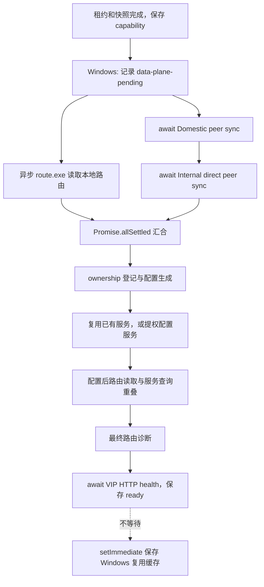
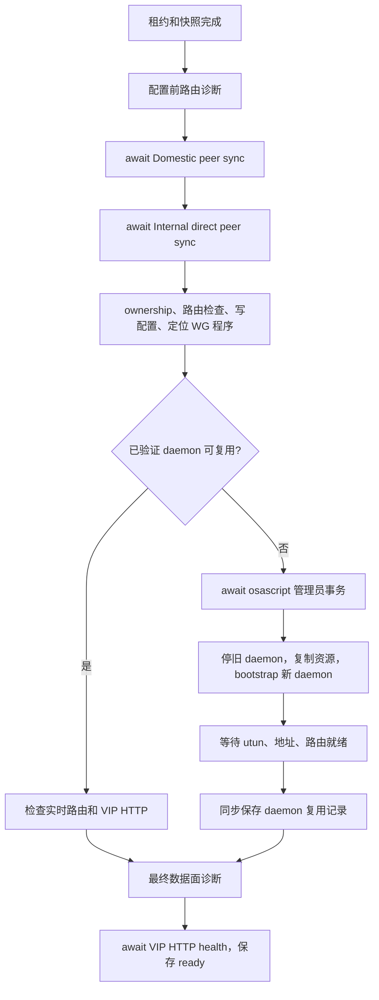

# 正式 Luopan 调用 standalone 的执行顺序：Windows / macOS

状态：2026-10-23 源码走读；未改运行代码、系统网络或生产配置。承接 [53 登录与容量分析](./53-luopan-login-and-domestic-capacity-review-2026-10-22.md)。正式应用目录为 `/Users/qpjoy/workspace/mingxi/luopan/po-frontend`；分析基线为 `f0fb437`。

## 1. 先区分“串行等待、并行等待、后台、同步阻塞”

| 分类 | 代码形式/例子 | 是否挡当前登录 | 是否可能阻塞 Electron 主线程 |
| --- | --- | --- | --- |
| 串行等待 | `await fetch(A); await fetch(B)` | 是，A 完成后才开始 B | 网络等待本身通常不阻塞事件循环 |
| 并行后汇合 | `await Promise.allSettled([A(), B()])` | 是，要等两个分支结束 | 取决于分支中有没有同步代码 |
| 不等待的后台任务 | `void task()`、`setImmediate(() => void task())` | 不以任务完成作为入口门槛 | 仍可能包含同步文件/原生命令，不能等同于独立线程 |
| 同步阻塞 | `execFileSync`、`spawnSync`、同步文件操作、`Atomics.wait` | 是 | 是，执行期间主进程不能处理其他 JS 回调 |

当前主链多数是“使用异步 I/O 的串行等待”，不是全部并行，也不是所有 `async` 都已放后台。本文中“补丁路径”指正式 package.json/lockfile 声明的两个 pnpm patch 正确应用后的实现；本机实际安装的无补丁 2.3.18 另列，不能混同为线上安装包实况。

## 2. standalone 在 Luopan 中负责什么

Luopan 在自己的 Electron 主进程中调用 SDK，产品声明为 `productId=luopan, mode=standalone`。它自行拥有产品网络，不需要先启动 MX-H2I 桌面程序。

| 层次 | 当前执行的事情 |
| --- | --- |
| Luopan adapter | 启动身份选择、Token/密钥/lease capability 加密存储、请求排队、bootstrap、peer 同步、网络状态、主窗口代理、海外后台任务 |
| standalone/core | POST enrollment，取得产品租约/IP；再 POST snapshot，得到 peer、endpoint、VIP、路由计划 |
| electron-launcher | 本机 ownership 冲突检查、准备 WG profile、选择 relay/direct peer、调用平台服务、路由诊断、保存 ownership |
| native wireguard | Windows 服务/UAC/路由/NRPT 生命周期；macOS LaunchDaemon/utun/路由/endpoint bypass 生命周期 |
| 其他 Launcher 能力 | 网络 ready 后检查应用更新；用户身份 ready 后准备 Oversea 配置 |

`connectNetwork()` 当前直接走 enrollment → snapshot，调用前没有额外显式 GET product registry；产品权限与分配在服务端处理。不要把 demo 或旧设计的每一个步骤原样加入正式流程。

依据：[创建 Luopan standalone](/Users/qpjoy/workspace/mingxi/luopan/po-frontend/src-electron/luopan-launcher-manager.ts:509)、[standalone connectNetwork](/Users/qpjoy/workspace/qpjoy/de/de-llaaddddeerr/electron-dock/mx-launcher/packages/launcher-standalone/src/index.ts:123)、[core 创建 session](/Users/qpjoy/workspace/qpjoy/de/de-llaaddddeerr/electron-dock/mx-launcher/packages/launcher-core/src/index.ts:714)。

## 3. 两个平台共同的主链

### 3.1 应用启动

```text
显示本地“正在配置网络”页面
 → 读取本地配置、runtime、remembered user
 → 有记住的用户：读取保存的 MX token → 尝试恢复用户网络
   否则/恢复失败：申请匿名网络
 → 完整执行建网流程
 → 主窗口 setProxy → closeAllConnections
 → 加载正式 renderer
```

以上全部是前置等待。`startupNetworkPromise` 合并同一轮重试，避免重复启动。只有联网成功才加载正式 renderer；本地 loading 页提前显示，不代表业务已进入。

恢复过用户身份时，海外准备可在 renderer 加载前开始，但不 await；应用更新检查在 renderer 加载完成后 `void` 调用。代理 `resolveProxy` 诊断通过 `setImmediate` 后置，`setProxy` 和 `closeAllConnections` 本身仍 await。

依据：[startup](/Users/qpjoy/workspace/mingxi/luopan/po-frontend/src-electron/electron-main.ts:338)、[身份恢复](/Users/qpjoy/workspace/mingxi/luopan/po-frontend/src-electron/luopan-launcher-manager.ts:129)、[主窗口代理](/Users/qpjoy/workspace/mingxi/luopan/po-frontend/src-electron/electron-main.ts:256)。

### 3.2 点击登录

```text
业务账号登录 → user-info
 → launcher:connect-user 进入 userConnectionQueue
 → 旧海外请求 abort、等待本地旧配置清理
 → MX 网络 OAuth → 加密保存 token
 → connectIdentity(user)
 → 主窗口代理配置 → 保存 rememberSession
 → 发起海外准备、更新检查（均不 await）
 → IPC 返回
 → 路由权限加载 → 首页
```

业务登录在调用 standalone 之前；路由权限加载在 standalone 返回之后。两者都影响用户感知总时间，但不应计入 WG 安装时间。

### 3.3 一次 connectIdentity 的共同步骤

| 顺序 | 动作 | 分类 |
| --- | --- | --- |
| 1 | 同身份正在连接则共享 Promise；不同身份则等待上一轮结束再执行 | 串行/合并请求 |
| 2 | 若当前进程已有同身份 activeSession 且 ready，先探一次 VIP health；成功直接返回 | 前置快速分支 |
| 3 | 逐个 bootstrap 候选探健康端点 | 串行网络等待 |
| 4 | 读取或首次生成 WG 密钥；准备并保存 lease capability | 串行等待，局部加解密同步 |
| 5 | POST enrollment：提交产品、设备、身份、公钥及 capability | 串行网络等待 |
| 6 | POST snapshot：使用第 5 步返回的 lease | 串行网络等待，依赖前一步 |
| 7 | 依次持久化 handover lease/current lease capability | 串行本地等待 |
| 8 | applySession：Windows 只记 pending；macOS 做一次配置前路由诊断 | Windows 轻量状态；macOS 含同步探测 |
| 9 | 准备本地路由并同步远端 peer，平台差异见下 | Windows 局部并行，macOS 串行 |
| 10 | ownership → WG 平台操作 → 数据面诊断 → ownership 落盘 | 前置等待 |
| 11 | curl 直连 service VIP `/healthz` | 异步子进程，但前置 await |
| 12 | 保存 network-ready、activeSession/identity/runtime，再返回 | 前置本地等待 |

第 11 步使用 `curl --noproxy '*' --max-time 2`，子进程上限 3 秒；这里主要验证 Launcher 的 VIP health，不等于已经查询 Java 首页业务。`getInternalApiDirectStatus` 根据网络状态与 URL 计算 running，没有额外发业务 HTTP 请求。

密钥通常复用已加密保存的值，不是每次重新生成。遇到特定 stale lease 错误才进入停止旧数据面、rotate key、更新 install/device identity 后重新 enrollment 的恢复分支。

依据：[排队/快速复用/主链](/Users/qpjoy/workspace/mingxi/luopan/po-frontend/src-electron/luopan-launcher-manager.ts:283)、[配置前诊断](/Users/qpjoy/workspace/mingxi/luopan/po-frontend/src-electron/luopan-launcher-manager.ts:526)、[VIP health](/Users/qpjoy/workspace/mingxi/luopan/po-frontend/src-electron/luopan-launcher-manager.ts:969)、[业务状态计算](/Users/qpjoy/workspace/mingxi/luopan/po-frontend/src-electron/electron-main.ts:627)。

## 4. Windows：三个局部并行，外层仍然逐段等待

### 4.1 peer 同步前后



[prepareRoutesAndSyncPeers](/Users/qpjoy/workspace/mingxi/luopan/po-frontend/src-electron/luopan-launcher-manager.ts:712) 真正同时发起的是“本地路由预读”和“整段 peer 同步”。**Domestic 与 Internal direct 彼此没有并行**。两条分支都 settle 才继续；路由读取失败可回退，peer 请求抛错则失败。预读快照超过 5 秒不能用于配置准备，回退到新查询。

### 4.2 服务复用与安装/重启

先生成产品 WG 配置、确认本地路由冲突与 ownership，再检查能否复用旧服务。补丁的复用不是“看到服务 Running 就直接返回”：需配置/程序指纹、服务进程身份、lease reuseKey 一致，并通过实时状态、路由及 VIP HTTP 检查。成功则跳过 UAC 安装/重启，但外层仍会完成数据面诊断和最终 HTTP health。

复用失败进入提权 PowerShell，等待子进程结束：

```text
确认旧服务归属
 → 请求旧服务停止
 → 清理本产品旧 NRPT/路由、登记 endpoint 物理出口旁路
 → 复用同程序同配置路径的服务注册来重启，或回退 WireGuard installer
 → 确认服务 Running 且新 lease IP 已出现在正确网卡
 → 应用/核对产品 overlay 路由与 NRPT 处理入口
 → 再确认服务和地址
```

Luopan 本次配置 suppress DNS，不新增接管业务域名的 NRPT 规则；通用生命周期中的旧 owned NRPT 清理仍会执行。“当前不配置 DNS”不等于“不会有 DNS 清理耗时”。

**DNS 与端点准备的并行是有条件的**：只有已验证可重启的旧服务、无 DNS 配置、无新增 NRPT 规则、端点全为 IPv4、启用快速连接检查，才会：

```text
确认旧服务 Stopped
 ├─ PowerShell 异步 runspace：完整 owned NRPT 清理（持有机器级 DNS 互斥）
 └─ 主分支：旧路由清理 → endpoint bypass（端点互斥）→ 可提前启动 DNS 无关服务
 → finally 等待 DNS 任务结束
 → 新服务与新地址就绪 → 路由核验
```

`BeginInvoke/EndInvoke` 是并行子任务，**仍必须 join**；超时或清理失败会阻止 ready，并处理已尝试启动的服务。真正首次安装没有可验证的旧服务，通常不满足这个重叠条件；域名端点、DNS 配置、归属不匹配等也保留串行回退。

依据：[服务复用补丁](/Users/qpjoy/workspace/mingxi/luopan/po-frontend/patches/@qpjoy__electron-launcher@2.3.18.patch:510)、[native 快速就绪条件](/Users/qpjoy/workspace/mingxi/luopan/po-frontend/patches/@qpjoy__electron-core-wireguard@2.3.17.patch:195)、[停止/并行清理/重启](/Users/qpjoy/workspace/mingxi/luopan/po-frontend/patches/@qpjoy__electron-core-wireguard@2.3.17.patch:269)。

### 4.3 配置后的检查与缓存

SDK 先派发异步 `route.exe print -4`，随后执行服务状态查询，最后 await 路由结果。两个原生进程可重叠；**服务查询本身仍是同步调用，可暂停 Electron 主线程**。通过校验的配置后快照仅用于同一次连接，5 秒内有效、一次消费，绑定配置和 operation；它不能替代后续连接的新鲜证据。

最终数据面诊断失败会重试，默认最多 12 轮、间隔 1 秒；每轮本身的原生命令耗时另计。通过后再 await VIP HTTP health。只有这些成功且 ready 状态保存后，Luopan 才用 `setImmediate` 发起 Windows 服务复用缓存保存；后者不挡登录，其异步 PowerShell 查询之外仍有同步 hash/文件读写。

依据：[配置后检查并行](/Users/qpjoy/workspace/mingxi/luopan/po-frontend/patches/@qpjoy__electron-launcher@2.3.18.patch:568)、[缓存后置](/Users/qpjoy/workspace/mingxi/luopan/po-frontend/src-electron/luopan-launcher-manager.ts:673)。

## 5. macOS：主要靠复用，冷路径基本串行



macOS 没有 Windows 那段“路由预读 ∥ peer 同步”。`applySession` 先做实际路由诊断，之后依次同步两个 peer，再进系统配置。

### 5.1 有补丁时的服务复用

检查 daemon installed/loaded/running、PID、启动时间、配置与二进制/脚本/plist 指纹、lease reuseKey。匹配后仍检查 live WG/route 与 VIP health，成功才跳过提权。这个检查中的 `launchctl`、`ps`、文件读取/哈希等包含同步操作，HTTP probe 则异步 await。

冷应用成功后，macOS 的复用记录保存目前是**同步前置**，没有像 Windows 一样由 Luopan 延后到 `setImmediate`。保存失败被忽略，但执行它所花的时间仍在当前调用内。

依据：[macOS 复用指纹](/Users/qpjoy/workspace/mingxi/luopan/po-frontend/patches/@qpjoy__electron-launcher@2.3.18.patch:14)、[复用/安装/保存顺序](/Users/qpjoy/workspace/mingxi/luopan/po-frontend/patches/@qpjoy__electron-launcher@2.3.18.patch:457)。

### 5.2 不可复用时的管理员事务

1. 准备 LaunchDaemon 资源与脚本；`osascript ... with administrator privileges` 发起提权并 await。
2. 清理匹配的旧实例；bootout 本产品 daemon，等待退出；复制 WG 配置、`wg`、`wireguard-go`、daemon script、plist，设置 root 权限。
3. bootstrap/enable daemon。补丁去掉 `kickstart -k` 的 `-k`，避免杀掉 RunAtLoad 刚启动的隧道。
4. daemon 消费 clean-start marker；没有有效 marker 时执行恢复清理。配置公网 WG endpoint 的物理出口旁路。
5. 启动 `wireguard-go` 子进程，等待新 utun 名称；`wg setconf`，网卡 up，设置 lease 地址、anchor、自身 lo0 路由和产品路由，执行最终验证。
6. JS 层等 daemon/tunnel ready，再做 SDK 状态和数据面检查，再做 Luopan 的 VIP HTTP health。

`wireguard-go` 被 shell 放后台运行，是为了让 daemon 继续配置该网卡；**业务入口仍在等配置和 health，不会因此提前进入系统**。daemon 最后 `wait WG_PID` 是长期运行生命周期，JS 不会等待整个 daemon 退出，而是轮询它就绪。

DNS 相关函数是 native 通用能力；本次 Luopan `suppressWireGuardDns:true` 导致生成配置不设置 WireGuard DNS，不等于 H2I 的 split DNS/PAC 接入流程。

依据：[macOS installer 与 readiness](/Users/qpjoy/workspace/mingxi/luopan/po-frontend/node_modules/@qpjoy/electron-core-wireguard/dist/index.js:735)、[管理员脚本](/Users/qpjoy/workspace/mingxi/luopan/po-frontend/node_modules/@qpjoy/electron-core-wireguard/dist/index.js:1890)、[daemon 启动](/Users/qpjoy/workspace/mingxi/luopan/po-frontend/node_modules/@qpjoy/electron-core-wireguard/dist/index.js:2144)、[kickstart 修正](/Users/qpjoy/workspace/mingxi/luopan/po-frontend/patches/@qpjoy__electron-core-wireguard@2.3.17.patch:80)。node_modules 链接描述本机基线，安装依赖后内容可能改变。

## 6. 真正后台运行的内容及串行队列

| 内容 | 调度方式 | 边界 |
| --- | --- | --- |
| 新用户海外订阅 | `void prepareOverseaInBackground` | 远端同步与下载不挡内网登录；打开海外链接时才等待就绪 |
| 已记住用户的海外恢复 | 启动建网成功后发起，不 await | 可与 renderer 加载重叠 |
| 主窗口代理诊断 | `setImmediate` 中 resolveProxy | 不挡页面进入；setProxy/closeAllConnections 仍前置 |
| Windows 复用缓存 | ready 后 setImmediate | 仅正确应用补丁时有效；不挡登录 |
| 应用更新检查 | 网络 ready 后 void handleNetworkReady | 检查结果不作为网络登录门槛；手动下载/安装另有等待 |
| macOS endpoint watchdog | daemon 内后台子进程，约每 5 秒检查 | 物理出口或路由漂移时恢复旁路；不是每 5 秒重做账号登录或申请 lease |
| WG 保活 | 生成 peer 的 PersistentKeepalive=25 | 原生网络行为，不是 JS 登录任务 |

后台不代表可随意并发写系统状态。当前还有：

- `userConnectionQueue`：用户联网 IPC 整体串行；上一个慢请求会让下一个等。
- `connectIdentity`：同身份共享任务，不同身份等待上一轮结束。
- KeyStore：并发读取/首次创建共享进行中的操作；rotate 等前一操作。
- LeaseCredentialStore：`operation.then(task, task)` 串行加密文件写入。
- OverseaBackground：remote 请求可 abort/丢弃旧 generation，本地 clear/apply 仍按 writes 队列串行；新登录等待旧本地清理。
- ownership：跨进程文件锁保护 H2I/Luopan 等应用的资源归属。锁等待使用 `Atomics.wait`，当前上限 2 秒，可能同步暂停 Electron 主线程。

主进程本身没有一个持续定时“刷新 lease/重新 connectIdentity”的循环；手动 refresh、启动恢复、用户登录/路由检查触发连接。不能把 native watchdog 或 WG 保活当作 Launcher 定时重新认证。

依据：[IPC 队列](/Users/qpjoy/workspace/mingxi/luopan/po-frontend/src-electron/electron-main.ts:865)、[海外写入队列](/Users/qpjoy/workspace/mingxi/luopan/po-frontend/src-electron/oversea-background.ts:18)、[lease 文件队列](/Users/qpjoy/workspace/mingxi/luopan/po-frontend/src-electron/launcher-lease-credential-store.ts:127)、[同步锁等待](/Users/qpjoy/workspace/mingxi/luopan/po-frontend/node_modules/@qpjoy/electron-launcher/dist/process-lease.js:47)。

## 7. 目前实际依赖与声明补丁的差异

本机 Electron 解析的是无 patch_hash 的 Launcher 2.3.18；上一轮静态检查 20 项 Windows 性能特征均 false。以下是本机文件证据，不代表用户 Windows/macOS 安装包已经复现。

| 项目 | 正式源码+已声明补丁 | 本机无补丁依赖 |
| --- | --- | --- |
| Windows 配置前路由预读 | 有异步导出，和 peer 同步并行 | 缺少该导出，不能获得该优化；有回退路由探测 |
| Windows 服务复用/原地重启 | 配置/身份匹配后可复用；失败回退 installer | 无新增复用分支 |
| Windows 等服务 ready | 以 Running+新 lease 地址为条件 | 完整重建路径两次要求持续 Running 4 秒，形成约 8 秒稳定等待，另加其他操作 |
| Windows NRPT/endpoint 重叠 | 满足条件时 runspace 并行，仍 join | 原串行流程 |
| Windows 配置后路由查询/缓存 | 局部并行、快照复用、缓存后置 | 原重复同步探测路径 |
| macOS daemon 复用 | 指纹+进程+live health 校验后跳过安装 | `reuseExistingDarwinService:true` 没有对应实现分支 |
| macOS bootstrap 后 kickstart | 不带 `-k` | 仍带 `-k`，可能重启刚创建的 daemon |

Windows 的两次 4 秒在 [本机 native 旧实现](/Users/qpjoy/workspace/mingxi/luopan/po-frontend/node_modules/@qpjoy/electron-core-wireguard/dist/index.js:3428) 定义，由 [完整安装路径](/Users/qpjoy/workspace/mingxi/luopan/po-frontend/node_modules/@qpjoy/electron-core-wireguard/dist/index.js:3475) 在安装后、加路由后各调用一次；这不是今天真机实测，也不是每次 app 内同身份快速复用都必花 8 秒。

Quasar 的 [构建/开发检查](/Users/qpjoy/workspace/mingxi/luopan/po-frontend/quasar.config.ts:254) 会调用 runtime inspector；Windows 主机缺补丁时检查不通过。检查按运行主机 platform，macOS ready 不证明 Windows 优化存在。实际发布必须比对 ASAR/安装包的文件特征和指纹。

## 8. “已装服务复用”和“同进程会话复用”是两回事

同进程 `activeSession + activeIdentity` 健康时可在最外层直接返回，跳过 enrollment、peer sync 和平台应用。应用重启后 activeSession 不在内存，即使系统 WG 服务仍运行，也会先重新走控制面；只有进入平台 SDK 后，补丁才可能复用已存在的系统服务。

当前 [普通 before-quit](/Users/qpjoy/workspace/mingxi/luopan/po-frontend/src-electron/electron-main.ts:1166) 清理旧 tunnelManager、OpenVPN、Mihomo 和浏览器，**没有调用 `luopanLauncherManager.stop()`**；更新安装前的 [cleanupRuntimeForUpdate](/Users/qpjoy/workspace/mingxi/luopan/po-frontend/src-electron/electron-main.ts:301) 才显式 await 它。因此不能假定普通退出必停 standalone 系统服务。macOS 关闭全部窗口也不退出进程，Windows 则触发 app.quit。

`launcher:clear-user` 仅清启动偏好/海外配置，不调用 standalone stop 或主动切匿名。这些是当前调用边界描述，本轮没有改变生命周期策略。

## 9. 对卡顿定位的直接含义

- Windows 远端准备阶段近似 `max(本地路由预读, Domestic peer + Internal peer)`，不是把三项相加；macOS 这段仍是依次执行。
- Windows DNS 清理与 endpoint 操作的日志可能重叠；macOS 复用缓存保存目前仍算入前置耗时。
- 两个平台的 enrollment → snapshot、Domestic → Internal direct、平台 ready → 最终 HTTP health 都仍是依赖链。
- 同一条调用既可能“等远端但事件循环空闲”，也可能“同步原生命令导致主进程暂停”。应同时看 LoginTiming 阶段和 main event-loop delay，而不只看 loading 时长。
- 真正可后台的海外/更新/代理诊断已经后置；当前重点是核实补丁生效、缩短或移除不必要的前置依赖、减少重复系统探测。不能把所有步骤改为 Promise.all：租约/身份交接、owned DNS/route 清理和 ready 证据仍有真实依赖，也承担 MX-H2I 共存保护。
