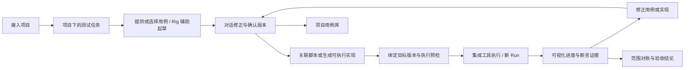

# mx-rig 实施规划：以线上 Luopan 双端全量测试验收

创建：2026-10-02；更新及验证：2026-10-03。Rig 基线：0.8.0 Preview。本文只规划 **mx-rig**，以用户最后明确的验收对象为准。

## 范围与目标

**被测对象：`/Users/qpjoy/workspace/mingxi/luopan/po-frontend`，线上 Luopan 项目的 Web 与桌面端。验收执行者：mx-rig。所有实现、测试资产、适配器和文档更改只在 mx-rig 内。**

`mx-launcher/demos/luopan` 是 standalone 集成 demo，可帮助理解 Launcher 合同，不能代替线上项目验收。MX-H2I、Launcher/Internal、Hub、Night-All 在本文中仅作为依赖上下文，不规划它们的产品演进或迁移。Hub 合同回归不再是 Rig 首个验收样例。

Rig 要成为以用户测试用例为中心的对话式测试工作台：用户接入项目后建立测试任务，提供已有用例，或让 Rig 根据需求辅助分析和起草；双方沟通修正，确认用例后由集成工具执行并展示证据。AI 分析和生成是可选能力，已有可执行测试可直接复用。首轮不扩展通用 Agent 市场、等级体系或新的业务中台。

“用 Rig 验收”意味着用户在 Rig 中发起和管理任务，由 Rig 的 Suite/Task/Runner 或 Procedure/Station 执行，结果进入 Rig 的 Run 与报告。手工在终端跑一组测试、只把结论贴进聊天，不构成这条产品链路的验收。

## 现有基础与准确缺口

| Rig 能力 | 已有实现 | 本轮需要补齐 |
| --- | --- | --- |
| 项目与测试计划 | App、Suite、Task、Case Catalog；CLI 项目上下文 | 将实际 Luopan 仓库、QA 代码、发布构建和环境固定到一次验收 |
| Agent 工作台 | Mission、对话、工具、审批、人工接管、Flight Plan | 项目下的测试任务统一承载用例协作、审阅、执行 Run、问题和复验 |
| 用例协作 | Case Catalog、case-designer、case_draft；项目下任务、JSON 导入、编辑、审阅、版本历史 | 已确认任务用例沉淀到共享项目库；可执行实现关联；更多文档导入格式 |
| 确定性执行 | 代码 Runner、ProcedurePlayer、ProcedureBench、Station | Web/桌面分别派发；完整用例分母与必需平台固定 |
| 浏览器与桌面 | BrowserTools、Electron 工位、原生桌面预览 | 真实打包 Luopan 身份；平台能力预检；专用网络/权限工位 |
| 结果与证据 | JUnit、summary v2、catalog 对账、artifact、回放 | 跨 Suite 验收结论；版本一致；证据 hash、上传与缺失状态 |
| 修复 | CLI 文件/命令能力；Procedure 修正、验证、批准 | 测试代码提案绑定原失败、基准版本、diff 和新 Run |
| 团队执行 | 自有账号、PG、认领、审批 CAS、心跳、回收 | 迟到写入隔离、故障验证；环境占用与清理回执 |

继续复用已有实体，避免另建同义的 TestJob/TestRun 系统。当前 `mxt_tasks` 必须绑定 Suite，实质是执行计划；它与新的用户侧“测试任务”含义不同。建议扩展 Mission 的项目关联和持久任务视图，承载从用例讨论到多次执行的工作过程；创建该容器不应强制启动模型。Run 是一次执行，Procedure 是确定性规程。Mission 完成不代表测试通过；派发成功不代表 Run 已执行。

源码已接入 `cypress`、`playwright` 和 `playwright-electron` 引擎，另有 BrowserTools 与 Procedure 路径。这证明具备执行基础，不表示“导入自然语言用例后在桌面工作台可视化跑通”已经完成。`case_draft` 在 Mission 中保存待审建议，现可载入任务用例编辑器，经人修正、保存和确认；版本存储独立于 Runtime 写入。当前 Runtime 的 followup 仍不支持在活动执行中直接续接对话，运行中的指令处理待补齐。

当前 Luopan 接入有明确限制：

- Web 模板 `packages/test-platform/server/onboarding/compass.mjs` 默认 `public` 分支和 `pnpm e2e:local`。实际 checkout `feat/yjj/hdo_v2`、提交 `a4cc5de02177cf67b8a498836151297068d24575` 没有该脚本，`npm test` 是空通过命令。必须针对实际被测提交预检。
- 当前 checkout 发现 25 个唯一路由路径、155 个测试文件。这是源码资产清单，不是已执行的用例数或业务覆盖率。
- `test-packs/compass/rig-specs/electron`（原 `test-packs/compass-electron`）只有两个启动用例与一个有前置条件的登录用例；原生弹窗、系统权限、完整业务和网络行为不能据此判为通过。
- Runtime 同步会裁剪内容、排除部分转录与证据，不能当完整 artifact 交付；PG 故障测试与真实模型评测应分别验证。

这些是规划时的源码快照，不等于线上正在运行该提交；执行前以部署清单和实际发行物重新绑定。

## Rig 内的目标流程

1. **接入被测项目**：登记项目名称、目录和 Web/桌面类型，识别现有测试资产。项目只需接入一次；环境、账号和发行包可在执行前补齐，不应阻塞用例讨论。本轮 Luopan 源目录只读，QA 工作目录位于 mx-rig 内。
2. **在项目下建立测试任务**：例如“本次发布双端验收”或“登录与权限回归”。用户在项目中开始一次新的测试对话时，可自动建立任务，无需先配置 Suite、引擎或定时计划。
3. **准备任务用例**：支持用户导入或手写、选择项目已有用例、让 Rig 根据需求和源码辅助起草，三种来源可以混用。Rig 标明来源和推断，补充建议不得静默替换用户的预期结果。
4. **沟通、修正与确认**：对话与用例表同步；用户可直接编辑，或让 Rig 修改前置条件、数据、步骤、预期结果、优先级和适用平台。确认的是可见的用例版本与本次范围，草稿不自动成为正式验收标准。
5. **准备可执行实现**：已有 Cypress/Playwright 脚本直接关联；自然语言用例由 Rig 转成脚本或 Procedure，并保持 caseId、用例版本与实现的对应关系。不能自动执行的项标明待实现、受阻或人工见证。实现不得擅改已确认的预期结果；需要改变时返回用例审阅。
6. **提交执行并可视化展示**：执行前绑定应用提交、Web 部署包、桌面发行包、QA 提交、环境和账号引用，预检脚本与工位。Rig 在后台准备执行计划并选择已配置的引擎，用户可查看和覆盖；界面展示用例进度、步骤、可用的实时预览及截图/trace/日志。断言由脚本/Procedure 产生，模型不决定红绿。
7. **查证、修正与复验**：从 Run 定位失败证据和实际版本，区分产品、测试、环境问题或证据不足。用户继续对话修正用例或测试实现；每次改变形成新版本，每次复验建立新 Run。只改 mx-rig 中的测试代码/规程，产品问题保留可复现证据，本轮不改 Luopan。
8. **沉淀与作出结论**：经确认的用例版本进入项目用例库供后续任务引用。全部必需用例与平台满足、清理完成、证据完整后才通过；缺项明确 blocked/notRun，不用总通过率掩盖关键缺口。

### 用户界面与实体关系

用户主要接触“项目 → 测试任务 → 用例 → 执行结果”。任务内部提供“对话、用例、执行、结果”视图；模型、代理、引擎与工位配置放在项目或工作台设置中。每次执行自动产生记录，用户不必另建一个任务才能复跑。

| 用户概念 | 复用基础与规划边界 |
| --- | --- |
| 项目 | App 加项目目录、需求来源、QA 目录和环境引用；项目用例库跨任务复用 |
| 测试任务 | 扩展 Mission 的任务视图，关联项目、目标、对话、草稿、确认的范围和多个 Run；不要求用例齐全才创建 |
| 用例 | Case Catalog 加版本；任务可以保留新草稿，并引用已有用例的明确版本，不能跟随用例库更新而静默变化 |
| 执行计划 | 复用现有 Task/Suite，记录引擎、命令、过滤范围和工位；在准备执行时生成或选择 |
| 执行记录 | Run 固定用例版本、实现版本、目标构建和环境，保存结果与证据；后续修订不覆盖历史 |

用例可简化为草稿、待确认、已确认；是否已具备自动化实现单独表示。已确认不等于可执行，更不等于已通过。正在运行时允许用户提出修订，但默认作用于下一版；明确要求停止或切换当前执行时，经取消/暂停回执后再创建新 Run，不能在同一 Run 中悄悄更换验收标准。

可视化能力按引擎说明：统一展示用例、步骤、结果和证据；支持预览的工位额外提供实时画面与接管。Cypress Runner 原生界面是否嵌入需单独验证，不能由“已集成 Cypress”推断所有执行都能直接嵌入 Rig 桌面。

现有固定流程继续承担可重复执行和回归，逐步通过工具接口开放给 Agent；Skill 描述何时及如何组合这些工具。普通用户只需围绕测试目标和用例沟通，无需先理解 Skill、Harness 或 Runner。

## Luopan 覆盖范围驱动的 Rig 能力

下表是用例设计范围，不是已实现/已通过清单。落地时拆成稳定 caseId 与单独断言，登记到 Rig Catalog；不能只给每个页面一个“打开成功”断言。

| 验收范围 | Luopan 依据 | Rig 要提供的支持 |
| --- | --- | --- |
| 登录与会话 | 登录、找回密码、过期/撤销、退出、角色与灰度 | 账号引用、敏感输入处理、正反向权限断言、会话隔离 |
| 核心业务 | 首页、AI 对话、社媒/内容/账户/评论线索、策略 | 可重复数据、流式/异步等待、分页/空数据/重试、业务结果断言 |
| 分析与任务 | 画像、人员落查、敌情、文件分析、特征比对、Agent 超市、政情报告 | 文件 fixture、任务状态/取消、额度与重复调用检查、长任务证据 |
| 设置与外部入口 | 设置、帮助、Twitter 设置、二维码、支付回跳、profile 重定向、未知路由 | 持久化验证、受控外部跳转/测试订单、秘密不泄露、错误页 |
| 双端一致性 | Web 与 Electron 共享业务路径 | 相同用例条件和数据，各自独立 Run；记录平台差异 |
| 桌面专属 | 启动、窗口/托盘、文件、更新、安装、退出/重启 | 打包身份与 hash、生命周期管理、原生能力预检与人工见证回执 |
| 网络与权限 | 隧道、路由、授权拒绝、断网/恢复、与 MX-H2I 共存 | 专用工位、环境互斥、操作前后系统证据、清理与恢复；Rig 不成为网络 owner |
| 通用异常 | 401/403、限流、超时、500、空结果、重复点击、取消 | 故障 fixture、未知结果标记、幂等断言、失败分类 |

“全量”以版本化 Catalog 和本次发布矩阵为分母。先确认线上支持的浏览器、Windows/macOS 版本、CPU 架构和安装/便携发行方式，再锁定矩阵；没有实测的组合不外推为通过。已下线或未发布的功能在范围定义时留依据，不允许测试临时 skip 来缩小分母。

## 最小增量设计

### 项目、环境与版本

在现有 App/Mission/Case/Suite/Task/Run 上补关联、版本与快照，不另建项目管理服务。项目接入与任务草拟使用最少信息；执行快照再固定应用仓库/提交、QA 仓库/提交、用例版本、target origin 或发行包 hash、环境/seed 版本、账号引用、工位要求、预算和清理方案。

应用 SHA 与 QA SHA 分开。外置测试包在 mx-rig 内，目标仓库只读。Web 部署版本不能仅由本地 HEAD 推断，桌面程序不能只凭进程名称认定为 Luopan。public Cypress 模板作为历史资产保留，新套件明确绑定当前可执行测试源。

### 执行与结果

复用 summary v2、JUnit、catalog scope 与 caseFilter。单条复跑可以通过，但只影响对应 Run；全量验收必须对账所有必需 Suite、用例和平台。零用例、全部跳过、缺失用例、重复结果、版本不一致、缺证据不能成为全量通过。

Agent 负责选计划、解释与提案，Runner/Procedure 负责执行和断言。Native 工位只注册明确能力；缺能力时 blocked 或生成带证据的人工见证步骤，不能用 renderer 点击替代系统行为证明。

### 证据与修复

复用 artifact API，增加清单：Mission/Run/case/action、类型/hash、相对路径、上传状态、访问范围。断网后可补交，重复上传幂等；只同步本机文件路径不算交付。

代码变更提案保留原失败、基准 QA 提交、diff、删改的断言/skip/快照、验证 Run。批准时再次检查版本，旧提案不能覆盖新测试。新成功不抹去旧失败。

### 持久执行与环境恢复

PG 认领、心跳和写入绑定执行实例与代次，回收后旧进程不得回写。回收代表外部动作结果可能未知，不自动重放已经提交的网络/更新/写入动作。

网络、更新与会话状态测试需要工位/环境占用锁、唯一数据命名空间、取消回执和清理步骤。清理失败单列，不覆盖原断言结果。Rig 保持执行与观测角色，不实现 Launcher 的路由/代理 ownership。

## 分阶段交付

| 阶段 | 仅在 mx-rig 内的交付 | 完成条件 |
| --- | --- | --- |
| P0 事实与可靠性 | 修正验收对象与历史入口说明；Run 防误绿；PG 执行代次与故障测试 | 失败不被 totals 覆盖，全 skip 不通过；审批交接、回收与续接后迟到写入被拒绝 |
| P1a 用例协作工作台 | 项目接入、项目下任务、导入/编辑/辅助起草、对话修正、用例确认与版本 | 用户可不调用 AI 建立任务和提供用例；也可与 Rig 共创；不要求预先配置 Suite；草稿和正式版本可区分 |
| P1b 接入完整范围 | Luopan 项目/构建/环境绑定、外置双端 test-pack、完整 Catalog、工位预检 | 显示全部待验范围及实现映射，未实现/受阻可见；不执行占位测试命令 |
| P2 确定性与可视化执行 | 用例与脚本/Procedure 关联、桌面内的测试代码提案、引擎适配、Web/Electron 业务用例和数据合同 | 从确认用例在 Rig 中发起双端执行；进度、证据、版本进入 Run；复用已有脚本；mock/启动冒烟不当全量 |
| P3 证据与恢复 | artifact 清单与补传、环境互斥、取消/清理、原生工位矩阵 | 重启/断网/取消后可核验结果与遗留；网络、权限、更新具有系统证据 |
| P4 测试修复闭环 | 原失败 → 分类 → mx-rig 测试 diff → 验证 → 审阅 → 新 Run | 已知测试错误能修复；产品缺陷不会靠删断言“修绿”；历史可追溯 |
| P5 用 Rig 完整验收 | 一项 Luopan 验收任务关联所有 Suite/平台 Run 并给出完整性报告 | 必需项全执行且满足，证据/清理齐全；另报真实模型介入率、误修和成本 |

先实现 P0 → P1a/P1b → P2，再补 P3/P4；P5 是产品验收，不等于一次演示。优先用少量真实用例打通项目、任务、审阅、可视化执行与复验，再扩展 Luopan 全量范围。每阶段使用 Rig 的正式界面/CLI 入口验证，避免另写一套绕开 Rig 的验收工具。

## 本轮状态与执行条件

已实现 P0 与 P1a 的第一版，改动均在 mx-rig 内。P0 包含 Run 汇总判定、历史 Compass 接入范围提示、PG 执行代次与迟到写入保护。P1a 已提供：

- Web 与 Electron 共用“项目与任务”入口：管理员登记项目名称、目录与被测端，测试成员可在项目下创建任务。复用 App 与 Mission，`draft` 状态不调用模型、不占用执行认领，不要求 Suite。
- 任务内手工录入、JSON 文件/文本导入、选择项目 Catalog 用例。重复编号整批拒绝；不完整用例可保存，但确认时必须有步骤和预期结果。
- 对话使用本任务最新用例快照，Rig 提议不自动生效；载入编辑器后由用户修正、保存、确认。修订已有用户编号时不强迫改成 Rig 的编号格式，旧版本建议标明来源版本。
- 每次保存产生新用例版本，确认记录人员与时间；后续改动重新待确认，旧快照仍可查看。File/PG 存储复用文档基础，PG CAS 与本地串行化保护陈旧编辑，用例不随 Runtime 整行保存而丢失。

当前 UI 使用“用例、对话、测试实现、执行与结果、版本历史”五个视图。通用执行底座已继续落地 P2 的第一部分，不代表 P1b 的 Luopan 完整接入或 P2 全部完成：

- 在同一任务内选已有测试计划，关联本平台每条用例的相对脚本路径，预览命令、仓库/引用、工作目录、目标、mock/real、轨道和执行位置，然后显式派发。项目用例库中的同套件关联可复用；自定义编号无需先导入 Catalog。
- Run 保存确认用例、版本、确认人、平台、脚本关联、Task/Suite/App 配置与桌面包快照。配置变化使旧预览失效；相同 `requestId` 的重试在单进程内存模式与 PG 多副本下都返回同一 Run，后续用例修订不覆盖原记录。
- 本机 Runner 认领和 Kubernetes 调度均读取快照；完成时按已确认的 caseId 与 specPath 对账。缺失、跳过、脚本不匹配不会产生通过；原始失败、不稳定和范围外结果仍保留。现阶段报告依赖 Runner 的断言和编号合同，关联路径并不证明脚本已经正确实现自然语言预期，仍需人工审阅测试实现。
- 任务页按版本、平台和环境显示运行状态及逐条结果；只展开最近一次，历史逐次按需读取，避免把所有步骤一次塞进桌面响应。详细步骤、截图和录像复用既有报告入口，尚未将完整报告嵌入任务页。共享测试 API 不暴露私有 Mission 的用例正文。

兼容阶段明确按**整套 Suite 命令**执行，不把脚本关联伪装成精确到单条的引擎过滤；同套件额外测试可能运行。暂不接入带 `caseFilter` 的计划，也不支持一次把一个平台的用例分到多个 Suite。每个平台分别发起，mock 与真实环境不合并；没有“全量验收通过”的自动聚合按钮。Runner 实际提交可记录，但应用部署 SHA 与 QA SHA 分离、脚本哈希和完整环境清单尚待补齐。

桌面已接入按任务连接的只读源码分析，以及测试实现提案、审阅和 QA 导出；项目登记路径本身不授予读取权限。桌面已支持主动拉取登记的 Git 仓库并固定源码基准，Web 远程源码工位尚未接入；用例导入格式暂为 JSON。完整交付和验证记录见本文末尾，后续按以下顺序继续：

1. 项目成员与访问首版已落地，接下来实现显式共享任务及多人冲突处理，再接通对应权限范围的 QA Git 同步及批准实现的 Runner 执行；固定所读源码、用例、测试实现和实际执行之间的对应关系，保持被测 Luopan 仓库只读。
2. 多 Suite / 平台矩阵：把一个业务用例的 Web、Electron、原生操作分别映射到实现与工位；缺实现、缺证据、缺环境和待清理项明确阻塞，支持按失败范围复验。
3. 用正式 Luopan 测试入口逐步替换隔离夹具，补齐完整 Catalog、环境和数据清理后，再由 Rig 完成双端全量验收。

2026-10-03 验证：`npm run check` 通过，193 个 JavaScript 模块可解析；设置 `MX_RIG_TEST_DATABASE_URL` 后运行 `npm test`，**583 passed / 0 failed / 0 skipped**，包含 20 项真实 PG 测试。独立回环 PostgreSQL 使用本次临时目录和测试数据库，验证后已停止并清理数据；未连接 Luopan 线上服务。最新测试日志在 `/tmp/mx-rig-case-pg.k4Wg8x/full-tests.log`；先前 P0 日志保留在 `.runtime/rig-review-check.log` 和 `.runtime/rig-review-tests.log`。

Playwright 实测 Web（1440×960）与 Electron（独立临时 profile）均通过：接入项目 → 创建任务 → 手工及 JSON 导入 → 确认 → 修订及旧版核对 → 对话生成建议 → 人工采纳并确认。使用替身模型，未调用外部模型；执行前未产生 Run，页面无未解释的应用控制台错误。验证中修复了快速切换编辑时旧表单接收输入，以及 Chromium 对 HTML pattern 的校验问题。截图与结果在 `/tmp/mx-rig-case-ui-gEfjzG/`。移动端只检查了无横向页面溢出，未作完整使用验收。

后续执行闭环验证（2026-10-03）：最终全量 `npm test` 为 **592 passed / 0 failed / 0 skipped**，包含 21 项真实 PostgreSQL 多副本测试；另验证跨副本并发派发、配置变化、排队快照、缺失/跳过/脚本不匹配、权限与历史按需读取。日志：`/tmp/mx-rig-execution-pg.s70hfqcc/final-full-tests.log`。数据库仅为临时回环实例，验证后停止并清理数据。

真实 UI 验证使用 Playwright（当前没有 Browser 插件），Web 地址 `http://127.0.0.1:61728/rig/`，视口 1440×960；Electron 使用隔离临时 profile。两端都完成用户用例/AI 建议审阅到 v4 → 预览 → 派发 → Rig 正式 Runner 认领 → Web Playwright 与桌面 Electron 夹具断言 → summary、截图和步骤上传 → 结果刷新 → 历史展开。刻意错配一条脚本后得到 blocked；未调用 Luopan 线上服务。入口身份、非空内容、无错误遮罩、应用控制台与交互检查通过。截图与运行日志：`/tmp/mx-rig-execution-ui-S8w26U/`；临时 UI 测试脚本：`/tmp/mx-rig-test-execution-20261003.mjs`。Web 390×844 只检查横向溢出，未作完整移动端验收。本轮真实引擎验证覆盖 Playwright 和 Electron 夹具，未运行 Cypress 引擎；所有这些都是 Rig 执行链路验证，不是 Luopan 业务通过证据。

PG 部署需按顺序应用 `023_mission_execution_epoch.sql`、`024_test_workbench.sql` 和 `025_workbench_execution.sql`，并统一升级写入代码和匹配的桌面客户端；新旧服务长期混跑不能保证代次隔离，升级步骤见迁移目录 README。此处测试不等于已部署。

执行接口均位于 `/api/rig/v1/missions/:id/executions`，先检查 Mission 归属；写入需要 operator。GET 返回计划与最近 50 次执行摘要，`?run=<runId>` 可读取属于本任务的单次结果。`:plan` 接收 `{expectedRevision, taskId, bindings?: [{caseId, specPath}]}`，返回可审阅 manifest 与 `planHash`；`:dispatch` 在同一输入上增加 `planHash` 和 UUID `requestId`。用户/Agent 不能在此提交任意命令。没有创建第二套调度系统，真正运行的仍是现有 `mxt_runs` 与 Runner。

Luopan 实际执行还需绑定 Web 测试入口、线上对应提交/部署包、桌面发行物与平台、专用账号获取方式、测试数据范围、清理方案和网络工位。测试需在允许的测试账户和数据范围内运行，不能从“线上项目”推断允许改真实用户密码、支付、删数据或升级真实用户设备。

**Rig 的规划与首个验收对象已固定；Luopan 双端全量验收尚未完成。** 框架单元/集成测试通过只证明相应 Rig 行为，不作为 Luopan 本身的通过证据。

## 2026-10-03 导航与任务助手收敛

- 主入口和「新建任务」均进入项目下的测试任务，最近任务置于侧栏前部。报告、资产、专家 Agent、编排与配置仍可从折叠组进入；独立 Agent 工作台保留自己的新建入口。
- 移除全局职业视角；报告本页按摘要、风险、用例、覆盖切换。职责分配不等于账号权限，未来审阅人、负责人应挂在任务协作记录上，当前未新增团队责任分配功能。
- 新任务默认 Rig 测试助手，用户用例仍为主；读取真实执行后才能解释结果。`task_results` 绑定当前 Mission，只读且验证归属，保留版本、平台、profile、缺失/受阻状态。默认最多 10 次执行摘要，每批 10 条用例，返回 nextCaseOffset；按 runId 可读取任务内的历史执行。模型上下文不含完整步骤与截图，完整证据仍经现有报告查看。
- 原用例设计师等专家与旧任务保留，尚未把专家实现为自动委派子 Agent。旧部署的工具允许列表不扩张，管理员启用 task_results 后新助手才能读结果；任务内派发仍是用户预览确认后的确定性动作。

下一步仍是受控 QA 工作区中的测试实现提案与审阅，再扩展多套件、双端矩阵；本轮导航和助手改动不等于自动生成脚本或 Luopan 全量验收完成。

本轮 UI 验证：当前无 Browser 插件/技能，使用已安装的 Playwright。Web `http://127.0.0.1:59935/rig/`（1440×960）与 Electron 隔离 profile 均完成：项目下建任务 → 用户用例与模型建议审阅 → v4 确认 → 正式 Runner 跑 Web/桌面夹具 → 错配脚本受阻 → 历史读取 → 对话读取本任务真实 Run → 四种报告重点切换 → 旧 Agent 入口 → 新建任务返回项目。无应用控制台错误，入口、非空页面、无错误遮罩和交互检查通过。修复了展开导航后最近任务被挤压、报告重点控件重叠两个实测问题；任务内及最近任务状态显示“本轮对话完成”，不表示测试通过。

截图与结构化结果：`/tmp/mx-rig-execution-ui-AkAL5X/`；临时脚本：`/tmp/mx-rig-navigation-qa-20261003.mjs`。Web 390×844 仅验证无横向溢出；未验收完整移动操作。模型为脚本替身，测试引擎是真实 Playwright/Electron 隔离夹具，未连接 Luopan 线上服务。原 Web 与桌面 smoke 脚本也通过，日志分别为 `/tmp/mx-rig-navigation-browser-smoke.log`、`/tmp/mx-rig-navigation-desktop-smoke.log`，截图在 `/tmp/mx-rig-navigation-smoke/`。测试服务和隔离应用均在验证后关闭。

最终验证：`npm run check`（197 个模块）与 `npm test` **595 passed / 0 failed / 0 skipped**，包含 21 项真实 PostgreSQL 测试。新增验证涵盖任务结果工具的归属检查、Web/桌面一致性、缺失用例状态保留和分页，以及旧版教学完成记录兼容。同步调整折叠菜单的旧 UI 测试，并修正旧编排测试对后台保存完成时机的假设。全量日志：`/tmp/mx-rig-navigation-pg.24as11zp/full-tests.log`；临时 PostgreSQL 已停止、数据已清理。

## 仓库、项目工作区与版本同步（2026-10-03 补充决策）

### 两种源码接入

项目应接受本机目录，或 Git 地址与明确分支/引用。二者都是“源码来源”，不能与测试资产的写入位置混为一谈。

- 本机目录：使用用户已有检出，不切换其分支，不 reset、stash 或清理未提交改动。分析前记录当前 HEAD 与工作区是否有未提交改动；有改动时仅记录实际分析文件的内容哈希，不把 HEAD 当成全部源码事实。没有 Git 的目录仍可接入。
- 远程仓库：由执行分析的工位拉取到 Rig 管理的独立检出，先核对连接与分支，再解析实际 commit。一个任务运行期间固定该 commit；刷新分支需要显式操作并形成新的分析基准，不能随着轮询悄悄变动。不同任务使用独立 worktree/检出，避免分支互相切换。
- 桌面优先在成员本机拉取；Web 使用选定的受控工位。服务端不能把客户端绝对路径当成自己的本机路径。Git 认证通过连接引用或本机凭据管理器；密钥不写入项目清单、用例或模型上下文。
- 仅提供仓库地址不意味着允许 push。只读克隆、拉取和写入 QA 仓库分别记录权限；推送、合并、修改被测仓库需明确配置。

**当前实现**：项目表单可登记目录、Git 地址与分支；任务记录来源信息。桌面可连接已有本机目录，或主动拉取任务登记的 Git 仓库，再只读 list/read/search。连接记录实际提交、分支及工作区状态；源码读取带完整文件哈希，模型实现提案自动附带来源记录。登录会话结束后需要重新连接。Web 远程源码工位、跨桌面接管及自动重连尚未实现。

### 测试资产放在哪里

默认采用独立 QA 工作区，支持用户选择共置模式：

| 模式 | 目录与 Git 归属 | 用途 |
| --- | --- | --- |
| Rig 托管（默认，规划） | `project-workspaces/<projectId>/source/` 保存远程检出，`qa/` 是独立测试 Git 仓库 | 被测仓库只读，测试独立迭代；适合 Luopan 当前边界 |
| 用户提供 QA 仓库（规划） | 单独登记测试仓库、分支、工位检出位置 | 团队已有 E2E 仓库、CI 或独立 QA 包 |
| 项目共置（可选，规划） | 被测项目的 `.rig/`，使用该项目本身的 Git | 用户明确允许测试资产进入业务仓库时；不默认在 `.rig/` 再嵌套一个 `.git` |

QA 仓库推荐结构：`.rig/project.json` 保存无凭据配置、格式版本和来源引用；`.rig/cases/` 保存规范化用例；`.rig/skills/` 保存项目测试说明；`.rig/capabilities.json` 引用工具与技能的版本；`tests/`、`cypress/e2e/` 保存测试实现。模型聊天、令牌、运行时缓存和大体积截图/录像不提交 Git；证据进入 artifact 存储。

项目 QA 仓库保存共享基线；**只有可见范围一致的任务**才能在同一共享仓库的独立分支和工作副本里生成、修订资产，再明确合入项目基线。Git 分支不提供任务级保密：私有或仅限指定成员的任务资产先留在个人 QA 仓库或受任务权限控制的存储，显式发布后才进入共享项目仓库。批准测试实现不等于批准扩大共享范围。任务不能通过共用一个可写目录相互覆盖。个人使用先支持本机 QA Git，不强制绑定远程；团队需要共享时再配置 QA Git 远程与同步方向。这里描述的是目标形态，当前桌面仍依赖 Rig 服务保存用例及审阅记录，尚不是完整离线客户端。

不要用 `v1/、v2/、v3/` 复制全部用例来实现可编辑历史。Git commit 和服务端 revision 标识版本，稳定 caseId 标识用例；文件只表示当前工作副本。不可变的运行包可以按内容哈希缓存，但它们是执行快照，不是另一份可编辑用例库。

**当前实现**：任务用例与实现版本保存在独立服务端文档（单机 FileDocument / 团队 PgDocument）；桌面按明确批准的内容导出到个人 Rig 数据目录 `qa/<missionId>/v<implementationRevision>-<contentHash>/`。这是不可变交付副本，不是本地 Git 仓库，未自动 init/commit/push，也不创建被测项目 `.rig/`。

### 数据库和 Git 的职责

采用混合方式，禁止两边各自声明“最新版”：

- 数据库负责身份、权限、项目与任务关系、审阅动作、用例/实现的业务版本、执行状态和同步队列。当前用例和实现编辑通过版本 CAS 提交，过期写入不能覆盖新版。
- Git 负责可移植测试资产的文件历史、代码差异、分支、合并及 CI 消费。每个资产版本关联服务端 revision、父版本、内容哈希；生成 Git 提交后再补充 commit SHA。
- Run 固定 `caseRevision + implementationRevision + assetCommit + sourceCommit/dirtyFingerprint + platform + environment + configHash`。没有完成关联的字段明确显示未固定，不推导为已验证。
- 项目用例库是可复用资产；任务用例是导入/引用后的独立快照。任务修正需要显式“提升到项目用例库”才能影响后续任务，不能悄悄修改其他任务已经确认的范围。当前只实现任务快照与已有 Catalog 导入，尚未实现双向提升。

第一阶段同步以服务端版本为协作依据。保存草稿进入数据库；明确的里程碑（确认用例、批准测试实现）进入 outbox，按不可变内容写入 QA Git 并提交，成功后回填 SHA。事件带幂等键，失败显示“等待同步”，重试不产生重复提交。同步状态与审阅状态分开，不能因为 Git 不可达丢弃用户已保存的草稿。

每个同步事件固定项目、任务、目标分支、父提交、业务 revision 与内容哈希。同一分支的写入串行处理，提交前核对父提交；外部变更导致基准不同则转为冲突待处理，不能把任务 A 的导出覆盖到任务 B 的工作副本。推送是可单独配置的后续步骤，本机 Git 提交完成不等于团队远程已同步。

从外部 Git 拉入变更时，先读取分支并比较共同基准，展示增删和断言变化，再导入为新的待审阅 revision。冲突时保留双边分支/草稿，由人解决；禁止时间戳较新的一方直接覆盖另一方。离线编辑沿用基准 revision，恢复连接时提交候选版本，冲突不静默覆盖。完整离线工作、Git outbox 和双向同步均属后续工作。

### 修改、回退与能力扩展

用例和实现分别修订、分别确认。用例 v4 对应实现 r7，修改用例形成 v5 后，r7 仍是 v4 的历史证据，不自动获得 v5 的批准。回退旧用例或测试代码生成新草稿，保留旧审批、旧提交和旧 Run；不得用 Git reset 重写已共享历史。Git 层最终可用 revert 或创建新提交表达恢复。

项目能力也应版本化：技能说明、引擎适配、测试数据准备和清理策略都可以随资产提交。但仓库中的 `.rig/skills/` 是待审阅的项目内容，不能自动给 Agent 增加工具权限、执行安装命令或绕过用户审批。服务端允许列表、工位实际能力与任务授权取交集，执行清单固定能力版本。当前尚无项目能力包的加载/安装与自动授权流程。

接续顺序：**已确认用例→实现提案与审阅（已交付）→源码 Git 检出与基准（已交付）→项目成员/任务协作权限→对应范围的 QA Git/outbox→审核实现接入 Runner→多套件与双端完整性验收**。导出文件不代表执行成功，登记仓库地址后仍需主动连接。

## 本轮实现提案交付

任务新增“测试实现”页，Web/桌面可提交完整测试源码与 `caseId→文件→断言` 映射，查看相对上一批准版本的差异、修改、批准和查看历史。模型通过 `implementation_read` 与 `implementation_draft` 提供建议，不能批准提案。每次修改产生新实现 revision，内容哈希与已确认用例版本绑定；旧提案不覆盖用例标准。

模型起草必须提交它先前读取的 `expectedVersion`，服务端不替它更新版本号。用户在模型思考期间修订后，旧提案会产生冲突，模型需重新读取并核对变更；Web 与桌面遵循同一规则。

桌面通过用户选定目录启用 `project_source`，复用工作区只读工具并检查真实路径及凭据文件别名；不开放 workspace_write/workspace_run。已批准的最新实现可保存到 Rig 管理的 QA 目录，校验内容并保留清单，重复保存幂等；本地文件被改动时拒绝覆盖。源码路径与 QA 路径不得重叠，导出不会执行代码或安装依赖。

用例历史新增“恢复为新草稿”；实现历史可载入旧版建立新修订。两种恢复都需要重新确认/批准，历史仍可核对。当前代码编辑使用完整 JSON/源码，面向技术审阅者；产品成员可先看用例与断言映射。简化编辑器、项目能力包、Git 同步和批准实现的一键 Runner 接入仍未交付。

接口：`GET/POST /api/rig/v1/missions/:id/implementation`，GET 可加 `?revision=N`；POST 提交 `{expectedVersion, caseRevision, proposal}`。批准为 `POST .../implementation:approve`，提交 `{expectedVersion, hash}`。均校验 Mission 归属，写入需 operator，File/PG 使用独立文档和 CAS，无新增数据库迁移。模型读取单文件与摘要有上下文上限；完整源码仍在任务内可审阅。旧部署需同时在 Internal 工具允许列表与相应 Agent 工具中启用新能力，已有配置不会被升级静默扩权。

本轮最终验证：`npm run check` 通过（202 个模块）；配置临时 PostgreSQL 后 `npm test` 为 **601 passed / 0 failed / 0 skipped**，包含 22 项真实 PG 测试。覆盖实现版本与审批、旧版恢复、双副本并发写入、用户修订后拒绝旧模型提案、用例版本变化、任务归属和权限、源码凭据别名与越界保护，以及 QA 导出的幂等与防覆盖。日志：`/tmp/mx-rig-implementation-pg.qxsu4t18/full-tests.log`；临时 PostgreSQL 已停止并清理数据。

UI 使用已安装的 Playwright（当前没有 Browser 插件/技能），Web `http://127.0.0.1:55741/rig/`（1440×960）与 Electron 隔离 profile（1440×801，设备像素比 2）均完成：登记项目 → 建任务 → 确认用例 → 模型代码提案 → 人工编辑与刷新保留草稿 → 批准 → 历史恢复为新修订 → 再批准 → 桌面导出 QA → 用例改变使实现过期 → 恢复用例为新草稿。桌面实际读取了临时夹具源码，导出后核对文件与清单，源码目录保持原样。页面身份、非空内容、无错误遮罩、控制台健康、截图与交互检查通过，无应用错误或警告；Web 390×844 仅检查无横向溢出，未作完整移动端验收。

截图与结果：`/tmp/mx-rig-implementation-ui-z3hQxB/`；临时测试脚本：`/tmp/mx-rig-implementation-qa.mjs`。模型为脚本替身，生成的测试源码未执行，此次提案流程未创建 Run；没有连接 Luopan 线上服务。临时服务和应用已关闭。本轮修复了 Web 新模块静态路由遗漏、PG 文档键超长、模型提交版本基准以及退出时清理实现编辑状态的问题。

## 2026-10-03 Git 源码接入与分析基准

桌面任务的“测试实现”页已可连接已有目录，或拉取任务登记的仓库。仓库使用 HTTPS、SSH URL 或 `git@host:path`，分支名默认按 `refs/heads/` 解析，也接受明确的 `refs/tags/` 和完整 SHA（服务端须允许取该 SHA）。本机回环 HTTP 供自建服务及隔离验证使用；其他明文 HTTP 当前不支持。认证复用本机 Git 凭据助手或 SSH agent/受信任主机设置；Git 输出中的原始错误不传给模型。新客户端与服务端需要同步升级，无新增数据库迁移。

远程检出位于个人 Rig 数据目录 `sources/<missionId>/<checkoutId>/`。实际使用独立临时仓库、单引用浅拉取和分离 HEAD；完整准备成功后才替换连接。没有 checkout 到用户现有源码仓库、reset/stash、安装依赖或 push。不同任务的源码目录独立，手动刷新创建新检出并保留旧目录；失败或取消保留原连接，临时目录清理。连接期间该任务不能开始对话，退出时取消拉取。连接只在当前桌面登录会话生效，历史基准及提案仍保留。当前未提供旧检出自动清理界面。

本机目录记录 HEAD、分支、工作区状态指纹；不修改工作区及 Git index。普通非 Git 目录也能使用，界面明确未获得提交。Git 状态限定连接目录，不包含忽略文件和子模块内部状态；不递归拉取子模块，不安装 Git LFS。检出不执行仓库 hooks、模板或全局 smudge filter，本机状态读取禁用本地 clean/process filter。此实现不是任意仓库代码执行沙箱，也不替代本机 Git/SSH 的凭据管理。

每次成功的源码查询记录结果哈希；read 额外记录实际读取文件全部字节的 SHA-256，即使只向模型返回部分行。一个连接基准最多保留 50 个不同查询；达到上限需保存提案或重新采集基准。模型提交实现前会复核 Git 状态和已记录查询，发现已读内容变化则停止提交，要求重新采集并核对。不是全目录原子快照；未读取文件、忽略文件和外部服务状态没有被这组哈希完整证明。

实现 revision 与导出清单附带 `sourceBaseline`：来源、commit、工作区状态、采集时间及读取记录，参与内容哈希。PG JSONB 改变键顺序后仍可校验。人工编辑、恢复保留所引用实现的原来源；切换当前源码连接不重写旧提案，界面提示核对原基准。服务端将它作为成员工位报告的来源信息保存，不把它视为远程可信执行证明。当前批准仍绑定用例/实现版本，后续 Runner 接入必须固定并校验实际源码与 QA 资产，不得由源码 commit 推导线上部署已验收。

接下来先实现独立 QA Git 与确认/批准后的同步队列，再将这些不可变资产接入 Runner；本轮尚未完成测试资产 Git 同步、依赖安装、自动执行或 Luopan 全量业务验收。

最终验证：`npm run check` 通过（205 个模块）；临时 PostgreSQL 下 `npm test` 为 **607 passed / 0 failed / 0 skipped**，包含 22 项 PG 测试。新增真实 Git smart HTTP 隔离仓库测试涵盖分支与标签、提交固定与显式刷新、任务隔离、失败/取消保留旧连接、临时检出清理、本机 index/分支不变、禁用 clean filter、内容变化复核及符号链接越界。跨副本验证覆盖源码记录保存、批准和导出哈希。全量日志：`/tmp/mx-rig-source-git-pg.qy6vb9cu/full-tests.log`；数据库已停止并清理数据。

首轮全量中，既有规程浏览器测试长时间未结束，清理该次隔离进程后，独立复跑和后续整套均通过，未据此修改规程生产逻辑。另修正新测试对临时目录的假设：全量脚本将临时目录放在父 Git 仓库的 `.runtime` 中，不能假设一定没有 HEAD；系统临时目录和仓库内临时目录两种设置均已验证。先前失败日志保留在 `/tmp/mx-rig-source-git-pg._92fwyko/` 与 `/tmp/mx-rig-source-git-pg.n30m0ppi/`。

最终 UI 验证使用 Playwright（当前无 Browser 插件），Web 临时地址 `http://127.0.0.1:50323/rig/`，视口 1440×960；Electron 隔离 profile，1440×801、设备像素比 2。实测本机目录连接 → 真实回环 Git 拉取 → 分支推进后页面刷新仍保留旧提交 → 主动更新基准 → 模型提案附带文件哈希 → 人工修订/批准/历史恢复 → QA 文件及来源清单导出。页面身份、非空内容、无框架错误遮罩、控制台错误/警告、截图和交互均通过。Web 390×844 仅检查无横向溢出。证据：`/tmp/mx-rig-git-ui-UBTlKH/`，脚本：`/tmp/mx-rig-git-qa.mjs`。模型为脚本替身；没有执行生成的测试、没有连接 Luopan 或外部真实 Git 仓库，私有 HTTPS/SSH 认证和其他操作系统尚未实测。临时 Git/Rig 服务、浏览器与桌面应用已关闭。

## 2026-10-03 多人协作、可见性与 SSO 决策

本节记录多人协作的初始设计与当时源码状态，并优先约束后续 QA Git/outbox 的实现。项目成员与访问已继续交付首版，最新状态见文末“项目成员与访问首版”；共享任务、协作事件和 QA Git 同步仍是待实现合同，不能依据本节把现有任务视为已共享。

### 项目访问改造前的代码状态

| 问题 | 当前事实与依据 |
| --- | --- |
| Rig 有没有用户？ | 有。`packages/test-platform/server/identity/index.mjs` 提供本地账号、会话、停用与吊销，以及可选 Launcher 联邦登录；`mxt_members` 决定 Rig 的 `viewer/operator/admin` 权限。角色不是测试、开发、负责人等职业。 |
| A 创建的项目 B 能看到吗？ | 在同一 Rig 服务内，能。`GET /api/v1/apps` 直接列出 App，目前没有逐项目成员筛选；创建项目要求 admin，所以普通 operator A 目前还不能自行建项目。App 没有项目所有者字段，创建行为在审计中留痕。 |
| B 能操作 A 的测试任务吗？ | 任务列表、用例、测试实现、执行入口和导出按 Mission.owner 校验；B 即使是另一个 admin 也不会自动成为 A 的任务协作者。B 可以在同一项目新建自己的任务。这里的任务指对话工作台 Mission，旧 `mxt_tasks` 是共享执行计划。 |
| 任务是不是完全私有？ | 不能这样承诺。旧质量报告曾向 operator/admin 展示跨成员的任务目标、结论和失败断言明细；本轮已让这些明细与任务 owner 一致。项目、Suite、Catalog、旧执行计划、Run/报告/制品及服务级统计仍沿用部署范围权限，尚未实现完整项目隔离，私有任务派发后的运行证据也不能视为私有。 |
| 多个窗口同时编辑怎样？ | CaseBooks、TestImplementations 已用业务版本和文档 CAS 拒绝陈旧保存；PG 在多个服务副本间检查，单机 FileDocument 只适合单进程。同账号多个会话可验证冲突保护；这不等于不同成员已经能共编一项任务。 |
| 桌面同步是什么？ | 桌面 Runtime 向服务同步裁剪后的任务记录；完整模型对话、检查点和本机证据不随之完整迁移。当前不能据此承诺另一台桌面继续操控相同浏览器或接管任务。 |
| Launcher SSO 到哪一步？ | 只读核对 `mx-launcher/docs/35-platform-implementation-and-acceptance.md` 第 6 节及 `server/src/admin-sso/`：已有管理站 OIDC 客户端、已有账号关联和管理会话试点；不是 Rig SSO 上线，也不证明统一 IdP 或跨产品开通完成。 |

首版团队部署明确使用 PostgreSQL。不同电脑分别启动 memory 模式是不同服务，项目不会因此同步；多副本也不能靠共享 JSON 目录代替数据库并发控制。各客户端必须连接同一团队服务，执行产生的文件证据还需进入共享 artifact 存储。

### 用户看到的协作流程

1. 接入项目，选择个人项目或团队项目；显示谁可以查看。团队项目邀请已有成员，并为其授予查看、编辑、审阅、执行或成员管理能力。
2. 在项目内建立测试任务。新团队项目的任务默认继承项目成员，可改为“仅自己”或“指定项目成员”；个人项目默认仅自己。已有私人 Mission 升级后保持原范围，分享前展示将共享的历史、用例、实现及相关证据。
3. A 起草用例，B 在获得权限后进入同一个任务。两人共用稳定 caseId 和服务端版本；自己的未保存草稿保留在自己的客户端，不被轮询覆盖。显示他人更新提示，不先做逐字实时协作编辑器。
4. A 保存 v5 后，B 基于 v4 保存会收到冲突。界面保留 B 的候选草稿，并展示共同基准、本地候选、服务端 v5；首版由人选择/合并，再基于 v5 保存 v6。不能自动把 B 的 expectedRevision 改为 v5 后重发。不同任务的改动互不影响，提升到项目用例库是单独动作。
5. 有审阅权限的人确认指定用例版本和批准实现；Agent 只能提议。用户发起执行时再次核对当前权限、已审版本与执行配置，创建不可变 Run。审批可以按项目政策允许作者自审，或要求另一位审阅者；首版不默认强制两人才能用。
6. A/B 看到同一执行事件、用例状态和证据。修改用例仍可进行，但只影响后续版本；正在运行的 Run 保留原快照。停止、接管和重新执行各有明确记录。

左侧继续按项目与任务组织，任务头部显示参与者、负责人、审阅人、执行端和共享范围。负责人是协调职责，Agent 的“测试专家/调试专家”是能力配置，两者都不直接赋予权限。

### 权限模型与最小数据改动（设计）

复用 App 和 Mission，不另建项目/任务中心。第一阶段一个 Rig 部署作为一个协作空间；暂不宣称具有多租户隔离。若之后接多个 MX 租户，需要显式映射协作空间并覆盖全部资源权限，不能只把 token 的 tenantId 填进一个字段便宣布完成。

- **身份**：现有 principalId 继续作为本地稳定主体，不因改名、切换登录方式而更换任务 owner。新增外部身份绑定关系，把经验证的身份源及 subject 映射到该主体；同一个外部主体只能绑定一个本地主体。新增绑定不重写历史创建人、确认人和审阅人。
- **项目**：App 增加 ownerId、visibility、policyRevision；`project_members(projectId, principalId, role/capabilities, status)` 唯一记录成员关系。模板可用 owner、maintainer、editor、reviewer、viewer，内部映射到 `project.manage / task.read / case.edit / case.approve / run.execute / asset.publish` 等明确操作。
- **任务**：Mission 保留创建者/owner 归属，另加 visibility、负责人及 `mission_collaborators`。任务指定成员必须属于项目；被移出项目后，任务邀请也不能继续提供访问。移出 owner 前要求先移交，避免无人可管理的项目。
- **权限判断**：服务端统一入口计算“有效账号 + Rig 部署角色上限 + 项目成员权限 + 任务可见性 + 本次操作能力”；任何客户端、Agent 或桌面回传的角色/owner 都不能扩权。viewer 不能因项目角色获得写权限，operator 能力也不代表能读取任何项目。
- **关联资源**：Suite、Catalog、执行计划、Run、截图/视频下载、事件流、搜索、统计、导出、MCP/Agent 工具与 Web/桌面接口必须使用同一授权范围。Run 固定其所属项目/任务并在读取时检查当前访问权。工位的限时 Run 凭据只能操作获派的 Run。
- **部署管理员**：现有 admin 管理部署及成员，但本轮没有扩大其任务正文访问权。未来审计式支持访问必须是明确产品政策，不能以“admin”字符串在某些接口中顺手绕过任务规则。

旧项目目前面向整个部署，不能直接伪装成“已私有化”。迁移先给它们标记明确的 legacy-shared 范围，由管理员指定 owner 和成员后切换；切换前盘点全部关联资源与旧共享链接。旧 Mission 继续 owner-only，不批量公开历史。完整隔离上线前，界面要明确哪些运行证据仍属于旧共享测试中心。

### 服务端同步与冲突处理（设计）

数据库是协作状态依据；WebSocket/SSE 只通知变化，Git 只同步测试资产。

| 并发情况 | 服务端规则 | 客户端表现 |
| --- | --- | --- |
| 同项目、不同任务 | 独立任务版本、源码检出和 QA 工作副本；显式提升共享基线 | 各自推进，可在项目视图汇总 |
| 同任务、同时改用例或实现 | 提交 expectedRevision/expectedVersion；事务内 CAS，仅一个成功；首版按整份版本冲突 | 409 保留本地候选，核对并生成新版；不以最后写入覆盖 |
| 审阅与修订相遇 | 审阅绑定 revision + hash；事务中检查用例/实现依赖和权限；原审阅仍属旧版 | 新版待审；用例变化使旧实现过期 |
| 同时给 Agent 发消息 | 消息先按幂等 requestId 入队并分配服务端序号；每任务一个活动执行控制者 | 第二条消息进入待处理队列，可取消；不启动两个 Runtime 争写同一任务 |
| 重复点击执行 / 网络重试 | 同一 requestId 只创建一个 Run；不同 requestId 是不同执行请求，环境锁决定能否并发 | 返回同一执行，或清楚显示排队/占用 |
| 执行端失联与接管 | holder + lease + executionEpoch；接管提高代次，拒绝旧持有者回写 | 显示中断/待核验；外部动作不自动重放 |
| 离线后提交旧草稿 | 沿用离线前的基准版本；未提交草稿不是共享事实 | 联网后提交候选并处理冲突；首版不承诺完整离线协作 |
| 成员被移除 | 新请求/订阅和新的有副作用操作检查最新权限；撤销流和执行资格 | 清除在线页面缓存；已下载文件无法由权限撤销收回 |

当前用例/实现各自 CAS 已有，但跨文档的“检查用例版本→批准实现→派发”尚不应称为多实体原子事务。团队实现时需在同一数据库事务内锁定任务版本/相关行并重新校验，持久化审批、审计和 outbox 后提交。UI 提前检查不能代替这个提交时检查。

事件采用每任务递增 seq：事件行与业务变更同事务写入，携带 eventId、actorId、resourceVersion 和发生时间；禁止依赖客户端时间决定谁覆盖谁。服务以 SSE 推送事件或失效通知，客户端用 cursor 补拉，按 eventId 去重；缺口/超出保留期则重新读取获授权的快照。多副本从 PG 事件表补读，通知通道只负责唤醒，不作为唯一消息存储；首版无需为了聊天引入独立消息基础设施。授权在订阅、补拉和发送时重检，移除成员不能只隐藏侧栏。

现有桌面整行同步只适用于单一执行端的兼容路径，不能放宽 owner 后直接复用为多人编辑协议。目标协议拆开：用户命令/版本编辑由服务提交；执行端只追加本代次的工具事件、进度和产物，不能回写成员、用例或审批。接管前还需固定源码/QA 提交、工位能力、目标环境与凭据引用；本机浏览器和未上传证据不会因切换登录自动迁移。

### QA Git/outbox 要跟随同一可见性（设计）

本节取代“同项目即可共享所有任务分支”的潜在解释。共享仓库的任意可读成员通常能够获得其中的任务分支与历史，所以不能拿分支名代替权限。

- 个人或受限任务先写个人/任务级 QA 存储。项目共享仓库只接收具有对应共享范围的资产；扩大范围另需 `asset.publish`，展示版本、文件、目标仓库及其成员范围。代码批准与发布是两个动作。
- 保存草稿只落数据库。确认/批准里程碑产生与业务写入同事务的 outbox；目标可以是本机 QA Git，不默认推送远程。事件固定 taskId/projectId、目标仓库/分支、业务版本、内容哈希、可见性及策略版本、请求人和幂等键。
- 单分支按前驱事件顺序提交。记录基准资产版本；前驱完成后解析其实际父 SHA，再使用 Git ref CAS 写入。外部推进了目标分支时显示冲突，禁止 force push。并行任务使用独立工作副本，不共用一个有可变 index 的目录。
- `pending / working / synced / conflict / failed` 与 confirmed/approved 独立。worker 认领带租约与代次；崩溃重试先核对 eventId、候选 SHA、父 SHA 与树哈希，避免“Git 已提交、数据库未回填”后重复提交。Git 网络不可达不回滚已保存的用户版本。
- 真正写 Git 或推送前重新检查项目/任务访问和目标配置；权限或发布目标变化使旧队列暂停待核对，不能继续向原共享仓库发布。已经发布的 Git 历史及成员下载副本不因 Rig 撤权而消失。
- `synced` 必须说明位置：本机仓库提交、服务端资产提交与远程推送分别记录回执。本机完成不能向 B 显示为“团队已同步”，DB 中一个 commit 字符串也不能证明 B 能获取该资产。

### SSO 如何接入而不阻塞协作

现在先用 Rig 本地账号验证多人流程。SSO 的职责是证明登录者身份并减少重复登录；项目成员、任务权限、用例版本、执行租约和 Git 冲突由 Rig 持有。SSO 发布不能替代这些实现。

现有联邦客户端直接采用 Launcher 内省返回的 principalId/userId/subject，没有完整的通用 OIDC 绑定迁移层。后续 Rig 新 SSO 入口应将经过验证的 `(issuer, subject)` 经绑定表映射到现有 principalId，单独校验 Rig 客户端/audience；不能按昵称或邮箱自动合并，也不能把 Launcher 的管理站 cookie 或广域角色直接用作 Rig 项目权限。

已经在 Rig 有任务的用户先走受验证的账号绑定流程；首次进入的新主体按开通政策创建 Rig 成员，再加入明确的项目，不能默认查看全部任务。保留 Rig 独立登录和应急管理入口；账号停用、解绑、会话撤销以及角色变化要测试已登录客户端和排队任务的行为。

Launcher 的“成员与访问”未来可作为统一操作入口，调用 Rig 的幂等成员/项目授权 API；Rig 仍保存和执行本领域权限、校验调用者并记录实际操作人与请求 ID。不要先在两边建两张互相覆盖的权限表，也不要求用户日常管理在多个产品手工补录。

需要与 Launcher 对齐的合同是：稳定主体及 issuer、Rig 应用登记/回调、现有账号绑定方式、开通与撤权事件、会话撤销时效、环境/租户映射。合同可以现在确认；联调等待相应 SSO 入口可用，任务协作开发不等待。

### 下一批实现与验收顺序

1. **项目访问控制**：稳定成员/绑定预留、项目 owner 和成员、旧项目迁移；逐项覆盖列表/读取/写入、统计、Run 与 artifact。A 建个人项目 B 不可见；加入后可见；移除后 API、下载及事件流均失权。暂不把一个可用的成员面板当成完整隔离。
2. **共享测试任务**：显式分享、参与者/审阅能力、追加消息和事件、版本冲突 UI；A/B 不同账号及两个 PG 副本共同验证。旧任务保持原范围；用户/Agent 的旧提案均不得覆盖新版。
3. **QA Git/outbox**：先个人仓库幂等提交和恢复，再项目共享发布与远程同步；验证 worker 失联、回执丢失、外部分支变更、成员撤权以及目标不可达。
4. **批准资产执行**：固定用例、实现、QA commit 与源码/应用版本，接入 Runner；再扩展双端、多 Suite 与 Luopan 完整验收。SSO 绑定/联调按身份入口就绪程度并行推进，不改变这条测试主线。

本轮只修改 mx-rig：收紧质量报告中的 Mission 明细；将同账号其他执行端任务的“他人任务”提示修正为“当前工作台未载入”，不冒充已支持跨桌面接管；增加真实账号在单机与 PG 双副本下的项目可见性、任务隔离和同账号双会话版本冲突验证。没有上线项目 ACL、开放跨用户任务编辑、创建共享 QA Git 或修改 Launcher SSO；这些项目按上述顺序交付。

本轮验证：`npm run check` 通过（206 个模块）；真实临时 PostgreSQL 下全量 `npm test` 为 **609 passed / 0 failed / 0 skipped**。新增多账号合同使用真实本地登录会话，分别在单机和两个 PG 服务副本验证：A 管理员建项目后 B 可见；B operator 不能建项目；A/B 能在同项目各建任务，但彼此及另一个 admin 均不能读取/修改对方用例、实现、执行入口与导出；A 的两个会话并发编辑只有一个成功，另一个返回 409，成功版本跨副本可读。报告测试先复现跨账号明细读取，再验证 operator/admin 不再读取他人目标、结论或断言。全量日志：`/tmp/mx-rig-source-git-pg.gj7r0hzk/full-tests.log`；临时 PostgreSQL 已停止并清理数据。定向回归 30 项通过，日志 `/tmp/mx-rig-collaboration-targeted.log`。

Web 与 Electron UI 验证通过：真实 Alice/Bob 账号依次登录 → 查看同一项目 → Web 查看各自任务、桌面分别新建本机任务 → 质量报告只展示本人结论/失败断言，同时保留两人的汇总数量 → 刷新 → 退出切换账号。采用已安装 Playwright（Browser 插件不可用）；Web 临时地址 `http://127.0.0.1:60029/rig/`，1440×960；Electron 隔离 profile，1440×801、DPR 2。入口身份、非空内容、错误遮罩、目标交互和截图均核验，无应用运行错误/警告。Web 登录前 `/me` 的 401 与既有 favicon 404 单独记入证据，不当作登录后应用错误；桌面无此项。此次未扩展移动端或其他系统覆盖，未调用模型或 Luopan。

UI 截图/结构化结果：`/tmp/mx-rig-collaboration-ui-nubd4R/`；临时脚本：`/tmp/mx-rig-collaboration-ui.mjs`。初轮脚本的父/子 section 重复定位、刷新时节点替换、切换账号后仍在报告页等等待假设已修正，再完整复跑两端；未因测试脚本假设改变产品行为。截图检查发现的跨执行端归属提示已单独修正并复跑，本机历史在切换账号后正确隔离。所有临时服务和隔离应用已关闭。以上是 Rig 当前权限边界的回归，不是未来共享任务、完整项目 ACL 或 Luopan 全量测试的验收。

## 2026-10-03 项目成员与访问首版

本批只修改 mx-rig，将项目访问设计接入现有 HTTP、桌面客户端和服务内 Agent 工具。**新工作台项目默认私人；添加项目成员后可以共享项目资产和运行证据；既有对话任务仍归创建者。** 没有开放跨用户共编 Mission，也没有提前创建 QA Git 仓库。

### 用户操作与兼容行为

在“项目与任务”登记项目时选择“仅创建者”或“指定成员”；建立项目仍要求部署 admin。项目下新增“项目成员与访问”，可以添加已有 Rig 账号并授予查看、编辑与执行、成员管理。角色复用 viewer/operator/admin，有效权限取部署角色与项目角色的较低者；给部署 operator 标记项目 admin 不会提升为管理员。创建者暂不可移交，只有所有者能改变项目共享范围；其他项目管理员可管理成员。

旧项目的空策略解释为 `legacy-shared`，面板明确显示“整个 Rig 服务共享（历史兼容）”。首次修改旧项目权限时，获授权的操作者成为所有者。人员 API 新建项目默认 private；服务 token 未提供 visibility 时保留 legacy-shared，兼容原有自动化。工作台始终显式传入新项目范围。旧项目不会因迁移突然消失，历史 Mission 不会因加入项目而公开。

权限修改使用页面读取时的 `expectedRevision`。两个管理者基于同一版本保存，只有一个成功；另一个收到 409，客户端保留候选成员列表并提示服务端新版本。重新载入成员是显式动作，不能把旧草稿的版本号偷偷改成最新版本再提交。共享任务中的三方用例合并界面尚未实现。

### 服务端实现

- `ProjectAccess` 为请求绑定独立的主体上下文；HTTP、服务内调用和 Agent 工具使用相同的资源检查。每次检查重新读取成员/项目策略，不依赖副本内的长期权限缓存。
- App 列表、关联 Suite/Catalog/执行计划、Run/报告/制品、项目通知与审计按访问范围过滤。嵌套资源从数据库取真实所属项目；不可见返回 404，可见但无操作能力返回 403。Run 列表在分页限制之前过滤可访问项目，避免私人记录挤占其他用户的可见页。
- 绑定已登记项目的 Procedure 读取和修改继承项目权限；不能改换项目来公开原有历史。暂不允许删除仍有关联规程的项目，避免其失去项目关联而扩大可见范围。
- 项目 Mission 列表/读取同时要求原 owner 与项目访问权；降为查看后拒绝用例确认、实现修改与新的执行操作。桌面刷新会隐藏已失权的项目任务；Agent 在继续工具调用前重检项目权限。
- 已建立的 Run SSE 订阅在发送新事件和心跳时重检访问；成员移除后终止流，不继续发送新内容。已经下载的文件、已经发送的网络数据和正在执行的外部动作不能由撤权追回或回滚。
- 本阶段使用 App 的单份 JSON 策略，成员上限 100；PostgreSQL 对项目行加锁，版本 CAS、策略和审计在同一事务提交。先复用已有主体 ID，不另外搭建账号体系或提前实现外部身份合并。未来需要大规模成员检索时再迁移为独立成员表，业务接口可保持。

### 明确保留的边界

这仍是一个可信团队的 Rig 部署。未绑定已登记项目的历史规程、服务级设置、Agent 配置和执行机仍是部署资产；机器 token 与调度器属于可信执行基础设施，尚未实现项目级工位认领隔离或不可信 Runner 隔离。项目权限不是数据库 RLS，也不构成多租户边界。

项目成员可以读取该项目的 Run 与运行证据，即使 Run 来源于另一人的私人 Mission；私人范围目前保护对话、用例簿和实现文档，尚未保护派发后的每个 Run。不能据此宣称任务证据完全私有。共享任务阶段必须补上任务/Run 的一致范围及显式分享提示，才能将私人任务与完整证据一起提供为产品保证。

成员变更自身具有事务与审计，但其他操作通常在开始时重检权限，尚未把每项业务变更与策略版本锁定到同一个事务。已启动的动作不会自动撤回；桌面也不支持另一个人接管原本机浏览器。SSO 的稳定主体绑定、共同任务消息序列、跨副本协作事件、任务执行控制权和 QA Git/outbox 均继续按前文设计推进。

部署先应用 `026_project_access.sql`，再统一升级所有服务及桌面客户端，之后启用私人项目和成员管理。旧服务不会执行项目权限，不能在启用后继续接收用户请求；仅完成 SQL 迁移不等于权限生效。详见迁移目录 README。本次未部署到团队环境。

### 验收与下一步

真实账号测试覆盖：创建私人项目、非成员及其他 admin 不可见、匿名入口不列私人项目、邀请后可见但不开放他人 Mission、查看角色拒绝写入、停用账号不能被邀请、移除后任务/下载失权、SSE 不发送撤权后的事件、并发请求上下文隔离、两个 PG 副本同时修改只有一次成功、成功修改才产生审计。另验证关联规程不可改换项目公开历史，以及没有 Run 的项目通知也按所属渠道检查访问。

最终 `npm run check` 通过（209 个模块）；临时真实 PostgreSQL 下全量 `npm test` 为 **612 passed / 0 failed / 0 skipped**。日志 `/tmp/mx-rig-source-git-pg.yjyx3mk4/full-tests.log`，检查日志 `/tmp/mx-rig-project-check.log`。临时数据库、Web 服务和隔离桌面应用均已关闭，数据库数据已清理；以上为 Rig 权限实现验证，不是 Luopan 测试结果。

最终 UI 通过：Playwright 驱动实际 Web 和 Electron，Alice 建私人项目 → Bob 不可见 → Alice 在成员界面邀请 Bob 并授予编辑 → Bob 创建自己的任务 → 服务端降为查看后界面禁用写入 → 移除后刷新隐藏项目和任务。Web 地址 `http://127.0.0.1:57885/rig/`，1440×960；Electron 使用隔离 profile，1440×801、DPR 2。两端无应用运行错误或警告；Web 登录前 `/me` 401 和已有 favicon 404 单独记录。截图与结构化结果在 `/tmp/mx-rig-project-ui-GRq2B8/`，脚本 `/tmp/mx-rig-project-ui.mjs`。当前无 Browser 插件，使用已安装 Playwright；未验收移动端，未调用模型或 Luopan。截图复核后修复条件文本误显示为 false；实测发现的桌面异步默认地址覆盖用户输入也已修复并重跑。

下一批先做共享任务：显式分享范围、参与者与审阅能力、用例冲突处理和单一活动执行控制者，在 A/B 不同账号及两个服务副本间验证。然后推进 QA Git/outbox 与批准实现的 Runner 执行，最后逐步替换为 Luopan 双端真实用例。**SSO 不阻塞这项工作；Luopan 全量验收仍未完成。**
