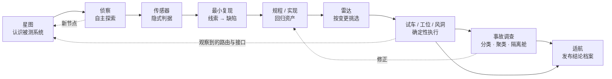
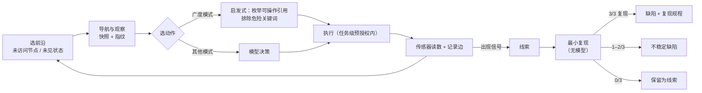
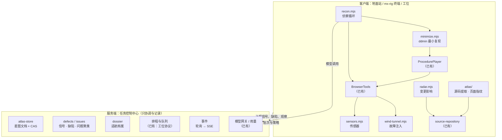

# MX Rig 蓝图：会自己找问题的测试乘组

创建：2026-10-05。基线：0.8.0 Preview（`feat/mx_insight_hub`）。

**2026-10-05 调整：** 本机评估发现，基础使用路径还要在两套界面之间切换。所以先执行 [docs/21 整合旧测试管理台](21-test-center-consolidation.md)，本文的新能力（监测、风洞、星图等）暂缓。已落地的试验场与自动检查项保留。

**性质：规划，不是交付记录。** 本文不替换 [docs/19](19-test-workbench-plan.md) 的验收主线（项目 → 任务 → 用例 → 实现 → Run → Luopan 双端验收）。docs/19 解决的是“把已知的测试做对、做全、做可信”。本文补另一半：**让 Rig 自己发现未知的问题，把发现变成回归资产，并说清楚能不能发布。**

约束不变：
- 只改 mx-rig；
- 不依赖 MX-H2I 登录，也不依赖其他系统的 Agent；
- 服务端只做协调与记录，执行放在桌面、终端和工位；
- 不改变 MX-H2I 的登录和联网。本文所有故障注入、网络模拟都只发生在 Rig 自己的隔离浏览器里，不碰系统网络。

## 0. 一句话与北极星演示

**Rig 从“能跑测试、Agent 能操作的工作台”，升级为“会自己找 bug、把 bug 变成回归、说清楚能不能发布”的测试乘组。**

同一套能力也给不懂测试的人用：填一个网址就能监测系统，收到白话的性能风险预警和健康周报（§6）。

北极星演示（对外展示与内部验收共用同一个脚本）：

> 给 Rig 一个地址或一个仓库，15 分钟后拿到四样东西：
> - 一张应用星图；
> - 一份缺陷清单，每条缺陷都能一键重放；
> - 一批新增的回归规程；
> - 一份适航结论。
>
> 全程看得见、能接管、能回放，**红绿不由模型决定**。

## 1. 测试领域速览：六个老难题

给不熟悉这个领域的读者，也给对外讲解用。每个招牌能力都对着一个行业公认的难题，而不是为了堆功能。

| 难题 | 通俗说法 | 行业常见做法与毛病 | Rig 的回答 |
| --- | --- | --- | --- |
| 判据难题（Test Oracle） | 怎么知道结果是错的？ | 只能靠人写断言。没写断言的地方坏了，测试照样绿 | **传感器**（§4.2）与**风洞**（§4.5）：不用写断言也能抓到的错误 |
| 覆盖错觉 | 测了很多，但不知道没测什么 | 拿代码行覆盖率代替业务覆盖；或者只数用例条数 | **星图**（§4.1）：以被测系统的页面、状态、接口为分母 |
| 发现难题 | 脚本只验证已知，未知缺陷靠人探索 | 探索性测试靠人力；AI 探索的结果不能复现，也沉淀不成资产 | **侦察 + 最小复现**（§4.3）：复现不了的只算线索 |
| 维护成本 | UI 一改，测试全红 | 自愈定位器悄悄换选择器，测的东西变了，报告仍是绿的 | 已有的**规程修正**，加上**事故调查**（§4.4）把失败分成产品、测试、环境三类 |
| 选择难题 | 全跑太慢，挑着跑怕漏 | 凭经验挑，或者每次都全量 | **雷达**（§4.6）：从代码变更推出影响面，并指出没有测试覆盖的改动 |
| 信任难题 | 不稳定的测试让人对红灯麻木；报告说不清能不能发 | 无限重试直到绿；用一个总通过率概括全部 | **隔离舱**（§4.4）与**适航**（§4.7）：结论按规则判定，有豁免就有签名和期限 |

## 2. 诊断：为什么现在还不“惊艳”

**已经很强、要守住的：**
- 测试领域内核：用例目录、计划、执行、执行机、证据；
- 诚实的结果语义：受阻不等于失败，零样本不给比率，派发成功不等于测试通过；
- 规程闭环：Agent 写，机器重放，失败时修正，修正经重放证明后由人批准；
- 浏览器航电：带引用的快照和确定性断言；
- 看得见的过程：实时接管、领航光标与回放；
- 飞行计划和工位回归；
- 终端 Agent；
- 用例工作台、实现提案、源码基准和项目权限；
- 612 项测试。

这些东西对外讲，行家会认可它“扎实”，但还谈不上“惊艳”。差在五处：

1. **Rig 只验证你告诉它的事。** 现在所有红绿都来自显式断言：用例、脚本或规程里的 assert。真实缺陷大多出在没人写断言的地方：控制台报错、接口 500、白屏、按钮点了没反应、文字被截断、无障碍缺失。代码核对：`packages/runtime/browser.mjs` 会记录 trace 与截图，但没有把 console 错误、页面异常、失败请求当作判据。
2. **Rig 没有被测系统的模型。** 它知道 Suite 和用例，却不知道应用有哪些页面、状态、接口、角色。因此说不出覆盖了多少，没法规划探索，也做不了变更影响分析。docs/19 里 Luopan 的“25 个路由、155 个测试文件”只是一份资产清单。
3. **Agent 只在被叫时干活。** 探索要人发起，一次一个任务，结果停留在对话里。缺一条“自主探索 → 缺陷 → 资产”的产线。
4. **失败之后的路太长。** 定级 Agent 能给结论，但缺少几样东西：证据融合、与上次通过的对比、同类失败聚类、最小复现。日常测试最耗人的环节，就是分析一屏红。
5. **展示依赖真实系统。** 对外演示只能拿 Luopan 或零散夹具：没有一个自带、可重复、埋好缺陷的试验场，也没有指挥大厅那样的观感。入口有二十多个，演示时找不到一条主线。

## 3. 原则（在 docs/12、docs/13 之上新增）

1. **判定权分层。**
   - 确定性判据决定红绿：断言、被项目提升为判据的传感器、风洞规则、适航规则。
   - 模型负责发现、解释和提案。
   - 人批准资产变更和发布结论。
2. **能重放才叫缺陷。** Agent 或传感器发现的异常先叫**线索**（Lead）。只有在不经模型的确定性重放中复现（默认 3 次中 3 次），才升级为**缺陷**（Defect）。只有 1–2 次复现的，标为不稳定缺陷。
3. **探索必须产出资产。** 每次侦察的终点是三样东西：星图更新、缺陷及其复现规程、新规程草稿。对话只是过程。
4. **分母必须是确认过的。** 覆盖率的分母是人确认过的星图节点。推断出来的节点只算候选，不进分母。
5. **客户端执行，服务端协调**（沿用）。浏览器、传感器、风洞、最小复现、雷达分析都在桌面、终端和工位上跑；服务端存星图、缺陷、问题、适航档案，负责排队和推送事件。
6. **断言只增不减**（沿用）。这条规则同样适用于测试实现提案和最小复现：复现规程里不能悄悄删掉原有判据。

## 4. 七个招牌能力

先看闭环，再逐个展开。

每一项都写：是什么、日常价值、怎么做（复用什么、在哪执行）、判定边界、首版验收。

### 4.1 星图（Star Chart）：被测系统模型

**是什么：** 一份带版本的被测系统模型。节点和边如下：

| 类型 | 内容 |
| --- | --- |
| 节点 | 页面/路由、视图状态（空列表、有数据、错误、无权限）、接口、角色、需求条目 |
| 边 | 导航：从哪个页面，经什么动作，到哪个页面 |
| 边 | 调用：页面调用了哪个接口 |
| 边 | 覆盖：哪些用例、规程、实现文件触达了这个节点 |

每个节点都带三样东西：来源（源码推断 / 探索观察 / 人工登记）、最后一次观察的时间、证据（截图缩略图、快照指纹）。

**日常价值：**
- 回答“我们测了什么、没测什么”。
- 热力图按平台（Web / Electron）分别显示每个页面的状态：有没有用例、有没有自动化、最近一次是绿还是红、有多久没跑。
- 举例：“确认的 25 个路由里，6 个零自动化；‘文件分析’在 Electron 上从未执行。”

**怎么做：**
- **源码提取**（客户端）：
  - 在桌面和终端，基于已有的 `project_source` 与 `source-repository.mjs` 源码基准读取源码。
  - Vue/Quasar 项目从 `src/router/routes.ts` 抽路由，从 `src/features/*` 和 import 关系推出“路由 → 组件 → 接口模块”。Luopan `po-frontend` 正是这种结构，另有 `routerGrayFeatureGuard` 可以抽出灰度与角色约束。
  - 每个提取器按框架做成适配器，首版只做 Vue Router。
- **运行观察**（客户端）：
  - 浏览器工位每次进入新页面，计算一个**页面指纹**：URL 归一化（把 ID 替换为 `:id`），再加上可访问性树的地标与标题骨架哈希，去掉易变文本。
  - 同一指纹即同一视图状态。请求日志给出“页面 → 接口”的边。
  - 规程试车、侦察、代码 Runner 的 trace 都可以喂给星图。
- **存储**（服务端）：
  - 星图是一份项目级文档，复用 CaseBooks 的 FileDocument / PgDocument 与 CAS 版本。
  - 候选节点经人确认后才进入分母。确认、合并、废弃都产生新版本。
- **映射**：用例可以声明它覆盖哪些节点；规程和实现的覆盖从执行 trace 里观察得出。两种来源分开标注。

**判定边界：** 星图只回答“有没有被触达、结果如何”，不宣称业务覆盖完整。没被源码或探索发现的功能，不会出现在星图里，所以界面始终显示“候选 / 已确认 / 过期”三种状态。

**首版验收：**
- 对 Luopan 当前提交提取出候选路由，与源码中实际的 25 个路由逐一核对。
- 人工确认后，热力图显示与 155 个测试文件的映射。这只是资产映射，不作为覆盖率声明。

### 4.2 传感器（Sensors）：每一步都免费的隐式判据

**是什么：** 挂在浏览器工位会话上的一组检测器。Agent 操作、规程试车、工位回归、侦察，每走一步都自动采集，不调用模型。

| 传感器 | 检测内容 | 实现要点 |
| --- | --- | --- |
| 页面异常 | 未捕获异常、`console.error` | `page.on('pageerror')`、`page.on('console')` |
| 接口失败 | 同源 XHR/fetch 返回 5xx 或非预期 4xx；请求失败；超时 | `context.on('response' / 'requestfailed')`；可按项目声明“预期的 4xx” |
| 白屏 | 加载完成后可访问性树几乎为空，且没有加载指示 | 复用 `aria.mjs` 快照 |
| 卡死加载 | `role=progressbar` 或 `aria-busy` 持续超过阈值 | 定时检查快照 |
| 无效点击 | 点击后约 1 秒内没有 DOM 变化、没有请求、没有跳转 | MutationObserver 计数。**只作线索**，误报风险高 |
| 内容泄漏 | 页面上可见 `undefined`、`NaN`、`[object Object]`、未渲染的 `{{ }}`、未翻译的 i18n key | 可见文本正则，规则可按项目配置 |
| 截断与溢出 | 文本被截断且没有提示；容器横向溢出 | 注入脚本比较 scrollWidth 与 clientWidth |
| 无障碍 | 缺少可访问名称、表单无标签、对比度不足等 | 内置 axe-core（MPL-2.0），每个新视图状态跑一次 |
| 性能 | LCP、CLS、INP、长任务 | 注入 PerformanceObserver |
| 被动安全 | URL 中出现令牌形态的字符串、混合内容、明文页面上的密码框 | 只读检查，不做任何攻击 |

**每次读数**记为一条 `Signal`，字段包括：传感器、严重度、页面指纹、步骤序号、证据引用、规范化后的签名。

**判定边界：**
- **首版所有传感器都只产生线索，不改变 Run 的结论。**
- 项目可以把低误报的传感器显式“提升为判据”，例如“未捕获异常即失败”“同源 5xx 即失败”。提升会产生策略版本，写进执行快照。
- 已知噪声进**噪声白名单**，每条都要写原因和到期时间，到期自动失效，不能永久静音。
- 密码、验证码字段的遮罩规则沿用 docs/16；传感器证据同样不含敏感值。

**日常价值：**
- 现有的每一条规程、每一次回归，立刻多出几十个“免费断言”。
- 回放时间轴下面加一条传感器轨道：哪一步出现了 console 错误、哪个接口 500 了，红色刻度一目了然。这正是 docs/15 里“回放里显示网络请求和控制台输出”的下一步。

**执行位置：** 客户端（桌面、终端、工位）。零模型成本。

**首版验收：** 在试验场（§5.2）重放全部规程，可被传感器检测的埋点缺陷检出率不低于 80%，且没有任何 Run 的结论被改变。

**2026-10-05 第一版结果（夹具上的检测能力，不是产品质量）：** 10 个传感器可检出的缺陷全部检出；2 个断言负责的缺陷全部由断言判失败；修复版 0 误报；5 条规程断言全部通过，但传感器发现了问题。已实现 13 个传感器：表中除无障碍、INP 以外的各项，外加请求失败与布局跳动。详见 §12。

### 4.3 侦察（Recon）：自主探索产线

**是什么：** 一个有预算、有边界、无人值守的探索任务。

**输入：**
- 目标 origin、星图、账号引用；
- 预算：时长、步数、token；
- 范围：站点、禁止的动作类别；
- 策略，四选一：
  - **广度**：优先访问星图里还没被观察的节点；
  - **深挖**：围绕一个功能做状态组合；
  - **新手**：按首次使用的路径走；
  - **破坏者**：边界输入、重复提交、快速切换、返回键。

**循环：**

**最小复现**是侦察的灵魂，全程不用模型：
1. 从 trace 拿到导致信号的完整动作序列；
2. 用 delta debugging（ddmin）反复删减步骤，每个候选都在全新的浏览器 context 里由 `ProcedurePlayer` 重放，看同一签名的信号是否再现；
3. 得到最短序列后，再重放 3 次确认是否稳定。

成本是时间而不是 token，单条线索的重放次数有上限（默认 30 次）。

**输出：**
- 星图候选节点和边，附截图；
- 线索；
- 缺陷，附最小复现规程、视频与 trace；
- 走通的主路径固化为规程草稿（复用已有的固化流程）。

缺陷和规程草稿都进入审阅，不会自动生效。

**乘组分工：**
- **侦察员**：探索；
- **分析员**：复现与最小化，是确定性程序，不是模型；
- **书记员**：用模型写缺陷描述，只能引用读到的证据，复用 `finding_submit` 的引用核验。

工作台上用三条泳道展示他们各自在做什么。

**判定边界：**
- 写动作只在任务级预授权的测试 origin 内执行（docs/12 §6.10）。
- 删除、支付、发送、改密码、提交订单这几类动作，默认跳过或请人接管（`browser_handoff`）。
- 生产禁区始终拒绝。
- Luopan 线上环境只做只读侦察，除非提供了测试环境与测试账号。

**执行位置：**
- 客户端：桌面、`mx-rig recon`、工位；
- 夜间侦察由服务端排程，工位领取执行（复用 docs/13 §3.10 的工位协议）。

**首版验收：**
- 在试验场上，侦察 15 分钟找到的缺陷里，召回率不低于 70%（相对埋点总数），已升级缺陷的精确率不低于 90%。
- 记录每个缺陷的 token 成本和首个缺陷出现的时间。
- 必须用真实模型跑出基线；脚本模式只证明流程可用。

### 4.4 事故调查（Mishap Investigation）：失败取证、聚类与隔离舱

建立在已有的**飞行记录仪**（事件账本 + 截图 + `trace.zip`）之上。

**取证包：** 每个失败的 Run、规程试车或侦察缺陷，都生成一份**调查清单**。它就是 docs/19 P3 规划的证据清单，在这里增加分析字段。

| 类别 | 内容 |
| --- | --- |
| 证据 | trace、失败那一步前后的截图、传感器信号、该步的请求与响应摘要、console 输出 |
| 版本与环境 | 用例 revision、实现 revision、源码基准、执行机、环境 |

**分析顺序：先确定性，后模型。**
1. **与上次通过对比**：同一规程或用例，上次通过时在同一步的快照差异、接口响应差异、耗时差异。为此，规程试车在通过时也要按步保存快照摘要（默认保留最近 5 次，受产物预算约束）。
2. **规则分类**：
   - 受阻码 → 环境问题；
   - 找不到元素，但页面上有名称相近的元素 → 测试问题，大概率是改名，直接衔接规程修正；
   - 断言失败，且同一步出现同源 5xx → 产品或后端问题；
   - 其余 → 待判定。
3. **模型叙述**：在规则结论之上写人话，只引用读到的证据。

**失败聚类（问题，Issue）：**
- 签名由四部分组成：失败步骤的语义（动作 + 目标的角色和名称）、错误码、接口路径模式加状态码、规范化后的消息（去掉数字、ID、UUID）。
- 签名相同的失败归为同一个**问题**，记录首次出现、最近出现、次数、涉及的用例、平台和版本。
- 每天早上看到的不再是 40 条红色用例，而是 3 个问题。

**隔离舱（Quarantine）：**
- 在同一组（用例 revision、实现 revision、源码提交、环境）下结果翻转，就是不稳定的证据，与内核的 `flaky` 语义一致。
- Rig 建议隔离，由人批准。每条隔离都有负责人和到期时间，默认 14 天。
- 隔离中的用例照常执行，但不参与门禁；适航档案单列“隔离债”。

**首个坏提交（后续）：**
- 被测项目在 `.rig/project.json` 里声明了本地启动命令，并且规程是确定的，就可以在上次通过与本次失败之间二分。
- 只用于本机或开发环境；每次启动命令都要经过终端 Agent 的确认与沙箱。

**日常价值：** 一屏**失败卡**，内容如下：
- 前后对比截图滑块；
- 高亮的快照差异；
- 高亮的失败请求；
- “同类问题 7 次 / 3 条用例 / Web + Electron”；
- 一键实时复现；
- 一键导出缺陷（Markdown 或飞书卡片，复用已有的通知适配器）。

**执行位置：**
- 对比与分类在客户端或服务端都可以：纯函数，沿用 `insights.mjs` 的写法；
- 聚类在服务端，因为它需要跨 Run 查询；
- 复现在客户端。

### 4.5 风洞（Wind Tunnel）：故障注入与健壮性矩阵

**是什么：** 一组声明式的故障配置，挂在隔离浏览器 context 现有的唯一路由钩子上（`browser.mjs` 里的 `context.route('**/*')`，目前用于站点范围），和站点范围检查叠加。

| 故障 | 实现 |
| --- | --- |
| 指定接口返回 500 / 401 / 403 / 429 | `route.fulfill` |
| 延迟 N 毫秒、超时、中断 | 延迟后 `continue` / `abort('timedout')` |
| 空数组、畸形 JSON、超大响应 | `route.fulfill` 改写响应体 |
| 断网与恢复 | `context.setOffline` |
| 弱网 | CDP `Network.emulateNetworkConditions` |
| 时间漂移 | Playwright `page.clock` |
| 语言、时区、视口 | 用新的 context 参数开一个新 context |

**矩阵：** 规程 × 故障配置。风洞的判据**不需要逐条手写断言**，统一检查四件事：
1. 没有白屏；
2. 没有未捕获异常；
3. 页面出现可感知的错误提示（`role=alert`，或项目配置的错误文案）；
4. 故障撤除后能恢复（重试按钮或刷新后正常）。

这些全部由传感器和确定性检查给出。

**日常价值：** 直接对应 docs/19 中 Luopan 的“通用异常”范围：401/403、限流、超时、500、空结果、重复点击、取消。演示效果是一张热力矩阵，比如“我们用 8 种方式把后端打挂，这 3 个页面会白屏”。

**判定边界：**
- 只作用于 Rig 的隔离浏览器，不设置系统代理、路由、DNS，不影响 MX-H2I 或任何其他进程。
- 对真实后端只注入响应侧故障，不向后端发送异常流量。
- 风洞结果是独立的一类执行，不混进功能用例的通过率。

**执行位置：** 客户端或工位。零模型成本。

**首版验收：**
- 试验场的健壮性埋点缺陷全部检出。
- 用允许的测试账号，对 Luopan 测试环境的 5 个关键页面跑只读 GET 类故障矩阵。

### 4.6 雷达（Radar）：变更感知的测试选择与补测

**是什么：** 输入一段代码变更，输出影响面、推荐执行集，以及没有被任何测试覆盖的变更。

**映射链：** 变更文件 → 星图节点 → 覆盖这些节点的用例、规程、实现。置信度分三级：

| 级别 | 来源 |
| --- | --- |
| 静态直接 | 路由文件、页面组件本身改了 |
| 静态传递 | 被页面组件 import 的模块改了；接口模块改了，对应调用它的页面 |
| 运行观察 | 历史 trace 显示某条规程或测试访问过这个页面或接口 |

**输出：**
- 推荐执行集，分为必跑、建议、可选；
- **未覆盖的变更**：改动触及的节点上没有任何测试。Rig 给出两个选项：针对这些节点发起侦察，或让用例设计师起草用例。

**入口：**
- 终端：`mx-rig radar --base main`；
- 工作台：“本次变更”；
- 服务端排程：监视分支，由工位执行选出的集合（复用定时回归）。

**判定边界：** 选择性执行只是推荐，报告明确写“选择性执行，不代表全量”。发布门禁仍以适航档案中的完整矩阵为准。

**执行位置：** 客户端，复用源码基准的 diff 与只读工具。

**首版验收：** 在试验场埋 10 个变更，每个变更都会让某条测试失败。雷达推荐的必跑与建议集合，至少在 9 个变更里包含那条失败的测试。

### 4.7 适航（Airworthiness）：发布结论档案

**是什么：** 针对一个发布候选生成的不可变档案。它在飞行计划的放行评审和 docs/19 P5 完整性对账之上扩展，内容包括：
- 目标构建：Web 部署包或桌面安装包的 hash；
- 必需矩阵（平台 × 用例集）的对账结果；
- 传感器与风洞摘要；
- 未关闭的缺陷及严重度；
- 隔离债；
- 证据清单 hash；
- 审批人。

**结论**按项目配置的确定性规则判定，四选一：

| 结论 | 含义 |
| --- | --- |
| 适航 | 全部规则满足 |
| 有条件适航 | 每条豁免都有签名人、理由和到期时间 |
| 不适航 | 例如存在未关闭的 S1 缺陷 |
| 无法判定 | 有受阻项或缺失项，不能用总通过率掩盖 |

模型只写摘要，不参与判定。

**日常价值：**
- 两份档案可以做差异：“相比上个版本，新增 3 个缺陷，修复 5 个，确认路由覆盖 +4”。
- 可以导出为自包含 HTML（复用回放导出的打包方式）或 PDF，也可以给出服务端链接。
- 这是对外展示的收尾页面。

**判定边界：** 适航档案不参与任何外部发布门禁的自动放行（docs/12 §8），是给人做决定用的。

## 5. 体验层：让人看见测试乘组在工作

### 5.1 指挥大厅（Control Room）

一个全屏只读视图，用于团队大屏和对外演示，布局如下：

| 位置 | 内容 |
| --- | --- |
| 左 | 星图，侦察访问到哪个节点就点亮哪个 |
| 中 | 工位实时画面拼屏，最多 4 路，复用每秒 4 帧的 screencast |
| 右 | 乘组泳道（侦察员 / 领航员 / 分析员 / 书记员各自当前在做什么），加传感器信号滚动条 |
| 下 | 执行矩阵、缺陷计数、适航进度 |

viewer 角色即可查看。服务端只聚合事件：首版沿用轮询，后续按 docs/19 的每任务事件序列改为 SSE。

### 5.2 试验场（Proving Ground）与一键演示

**试验场**位于 `test-packs/proving-ground/`：一个自带的小型 Web 应用，后续加 Electron 外壳，里面埋好已知缺陷。它同时承担三个用途：对外演示、侦察与传感器的评测基准、新成员上手教程。

- **页面：** 登录、列表（搜索 / 筛选 / 分页）、详情、新建与编辑表单、设置（语言切换）、上传、报表。
- **缺陷目录：** 机器可读的 `defects.json`。每条缺陷写明编号、类别、触发方式，以及应该由哪种手段检出（传感器 / 断言 / 风洞 / 侦察）。
- **缺陷举例：**
  - 特定筛选组合返回 500；
  - 空列表时白屏；
  - 快速双击产生重复记录；
  - 英文模式下按钮文字被截断；
  - 未翻译的 i18n key；
  - 表单缺少标签；
  - 某个按钮点了没有任何反应；
  - 慢接口导致加载永远不结束；
  - 401 后不跳转登录；
  - 最后一页分页错乱；
  - 输入过快时的搜索竞态。
- **缺陷开关：** 每个缺陷可以单独打开或关闭，由此产生三个版本：“有缺陷”的 v1、“已修复”的 v2、“回归”的 v3。雷达演示和适航差异演示都要用到这三个版本。
- **定位：** 明确是夹具，结果永远不作为任何真实产品的通过证据。

**一键演示：** `bash scripts/manage.sh local demo`
- 启动试验场和 Rig，种好示例项目，打开指挥大厅，按脚本走完北极星演示；
- 默认使用评测集已有的脚本模型，结果确定，离线可跑，演示不会翻车；
- 加 `--live` 改用真实模型。

### 5.3 收敛主导航

主线收敛为五个入口：**项目 · 星图 · 任务 · 问题 · 适航**。Agent 市场、编排、Provider、出网、钩子、工具等收进“配置”。

`apps/web/views.js`（6.3k 行）顺着这五个界面拆分。这既是 docs/12 §2.2 第 9 项的落地，也让新界面不再往一个巨型文件里堆。

## 6. 人人可用：不懂测试，也能用 Rig 盯住系统

前五节面向测试与开发。本节把用户扩展到产品经理、运维、项目负责人和客服主管。他们不写用例，也不知道 Suite、Runner 是什么，但关心三件事：系统现在好不好、有没有变慢、哪里有风险。

### 6.1 两层命名：界面说大白话，航天词留给品牌和文档

航天词表适合讲故事和写文档，但不适合放在第一次使用的界面上。规则：**首屏和向导里不出现 Suite、Runner、Procedure、Mission、Catalog 这类词**；进阶页面保留原名，并在名称旁附上白话。

| 界面上看到的 | 文档 / 品牌名 | 一句话解释 |
| --- | --- | --- |
| 监测 | — | 定时自动检查一个网站或一条流程，有问题就提醒 |
| 自动检查项 | 传感器 | 每一步都会自动查的东西：报错、白屏、变慢、接口失败 |
| 检查步骤 | 规程 | 一张能原样重放的步骤表 |
| 页面地图 | 星图 | Rig 认识的页面和接口，以及哪些被检查过 |
| 自动探索 | 侦察 | Rig 自己把系统点一遍，找问题 |
| 问题 | 事故调查 / 问题 | 同一个原因引起的失败合并成一个问题 |
| 故障演练 | 风洞 | 模拟后端出错、网络变差，看页面扛不扛得住 |
| 改动影响 | 雷达 | 代码改了之后，该检查哪些地方 |
| 发布结论 | 适航 | 这个版本能不能发 |
| 执行电脑 | 工位 | 真正打开浏览器干活的那台电脑 |

### 6.2 三个动作：盯、查、报

- **盯（监测）**：填一个网址 → 选一个模板 → 选通知方式（飞书 / 企业微信 / Webhook）。三步完成，不需要先建项目、计划或执行机。Rig 会按设定的频率，在工位上打开页面，全部自动检查项打开，记录速度和错误。
- **查（检查）**：用一句话描述，例如“帮我看看登录后搜索能不能用”。Rig 起草检查步骤并走一遍；走通的路径保存为能重放的检查步骤，之后监测可以带上它。碰到登录、验证码，请人接管一次（docs/16）。
- **报（报告）**：两种。即时的**风险预警**，以及定期的**健康周报**。都用白话，按红黄绿分级，每条结论都能点到证据。

### 6.3 监测模板

| 模板 | 需要填写 | 检查什么 |
| --- | --- | --- |
| 网站体检 | 一个网址 | 能否打开；首屏速度（LCP）；布局跳动（CLS）；交互延迟（INP）；控制台报错；接口失败；白屏；坏链接；无障碍 |
| 关键流程守护 | 网址，加上一句话描述的流程（或手动走一遍录下来） | 每一步是否成功、每一步耗时、相关接口的耗时 |
| 接口健康 | 从页面流量中自动发现的接口，也可以手填 | 可用率、P50/P95 延迟、错误率 |
| 版本前后对比 | 两个版本或两个时间点 | 速度与错误的前后差异 |

**登录态：**
- 由工位本机保存，加密存储，不上传服务端；
- 过期时通知负责人重新接管登录一次；
- 密码不经过 Agent，也不进入任何报告，沿用 docs/16 的规则。

### 6.4 性能基线与风险预警

**指标从哪来：**
- 每次监测都由传感器产出样本：Web Vitals、接口耗时、错误、白屏、加载卡死。
- 工位只上报数值和必要的证据引用，不上报页面正文。

**什么时候报警：** 需要两类条件同时满足，避免一次网络抖动就报警。

| 条件 | 规则 |
| --- | --- |
| 绝对阈值 | 采用公开的 Web Vitals 分档：LCP 2.5 s / 4 s，CLS 0.1 / 0.25，INP 200 ms / 500 ms；接口阈值可按项目配置 |
| 相对基线 | 每个页面 × 指标保留滚动基线（最近 7 天的中位数与 MAD）。新样本连续 N 次（默认 3 次）超过“中位数 + 3 × MAD”，并且相对恶化超过 20% |

**预警分级：** 注意 / 警告 / 严重。同一风险合并成一条，可以设置静默时段，恢复后发送恢复通知。

**超出阈值的风险判断：** 以下三类都由确定性计算给出，模型只把它们写成人话，并且只能引用实际样本。

| 风险 | 含义 |
| --- | --- |
| 趋势风险 | 一周内持续变慢，即使还没越过阈值 |
| 关联风险 | 变慢的开始时间，与某次发布或某个接口变慢在时间上重合 |
| 容量风险 | 接口 P95 随时间上升 |

**性能风险预警报告的结构：**
1. **一页结论**：健康分、红黄绿状态、本期最大的 3 个风险、需要谁做什么。
2. **每个风险一节**，包含：
   - 白话描述现象，例如“登录页首屏从 1.2 秒变为 1.7 秒，从 10 月 3 日开始”；
   - 影响了哪些页面；
   - 证据：趋势图、慢请求、截图；
   - 可能原因，明确标注为推断；
   - 建议的处理人。
3. **附录**：指标定义、样本数、采样位置与时间。

报告可以导出 HTML / PDF，也可以推送到飞书。

**健康分：**
- 公式公开，例如：可用性 40% + 速度 30% + 错误 20% + 体验 10%；
- 零样本不给分，显示 `—`；
- 受阻（工位离线）不计入分数。

**诚实边界：**
- 合成监测不等于真实用户体验。样本来自工位的网络、位置和硬件，报告注明采样位置与样本数。
- 不做真实用户监测（RUM）：那需要往被测产品里注入 SDK，而本蓝图不修改被测产品。
- **容量体检**（基于已有 k6 引擎、带并发与时长上限的模板）只在测试环境、由管理员开启，不对线上做压测。

### 6.5 执行与数据

- 监测由服务端排程，工位领取执行，复用定时回归与工位协议（docs/13 §3.10）。服务端只排队、存数值、发通知。
- 新增指标样本表：原始样本保留 14 天，小时聚合保留 90 天。memory 模式下仅保留最近样本，用于演示。
- 预警与周报复用已有的通知适配器。报告页复用回放导出的自包含 HTML 打包方式。

### 6.6 首版验收

- 找一位非测试岗位的同事，不看文档，5 分钟内在试验场上建好监测。
- 打开试验场的“慢接口”缺陷后，收到预警；关闭缺陷后，收到恢复通知。
- 周报里每个风险都能点到证据，健康分能逐项展开到公式。

## 7. 日常怎么用

| 时机 | 发生什么 | 用到的能力 |
| --- | --- | --- |
| 每天早上 | 打开“问题”页：夜间回归加夜间侦察的结果已经聚类成几个问题；隔离舱有到期提醒 | 工位、侦察、事故调查、隔离舱 |
| 任何时候（产品、运维、负责人） | 飞书收到“登录页变慢 40%”的预警，点开看到趋势图和慢请求；周一收到健康周报 | 监测、传感器、风险预警（§6） |
| 每次提交或分支 | 雷达给出影响面，工位执行推荐集，结果推到飞书 | 雷达、工位、通知 |
| 新需求 | 需求文本 → 用例草稿 → 星图上新增候选节点 → 针对性侦察 → 规程草稿 → 审阅 | 用例工作台（docs/19）、星图、侦察 |
| 失败时 | 打开失败卡 → 判断问题类别 → 测试问题走规程修正或实现提案，产品问题导出缺陷 → 复验产生新 Run | 事故调查、规程修正、实现提案 |
| 发版前 | 飞行计划 → 风洞矩阵 → 适航档案 → 签字 | 飞行计划、风洞、适航 |
| 在终端里 | `mx-rig recon <url> --budget 10m`、`mx-rig radar`、`mx-rig investigate <runId>` | 终端 Agent（docs/14） |

## 8. 对外展示脚本

**3 分钟版：**
1. 指挥大厅里输入试验场地址，侦察开始。星图逐个点亮，乘组泳道开始滚动。
2. 第 2 分钟左右，缺陷陆续弹出，每条带“已复现 3/3”。
3. 点开一条缺陷，回放：光标移动，传感器轨道上的红色刻度对准 500 请求。
4. 切到风洞矩阵：8 种故障 × 6 个页面。
5. 收尾在适航档案：“有条件适航，1 条豁免，签名人某某，到期日某某”。

**15 分钟深度版：** 在 3 分钟版基础上加四段：
- 雷达分析一个 diff，指出一处未覆盖的改动，并现场侦察这处改动；
- 规程修正闭环：按钮改名 → 修正 → 验证试车 → 断言数量核对 → 批准；
- 遇到验证码时人工接管；
- 在终端里让测试工程师修一条 Playwright 测试。

**不要说的话：**
- “AI 判定通过”；
- “无人值守自动发布”；
- “覆盖率 100%”（分母永远是确认过的星图）。

## 9. 架构演进

**新增模块：全部在 mx-rig 内**

| 模块 | 位置 | 执行侧 | 复用 |
| --- | --- | --- | --- |
| 传感器 | `packages/runtime/sensors.mjs` | 客户端 | `browser.mjs` 的页面监听、`aria.mjs`、pilot 注入脚本的方式 |
| 风洞 | `packages/runtime/wind-tunnel.mjs` | 客户端 | `browser.mjs` 的 `context.route` 钩子 |
| 星图提取 | `packages/runtime/atlas/` | 客户端 | `project_source`、`source-repository.mjs` 基准与哈希 |
| 侦察 | `packages/runtime/recon.mjs` | 客户端 | `engine.mjs` 的 Agent 循环、任务级预授权、规程固化 |
| 最小复现 | `packages/runtime/minimize.mjs` | 客户端 | `ProcedurePlayer` |
| 雷达 | `packages/runtime/radar.mjs` | 客户端 | 源码基准、星图映射 |
| 星图存储 | `apps/server/atlas-store.mjs` | 服务端 | FileDocument / PgDocument、CAS |
| 缺陷与问题 | `apps/server/defects.mjs` | 服务端 | 纯函数聚类（沿用 `insights.mjs` 的写法）、PG 表 |
| 适航档案 | `apps/server/dossier.mjs` | 服务端 | 飞行计划放行评审、执行对账 |
| 界面 | `apps/web/atlas-view.js`、`control-room.js`、`issues.js`、`dossier.js` | Web 与桌面共用 | `graph-view.js`、`replay.js` |
| 试验场 | `test-packs/proving-ground/` | — | — |
| 评测 | `evals/scenarios/recon-*`、`sensor-*`、`radar-*` | — | 已有评测框架与脚本模型 |

**先稳定合同，再写功能**（docs/10 §6.2 的原则）：先在 `packages/contracts` 里用 zod 定好下列对象，所有新模块和界面只依赖合同。

| 合同 | 用途 |
| --- | --- |
| `Signal` | 一次传感器读数 |
| `Lead` | 线索 |
| `Defect` | 已复现的缺陷 |
| `Issue` | 聚类后的问题 |
| `AtlasNode` / `AtlasEdge` | 星图节点与边 |
| `PageFingerprint` | 页面指纹 |
| `FaultProfile` | 风洞故障配置 |
| `Dossier` | 适航档案 |

**数据：**
- 星图与适航档案用文档存储，适合 CAS 和整份审阅；
- 信号、缺陷、问题用 PG 表，需要跨 Run 查询和聚类，从迁移 `027` 起编号；
- memory 模式同样可用，便于本机演示。

**模型在哪里用、在哪里不用：**

| 环节 | 模型 | 确定性部分 |
| --- | --- | --- |
| 传感器、风洞、最小复现、聚类、适航判定 | 不用 | 全部 |
| 星图提取 | 可选：给节点起业务名 | 路由、import 关系、页面指纹 |
| 侦察 | 深挖、新手、破坏者模式用模型选动作 | 广度模式完全启发式 |
| 事故调查 | 写叙述 | 对比与规则分类 |
| 雷达 | 可选：解释影响 | 映射与置信度 |

**成本控制：** 侦察有 token 与时长双预算，复用已有的用量计量。广度模式零 token，适合夜间大面积跑。

## 10. 用数字证明“惊艳”：乘组成绩单

把评测集从“Agent 能不能正确判断”扩展到“Agent 能不能找到问题”。结果放在一个“乘组成绩单”页面上，它本身也是对外展示素材。

| 指标 | 怎么测 |
| --- | --- |
| 侦察召回率 / 精确率 | 试验场埋点缺陷中找到的比例；已升级缺陷中真实缺陷的比例 |
| 首个缺陷用时、每个缺陷的 token | 侦察记录 |
| 复现率 | 线索中能确定性复现的比例 |
| 传感器检出率 / 误报率 | 试验场 v1（有缺陷）与 v2（已修复）各重放一遍 |
| 正确修正率 / 误修绿率 | 已有场景 07、08 扩展：删断言、放宽断言都算误修绿 |
| 雷达选择召回 | 试验场的 10 个埋点变更 |
| 聚类纯度、分类准确率 | 带标注的失败样本集 |
| 人工介入次数 / 任务、审批等待时间 | 任务账本 |

**纪律：没用真实模型跑过的指标不展示数字。** 脚本模式只说明流程正常（与 docs/12 §6.14 一致）。

## 11. 路线

规模按相对大小（S/M/L）估计，不承诺日历。docs/19 的主线（共享任务 → QA Git/outbox → 批准实现接入 Runner → Luopan 双端验收）**并行推进**，交汇点写在最后一列。

| 阶段 | 内容 | 规模 | 依赖 | 完成条件 | 与 docs/19 的交汇 |
| --- | --- | --- | --- | --- | --- |
| **B0 地基** | 新合同；试验场 v1（Web，约 12 个埋点缺陷，可开关）；`local demo` 骨架加脚本模型 | M | — | 一条命令起演示；缺陷目录机器可读；试验场自带测试 | — |
| **B1 传感器 + 事故调查** | 传感器挂在 BrowserTools 与 ProcedurePlayer 上；回放的传感器轨道；失败卡；签名聚类；通过时的快照摘要 | M | B0 | 试验场可检出埋点的检出率 ≥ 80%，没有 Run 的结论被改变；30 条失败正确聚成若干问题 | 证据清单（P3）在这里落第一版 |
| **BM 监测与预警** | 白话向导与两层命名；监测模板；指标样本与基线；风险预警；健康周报与导出 | M | B1 | 非测试同事 5 分钟建好监测；试验场慢接口触发预警，修复后收到恢复通知 | 与工位定时回归共用排程 |
| **B2 风洞** | 故障配置、矩阵执行（工位）、矩阵视图 | S | B1 | 试验场健壮性缺陷全部检出；Luopan 测试环境 5 页只读矩阵 | 覆盖 Luopan“通用异常”范围 |
| **B3 星图** | Vue Router 提取器、页面指纹、星图文档与审阅、热力图 | M | B0 | Luopan 候选路由与 25 个实际路由核对一致；人工确认后有映射 | 给 P1b“完整 Catalog”提供分母 |
| **B4 侦察 + 最小复现** | 侦察循环（四种策略）、ddmin、线索到缺陷的升级、乘组泳道、夜间侦察 | L | B1、B3 | 试验场召回率 ≥ 70%、精确率 ≥ 90%（15 分钟）；记录真实模型基线 | 缺陷和规程草稿走同一套审阅 |
| **B5 雷达** | diff → 星图 → 推荐集；未覆盖变更 → 侦察或用例草稿 | M | B3 | 10 个埋点变更中至少 9 个命中 | 选择性执行接入 Run 快照 |
| **B6 适航 + 指挥大厅** | 档案、豁免、导出、档案差异；指挥大厅；主导航收敛 | M | B1–B5 | 生成 Luopan 发布候选档案；3 分钟演示完整走通 | 承接 P5 完整验收 |

**为什么这个顺序：**
- 传感器最便宜（零模型），也最立竿见影：已有的每次回放和回归马上变得更有价值。
- 监测紧跟传感器：它就是“定时跑传感器 + 基线 + 白话报告”，能最快把用户面扩到非测试人员。
- 试验场是演示和评测的共同前提，所以在最前面。
- 侦察依赖传感器（判据）和星图（前沿），只能放在中段。
- 适航要等其他能力都有产出，才有东西可汇总。

## 12. 第一步：试验场 v1 与传感器（2026-10-05 已落地）

### 交付了什么

1. **试验场 v1**：`test-packs/proving-ground/`。
   - 零依赖的 Node 服务加原生 JS 页面，内容是“星港物资台”；
   - 12 个可开关的已知缺陷：10 个由传感器检出，2 个由断言检出；
   - 机器可读的 `defects.json`，加 8 条检查步骤（`procedures.json`）；
   - 启动命令：`npm run proving-ground [-- --bugs all|none|PG-001,…]`。
2. **`packages/runtime/sensors.mjs`**：13 个传感器。
   - 页面异常、控制台报错；
   - 接口 5xx、请求失败、慢接口；
   - 白屏、加载卡死、内容泄漏（含未翻译的文案键）、文字截断、无效点击；
   - URL 中的令牌；
   - LCP、CLS。
   - 每条信号：先脱敏，URL 只保留路径，令牌只报参数名；按签名去重计数。
3. **接入方式**：
   - **Agent 步骤**：`BrowserTools.execute` 的结果带上 `signals`，任务记录汇总成 `row.signals`。
   - **规程试车**：`ProcedurePlayer.run` 的每一步与整次结果带上 `signals`，结果另带 `metrics`（页面时序、接口 P50/P95）。
   - **工位回归**：使用同一个规程播放器，所以同样带信号。
   - **服务端**：规程运行 schema 接收这两个字段。老版本服务端拒收时，客户端会去掉这两个字段重新上报（`reportRun`），试车记录不会丢。
4. **界面**：
   - 回放（工作台与导出的 HTML）增加“自动检查项”轨道：每一步一格，按最严重的线索着色；当前步骤的线索列在下方。
   - 规程的试车记录增加“自动检查项”一列，可以展开看每条线索。
5. **评测**：`npm run eval:sensors`。在有缺陷版本和修复版上分别无模型重放，输出检出率、误报、无法对应的线索，以及“断言通过、但传感器报警”的规程。

### 判定边界（与 §3 一致）

- 所有传感器只产生线索，不改变任何步骤、试车或 Run 的结论。
- 回归测试验证了这一点：`list-filter` 背后有一个 500，结论仍是 passed。

### 实测结果

- 夹具上：10/10 检出，0 误报，断言 2/2。
- 修 bug 记录：Agent 的点击会先截一张带遮罩的意图图，截图时 Playwright 会往页面里临时插入元素（`x-pw-glass`）。这让“无效点击”传感器在 Agent 路径上漏报。现在把 Rig 和 Playwright 自己的节点排除在外，并加了回归测试。

### 还没有做

- **没有走正式入口实测**：没有在桌面端界面和 `mx-rig` 终端里对试验场实测。本轮的实测直接驱动 `BrowserTools` 与 `ProcedurePlayer`，这是桌面端和终端使用的同一套代码，但不是正式入口。
- **信号还没进质量报告**：内核的 summary v2 会丢弃未知字段，所以工位回归的信号只留在规程试车记录里，没有进入 Run 与报告。
- **还没有“提升为判据”和噪声白名单**。
- **还没有无障碍（axe-core）与 INP**。
- **还没有失败卡、签名聚类和隔离舱**：这几项属于 B1 的事故调查部分。

下一步建议：先做 BM（监测与预警）的第一版，因为它复用这里的传感器与 `metrics`；然后把信号接进质量报告。

## 13. 风险与边界

| 风险 | 对策 |
| --- | --- |
| 侦察在真实系统上做了写操作 | 只在预授权的测试 origin 内写；危险动作类别默认跳过或人工接管；生产禁区不变；线上 Luopan 只读 |
| 传感器误报让人麻木 | 默认只产生线索；提升为判据要显式操作并记录策略版本；噪声白名单必须带到期时间 |
| 模型成本失控 | 双预算；广度模式零 token；成绩单公开每个缺陷的 token |
| 星图过期 | 每个节点记录最后观察时间，过期就标出；分母只算确认节点 |
| 夸大结论 | 缺陷必须能确定性复现；选择性执行不等于全量；适航由规则判定；试验场结果永远不作为产品证据 |
| 越界影响其他系统 | 风洞只在隔离浏览器内；不碰系统网络和其他进程；不依赖 MX-H2I 登录；不依赖外部 Agent；只改 mx-rig |
| 复杂度继续膨胀 | 冻结系统层游戏化与 Agent 市场的扩展（docs/12 已冻结）；主导航收敛为五个入口；`views.js` 按界面拆分 |

## 14. 明确不做

- 不做悄悄改选择器的自愈。所有修正都是有差异、有验证、要人批准的新版本。
- 不让模型判定红绿，也不让适航档案自动放行发布。
- 不做压测平台。k6 仍只是执行机上的一种引擎。
- 不做主动安全渗透。只做被动检查。
- 本蓝图不含移动原生 App；Windows 原生工位仍按 docs/12 的路线。
- 不把图运行时扩成通用 Agent 框架，不依赖其他系统的 Agent。

## 附录：新增术语

沿用 docs/12 §5 的原则：一个术语只有一个含义，已发布的 API 路径与表不改名。

| 航天术语 | 中文 | Rig 概念 |
| --- | --- | --- |
| Star Chart | 星图 | 被测系统模型：页面、状态、接口、角色、覆盖 |
| Sensors | 传感器 | 隐式判据检测器；读数叫信号（Signal）。“遥测”仍指实时事件流 |
| Reconnaissance | 侦察 | 有预算、有边界的自主探索任务 |
| Lead / Defect / Issue | 线索 / 缺陷 / 问题 | 未复现的异常 / 确定性复现的异常 / 聚类后的同类失败 |
| Mishap Investigation | 事故调查 | 失败取证、对比、分类、聚类，基于飞行记录仪 |
| Quarantine | 隔离舱 | 有负责人、有期限的不稳定用例隔离 |
| Wind Tunnel | 风洞 | 隔离浏览器内的故障注入与健壮性矩阵 |
| Radar | 雷达 | 变更影响分析与测试选择 |
| Airworthiness | 适航 | 发布候选的结论档案 |
| Control Room | 指挥大厅 | 全屏只读的实时总览 |
| Proving Ground | 试验场 | 自带、埋好缺陷的演示与评测应用。“靶场安全”仍指策略 |
