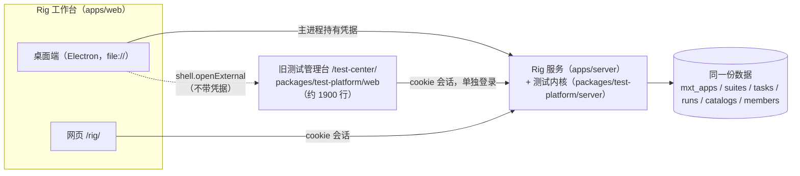
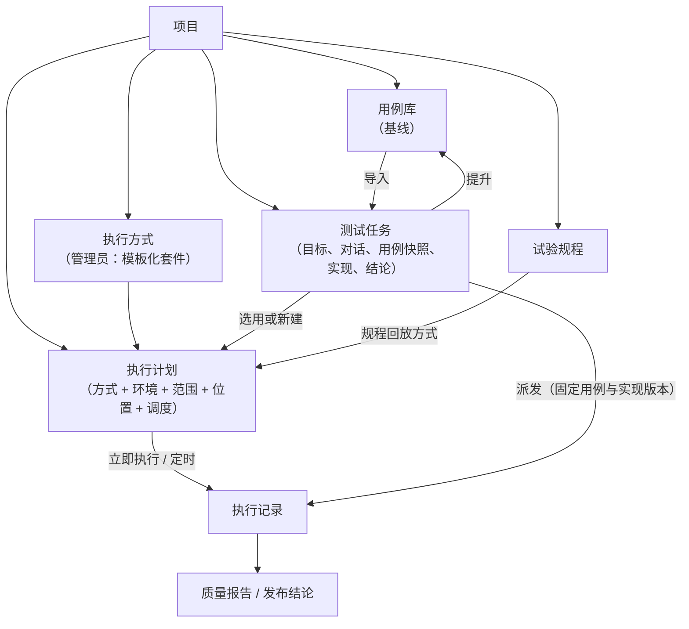

# 整合旧测试管理台：以 Rig 为主的一套工作台

创建：2026-10-05。基线：0.8.0 Preview。**性质：规划。第 8 节的决定已于 2026-10-05 确认，M0 开始实施。**

用户在本机评估时发现了几个问题：

- 桌面端点「完整测试管理台」会跳到系统浏览器，要再登录一次；
- 那边是另一套界面；
- “跑一次测试”这条主线必须在两套界面之间来回切。

用户决定采用方案 A：把旧管理台独有的功能全部迁进 Rig 工作台，桌面端和网页只保留一套界面；Compass 验收也一并迁进 Rig。

本文是这次整合的功能清单、概念去重和迁移顺序。docs/20 蓝图里的新能力暂缓，等本文完成后再继续（docs/20 头部已注明）。

约束不变：
- 只改 mx-rig；
- 不依赖 MX-H2I 登录，不影响它的联网；
- API 路径和 `mxt_*` 表不改名（docs/12 §5），只改界面和用语。

## 0. 结论

1. **一套界面。** 桌面端和 `/rig/` 共用的工作台承载全部日常功能。`/test-center/` 迁完后改成只读，保留不删。桌面端不再打开系统浏览器。
2. **两套界面背后本来就是同一份数据。** 两边调用的是同一个服务、同一套 `/api/v1/*` 接口和同一个数据库。所以整合**不需要数据迁移**，要改的是界面、入口和用语。
3. **“测试任务”这个词现在指两件不同的东西，必须拆开：**

   | | 旧管理台的“测试任务” | Rig 的“测试任务” |
   | --- | --- | --- |
   | 数据 | `mxt_tasks` | Mission |
   | 实际含义 | 怎么跑、在哪跑、跑哪些、什么时候跑 | 一次有目标的测试工作：协作用例、准备实现、执行、下结论 |
   | 整合后叫 | **执行计划** | **测试任务**（不变） |

   两者真正重叠的只有一点：都能发起执行。整合后规则是**执行一律通过计划**，任务内可以就地新建计划（§3）。
4. **四处调度统一。** 目前排程分散在：旧测试任务的 cron、规程回归任务、编排的 cron、飞行计划。整合后都在项目的「执行计划」里出现（§3.3）。
5. **Compass 验收迁进 Rig，不侵入原项目。** 不再拉被测仓库、跑它里面的 Cypress，改成 Rig 托管的罗盘测试项目，由两部分组成（§5）：
   - **被测源码的只读快照**：固定到 `feat/yjj/hdo_v2` 的某个提交；
   - **适配它的 `rig-specs`**：放在 Rig 管理的 QA Git 仓库里。

   原项目升级不会让测试跑不了，因为更新基准是显式操作。旧 `public` 分支的用例只作参考。远程执行机领取测试资产包的能力与 docs/19 的“批准的实现接入 Runner”共用。

## 1. 现状：一份数据，两套界面



**为什么桌面端要跳到系统浏览器：** 桌面端的凭据只放在主进程里，界面进程拿不到。旧管理台是另一个网页应用，用 cookie 单独登录。桌面端不会把凭据带给别的页面，所以只能交给系统浏览器（`apps/desktop/main.mjs` 的 `EXTERNAL_PATHS` 与 `test-center` 动作）。执行报告 `/api/v1/runs/:id/report` 也是这样打开的。

**旧管理台为什么至今还在：** 它是从 mx-test-framework 整体迁过来的界面（docs/01 §历史代码迁入）。Rig 工作台后来做的是任务、用例协作、Agent、规程、报告，但账号、执行方式、计划、执行机这些管理功能一直没有迁过来。docs/12 §2.2 第 9 条把“三套测试 UI”记成了技术债。

## 2. 功能清单：旧管理台 → Rig 工作台

“动作”一列的含义：
- **迁入**：Rig 没有，要新做；
- **合并**：两边都有，保留 Rig 这边，补上缺的部分；
- **去掉**：Rig 已经覆盖，或者不再需要。

### 2.1 旧管理台有界面的功能

#### 登录与账号

- 登录、退出（`/api/v1/auth/login|logout|me`）：工作台已有，用同一个身份服务。**去掉。**
- 修改密码（`/api/v1/auth/password`）：工作台左下角已有。**去掉。**

#### 概览

旧管理台的概览有：四步上手引导、计数卡片（任务、通过、应用、在线执行机）、最近执行。

- Rig 现状：“总览”“新手引导”“系统”三处做的事差不多。
- 去向：项目列表页和总览。
- 动作：**合并**。引导只保留一处；“系统”保留现状（§4）。

#### 测试任务（即执行计划；M3 已迁入）

1. **计划列表**（`GET /api/v1/tasks`）：名称、应用、在哪跑、调度、下次执行、上次结果。
   - Rig 现状：工作台“测试中心”页能列出计划，可以从计划“创建测试工作流”；试验规程页能建规程回归任务。
   - 去向：项目 → **执行计划**页签。
   - 动作：**迁入**。
2. **新建计划**（`POST /api/v1/tasks`）：应用、执行方式、被测地址、数据模式（mock/real）、轨道（functional/demo）、在哪跑、哪一台、只跑哪几条、调度（手动或 cron）。
   - Rig 现状：没有。任务的“执行与结果”只能选**已有**计划。
   - 去向：项目 → 执行计划 → 新建；任务的“执行与结果”里也能就地新建。
   - 动作：**迁入**。同一个表单在两处复用。
3. **立即执行**（`POST /api/v1/tasks/:id:run`）：
   - Rig 现状：任务内可以预览并派发，带用例版本和脚本关联；也能经工作流派发。
   - 去向：在执行计划上直接执行；在任务内派发。
   - 动作：**合并**。计划上的“立即执行”产生一次不属于任何任务的执行；任务内派发带上用例快照。
4. **编辑、停用、删除计划**（`PUT/DELETE /api/v1/tasks/:id`）：接口有，旧界面也没有。
   - 去向：执行计划页签。
   - 动作：**迁入**，补上旧界面缺的部分。

#### 执行记录

- 执行列表（`GET /api/v1/runs`）。
- Rig 现状：“测试中心”页和质量报告能看到；任务内能看到本任务的执行。
- 去向：项目 → **执行记录**；全局的放在“质量”分组下。
- 动作：**合并**。

#### 执行详情

旧管理台的执行详情包括：
- 实时流程（SSE `/api/v1/runs/:id/events`）；
- 计数卡片、未执行与受阻提示；
- 用例明细：录像、点步骤跳到录像那一刻；
- 只重跑这一条（带 `caseFilter` 再执行一次）；
- 完整报告与对外脱敏报告。

Rig 现状：任务内能看到逐条结果；步骤、截图、录像要跳外部的报告页。

- 去向：统一的**执行详情**组件，项目、任务、报告三处共用。
- 动作：**迁入**。报告改成在应用内查看或保存为文件。

#### 应用与用例

1. **应用列表、注册应用**（`/api/v1/apps`）：
   - Rig 现状：“项目与任务”可以登记项目，能填目录、Git 和分支、被测端、可见范围。
   - 动作：**去掉**，Rig 已覆盖。
2. **删除应用**（`DELETE /api/v1/apps/:app`，有执行记录时要 `force`，两次确认）：
   - Rig 现状：没有；仍有关联规程时禁止删除。
   - 去向：项目 → 设置 → 删除。
   - 动作：**迁入**，保留两次确认和规程保护。
3. **接入 / 对齐 Compass**（`POST /api/v1/onboarding/compass:reconcile`）：
   - Rig 现状：没有。
   - 去向：新建项目 → **从验收包创建**（§5）。
   - 动作：**迁入并重做**。

#### 用例库（项目级 Catalog）

1. **用例列表**（`GET /api/v1/apps/:app/cases`）：是否已实现、最近结果、来源（界面登记或代码仓库）。
   - Rig 现状：“测试中心”页只读；任务可以导入项目用例。
   - 去向：项目 → **用例库**页签。
   - 动作：**迁入**。
2. **新建、编辑用例**（`POST/PUT /api/v1/apps/:app/cases`）：编号、优先级、标题、前置条件、步骤（操作 → 期望）、需求编号。
   - Rig 现状：任务用例簿的编辑器更完整，有版本、确认、AI 起草、JSON 导入。
   - 动作：**合并**。复用任务的用例编辑器；用例库按条编辑。
3. **导出给开发**（`GET .../cases:export`）：
   - 去向：用例库 → 导出。
   - 动作：**迁入**。
4. **用例历史**（`GET .../cases/:caseId/history`）：接口有，旧界面没有。
   - 去向：用例库 → 单条历史。
   - 动作：**迁入**。

#### 执行机（M1 已迁入）

1. **执行机列表、移除**（`/api/v1/runners`）：
   - Rig 现状：桌面端可以把本机注册为执行机，并启动、停止、移除；规程工位用同一套注册。
   - 去向：全局 → **执行机与工位**。
   - 动作：**合并**。执行机和工位放在一页，按能力（套件引擎 / 规程回放）标注。
2. **接入一台电脑**（`POST /api/v1/runners:enroll`，一条命令接入，页面轮询等它上线）：
   - Rig 现状：桌面端只能注册本机。
   - 去向：执行机与工位 → 接入。
   - 动作：**迁入**。

#### 成员（全局账号，管理员；M1 已迁入）

1. **新建账号**（`POST /api/v1/members`，一次性密码只显示一次）：
   - Rig 现状：只有项目内的“成员与访问”，只能挑选已有账号。
   - 去向：管理 → **账号与成员**。
   - 动作：**迁入**。
2. **重置密码、停用、改角色**（`POST ...:resetPassword`，`PATCH /api/v1/members/:id`）：同上，**迁入**。

#### 新手指引

- Rig 现状：Rig 也有“新手引导”。
- 动作：**合并**进 Rig 的新手引导。

### 2.2 只有接口、两边都没有界面的内核能力

这些能力在迁移中顺带补上界面。补上之后，Compass 验收和日常回归就不用再写接口调用。

| 内核能力 | 接口 | 为什么现在需要 | 去向 | 批次 |
| --- | --- | --- | --- | --- |
| 执行方式（Suite）的增改查 | `GET/POST/PUT /api/v1/apps/:app/suites` | 没有它，新项目建不了计划。现在只能靠 Compass 对齐或直接调接口 | 项目 → 设置 → 执行方式（管理员）。从模板（Cypress / Playwright / Playwright-Electron）预填；规程回放由服务端按固定定义建立。命令只有管理员能改，按空格分参数、不经过 shell，改动记入审计（内核原有规则）| M2 已交付 |
| 应用密钥 | `/api/v1/apps/:app/secrets` | Compass 桌面端正式登录要 `COMPASS_E2E_ACCOUNT/PASSWORD` | 项目 → 设置 → 密钥（只写不读，只显示名字和更新时间） | M2 已交付 |
| 安装包 | `/api/v1/apps/:app/packages` | 桌面验收要固定发行包和 hash（docs/19） | 项目 → 设置 → 安装包 | M6 已交付（M5 漏做） |
| 通知渠道 | `/api/v1/notification-channels` | 钩子、讲评、以后的预警都要推送，但现在没有地方配置渠道 | 能力与配置 → 通知渠道 | M2 已交付 |
| 审计 | `GET /api/v1/audit` | 管理员查谁改了什么 | 管理 → 审计 | M6 已交付 |
| 用例目录同步与记录结果 | `.../catalog:sync`、`.../results:record` | 代码仓库里的目录与平台对账；人工见证结果 | 用例库内的操作 | 目录同步 M2 已交付；人工见证仍未做（见 §6.6） |
| Webhook 密钥 | `.../webhook-secret` | 外部 CI 触发 | 项目 → 设置 | 暂缓 |

### 2.3 Rig 已有、旧管理台没有的（保留，不在本次范围）

这些不动，只是在新的信息架构里归位：
- 用例版本与确认、AI 起草、测试实现提案与审批、源码基准；
- 项目成员与访问；
- 试验规程、工位回归、自动检查项；
- 编排与飞行计划、钩子；
- 质量报告；
- Agent、Provider、出网；
- 回放与人工接管。

## 3. 概念重复：执行计划与项目、任务

### 3.1 同一个词指不同的东西

| 词 | 现在指的东西 | 整合后 |
| --- | --- | --- |
| 测试任务 | 旧管理台：`mxt_tasks`（执行配置）；Rig：Mission（一次测试工作） | 旧的改叫**执行计划**；Rig 的保留 |
| 任务 | Rig 里还指独立的 Agent 对话（“任务工作台”） | 独立 Agent 对话改叫 **Agent 会话**，入口放进“能力与配置” |
| 计划 | 执行计划（`mxt_tasks`）、飞行计划（编排） | 执行计划不变；飞行计划改叫**分阶段计划**，作为执行计划的一种（§3.3） |
| 测试中心 | 工作台里的一个页面；旧管理台本身 | 都去掉，功能分散到项目各页签 |
| 用例 | 项目 Catalog、任务用例簿、规程关联的 caseId | 见 §3.2 c |
| 新手引导 / 新手指引 / 系统 | 三处上手教学 | 新手指引并进新手引导；系统保留现状 |
| 执行机 / 工位 / 本机执行机 | 内核 Runner、规程工位、桌面端托管的本机执行机 | 统一叫执行机，标注能力 |

### 3.2 实体对照与判定

| 实体（数据） | 是什么 | 现在谁在用 | 判定 |
| --- | --- | --- | --- |
| App（`mxt_apps`） | 被测系统 | 旧管理台叫“应用”，Rig 叫“项目” | **同一个实体**，只是叫法和界面重复。统一叫**项目** |
| Suite（`mxt_suites`） | 怎么跑：引擎、代码来源、命令、执行机要求、目标模式 | 只有 Compass 对齐和接口能建 | 不重复。是项目的**执行方式**，管理员配置 |
| Task（`mxt_tasks`） | 执行方式 + 环境（mock/real、地址）+ 范围（caseFilter）+ 位置 + 调度 | 旧管理台“测试任务”、规程回归任务、任务内派发时引用 | 与 Mission **用途不重复**，叫法冲突。统一叫**执行计划** |
| Mission | 有目标的测试工作：对话、用例快照与版本、实现、源码基准、多次执行 | Rig“测试任务” | 保留。它**选用**计划，不再自带一套调度 |
| Catalog case | 项目用例基线 | 旧管理台“用例”，Rig 只读并可导入 | 作为**用例库** |
| CaseBook | 任务内的用例快照与版本 | Rig 任务 | 保留。从用例库导入，确认后可以**提升到用例库**（新增，docs/19 已设计） |
| Procedure | 可确定性重放的步骤表，关联 caseId | Rig 试验规程 | 保留。作为用例的一种实现 |
| Run（`mxt_runs`） | 一次执行 | 两边共用 | 保留。只做一个**执行详情**组件 |

**a. 执行计划与测试任务分别负责什么**

- **执行计划回答“怎么跑、在哪跑、跑哪些、什么时候跑”。** 它可以反复用、可以定时，适合日常回归和全量回归。计划上的“立即执行”产生的执行不属于任何任务。
- **测试任务回答“这次要验证什么、结论是什么”。** 用户在任务里确认用例版本，发起执行时**选一个计划**，没有合适的就就地新建。派发把用例版本、脚本关联和计划配置固定进执行记录（已有，见 docs/19 的 executions 接口）；实现版本、源码提交和测试资产哈希的固定还没做，随 M5 补上。
- **不让任务自带调度。** 想“每晚跑这个任务的用例”，就基于任务的用例范围生成一个定时计划；计划保留来源任务的引用，用例变化时提示更新范围。

**b. 什么时候用哪个**

| 场景 | 用什么 |
| --- | --- |
| 每晚回归、每次提交冒烟 | 执行计划（定时 / 手动） |
| 规程回归 | 执行计划，执行方式选“规程回放” |
| 本次发布双端验收、某个需求的专项测试、失败复验 | 测试任务（内部引用计划） |
| 按阶段放行（冒烟 → 功能 → 回归 → 讲评） | 分阶段计划（编排），也出现在计划列表里 |

**c. 用例只有一个基线**

- 用例库是项目基线；
- 任务里是快照：确认之后，显式“提升到用例库”才会影响以后的任务；
- 规程、测试实现、代码仓库里的测试都是**同一个 caseId 的不同实现**。

“已实现”由以下任一条推导：代码目录里有实现、有启用的规程、有已批准的测试实现。界面上标明是哪一种。

### 3.3 四处调度合并到“执行计划”

| 现在 | 存储 | 合并方式 |
| --- | --- | --- |
| 旧测试任务的 cron | `mxt_tasks`（内核排程器） | 就是执行计划本身 |
| 规程回归任务（`/api/rig/v1/procedure-tasks`） | 也是 `mxt_tasks`，执行方式为 `rig-procedure` | 已经在同一张表里，只要在计划列表里显示出来；试验规程页保留一个快捷入口 |
| 编排的 cron（`orchestration-schedule.mjs`） | Rig 设置 | 第一步只在计划列表里**只读汇总**、标明来源；以后再评估是否并进 `mxt_tasks` |
| 飞行计划 | 编排规格 | 作为“分阶段计划”显示在计划列表；编辑仍在编排中心 |

### 3.4 整合后的对象与主线



用户主线：

1. 建项目，或从验收包创建。
2. 建测试任务，准备用例。
3. 确认用例，准备实现。
4. 选或建执行计划，派发。
5. 看执行详情，修正后复验。
6. 下结论，把用例提升到用例库。

日常回归只碰第 4 步的计划。

## 4. 目标信息架构（桌面端和网页完全一致）

| 分组 | 页面 | 内容 |
| --- | --- | --- |
| 项目 | 项目列表 | 卡片：最近执行、通过情况、待办；新建项目，或从验收包创建 |
| 项目 | 项目详情 · 概览 | 这个项目的最近执行、计划、任务、风险 |
| 项目 | 项目详情 · 测试任务 | 现有的任务工作台：用例、对话、测试实现、执行与结果、版本历史 |
| 项目 | 项目详情 · 用例库 | 增改、导出、历史、目录同步、实现状态 |
| 项目 | 项目详情 · 执行计划 | 列表、新建、编辑、停用、立即执行、定时；规程回归和分阶段计划也在这里 |
| 项目 | 项目详情 · 执行记录 | 列表加统一的执行详情 |
| 项目 | 项目详情 · 试验规程 | 本项目的规程（现在的全局规程页按项目过滤） |
| 项目 | 项目详情 · 设置 | 执行方式、密钥、安装包、成员与访问、删除项目 |
| 质量 | 总览、质量报告 | 现有页面 |
| 执行 | 执行记录、试验规程、执行机与工位 | 跨项目的执行计划与执行；规程；执行机列表、接入另一台电脑、本机托管、移除 |
| 能力与配置 | Agent 会话、Agent 市场、Provider、编排中心、钩子、工具与边界、出网与通道、通知渠道 | 现有页面加通知渠道 |
| 管理 | 账号与成员、Internal 配置、审计 | 账号从旧管理台迁入 |
| 帮助 | 新手引导、系统 | 新手引导合并旧管理台的新手指引；系统（等级与教学任务）**保留现状** |

**桌面端：**
- 不再有任何“打开系统浏览器”的入口；
- 执行报告在应用内查看，或保存为 HTML 文件；
- 回放导出保持现状；
- 凭据仍然只在主进程。

## 5. Compass 验收迁进 Rig

### 5.1 现状（本次只读核对）

**Web 测试**

- “对齐 Compass”建的执行方式会去拉被测仓库 `po-frontend` 的 `public` 分支，执行 `pnpm e2e:local`（本地起开发服务、用 mock 数据跑 Cypress）。
- 测试资产只存在于 `public` 分支：提交 `48af490`（2026-08-10），共 14 个 spec 和 23 条用例目录：
  - smoke 3 个、core 6 个、real 2 个、demo 2 个、capture 1 个；
  - 用例目录 `case-catalog.frontend.json` 17 条、`case-catalog.agents.json` 6 条。
- **当前开发分支 `feat/yjj/hdo_v2`（`a4cc5de`）的 `cypress/` 目录是空的，`package.json` 里也没有 e2e 脚本。** 也就是说，这个模板依赖的测试资产在活跃分支里已经不存在了（docs/19 也记录了 `e2e:local` 缺失）。

**桌面端测试**

- 测试包已经在 mx-rig 里：`test-packs/compass-electron`，Playwright Electron，3 条用例：2 条启动冒烟，1 条正式登录（标为 `blocked-prerequisite`）。
- 但“对齐 Compass”仍然要求填一个**外部 QA Git 仓库**，执行机从那里拉代码。
- 用例目录有两份副本：`packages/test-platform/server/onboarding/compass-electron.json` 和 `test-packs/compass-electron/case-catalog.electron.json`。

**接入入口**：内核的管理员接口，加旧管理台上的一个按钮。

### 5.2 目标：Rig 托管的罗盘测试项目（源码快照 + rig-specs）

2026-10-05 的决定：Git 不侵入原项目；Rig 自己保存被测分支的副本和适配它的测试。

```text
<Rig 数据目录>/project-workspaces/luopan/
  source/
    feat-yjj-hdo_v2@a4cc5de/      被测源码的只读快照：从原仓库拉到这里，不碰原目录
  qa/                             Rig 管理的测试 Git 仓库
    .rig/project.json             来源仓库、分支、固定提交、被测端、执行方式（不含凭据）
    .rig/cases/                   规范化用例，与 Rig 用例库的版本对应
    rig-specs/web/                Playwright Web 测试：对快照起的服务或测试环境地址运行
    rig-specs/electron/           Playwright Electron 测试：现有 test-packs/compass-electron 迁入后适配
    reference/public-48af490/     旧 Cypress 用例的目录与说明：只作参考，不执行
```

**原项目零侵入**
- Rig 只从原仓库读取：拉到自己的目录。
- 不在 `/Users/qpjoy/workspace/mingxi/luopan/po-frontend` 里切分支、reset、stash、写文件，也不 push。
- 拉取复用 docs/19 已实现的源码接入方式：独立临时仓库、单引用浅拉取、分离 HEAD、不执行仓库 hooks。

**基准固定**
- 快照固定到一个提交。第一个基准是 `feat/yjj/hdo_v2@a4cc5de`（2026-09-30）。
- 原项目继续开发不影响已有测试。
- “更新基准”是显式操作：
  1. 拉取新提交，作为新快照；
  2. 用现有 rig-specs 跑一遍；
  3. 差异列成修正任务；
  4. 适配完成后形成新的 QA 版本。
- 旧快照和旧测试都保留，仍然可以复跑。

**测试资产归 Rig**
- rig-specs 放在 Rig 的 QA Git 仓库里，版本与 Rig 用例库、测试实现的 revision 对应（docs/19 中数据库与 Git 的分工）。
- mx-rig 代码仓库里只放种子 `test-packs/compass/`：项目模板加初始 rig-specs。
- “从验收包创建”时，把种子复制成项目 QA 仓库的第一次提交。之后以项目 QA 仓库为准。

**旧用例只作参考**
- `public@48af490` 的 23 条用例、14 个 spec 是针对旧界面写的，不直接执行。
- 它们以“参考”状态进入用例库：标明来源和“可能已失效”，**不计入分母**。
- 由人或 Rig 测试助手对照新界面（hdo_v2）重写成 rig-specs，逐条确认；也可以明确废弃。

**怎么执行**

| 方式 | 说明 |
| --- | --- |
| 对快照运行 | 在持有快照的电脑上（桌面端或工位）启动快照的开发服务，rig-specs 对它运行。数据用 Playwright 路由拦截提供固定数据（参考旧 fixtures），不依赖后端。这符合“执行放在客户端” |
| 对测试环境运行 | rig-specs 对部署好的测试地址运行，需要允许的测试账号与数据范围 |
| 桌面端 | 对快照打包出的 Electron 应用运行，或对固定 hash 的发行包运行 |

- 执行记录固定 `sourceCommit + qaCommit + caseRevision + 执行方式`。
- 远程执行机领取 QA 资产包：按内容哈希，由执行令牌授权。
- 需要从源码起服务的执行，只在持有快照的电脑上进行。第一版不向远程执行机分发源码。

**工作台入口与旧接口**
- 新建项目 → **从验收包创建** → 罗盘 → 填来源仓库（本机目录或 Git）、分支、要固定的提交 → Rig 创建快照、QA 仓库、执行方式、计划和用例库。
- 旧接口 `/api/v1/onboarding/compass:reconcile` 保留兼容，内部读取同一份验收包定义。

### 5.3 M5 第一批要做的事

1. **快照**：本机目录或 Git → 固定提交的只读副本。界面显示固定的提交、时间，以及与原分支最新提交差多少。
2. **QA 仓库**：在本机 `git init`，第一次提交来自种子。用例确认、实现批准时提交，这是 docs/19 outbox 的个人仓库第一版。不推送远程。
3. **首批 rig-specs**：
   - 范围是 hdo_v2 的路由（docs/19 统计为 25 个）；
   - 先覆盖登录、首页、AI 对话、策略这几条主路径，参考旧 smoke 和 core 用例的意图；
   - 在 mock 模式下对快照跑通。
4. **桌面端**：现有 2 条启动冒烟适配 hdo_v2 的打包产物。正式登录依赖评审过的非生产验证码钩子和专用测试账号，没有就保持受阻，不绕过。密码只进应用密钥。
5. **参考导入**：旧 23 条用例以“参考”状态进入用例库，不计入分母，直到被重写或明确废弃。
6. **结论边界**：快照加 mock 的结果，说明的是“这个提交的前端行为”，不等于线上通过。线上要有允许的测试账号和数据范围（docs/19 执行条件）。

## 6. 迁移顺序

每一批都能单独发布。每一批完成后，旧管理台上对应的入口就显示“已迁入 Rig”。

| 批次 | 内容 | 完成条件 |
| --- | --- | --- |
| **M0 用语与骨架** | 新导航分组（§4）；“测试任务 / 执行计划 / Agent 会话”改名；项目详情改成页签（测试任务、用例库、执行计划、执行记录、成员与访问）；桌面端执行报告改成应用内查看 | 桌面端和网页导航一致；执行报告不再打开系统浏览器；旧管理台入口标注“迁移中”，等 M1–M3 迁完后从桌面端移除；原有测试全部通过 |
| **M1 管理员闭环** | 账号与成员（新建、一次性密码、重置、停用、改角色）；执行机与工位（列表、一条命令接入、本机托管、移除） | 新部署从建账号到接入执行机，全程不用打开 `/test-center/` |
| **M2 项目设置与用例库** | 执行方式模板（管理员）；应用密钥；通知渠道；删除项目；用例库的增改、导出、历史、目录同步；任务用例**提升到用例库** | 新项目不调接口、不用旧管理台就能配好执行方式和用例；提升后有版本、有来源 |
| **M3 执行计划** | 项目下的计划列表、新建、编辑、停用、立即执行、cron；规程回归并入；编排 cron 只读汇总；任务内就地新建计划 | 在任务内找不到计划时，可以当场新建并派发；每晚回归可以只靠计划完成 |
| **M4 执行详情** | 统一执行详情：实时流程、用例明细、录像跳转、步骤、只重跑这条、完整报告与脱敏报告（应用内或保存为文件）、人工见证结果 | 旧执行详情的功能全部可用；项目、任务、报告三处是同一个组件 |
| **M5 罗盘测试项目** | 源码快照（固定提交，不碰原目录）；项目 QA Git 仓库与 rig-specs；种子 `test-packs/compass`；从验收包创建；旧用例参考导入；执行机领取 QA 资产包；安装包页；旧接口兼容 | 对 `feat/yjj/hdo_v2@a4cc5de` 快照，mock 模式下首批 rig-specs 在 Rig 里跑出结果；原项目目录的 git status 与 HEAD 不变；更新基准会产生新快照，旧快照仍可复跑；桌面端 2 条启动冒烟跑出结果；正式登录仍标为受阻 |
| **M6 旧管理台改为只读** | `/test-center/` 顶部横幅说明已迁入和对应入口，所有写操作移除；新手指引并进新手引导；审计页。**只读保留，暂不删除** | 工作台覆盖本文 §2 全部“迁入 / 合并”项；旧页面只读，可以查看历史 |

依赖关系：
- M0 → M1、M2 → M3 → M4；
- M5 依赖 M2（执行方式、密钥）和 M3（计划）；其中“执行机领取测试资产”这部分可以与 M3、M4 并行开发；
- docs/19 主线的“共享任务、QA Git 同步”与本文并行，互不阻塞。

### 6.1 M0 交付记录（2026-10-05）

**已交付**

- **导航**：项目与任务 → 质量 → 能力与配置 → 管理 → 帮助。
- **改名**：
  - “任务工作台”改为“Agent 会话”；
  - 工作台里的“测试中心”页改为全局的“执行记录”页，汇总全部项目的执行计划与执行；
  - 全部用户可见文案里的“测试计划”改为“执行计划”，包括给模型的工具说明、一句话解析、飞行计划校验和教学任务。
- **项目页签**：测试任务、用例库、执行计划、执行记录、成员与访问。用例库和执行计划这一批只读，新增和编辑放在 M2、M3。
  - 新增读取动作 `app-tasks`、`app-runs`，网页和桌面端都可用，对应 `/api/v1/tasks?app=`、`/api/v1/runs?app=`。
- **执行报告在桌面端内打开**（`apps/desktop/report-window.mjs`）：
  - 独立会话分区；
  - 主进程只给这次执行的报告和产物请求加凭据；
  - 页面脚本读不到凭据，访问其他接口和其他站点一律拒绝。
  - 规则单独放在 `report-request.mjs`，有单元测试。
  - 顺带修好一个旧问题：规程试车记录里的“执行记录”按钮指向 `/test-center/#/runs/…`，这个地址桌面端会拒绝、旧管理台也不识别，现在改为打开该执行的报告。
- **旧管理台入口**：改名为“旧管理台（迁移中）”，还会打开系统浏览器，等 M1–M3 把账号、执行方式、执行计划、执行机迁完后从桌面端移除。
- **系统面板**：保留现状。

**验证**

- `npm run check`：217 个模块通过。
- `npm test`：627 项，603 通过，0 失败；24 项 PostgreSQL 测试因为没有设置数据库地址而跳过。
  - 并行跑时有一次 Chromium 启动超时，单独重跑通过，与本次改动无关。
- `npm run test:browser` 通过。
- `npm run test:desktop` 通过，新增了一步：真实派发后在桌面端打开报告窗口。核对了三件事：
  1. 报告带登录态渲染；
  2. 设计系统的颜色变量已加载（修复了 `tokens.css` 被拦的问题）；
  3. 报告窗口里请求 `/api/v1/members` 被拦截。
- 用无头浏览器在本机服务上核对：
  - 五个项目页签都能切换；
  - 执行计划卡片显示环境、执行位置和 cron；
  - 全局执行记录页按项目汇总；
  - 除登录前 `/me` 401 和 favicon 404 外，没有控制台错误。

**下一步：M1**（账号与成员、执行机与工位）。

### 6.2 M1 交付记录（2026-10-05）

**已交付**

- **管理 → 账号与成员**（仅部署管理员）：
  - 新建账号：一次性密码只显示一次，带复制按钮；点“我已交给本人，关闭”后，页面状态里不再保留这个密码；
  - 改权限：改的是自己时，会刷新自己的权限；
  - 重置密码：确认后已登录会话立即失效，给出新的一次性密码；
  - 停用 / 启用：不能停用自己；
  - 有 Launcher 联邦时会注明来源。
- **执行 → 执行机与工位**：
  - 一张表列出全部执行机：在线 / 正在跑 / 离线（按最近报到时间推算）、类型（个人电脑 / 平台容量 / 规程工位）、引擎与被测端、系统、归属、最近活跃；
  - 归属者或管理员可以移除，确认框提醒“那台电脑若仍在运行会重新出现”；
  - “接入另一台电脑”：给出一次性命令，可切换 Windows / macOS·Linux，可复制，每两秒查询一次，直到接入或过期；
  - 桌面端的“本机执行机”面板从执行记录页移到这里。
- **导航**：质量（总览、质量报告）→ 执行（执行记录、试验规程、执行机与工位）→ 管理（账号与成员、Internal 配置）。
- **桌面端客户端**：
  - `RigClient.send` 支持 PATCH 和 DELETE，204 视为空响应；
  - 新增 `member-*`、`machine-*` 动作，参数逐个校验；
  - 4xx 拒绝改为显示服务端自己的原因（例如账号格式不对），不再只显示“服务拒绝请求 (409)”；5xx 仍然只显示通用提示。

**实测中发现并修复**

- 新建账号表单的 `#member-role` 与左下角用户卡片的 id 冲突。
- 导航分组的展开状态只在异步的 `toggle` 事件里记录，轮询重绘时可能把刚展开的分组画成收起。现在在点击时同步记录。
- 两个 smoke 脚本的 `openNav` 在刚登录、导航还没画出来时就判断分组，有可能跳过展开。现在先等导航项出现。
- `tests/station.test.mjs` 写死“试验规程在质量分组”，已改为执行分组。

**验证**

- `npm run check` 通过。
- `npm test` 全量通过，24 项 PostgreSQL 测试跳过。
- 新增 `tests/client.test.mjs`：GET/POST 保持不变，PATCH 和 DELETE 正确发送，204 视为空响应，方法和路径有白名单，4xx 保留原因。
- `npm run test:browser` 新增一段网页上的完整流程：
  1. 新建账号，一次性密码可以真实登录；
  2. 改为只读；
  3. 重置密码，得到不同的新密码；
  4. 停用，用接口核对角色和停用状态；
  5. 生成接入命令；
  6. 一台执行机出现在列表里，被移除后接口返回空列表。
- `npm run test:desktop` 新增：经主进程完成新建、改权限、重置、停用、拒绝原因、接入码与查询、移除执行机；执行机与工位页同时显示本机执行机面板和列表。

**仍在旧管理台的**：执行方式、执行计划的新建与编辑、用例库编辑（M2、M3）。所以“旧管理台（迁移中）”入口暂时保留。

**下一步：M2**（项目设置里的执行方式、密钥、通知渠道、删除项目；用例库的增改、导出、历史；任务用例提升到用例库）。

### 6.3 M2 交付记录（2026-10-05）

**已交付**

- **项目 → 设置**（仅部署管理员）：
  - **执行方式**：三个模板（Playwright 网页、Cypress 网页、Playwright Electron）预填引擎、被测端、在哪跑、目标模式和命令；可以编辑、删除。有执行记录时要二次确认，并说明指向它的执行计划会一起删除。“启用规程回放”按服务端的固定定义建立执行方式，不接收命令。
  - **密钥**：名字、值、说明。值用密码框输入，保存后任何页面都读不回来，列表只显示名字和更新时间。
  - **删除项目**：先输入项目标识确认；有执行记录时再确认一次，然后连同记录删除。项目仍有关联规程时由服务端拒绝。
- **项目 → 用例库**（项目编辑权限）：
  - 写一条用例：编号、优先级、标题、前置条件、逐行的“做什么 → 应该看到什么”、需求编号；
  - 界面登记的用例可以编辑、停用；停用保留编号和历史；
  - 每条用例都能看最近 30 次执行结果；
  - 导出目录文件（JSON）；
  - 从目录文件同步；
  - 来自代码仓库的用例只读。
- **测试任务 → 用例 → 提升到项目用例库**：新接口 `POST /api/rig/v1/missions/:id/cases:promote`（`apps/server/case-promotion.mjs`）。
  - 只提升已确认、并且与页面上版本号一致的版本。
  - 写入前经过内核自己的用例校验。步骤和预期行数相同时逐行配对，否则预期归到最后一步；去掉“1.”“2、”这样的序号；P3 降为 P2 并在备注里说明；备注写明来源任务、版本和确认人。
  - 来自代码仓库的同号用例不覆盖；编号不符合用例库规范（`<应用>-<端>-<业务域>-<三位序号>`）的逐条说明原因。
  - 每次提升记入审计 `case.promote`。
  - 用例按钮在已确认后显示“已确认 vN”，不再像是还能点。
- **能力与配置 → 通知渠道**：
  - 登记飞书、企业微信、Webhook 渠道：范围可以是全部项目或单个项目，事件可选失败、恢复、受阻、讲评，签名密钥只写；
  - 可以发测试消息、删除；
  - 地址只显示主机名。
- **一张动作表**：`apps/web/routes.js` 同时给网页和桌面端用，把每个动作映射成方法和路径，路径里的标识逐个校验。M1 的账号、执行机动作也并了进来，桌面端主进程和网页不再各写一份。桌面客户端支持 PUT（保存密钥）。
- **服务端提示**：未配置加密密钥时，提示改为 Rig 的变量名 `MX_RIG_SECRET_KEY`（旧名 `MXT_SECRET_KEY`），不再指向旧项目的 `.env.internal`。

**验证**

- 新增 `tests/case-promotion.test.mjs`：
  - 映射规则；
  - 草稿不能提升、过期版本不能提升；
  - 不合规编号和仓库用例逐条跳过并说明原因；
  - 第二次提升更新同号用例；
  - 审计里有两条记录。
- `npm run test:browser` 新增网页端完整流程：
  1. 从模板新建执行方式，用接口核对引擎和命令；
  2. 保存密钥，并核对页面源码里没有密钥值；
  3. 用例库写一条、编辑、停用；
  4. 刷新后在任务里提升，用例库里出现提升的用例，停用的那条不列出，预期逐行配对；
  5. 通知渠道登记、发测试消息、删除；
  6. 输入标识删除项目。
- `npm run test:desktop` 新增：经主进程新建执行方式、保存密钥（PUT，并核对返回里没有密钥值）、用例新增和更新、导出、任务提升、渠道登记和删除、删除项目；渲染进程传入 `../members` 这样的路径会被动作表拒绝。

**仍在旧管理台的**：执行计划的新建与编辑（M3）。旧管理台入口继续保留，标“迁移中”。

**下一步：M3**（执行计划：项目下的列表、新建、编辑、停用、立即执行、定时；规程回归并入；任务内就地新建计划）。

### 6.4 M3 交付记录（2026-10-05）

**已交付**

- **项目 → 执行计划**（`apps/web/plans.js`，项目编辑权限）：
  - 新建计划，表单按执行方式自动调整：
    - 测试自己起被测目标时，不要求填地址；
    - 桌面端执行方式不能选“服务器”；
    - 选“指定执行机”时列出在线执行机；
    - 选“定时”时填写 cron。
  - 编辑：名称、环境、轨道、在哪跑、只跑哪几条、手动或定时、启用。执行方式在新建后不能改，表单里会说明。
  - 立即执行：卡片上显示这次的执行编号和服务端给出的安排说明（排队、等待执行机等），可以直接打开报告。
  - 停用 / 启用、删除（执行记录保留）。
  - 定时计划显示下次触发时间。
  - 规程回归计划也在同一列表里，标为“规程回归”，规程本身仍在「试验规程」页维护。
  - 原来的“在 Agent 会话中派发”作为次要入口保留。
- **测试任务 → 执行与结果**：
  - 没有合适的计划时，可以当场新建（没有任何计划时默认展开）；
  - 建好后直接成为本次选中的计划，不用离开任务。
- **全局 → 执行记录**：增加“定时编排”只读汇总，显示 cron、时区和下次触发时间，修改仍在编排中心。
- **桌面端不再提供旧管理台入口**：
  - `open-path` 只接受执行报告；
  - 主进程里打开系统浏览器的代码已经删除；
  - 网页仍保留“旧管理台（迁移中）”链接，等 M6 改为只读。
- **用语**：服务端提示里的“执行机”页面，改为现在的“执行机与工位”，包括安排说明、接入码失效提示和安装脚本的报错。

**验证**

- `npm test` 全量通过，24 项 PostgreSQL 测试跳过。
- `npm run test:browser` 新增：
  1. 新建定时计划，用接口核对 cron、执行位置、地址和下次触发时间；
  2. 编辑为手动；
  3. 停用，核对 `enabled=false`；再启用；
  4. 立即执行，得到真实 `trun_` 执行，`taskId` 指向该计划；
  5. 删除；
  6. 在没有计划的任务里当场新建，选择框自动选中新计划。
- `npm run test:desktop` 新增：经主进程新建、编辑、执行、删除计划，安排说明使用新页面名；桌面端看不到旧管理台入口；`open-path` 打开 `/test-center/` 被拒绝。

**下一步：M4**：统一的执行详情，包括实时进度、用例明细、录像跳转、步骤、只重跑这一条、完整与对外报告。之后是 M5（罗盘测试项目）和 M6（旧管理台改为只读）。

### 6.5 M4 交付记录（2026-10-05）

**已交付**

- **统一的执行详情**（`apps/web/run-detail.js`，纯数据部分在 `run-model.js`）。以下五处打开的是同一个组件，在当前页面里原地显示，「← 返回」回到打开它的页签：
  - 项目 → 执行记录；
  - 全局 → 执行记录；
  - 测试任务 → 执行与结果（「执行详情：步骤、录像与报告」）；
  - 执行计划卡片（「最近一次执行」「上次执行」）；
  - 用例库的「最近结果」，以及总览的最近执行（总览跳到「执行记录」页打开）。
- **执行中**：
  - 七段流水（认领、检出、装依赖、启动、执行、收产物、归档）；被越过、没有上报的段标为“不适用”，而不是一直等待；
  - 等执行机时说明原因，包括服务端判断的“哪些执行机不满足、缺什么”；
  - 已接手的执行机、正在跑的用例和最近步骤，以及详细输出（日志）；
  - 每 2 秒轮询一次，结束后自动整页刷新为结果。
- **结束后**：
  - 结果、通过、失败、未执行、耗时；目录执行率与执行通过率；
  - 受阻、未执行和“已请求停止但执行机未确认”这三种情况各有说明；
  - 用例明细可按全部、失败、通过、未执行筛选，失败的用例自动展开；
  - 每条用例显示错误、截图、录像和步骤。点步骤上的时间，录像跳到那一刻。录像与用例的对应规则与内核报告完全一致：只认声明的、编号匹配的或 spec 匹配的录像，不把唯一的一段录像套到每条用例上。
- **操作**：
  - 「只重跑这条」：同一个执行计划，只跑这一条，新执行原地打开；
  - 「取消执行」；
  - 「完整报告」与「对外版（脱敏）」：桌面端在应用内的报告窗口打开；
  - 桌面端「保存为 PDF」：保存对外版报告，可以直接发给项目外的人。
- **内核新增 `GET /api/v1/runs/:runId/progress?afterSeq=N`**：
  - 内容与 SSE 的 `/events` 相同，只是 JSON 分页（每页 500 条，带 `more`）；
  - 原因：桌面端的请求都经主进程转发，主进程只回 JSON，不转发事件流；
  - 权限与 `/events` 相同（按项目访问权）。
- **桌面端播放录像不交出凭据**（`apps/desktop/run-media.mjs`）：
  - 页面把文件写成 `rig-media://run/<runId>/<path>`，主进程映射为服务端的产物地址，带上成员 token 和 Range 头转发，所以录像可以跳转；
  - 只放行执行里的 `.webm`、`.mp4`、`.png`、`.jpg`，编码过的 `..` 和 `/` 一律拒绝，不跟随跳转；
  - 页面 CSP 只为 `media-src` 和 `img-src` 加了 `rig-media:`。
- **保存 PDF**：在隐藏窗口里按报告窗口同样的规则渲染（只能访问这次执行的报告和产物），先选文件位置再渲染。录像不进 PDF，结果、错误和步骤都在。

**有意没做（改到 M5）**

- **人工见证结果**：内核的 `results:record` 会在“规程回放”执行方式下另起一次执行，语义上不是“在这次计划执行里确认某条用例”。罗盘目录里有 `manual-witness` 用例，到 M5 一起设计：在哪里记录、谁能记录、怎样计入覆盖率。

**验证**

- `npm test`：640 项，616 通过，0 失败，24 项 PostgreSQL 测试跳过。新增：
  - `tests/run-detail.test.mjs`：流水模型、录像对应、时间格式、路由校验、`rig-media:` 映射与拒绝、Range 透传；
  - 内核 `events.test.mjs`：`/progress` 的分页、游标、未登录 401、找不到 404。
- `npm run test:browser` 新增一段完整的执行（`scripts/smoke-run.mjs` 按执行机协议扮演执行机，上传一段真实录制的 webm）：
  1. 等待认领时的说明；
  2. 执行机接手后流水、实时用例、步骤在页面上自动出现；
  3. 结束后自动切到结果，失败用例展开，“1 条未执行”有说明；
  4. 录像加载并按步骤跳转；按失败筛选；
  5. 「只重跑这条」得到 `caseFilter` 为该用例的新执行，并原地打开；
  6. 取消该执行；返回执行记录。
- `npm run test:desktop` 新增：
  - 经主进程轮询时间线；
  - 录像通过 `rig-media:` 加载并跳转；非录像文件被拒绝；
  - 对外版报告在应用内打开；
  - 保存为 PDF，并核对文件头和大小。
- 截图：`.runtime/qa/web-run-live.png`、`web-run-detail.png`、`desktop-run-detail.png`。
- **实测中发现并修复**：
  - 流水下面多出一个 “null”；
  - 跑完的执行仍显示「执行」进行中、「收产物」待开始。现在结束时，未结束的段记为完成（受阻时记为卡住的段），没上报的段记为不适用；
  - 步骤时间只精确到秒，几百毫秒内的步骤都显示 0:00。现在与报告一样用 mm:ss，并多一位小数；
  - 全局执行记录表多了“项目”一列，却沿用五列的布局。

**下一步：M5**：罗盘测试项目，包括源码快照、rig-specs、从验收包创建，以及人工见证。之后是 M6（旧管理台改为只读）。报告页眉仍写着“MX 测试平台”，统一改名放在 M6。

### 6.6 M5 交付记录（2026-10-06）

**已交付**

- **验收包 `test-packs/compass/`**（mx-rig 仓库里的种子）：
  - `pack.json` 定义整个测试项目：
    - 被测源码：`po-frontend` 的 `feat/yjj/hdo_v2@a4cc5de`，子目录 `po-frontend`；
    - 两个执行方式：Web 源码快照 + 假数据；Electron 启动冒烟（专用测试机）；
    - 两个执行计划：主路径冒烟；全部用例（含韧性）；
    - 三份用例目录；
    - 结论边界说明。
  - `rig-specs/`：Rig 自己的用例格式和运行脚本，只依赖 `playwright`（1.58.2，与桌面端同版，共用它带的 Chromium）。
  - `rig-specs/electron/`：原 `test-packs/compass-electron` 整体迁入。内核原来那份重复的用例目录已删除，改为读取包里这一份。
  - `reference/public-48af490/`：旧 Cypress 的 23 条用例，自动化状态为新增的 `reference`。没有 spec，不能被选中执行；运行和质量报告都不计入分母。
- **第一批 rig-specs**：11 条，覆盖登录、首页、AI 对话、策略配置这几条主路径，均按 hdo_v2 的界面重写：
  - 每条用例在独立浏览器里运行并录像，步骤带录像偏移，执行详情里点步骤就能跳转。结束时无论成败都截一张图。
  - 页面的接口请求全部由这条用例自己的假后端应答，其他外部请求一律拦截并写进日志，所以不可能碰到真实系统。
  - 快照构建时，接口地址指向不可解析的 `compass-api.rig.invalid`。
- **发现一个产品问题**：`Strategy.vue` 进入页面时依次等待平台列表、配额、策略列表。平台列表接口一失败，策略列表就不再加载，页面显示“暂无策略数据”。
  - `CPS-WEB-STRAT-003` 记录的是期望行为，所以在 a4cc5de 上失败；
  - 主路径冒烟计划不含这一条。
- **测试项目工作区**（`packages/runtime/project-workspace.mjs`，桌面端）：
  - 源码快照：
    - 从本机目录（经 `file://` 只读拉取）或 Git 地址，拉到 Rig 自己的目录 `project-workspaces/<项目>/source/<分支>@<提交>`；
    - 稀疏检出，只取项目子目录；
    - 同一个提交不重复拉。
  - QA 仓库：`project-workspaces/<项目>/qa`，`main` 分支，不推送。
    - 第一次提交来自种子，`.rig/project.json` 记录来源、分支、固定提交和子目录（不含本机路径）；
    - 更新基准时追加一次提交，旧快照保留。
  - 只读保证：
    - 原仓库只被 `rev-parse`、`rev-list` 和 `upload-pack` 读取；
    - 单元测试逐字节核对原仓库的 `.git` 和工作区未变；
    - 对真实 luopan 仓库的端到端运行，前后核对了 HEAD、引用和 status 都没变。
- **执行**：
  - 工作区执行方式的代码来源写作 `rig-workspace://<项目>/qa`。执行机把它解析为本机工作区里的 QA 仓库；没有这个工作区的电脑记为受阻。
  - 内核只允许这类执行方式“指定执行机”，避免别的电脑领到后受阻。
  - 执行记录的 `sourceRef` 记源码提交，`version` 记 `QA <提交>`。
  - 执行方式可以声明 `requirements.caseSelection: 'case-id'`：按用例编号筛选的计划，只按这些编号计算覆盖。同一 spec 文件里没被选的用例不会被算成“未执行”；Cypress 这类整文件运行的引擎保持原来的规则。
  - 桌面端托管的本机执行机会拿到工作区位置和桌面端自带的 Chromium。
- **工作台**：
  - 「项目与任务」新增「从验收包创建」（管理员）。
    - 桌面端：选目录或填 Git 地址、分支、提交，一次完成服务端登记、快照、QA 仓库，并生成指定在本机执行机上跑的计划；
    - 网页端：只登记项目、执行方式和用例库，并说明剩下的要在桌面端做。
  - 「执行计划」页新增「测试项目工作区」：
    - 显示固定提交、原分支前进了多少、QA 仓库版本、保留的快照、本机执行机状态；
    - 可以启动本机执行机、生成执行计划、更新基准（默认用原分支最新提交）、打开 QA 或快照目录。
  - 「用例库」里参考用例标为「参考（不计入）」。
- **内核接口**：
  - `GET /api/v1/onboarding/packs`；
  - `POST /api/v1/onboarding/packs/:pack:apply`：管理员，只接受 `runnerId`。复用原有的幂等对齐逻辑，重复执行不会重复创建。
  - 旧的 `compass:reconcile` 保留。

**没做或只做了一部分**

- **人工见证结果**：罗盘目录只把 `systemPermissions` 声明为人工见证能力，还没有任何一条用例需要人工见证，现在做是空转。
  - 方案：执行详情里，覆盖方式为人工见证的用例显示「记录人工见证结果」，写入本次执行，记录见证人并进审计。
  - 等第一条需要人确认系统权限的桌面端用例写出来时一起做。
- **QA 仓库随用例确认、实现批准自动提交**：目前只在建立和更新基准时提交。
- **远程执行机领取 QA 资产包**：第一版只在持有工作区的电脑上运行，符合“源码不分发给远程执行机”。
- **执行记录里的用例版本**：执行记录还没有固定用例目录的版本（caseRevision）。
- **桌面端启动冒烟没有在 hdo_v2 上运行**：
  - 已核对它依赖的选择器（`#account`、`#password`、`.login-button`、`.ai-home-page`、`startup-loading.html`）在 hdo_v2 源码里仍然存在；
  - 罗盘启动会初始化 Launcher 和网络，本机有 MX-H2I，所以不在本机运行；
  - 正式登录仍然受阻，直到有评审过的非生产验证码钩子和专用测试账号。
- **路由覆盖**：hdo_v2 共 25 个路由，这一批覆盖 4 条主路径。

**验证**

- `npm test`：658 项，634 通过，0 失败，24 项 PostgreSQL 测试跳过。新增：
  - `tests/project-workspace.test.mjs`：快照、QA 仓库、更新基准、拒绝的输入、原仓库逐字节不变、执行机解析工作区、rig-specs 核对快照；
  - `tests/compass-pack.test.mjs`：用例目录与 spec 一致、计划引用的用例存在、参考用例不可执行、Electron 目录只有一份、假后端只应答已知接口；
  - 内核 `packs.test.mjs`：建立项目、指定执行机、幂等、权限、放置规则、参考用例不计入、按编号筛选的覆盖。
- **对真实 hdo_v2 的端到端运行**（临时 Rig 服务 + 桌面端的本机执行机）：
  1. 应用验收包；
  2. 从 `/Users/qpjoy/workspace/mingxi/luopan/po-frontend` 建立工作区，约 1.5 秒；
  3. 执行机领取指定给它的计划；
  4. 从 QA 仓库检出、离线安装、构建快照；
  5. 主路径冒烟 **10/10 通过**，全程 38 秒；全部用例计划 **10 通过、1 失败**（即上面的产品问题），54 秒；
  6. 视频、截图都已上传，执行记录写的是源码 a4cc5de 加 QA 提交；
  7. 原仓库前后不变。
- `npm run test:browser` 新增：网页端从验收包登记项目；执行方式指向工作区，没有生成计划；用例库显示 23 条「参考（不计入）」。
- `npm run test:desktop` 新增，用一个小仓库代替 po-frontend：
  1. 选目录并建立项目；
  2. 工作区面板显示固定提交和 QA 版本；
  3. 两个计划都指定在本机执行机上；
  4. 原仓库提交后，显示“已前进 1 个提交”；
  5. 更新基准，默认用最新提交，保留 2 个快照；
  6. 原仓库工作区未变。
- 截图：`.runtime/qa/web-pack.png`、`desktop-pack-workspace.png`。
- **实测中发现并修复**：
  - 稀疏检出的 cone 模式会带上仓库根目录的文件，改为只取子目录；
  - macOS 临时目录的符号链接让“目录重叠”检查失效；
  - 同一 spec 文件里没被选的用例被算成“未执行”；
  - 平台列表接口没提供假数据时，策略页整页不加载；这一点反过来成了上面那条产品问题；
  - AI 对话页保存对话的接口没提供假数据时，界面会弹出错误。

**下一步：M6**：旧管理台改为只读（保留，不删）、合并帮助文档、审计页，以及把报告页眉的“MX 测试平台”统一改名。

### 6.7 M6 交付记录（2026-10-06）

**已交付**

- **旧管理台改为只读，保留，不删**（`packages/test-platform/web`）：
  - 每页顶部横幅说明这一页的功能在工作台的哪里，并提供「打开 Rig 工作台」；
  - 新建、执行、编辑、删除、接入、重置、停用等控件在页面渲染后移除，成员权限下拉框禁用；
  - 兜底：前端 `api()` 拒绝除登录、退出、修改自己密码以外的一切写请求；
  - 侧栏和登录页标为「旧管理台（只读）」；工作台里的入口改名为「旧管理台（只读）」。
- **新手引导合并**：旧管理台的新手指引并进工作台的「帮助 → 新手引导」，按现在的用语重写：
  - 几个词、新项目从登记到每晚自动跑、最常做的三件事、三个容易误解的地方、卡住了怎么办；
  - 原来那版还在说“套件”，并指向旧管理台的执行机页。
- **审计页**（管理 → 审计，管理员）：
  - 按项目、对象类型筛选，最近 200 条；
  - 展开后，修改类记录只列出变了的字段（之前 → 之后），并附动作和来源 IP；
  - 内核新增执行计划的新建、修改、删除审计：此前改定时、改执行位置都不留记录。
- **安装包**（项目设置，M5 漏做的项）：
  - 显示当前安装包（文件、版本、sha256、构建提交、登记时间），可以登记新的；
  - 页面说明：桌面端执行会带上最新安装包，执行机下载后先校验 sha256；下载地址要用域名。
- **报告页眉**由“MX 测试平台”改为“MX Rig”；用例导出说明同步改名。
- **流程修复**（这次走查发现的，见 docs/22）：
  - **定时前先验证**：
    - 新计划只能手动；计划最近一次执行通过后，“定时重复”才能选；
    - 计划卡片显示“已验证 / 未验证 / 最近一次失败 / 最近一次受阻”；
    - 已经定时、但还没通过的旧计划给出提醒，不强行改掉；
    - 判断规则在 `apps/web/project-model.js`：取最近一次结束的执行，取消和过期的不算。
  - **上手清单**：项目页顶部列出执行方式、用例（建议）、执行计划、执行机、试跑通过、定时（建议）；
    - 每项按项目真实状态判断，并给出下一步按钮；
    - 桌面端可以一键在本机托管并启动执行机；
    - 必做项全部完成后自动收起。

**有意保留**

- “定时前先验证”只在工作台里约束，接口仍允许直接建定时计划，留给 CI 和 Jenkins；这类改动都进审计。见 docs/22 N7。

**验证**

- `npm test`：662 项，638 通过，0 失败，24 项 PostgreSQL 测试跳过。新增 `tests/project-model.test.mjs`：计划验证规则、上手清单各步判断。
- `npm run test:browser`：
  - M3 一段改为：
    1. 新建手动计划，确认“定时重复”不可选；
    2. 立即执行，模拟执行机跑通；
    3. 计划显示“已验证”后开启定时；
    4. 上手清单从“还差 3 步”变为“已经可以定时运行”；
    5. 审计里能看到 `scheduleKind manual → cron`。
  - 新增：为罗盘登记安装包；旧管理台的执行计划页和成员页都只读，有横幅、没有写操作控件。
  - 截图：`.runtime/qa/web-plans.png`、`web-audit.png`、`web-legacy-readonly.png`。
- `npm run test:desktop` 通过。
- **实测中发现并修复**：
  - Playwright 的 `isDisabled()` 不认 `<option>` 的 disabled，冒烟改为直接读属性；
  - 切换项目后，冒烟读到的是上一个项目的清单，改为等待本项目的执行方式出现。

至此 §2 的“迁入 / 合并”项全部在工作台里，旧管理台只读保留。走查结论和下一批建议见 [docs/22](22-flow-review.md)。

## 7. 兼容与不变

- **数据**：不迁移。同一份 `mxt_*` 数据，旧计划自动出现在新的执行计划页签里。
- **接口**：`/api/v1/*` 路径不变，新界面直接调用。只在必要时增加接口：资产包下载、用例提升、编排 cron 汇总。新增接口按项目访问权检查（docs/19 项目成员与访问）。
- **权限**：
  - 账号、执行方式、密钥需要部署管理员；
  - 计划和执行需要项目的“编辑与执行”权限；
  - 只读成员只能看。
- **老客户端**：旧版桌面端仍能连新服务。`/test-center/` 在 M6 前一直可用，M6 后只读。
- **部署**：PostgreSQL 部署按迁移目录 README 执行，无新迁移；资产包如需记录表，届时单独加迁移。内存模式重启会清空应用、计划和成员，界面上保持提示。
- **不碰其他系统**：Launcher、MX-H2I、Luopan 仓库、Hub 都不改；Compass 测试资产以副本形式迁入。

## 8. 已确认的决定（2026-10-05）

1. **命名**：旧管理台的“测试任务”改叫“执行计划”；Rig 的“测试任务”不变；独立 Agent 对话改叫“Agent 会话”。
2. **分工**：日常和定时回归走项目的“执行计划”；验收、专项、复验走“测试任务”，任务内引用计划。任务本身不带调度。
3. **Compass 测试资产**：
   - Git 不侵入原项目；Rig 托管被测分支 `feat/yjj/hdo_v2` 的固定提交快照，以及适配它的 rig-specs（项目 QA Git 仓库）；
   - 旧 `public@48af490` 的用例只作参考，因为界面与功能大部分已经更新；
   - 原项目升级不影响已有测试，更新基准是显式操作（§5.2）。
4. **旧管理台**：改成只读，先保留，不删除（M6）。
5. **系统面板**：保留现状。
